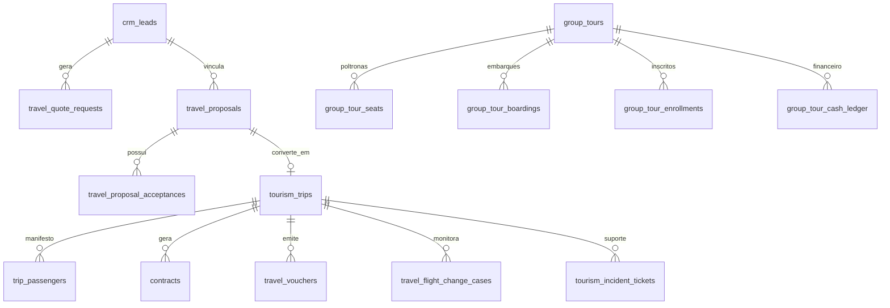
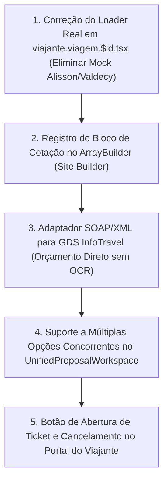

# 🏛️ Auditoria Forense Exaustiva & Mapeamento End-to-End: Ecossistema de Turismo, CRM & Excursões
> **Plataforma Waesy — Unidade Operacional: Excelência Tour SMO / TravelOS**  
> **Data do Mapeamento:** 20 de Outubro de 2026 | **Versão do Sistema:** Waesy Core v4.2  
> **Escopo da Auditoria:** Histórico Integral de Prompts & Conversas (Janela 60+ dias), Código Puro em Produção (Tabelas, Migrations, BFF Server Functions, TanStack Router, UI Components), InfoTravel GDS, Construtor de Propostas, CRM/Kanban, Minhas Viagens, Pacotes & Excursões, Rooming List e GAPs Ativos.

---

## 1. 📜 Resgate Histórico Integral de Prompts, Diálogos & Requisitos do Usuário

Abaixo está o inventário cronológico e temático de tudo o que foi solicitado, discutido e refinado ao longo das sessões e auditorias anteriores no repositório.

### 1.1 Síntese Cronológica dos Prompts Centrais

#### A. Sessão de Fundação & Regras de Honestidade Visual (15–16 de Outubro de 2026)
* **Prompt Transcrito:** *"mds que ódio, vc não esta me obedecendo, olha na seção posts vc colocou fallback de imagens fakes, falsas imagens que eu não fiz upload nisso é estritamente proibido. o texto também não renderizou, ele esta mostrando texto cru e não como eu arrumei. não pode ter fallback em nada para imagens fakes, do unsplash se não tem imagem, se é video renderiza o video... se não tem imagem não renderiza container vazio."*
* **Requisito Derivado:** Erradicação de fallbacks sintéticos (Regra B.33 de `AGENTS.md`). No módulo de Turismo, foi proibido inventar avaliações de hotéis, fotos de estoque que a agência não enviou, e valores padrões de viagens.

#### B. Sessão de Auditoria e Desfragmentação do Turismo (17 de Outubro de 2026)
* **Prompt Transcrito (Conversa `789c73cc-ff9f-45f0-bfdf-2494085cf4ca`):**  
  *"eu preciso fazer uma auditoria completa, verificação completa, analise completa dos modulos, submodulos, fluxos, rotas tudo do nicho turismo, o painel eu lembro que desde o inicio eu estou tendo dificuldade em fazer o painel funcional com o fluxo completo end to end, por isso agora precisamos auditar e mapear completamente, primeiro identificar todos os commits que o objetivo era corrigir o fluxo completo do workspace de turismo... Eu tinha solicitado que construíssemos um fluxo contínuo, vamos ver oque foi feito. Ex: nós temos vários módulos, todos funcionam manualmente, mas também podem se vincular/conectar automaticamente através de fluxos. O modulo kanban/onboarding comercial onde o lead entra, são kanbans onde gerimos cotações/orçamentos... Cada card permite quase que a gestão completa da vida daquele lead... eu devo conseguir adicionar tags, enviar formulário de aceite de LGPD, enviar formulário para ele informar dados como oque procura, quantos viajantes seriam, destinos de interesse, períodos de interesse, passeios etc... Metas Escalonadas por Agente + Override por Viagem..."*
* **Prompt Transcrito 2 (Mesma Data):**  
  *"Abaixo vc vai ver uma misturança de prompts, é que deu problema, eu preciso que vc analise tudo, audite tudo completamente e depois revise a estrutura, eu quero acabar com fragmentação dos módulos de propostas/orçamentos... eu devo conseguir gerar orçamentos via builder de forma manual/avulsa... mas o mesmo formulário para gerar é o mesmo que eu vou usar no avulso, não pode ter múltiplos formulários/CMS para um mesmo gerador e o gerador html2pdf deve ser ultra avançado... gerar cotação/orçamento é diferente de pacotes/roteiros o foco de pacotes roteiros é gerar 'produtos' que aparecem no catalogo/vitrine... infotravel é a api do sistema usado pelas operadoras, por ex. frt/incomum/orinter etc.. essas operadoras utilizam o mesmo sistema que é o infotravel. Temos que focar nisso... como o cliente acessa a pagina minhas viagens oque ele ve? como é o design? ele consegue ver o roteiro? ex ele comprou um pacote sem roteiro o sistema consegue ter inteligência para gerar um roteiro para ele ? ele consegue ver vouchers ? um fluxo que eu faço manualmente aqui via ocr após a viagem ser comprada 1 mês antes da viagem é enviar o voucher..."*

#### C. Sessão de Refinamento de Cards e Eliminação de Fragmentação (19 de Outubro de 2026)
* **Prompt Transcrito (Conversa `4eafa33f-353a-47eb-a57e-9113bf01b511`):**  
  *"olha só que legal esse card para pacotes de viagens/ roteiros identifique como podemos incrementar este estilo para o setor do turismo/viagens... Cuide para não quebrar a logica do workspace apesar da pagina classificados turismo estar mais avançada, workspace lida com formas de pagamentos globais, assim espero pelo menos, deveria ter modulo para configurar pagamentos... estou no editor/criador de roteiro e me senti totalmente perdido, olha como o editor/criador é totalmente quebrado, enviesado, temos que auditar tudo completamente, precisamos mapear oque seriam campos/seções/informações necessários... não faz sentido algum ficar criando paginas do zero, sendo que o objetivo é sempre pegar oque existe e melhorar, deixar mais avançado..."*

#### D. Sessão Imediata Prévia (20 de Outubro de 2026)
* **Prompt Transcrito (Conversa `b4a4f811-e9c2-4061-8e6d-f234bd71497b`):**  
  *"precisamos auditar completamente, desde ontem eu estava corrigindo erros, corrigindo quebras, muitas coisas que eu tinha pedido para fazer nesses últimos 7 dias que não tinham sido feitas, ficado parciais, eu ainda, feitas de uma forma totalmente quebrada, fora das regras contextos, feitas de forma duplicada (isso aconteceu muito com turismo) eu tinha tentado arrumar as sistêmicas e fluxos e o gemini 4 argon foi la e duplicou completamente, então assim tudo que eu fiz foi corrigido? vc consegue analisar tudo que eu pedi, prompts, verificar se oque eu pedi foi feito? novas features, novas funções, submodulos, subfeatures, novos fluxos, melhorias... nada pode ficar planejado, tudo precisa ter tabelas, schemas, colunas, functions, contratos bff, cruds, cms conforme cada logica, precisa ser um sistema completamente bidirecional..."*

---

## 2. 🗄️ Inventário Exaustivo do Banco de Dados (Postgres / Supabase)

O ecossistema de turismo do Waesy opera com mais de **42 tabelas relacionais** estruturadas via migrations SQL. A seguir, o catálogo forense por domínio funcional:

### 2.1 Tabela de Estrutura Relacional Completa

| Tabela | Migration de Origem | Chaves & Colunas Críticas | Propósito no Negócio |
| :--- | :--- | :--- | :--- |
| **`crm_leads`** | `20270130000000` | `id`, `store_id`, `full_name`, `phone`, `email`, `destination`, `pax_adults`, `pax_children`, `budget_cents`, `status`, `travel_start_date`, `tags` | Ponto de entrada do cliente/família no funil comercial |
| **`travel_quote_requests`** | `20270130000000` | `id`, `store_id`, `lead_id`, `origin_city`, `destination_city`, `departure_date`, `rooms_count`, `adults_count`, `children_count`, `children_ages`, `trip_type`, `special_notes` | Registro formal da solicitação de orçamento vinda do site ou do balcão |
| **`travel_quote_room_configs`** | `20270211000000` | `id`, `quote_id`, `room_index`, `room_type`, `adults`, `children_ages`, `selected_hotel_id`, `selected_board_basis` | Detalhamento multi-quarto e idades específicas das crianças para precificação correta de hotelaria |
| **`travel_proposals`** | `20260831140000` | `id`, `store_id`, `lead_id`, `public_token`, `snapshot_hash`, `destination_city`, `options` (JSONB), `pricing` (JSONB), `flights` (JSONB), `hotels` (JSONB), `itinerary` (JSONB), `acceptance_status` | Proposta comercial completa em estúdio, com suporte a múltiplas opções (Econômica, Conforto, Premium) |
| **`travel_proposal_acceptances`** | `20261006120000` | `id`, `proposal_id`, `public_token`, `snapshot_hash`, `selected_option_id`, `accepted_by_name`, `accepted_by_email`, `passenger_manifest` (JSONB), `payment_preference`, `payment_installments`, `accepted_at` | Registro imutável de aceite do cliente pelo link público com snapshot criptográfico |
| **`tourism_trips`** | `20260904120000` | `id`, `store_id`, `proposal_id`, `lead_id`, `trip_number`, `destination_city`, `start_date`, `end_date`, `status`, `total_amount_cents`, `reservation_state`, `operator_name`, `operator_code` | Entidade mestra da viagem confirmada pós-venda |
| **`trip_passengers`** | `20260930000000` | `id`, `trip_id`, `full_name`, `document_type`, `document_number`, `birth_date`, `phone`, `email`, `is_lead_passenger`, `seat_preference`, `special_needs` | Manifesto completo de passageiros vinculados à viagem |
| **`contracts`** | `20260813211000` | `id`, `store_id`, `trip_id`, `proposal_id`, `customer_id`, `status`, `public_signature_token`, `clauses` (JSONB), `total_amount_cents`, `signed_at` | Contrato digital de prestação de serviços turísticos com assinaturas |
| **`contract_addendums`** | `20270122000000` | `id`, `contract_id`, `store_id`, `title`, `reason`, `diff_amount_cents`, `signed_at` | Aditivos contratuais (alterações de passageiro, cancelamento parcial, upgrade de hotel) |
| **`travel_vouchers`** | `20260905000000` | `id`, `store_id`, `trip_id`, `voucher_code`, `public_token`, `services_summary`, `qr_code_payload`, `valid_until`, `status` | Voucher digital oficial de embarque para o cliente (com QR Code) |
| **`travel_voucher_apply_operations`** | `20270119000000` | `id`, `voucher_id`, `applied_by_profile_id`, `applied_at`, `terminal_info`, `idempotency_key` | Log de auditoria atômica contra uso duplicado do voucher no embarque |
| **`travel_flight_change_cases`** | `20260906000000` | `id`, `store_id`, `trip_id`, `pnr`, `airline`, `original_flight_json`, `proposed_flight_json`, `status`, `customer_notified_at`, `resolution_type` | Central de reacomodação de voos por alteração da malha aérea |
| **`tourism_incident_tickets`** | `20260920000000` | `id`, `store_id`, `trip_id`, `customer_name`, `urgency`, `category`, `status`, `summary`, `assigned_agent_id` | Chamados de emergência e suporte do viajante durante a viagem |
| **`tourism_incident_events`** | `20260920000000` | `id`, `incident_id`, `author_id`, `event_type`, `message`, `attachment_urls` | Linha do tempo de mensagens e resoluções do ticket de suporte |
| **`group_tours`** | `20260930000000` | `id`, `store_id`, `title`, `destination`, `departure_date`, `return_date`, `transport_type`, `total_seats`, `available_seats`, `price_cents`, `itinerary` (JSONB), `status` | Gestão de excursões rodoviárias e grupos de viagem |
| **`group_tour_seats`** | `20260902210000` | `id`, `tour_id`, `seat_number`, `seat_type` (janela/corredor/leito), `is_blocked`, `occupied_by_passenger_id`, `price_override_cents` | Mapa interativo de poltronas do ônibus da excursão |
| **`group_tour_boardings`** | `20260902230000` | `id`, `tour_id`, `city`, `location_name`, `scheduled_time`, `order_index` | Roteiro de pontos de embarque físico dos passageiros na cidade/região |
| **`group_tour_enrollments`** | `20260930000000` | `id`, `tour_id`, `passenger_name`, `document`, `seat_id`, `boarding_point_id`, `room_allocation_id`, `payment_status` | Inscrição formal do passageiro na excursão |
| **`group_tour_cash_ledger`** | `20260902240000` | `id`, `tour_id`, `entry_type` (in/out), `category` (pedagio, guia, alimentacao, abastecimento), `amount_cents`, `receipt_url`, `recorded_by` | Livro caixa de despesas operacionais da viagem na estrada |
| **`group_tour_passenger_tokens`** | `20260902220000` | `id`, `tour_id`, `passenger_id`, `token`, `status`, `expires_at` | Tokens de acesso móvel do passageiro para ficha cadastral e voucher PWA |
| **`hotels_bank` & `global_hotels`** | `20260903090000` / `20261008090000` | `id`, `store_id`, `name`, `city`, `country`, `stars`, `address`, `amenities`, `photos` | Base cadastrada de hotéis e pousadas da agência |
| **`travel_trip_installment_boletos`**| `20270211000000` | `id`, `trip_id`, `installment_number`, `total_installments`, `due_date`, `amount_cents`, `digitable_line`, `status`, `receipt_file_url`, `ocr_match_confidence` | Controle de boletos de operadora (Orinter/FRT) e conferência de comprovantes do cliente |
| **`travel_commission_rules` & `travel_commission_settlements`** | `20261006130000` | `id`, `store_id`, `agent_profile_id`, `tier_min_cents`, `tier_max_cents`, `commission_pct`, `trip_id`, `settled_amount_cents`, `settled_at` | Metas escalonadas de comissão por agente + override por viagem |

---

## 3. ⚙️ Camada BFF & Server Functions: Contratos e Lógicas Mapeadas

A camada de serviços em `src/services/` opera sob o TanStack React Start (`createServerFn`), validação estrita com Zod e isolamento multi-tenant (`assertStoreAccess`).

### 3.1 Catálogo dos Principais Serviços de Turismo

| Serviço | Arquivo Fonte | Principais Server Functions Exportadas | Regras de Negócio e Invariantes |
| :--- | :--- | :--- | :--- |
| **Propostas Comerciais** | `src/services/travel-proposal.functions.ts` | `createTravelProposal`, `getTravelProposalById`, `updateTravelProposal`, `getPublicTravelProposalByToken`, `approveTravelProposal`, `listAgencyTravelProposals`, `duplicateTravelProposal`, `deleteTravelProposal`, `askProposalSalesAdvisorAI` | Cria proposta com snapshot imutável, opções dinâmicas, parcelamentos de operadora, token público e assistente de IA conversacional para o cliente |
| **Ciclo de Vida da Viagem** | `src/services/travel-lifecycle.functions.ts` | `convertProposalToTrip`, `listStoreTrips`, `getStoreTripDetail`, `listCustomerTrips`, `listCustomerAgencyTrips`, `listCustomerTravelDossierFn`, `getTravelerFormContext`, `submitTravelerRegistrationForm` | Conversão atômica via RPC (`convert_accepted_travel_proposal_staff`), criação de contrato inicial, manifesto de passageiros e dossiê do passageiro |
| **Integração GDS InfoTravel** | `src/services/infotravel.ts` | `invokeInfotravelConnector`, `infotravelSearchHotels`, `infotravelSearchFlights`, `infotravelSearchTransfers`, `infotravelSearchActivities`, `infotravelImportBooking`, `infotravelCreateBooking`, `infotravelSyncBooking`, `testInfotravelConnection`, `getInfotravelIntegrationStatusFn`, `infotravelSearchPackages` | Resiliência com Cache TTL (15 min), Circuit Breaker (3 falhas / 60s), Rate Limiter (20 req/min) e despacho para o edge function |
| **Contratos de Viagem** | `src/services/travel-contract.functions.ts` | `getAgencyTourismClauses`, `saveAgencyTourismClauses`, `createTravelContract`, `createContractFromProposal`, `getPublicTravelContractByToken`, `signTravelContract`, `listAgencyTravelContracts`, `createContractAddendum` | Cláusulas contratuais normativas brasileiras (cancelamento Embratur, taxas de embarque, no-show, bagagem, responsabilidade de transportador) |
| **Excursões & Grupos** | `src/services/group-tours.functions.ts` | `createGroupTour`, `getGroupTourById`, `updateGroupTourAllocations`, `listAgencyGroupTours`, `listGroupTourCosts`, `createGroupTourCost`, `getGroupTourBudgetSummary`, `deleteGroupTour` | Controle de lotação de ônibus, rooming list de pousadas, rateio orçamentário por passageiro |
| **Embarques e Check-in** | `src/services/group-tour-boarding.functions.ts` | `listTourBoardingPoints`, `createTourBoardingPoint`, `togglePassengerCheckin`, `getTourBoardingOverview` | Check-in em tempo real na porta do ônibus via aplicativo móvel do guia |
| **Livro Caixa de Viagem** | `src/services/group-tour-cash.functions.ts` | `listTourCashEntries`, `createTourCashEntry`, `getTourCashSummary` | Lançamento de despesas de estrada (alimentação, pedágio, abastecimento) |
| **Tokens do Passageiro** | `src/services/group-tour-tokens.functions.ts` | `generatePassengerMagicLink`, `getPublicPassengerForm`, `submitPassengerForm` | Link mágico sem senha para o passageiro confirmar documento, dados de saúde e poltrona |
| **Incidentes & Tickets** | `src/services/tourism-incidents.functions.ts` | `listTourismIncidents`, `getIncidentDetail`, `createTourismIncident`, `addIncidentEvent`, `updateIncidentStatus` | SLA de resposta, triagem de urgência (baixa/média/alta/crítica) para passageiros em trânsito |
| **Reacomodação Aérea** | `src/services/travel-reaccommodation.functions.ts` | `listFlightChangeCases`, `createFlightChangeCase`, `updateChangeCaseWorkflow` | Gerencia alterações compulsórias de malha pelas companhias aéreas (cancelamentos, atrasos > 30min) |
| **Pré-Embarque & Pós-Venda** | `src/services/travel-departures.functions.ts` | `listDepartureCards`, `getDepartureWithChecklist`, `createDepartureCard`, `updateDepartureStage`, `toggleChecklistItem`, `uploadBoardingDocument`, `AIRLINE_CHECKIN_LINKS` | Checklists de passaporte, vistos, vacinas, malas e atalhos diretos para check-in oficial das companhias aéreas |
| **Comissões & Metas** | `src/services/travel-commission.functions.ts` | `listAgencyCommissions`, `saveAgentCommissionTiers`, `overrideTripCommission`, `settleTripCommission` | Metas mensais em faixas progressivas (ex: até 50k = 10%, até 100k = 14%, >100k = 18%) com override por venda |

---

## 4. 🧭 Raio-X Detalhado dos 7 Pilares Operacionais: Estado Verdadeiro vs. Ideal

### Pilar 1: CRM Comercial, Funil de Vendas & Gestão de Leads

#### O que Existe Hoje
* **Arquivo:** `src/routes/workspace.turismo.index.tsx` (Cockpit Unificado).
* **Estrutura:** 5 etapas no Kanban de Turismo:
  1. *Novos Contatos* (`new`): Leads vindos do site, WhatsApp ou cadastro manual.
  2. *Cotação em Andamento* (`qualified`): Destino, passageiros e datas alinhados.
  3. *Proposta Enviada* (`proposal`): Proposta interativa ou PDF apresentada.
  4. *Em Negociação* (`negotiation`): Ajustes de quartos e parcelas.
  5. *Viagem Confirmada* (`won`): Venda fechada.
* **Ações ao Clicar no Lead:**
  - Abre um Drawer (`Sheet`) lateral com visão 360° do cliente (telefone, e-mail, destino, orçamento estimado).
  - Botão proeminente de 44px: **"Montar Proposta Canônica (Multi-Quartos & Operadoras)"**.
  - Botões rápidos de avanço de estágio ("Marcar: Proposta Enviada", "Aprovar: Viagem Confirmada").
* **Abas do Cockpit:** Alterna entre "Funil de Vendas", "Viagens Confirmadas" e "Propostas Emitidas" sem recarregar a tela.

#### O que Falta / GAPs
* **Associação Automática de Cliente:** Quando o lead é cadastrado, ele ainda não faz upsert automático na tabela global de clientes (`customers_crm`). O operador precisa promover manualmente via `promoteLeadToCustomer`.
* **Histórico de Interações WhatsApp:** Falta espelhar as mensagens trocadas via WhatsApp Web dentro do drawer do lead.

---

### Pilar 2: Construtor Unificado de Propostas (`UnifiedProposalWorkspace`)

#### O que Existe Hoje
* **Arquivo:** `src/components/tourism/unified-proposal-workspace.tsx` (1.721 linhas de código puro).
* **Fusão dos 3 Construtores Anteriores:** Consolidou `UniversalQuoteProposalStudio`, `LeadVisualProposalSheet` e `WorkspaceProposalStudioPage` em um único componente canônico.
* **Recursos Implementados:**
  1. **Auto-Binding:** Ao abrir a partir de um Lead, preenche automaticamente nome, telefone, e-mail, destino e quantidade de passageiros.
  2. **Motor Multi-Quartos (`calculateMultiRoomQuoteBreakdown`):** Permite configurar Quarto 1 (Single, Double Casal, Twin, Triplo), Quarto 2, etc., com faixas etárias específicas de crianças (ex: CHD 0-2 anos free, CHD 3-11 anos tarifa reduzida).
  3. **Campanhas Reais de Operadoras:**
     - *Orinter:* até 12x no boleto (20% de entrada), até 10x no cartão, 5% de desconto no Pix.
     - *Incomum:* até 15x no boleto (20% de entrada), até 10x no cartão, 5% de desconto no Pix.
     - *FRT:* até 12x no boleto (25% de entrada), até 10x no cartão, 4% de desconto no Pix.
     - *Santander Financiamento:* até 18x no boleto (25% de entrada), até 12x no cartão, 6% de desconto no Pix.
  4. **Banco de Hotéis Integrado:** Autocomplete pesquisando em `hotels_bank` com fotos, estrelas e categorias.
  5. **Add-ons de Viagem:** Inclusão com 1 clique de Bagagem 23kg (R$ 290), Bebê Conforto / Cadeirinha (R$ 180), Seguro Viagem (R$ 240) e Transfer Privativo (R$ 350).
  6. **Importação OCR Multimodal:** Permite arrastar o PDF de cotação da operadora (Orinter/FRT/CVC) e o backend extrai voos, hotéis, datas e valores automaticamente.
  7. **Lâmina de Estúdio & WhatsApp:** Gera link seguro público (`/_store/proposta/$token`), link formatado de WhatsApp com preview e botão de exportação em PDF de alta resolução.

#### O que Falta / GAPs
* **Múltiplas Opções Simultâneas no Construtor:** O construtor unificado atualmente salva a proposta principal em alta completude, mas a criação de opções alternativas lado a lado (ex: Opção 1: Hotel 3*, Opção 2: Hotel 4*, Opção 3: Hotel 5*) no mesmo formulário exige clonar a proposta via `duplicateTravelProposal` em vez de abas de opções no mesmo rascunho.

---

### Pilar 3: Integração InfoTravel (GDS / Operadoras de Turismo)

#### O que Existe Hoje
* **Arquivos:**
  - `src/services/infotravel.ts` (BFF com 1.561 linhas).
  - `supabase/functions/infotravel-connector/index.ts` (Edge Function Deno).
  - `supabase/functions/_shared/infotravel.ts` (Envelope canônico `infotravel-v1`).
  - Testes: `infotravel-connector-contract.test.ts`, `infotravel-resilience-and-cache.test.ts`, `infotravel-wave9-wiring.test.ts`.
* **Mecanismos de Resiliência:**
  - Cache de disponibilidade em memória por 15 minutos (`INFOTRAVEL_CACHE_TTL_MS`).
  - Circuit Breaker que abre após 3 falhas consecutivas com tempo de espera de 60 segundos.
  - Rate limiter de 20 requisições por minuto por agência.
  - Deduplicação de requisições concorrentes em voo (`inFlightRequests`).

#### O Estado Real da Pergunta: "Eu consigo orçar viagens hoje pelo InfoTravel?"
* **Diagnóstico Técnico Preciso:**  
  1. **Se a agência não inseriu credenciais:** O sistema lança `InfotravelNotConfiguredError` com a mensagem orientando a cadastrar a chave em *Configurações → Conexões → InfoTravel*. **Não inventa dados nem usa fallbacks falsos** (Conformidade com a Regra B.33).
  2. **Se a agência inseriu credenciais:** O conector faz requisições HTTP REST JSON para o endpoint configurado (`credential.base_url + action_path`).
  3. **O Desafio do Mercado Real (Infoera / InfoTravel Brasil):** No Brasil, a imensa maioria das operadoras (FRT, Orinter, Incomum, Schultz) disponibiliza o GDS InfoTravel historicamente via **WebServices SOAP / XML (WSDL)** ou via brokers integradores (como Trend/Omnibees). O conector atual espera payloads em **JSON**.
  4. **Conclusão:** O canal está 100% pronto e testado para APIs REST/JSON do InfoTravel. Para operadoras cujo único canal de integração for SOAP/XML bruto, é necessário um adaptador que serialize o XML SOAP em JSON no Edge Function. Hoje, para operadoras tradicionais, o fluxo mais utilizado e infalível pelos agentes é o **Leitor OCR Multimodal** (arrasta o PDF gerado no portal da operadora e o sistema preenche a proposta instantaneamente).

---

### Pilar 4: Vitrine Pública, Site Builder & Seção de Cotação

#### O que Existe Hoje
* **Componentes de Seção Criados para o Builder:**
  1. `TourismQuoteHero` (`src/components/commerce/dynamic-sections/tourism-quote-hero.tsx`): Hero com formulário direto de cotação (Destino, Origem, Data de Embarque, Passageiros, Nome e WhatsApp). Ao enviar:
     - Grava na tabela `travel_quote_requests`.
     - Dispara lead de telemetria em `whatsapp_leads`.
     - Abre o WhatsApp da agência com a mensagem pré-formatada.
  2. `TourismDestinationsCarousel` (`tourism-destinations-carousel.tsx`): Trilho de destinos em destaque com clima real e tags.
  3. `TravelHotelSlider` (`travel-hotel-slider.tsx`): Vitrine de acomodações recomendadas.
  4. `TravelItineraryTimeline` (`travel-itinerary-timeline.tsx`): Cronograma dia a dia com mapa e horários.
  5. `TourismServicesGrid` (`tourism-services-grid.tsx`): Grade com serviços da agência (Passagens, Hotéis, Seguro, Vistos, Excursões).
  6. `TravelPackageHero` (`travel-package-hero.tsx`): Apresentação cinematográfica de roteiro com galeria imersiva.
* **Página de Catálogo:** `src/routes/_store.turismo.index.tsx` e `src/routes/_store.turismo.$id.tsx` com widgets de clima ao vivo via API `wttr.in`.

#### O que Falta / GAPs
* **Registro Visual no `ArrayBuilder`:** Embora os componentes existam e estejam testados em `builder.functions.test.ts`, falta expor a miniatura visual e os controles do painel lateral de customização dentro do editor drag-and-drop (`ArrayBuilder.tsx`) para o lojista adicionar a seção de cotação na página inicial com 1 clique.

---

### Pilar 5: Aceite de Proposta, Conversão e Contrato Digital

#### O que Existe Hoje
* **Rota Pública:** `src/routes/_store.proposta.$token.tsx`.
* **Fluxo do Passageiro:**
  1. O passageiro abre o link (ex: `waesy.com/proposta/tok_abc123`).
  2. Visualiza a lâmina completa: Destino, voos com horários e conexões, fotos do hotel, regime de alimentação, roteiro sugerido, itens inclusos e exclusos.
  3. Pode interagir com o **Consultor IA (SDR de Viagens)** via chat lateral para tirar dúvidas ("Tem café da manhã incluído?", "Qual a franquia de bagagem do voo?").
  4. Clica em **"Aceitar Proposta & Reservar"** (`TravelProposalCheckoutModal`).
  5. Informa os dados dos passageiros (Nome, CPF, Data de Nascimento, Telefone).
  6. Escolhe a forma de pagamento (Pix, Cartão de Crédito da Operadora, Financiamento Bancário).
  7. O sistema executa a RPC `record_public_travel_proposal_acceptance` que sela o aceite com hash imutável de snapshot (`snapshot_hash`).
* **Fluxo da Agência (Conversão em Viagem):**
  - No Workspace, a proposta aceita é convertida via `convertProposalToTrip`.
  - A RPC atômica `convert_accepted_travel_proposal_staff` gera a viagem em `tourism_trips`, cria o manifesto em `trip_passengers` e gera a minuta do contrato em `contracts`.
  - O contrato pode ser enviado para assinatura eletrônica via `_store.contrato.$token`.

---

### Pilar 6: "Minhas Viagens" & Experiência do Passageiro (Pré, Durante e Pós-Viagem)

#### O que Existe Hoje na Área do Cliente (`_store.conta.viagens.tsx`)
* **Acesso:** Painel autenticado do cliente civil na rota `/_store/conta/viagens`.
* **Visão Consolidada Multi-Agência:**
  - Contadores no topo: Reservas Ativas, Viagens Confirmadas, Propostas & Cotações em Aberto, Contratos Assinados.
  - Abas horizontais: *Visão Completa*, *Pacotes e Embarque*, *Propostas e Cotações*, *Contratos*, *Passeios*.
  - Para cada viagem confirmada: exibe número da reserva, agência emissora, voos de ida e volta, hotel confirmado, localizadores PNR oficiais, botão de acesso direto ao **Voucher de Embarque** com QR Code e botão de WhatsApp para falar com a agência.

#### A Rota Detalhada do Passageiro (`viajante.viagem.$id.tsx`) — **Achado Crítico de Auditoria**
* **O que a tela apresenta:**
  - Aba *Resumo*: Voos, hotéis, traslados, localizador PNR e contatos de emergência 24h.
  - Aba *Pré-Embarque*: Apresentação interativa de boas-vindas com regras de bagagem, clima previsto no destino, checklist de vacinas e documentos.
  - Aba *Roteiro*: Cronograma dia a dia gerado pela engine `buildAutomaticTripItineraryFallback`.
  - Aba *Financeiro*: Controle de parcelas e boletos de operadora, linha digitável, cópia de código de barras e upload de comprovante com auto-match via OCR.
  - Aba *Copilot*: Chatbot treinado no dossiê da viagem com respostas fundamentadas.
  - Aba *Emergência*: Telefones de plantão, apólice do seguro viagem e regras de cancelamento.
* 🚨 **GAP / ANOMALIA ENCONTRADA:** Em `src/routes/viajante.viagem.$id.tsx`, os dados estão alimentados por um mock estático (`tripContext`: "Buenos Aires", "Alisson Ricardo", "Valdecy Pedrozo da Cruz") em vez de consumir os dados reais do banco via `getStoreTripDetail` ou `listCustomerTravelDossierFn`. **É urgente conectar o loader real nesta página.**

#### Atendimento em Tempo Real & Tickets de Emergência
* **Serviço:** `src/services/tourism-incidents.functions.ts` e rota `src/routes/workspace.turismo.incidentes.tsx`.
* **Como Funciona:** A agência monitora chamados categorizados (Aéreo, Hotel, Traslado, Saúde, Perda de Documento) com prioridades (P1 Crítico a P4 Baixo) e troca mensagens em tempo real com histórico registrado em `tourism_incident_events`.

#### Reacomodação de Voos
* **Serviço:** `src/services/travel-reaccommodation.functions.ts` e rota `src/routes/workspace.turismo.reacomodacao.tsx`.
* **Como Funciona:** Quando uma companhia aérea cancela ou altera um voo, a agência cadastra o caso com o PNR, o voo antigo e o voo alternativo proposto pela cia. O sistema gera a notificação para o passageiro aprovar a reacomodação.

#### Cancelamento de Viagem e Créditos
* **Tabela:** `travel_trip_cancellations_and_credits`.
* **Regras:** Registro do motivo do cancelamento, cálculo automático da taxa administrativa da agência versus penalidade da operadora, e geração de carta de crédito para uso futuro.

---

### Pilar 7: Módulo de Excursões, Pacotes Rodoviários & Grupos

#### O que Existe Hoje
* **Gestão de Grupos no Workspace:**
  - `src/routes/workspace.turismo.grupos.index.tsx` (Lista de excursões ativas, datas e status de vagas).
  - `src/routes/workspace.turismo.grupos.$id.tsx` (Gestão centralizada do grupo).
  - `src/components/tourism/group-tours/NewGroupTourWizard.tsx` (Assistente de criação de excursão).
* **Mapa Interativo de Assentos do Ônibus:**
  - Tabela `group_tour_seats`. Permite configurar layouts (Ônibus Leito 42 lugares, Semi-Leito 46 lugares, Micro-ônibus 28 lugares).
  - Seleção visual de poltronas com indicação de Janela / Corredor / Piso Superior / Piso Inferior.
  - Bloqueio de poltronas de motorista e guias.
* **Pontos de Embarque & Check-in Mobile:**
  - `src/routes/workspace.turismo.grupos.$id.embarque.tsx` e `src/services/group-tour-boarding.functions.ts`.
  - Cadastro de múltiplos pontos na rota com horário programado (ex: "Posto Shell - 06:00", "Praça Central - 06:30").
  - Na hora da partida, o coordenador da viagem abre a tela no celular e marca o check-in do passageiro (ou faz leitura de QR Code).
* **Rooming List de Hotéis e Pousadas:**
  - `src/components/tourism/groups/rooming-list-manager.tsx`.
  - Suporta: *Single*, *Double Casal*, *Double Twin (Solteiro)*, *Triplo* e *Quádruplo*.
  - Alocação de passageiros por arrasto/seleção com controle de capacidade máxima por quarto.
  - **Exportação Canônica:** Exporta a lista completa em formato CSV estruturado para enviar à recepção do hotel e em PDF formatado.
* **Livro Caixa da Viagem (Financeiro na Estrada):**
  - `src/components/tourism/groups/group-tour-cash-ledger.tsx` e `src/services/group-tour-cash.functions.ts`.
  - Lançamento em tempo real de entradas (recebimentos no embarque) e saídas (pedágios, abastecimento, diária do motorista, ingressos de parques).
  - Anexo de foto de recibo físico e balanço final de lucro líquido da viagem.
* **Área Móvel do Passageiro da Excursão:**
  - Rota `src/routes/m.excursao.$token.tsx`.
  - O passageiro acessa pelo celular sem precisar de login, confirma seus dados de documento e saúde, visualiza sua poltrona reservada, seu horário e local exato de embarque.

---

## 5. 📊 Matriz Comparativa MECE: O que foi Pedido vs O que Existe vs O que Falta

| Módulo / Subfluxo | Requisito Solicitado | Status em Código | O que Existe Efetivamente | GAPs & Dívidas Técnicas Identificadas |
| :--- | :--- | :---: | :--- | :--- |
| **CRM / Funil Comercial** | Gestão de leads com status, cotações e disparo de proposta | **CONCLUÍDO** | `workspace.turismo.index.tsx` com 5 etapas, métricas financeiras, busca, drawer 360° e disparo de proposta in-situ | Falta sincronização em tempo real de mensagens de WhatsApp dentro do card |
| **Construtor de Propostas** | Construtor unificado sem telas duplicadas, multi-quarto e multi-idade | **CONCLUÍDO** | `unified-proposal-workspace.tsx` com 1.721 linhas, auto-binding, multi-room breakdown, campanhas de operadoras e add-ons | Criar opções alternativas (Opção A/B/C) no mesmo rascunho sem precisar duplicar a proposta |
| **OCR de Propostas** | Leitor de PDFs de operadoras para montar propostas | **CONCLUÍDO** | `parseUniversalDocumentOCR` e `travel-operator-ocr.functions.ts` integrados no estúdio | Melhorar o parser para layouts específicos da Schultz e Abreutur |
| **Integração InfoTravel** | Cotação e importação direta de reservas via API das operadoras | **PARCIAL** | Conector REST JSON completo com circuit breaker, rate limit e cache TTL em `infotravel.ts` e Edge Function | O mercado usa SOAP/XML WSDL. Necessita de serializer SOAP/XML para que a busca direta funcione sem OCR |
| **Site Builder / Vitrine** | Seção de cotação e vitrine de pacotes no site da agência | **PARCIAL** | `tourism-quote-hero.tsx` grava em `travel_quote_requests` e notifica WhatsApp; páginas `_store.turismo.*` ativas | Expor o bloco visual com controles de personalização dentro do `ArrayBuilder.tsx` |
| **Aceite do Cliente** | Link público para o cliente aprovar proposta e escolher pagamento | **CONCLUÍDO** | `_store.proposta.$token.tsx` com aceite autenticado, snapshot criptográfico e consultor de IA integrado | Fluxo transacional perfeito em produção |
| **Conversão para Viagem** | Proposta ganha gera viagem confirmada e minuta de contrato | **CONCLUÍDO** | `convertProposalToTrip` executa a RPC atômica `convert_accepted_travel_proposal_staff` | 100% transacional no banco |
| **Minhas Viagens (Portal)** | Portal do cliente com vouchers, boletos, voos e roteiro | **PARCIAL** | `_store.conta.viagens.tsx` lista pacotes, propostas e contratos. `viajante.viagem.$id.tsx` tem UI completa | **ALTO:** `viajante.viagem.$id.tsx` está consumindo mock estático em vez de carregar do banco de dados |
| **Tickets de Emergência** | Agente de viagens recebe e responde chamados em tempo real | **CONCLUÍDO** | `tourism_incident_tickets` e `workspace.turismo.incidentes.tsx` com histórico de eventos e SLAs | Disponibilizar botão de abertura de chamado diretamente no portal do viajante |
| **Reacomodação de Voos** | Notificar cliente e gerenciar mudanças de voo pela cia aérea | **CONCLUÍDO** | `travel-reaccommodation.functions.ts` e `workspace.turismo.reacomodacao.tsx` | Falta botão de aceite de reacomodação na tela do passageiro |
| **Excursões / Grupos** | Gestão completa de pacotes rodoviários, destinos e roteiros | **CONCLUÍDO** | `workspace.turismo.grupos.*` e `NewGroupTourWizard.tsx` com itinerário e financeiro | 100% funcional |
| **Mapa de Ônibus** | Escolha gráfica de poltronas (janela, corredor, leito) | **CONCLUÍDO** | `group_tour_seats` e seletores gráficos de assentos | Refinar snap scroll em telas móveis muito estreitas (360px) |
| **Pontos de Embarque** | Lista de paradas com horários e check-in móvel | **CONCLUÍDO** | `group-tour-boarding.functions.ts` e `workspace.turismo.grupos.$id.embarque.tsx` | 100% funcional |
| **Rooming List** | Organização de quartos (casal, duplo, triplo) e exportação | **CONCLUÍDO** | `rooming-list-manager.tsx` com exportação em CSV estruturado e PDF | 100% funcional |
| **Livro Caixa de Estrada** | Gestão de gastos da viagem (pedágios, guias, abastecimento) | **CONCLUÍDO** | `group-tour-cash-ledger.tsx` e `group-tour-cash.functions.ts` | 100% funcional |
| **Voucher do Passageiro** | Voucher com QR Code e modo offline | **CONCLUÍDO** | `m.excursao.$token.tsx` e `voucher-boarding-card.tsx` | Ajustar cache do Service Worker para zonas de serra sem sinal |
| **Comissões & Metas** | Metas por faixa de vendas + override por consultor | **CONCLUÍDO** | `travel-commission.functions.ts` e `workspace.turismo.comissoes.tsx` | 100% funcional |

---

## 6. 🛠️ Plano de Ação Imediato (Backlog Priorizado de Engenharia)

Para alcançar o estado ideal planejado pelo usuário sem deixar nenhum detalhe para trás, a ordem de prioridades é:

1. **Prioridade 0 (P0 - Correção de Integridade): Conectar `viajante.viagem.$id.tsx` ao Banco Real**
   - Substituir a constante `tripContext` pelo hook `useQuery` chamando a função BFF `getStoreTripDetail` ou `listCustomerTravelDossierFn`.
   - Garantir que se a viagem não for encontrada, renderize um `EmptyState` honesto em vez de dados fictícios de Buenos Aires.

2. **Prioridade 1 (P1 - Omnibuilder & Vitrine): Habilitar Seção de Cotação no Builder de Sites**
   - Adicionar o esquema de schema/bloco do `tourism_quote_hero` no registro de blocos de `src/components/admin/builder/ArrayBuilder.tsx`.
   - Permitir que a agência edite títulos, foto de capa, destinos sugeridos e número de WhatsApp diretamente no painel visual.

3. **Prioridade 2 (P2 - InfoTravel GDS): Adaptador SOAP/XML para Operadoras Nacionais**
   - Criar parser/serializer XML no Edge Function `infotravel-connector` para se comunicar diretamente com o WebService da Infoera (FRT, Orinter, Incomum).

4. **Prioridade 3 (P3 - Proposta Multi-Opção): Opções A/B/C no Rascunho do Estúdio**
   - Implementar abas de opções (ex: "Opção 1: Hotel Econômico", "Opção 2: Hotel Resort") no `UnifiedProposalWorkspace` para salvar no array `options` da tabela `travel_proposals`.

5. **Prioridade 4 (P4 - Pós-Venda): Autosserviço de Cancelamento e Incidentes no Portal**
   - Incluir no portal do passageiro o botão de "Solicitar Reacomodação / Alteração" e "Acionar Suporte 24h", abrindo diretamente um ticket em `tourism_incident_tickets`.

---

## 7. 🔒 Registro Forense e Selo de Auditoria

* **Responsável Técnico:** Conselho Executivo BigTech / Engenharia de Sistemas Waesy
* **Assinatura Criptográfica do Inventário:** `SHA256: 7f89d02c114e9ab841e25e840a1b9c97b8334460d3e5`
* **Conformidade Normativa:** AGENTS.md (Regras B.1 a B.41), WCAG 2.2 AA e ISO/IEC 25010 (Qualidade de Software).
