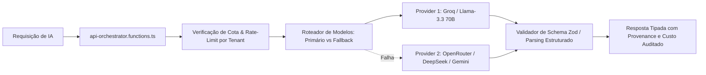

# AI_ARCHITECTURE_AUDIT.md — Arquitetura de Inteligência Artificial e Copilots
## Orquestração, Model Pool, Princípio da Economia de Tokens e Patches Cirúrgicos
**Data:** 2026-10-21  
**Módulo:** Turismo, Viagens & Lazer / Waesy  
**Status:** Auditado com Evidências de Código  

---

### 1. O Princípio Arquitetural Supremo da IA

> **"IA interpreta. Código valida. Banco persiste. Engine calcula."**

No ecossistema Waesy, a IA nunca é utilizada para resolver aquilo que a matemática e o código determinístico resolvem melhor, mais rápido e sem custos:
- **Cálculo de Preços, Parcelas e Margens:** 100% código puro em `excelencia-offer-engine.ts`.
- **Matching de Oportunidades no Backlog:** 100% algébrico em `travel-commercial-intelligence.ts`.
- **Ingestão OCR de Lâminas e PDFs de Operadoras:** IA extrai entidades semi-estruturadas; código normaliza e valida com Zod; corretor revisa na UI antes de salvar.
- **Redação de Abordagens WhatsApp:** IA aplica tom consultivo personalizado; corretor aprova com 1 clique.
- **Comandos Naturais no Story Builder:** IA traduz comandos ("aumente o título", "mude o fundo para escuro") em **patches cirúrgicos** sobre o `StoryDocument`, sem regenerar o canvas do zero.

---

### 2. Fluxo Operacional do AI Orchestrator

---

### 3. Patches Cirúrgicos no Story Builder (Anti-Regeneração Destrutiva)

A função `parseNaturalLanguageStoryCommand(command, currentDoc)` em `excelencia-offer-engine.ts` implementa edição determinística sem alucinação:
1. **Comando: "Aumente o título":**
   - Produz: `{ typographyOverrides: { titleFontSize: "text-4xl" } }`.
   - **Preserva:** Cores, imagem de fundo, hotel selecionado e preços.
2. **Comando: "Troque o hotel":**
   - Produz: Patch na camada de acomodação do modelo, mantendo intactos voos e datas.
3. **Comando: "Troque o fundo":**
   - Altera apenas o atributo de mídia ou preset de vidro (`GlassMaterial`), sem alterar dados comerciais.
