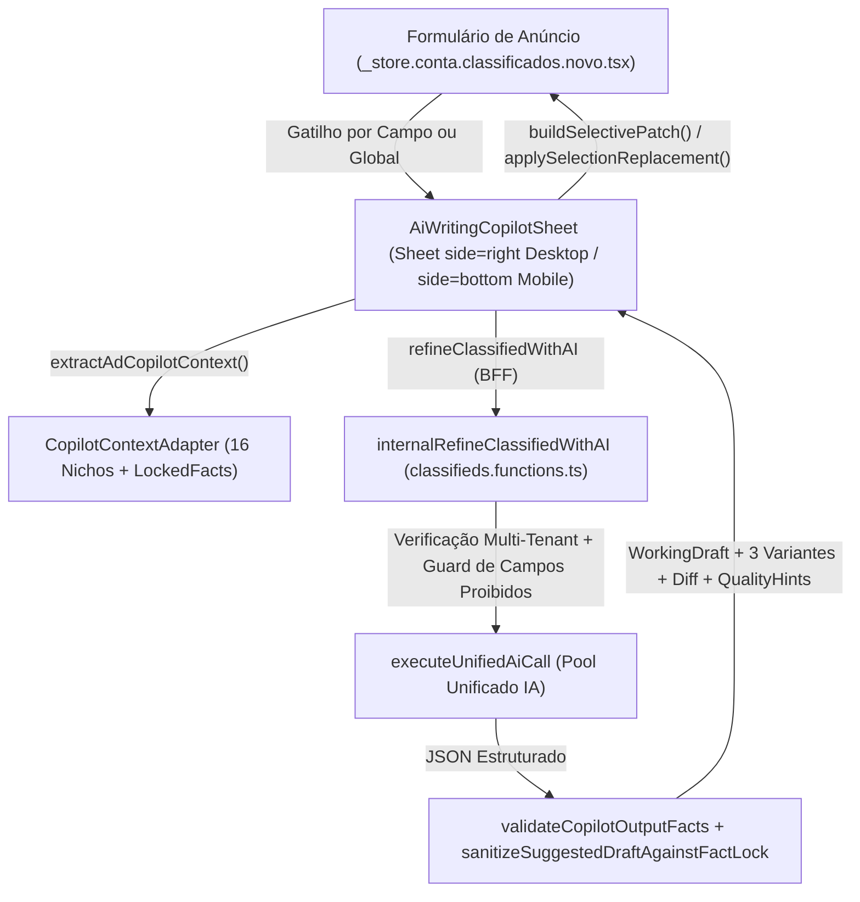

# AI_COPILOT_ARCHITECTURE — Arquitetura Canônica do Copilot Editorial Generativo

## 1. Fluxo Ponta-a-Ponta (Unificado e Bidirecional)

## 2. Componentes da Arquitetura

| Camada | Arquivo | Responsabilidade |
| :--- | :--- | :--- |
| **Domínio & Engine Editorial** | `src/lib/classifieds/ai-writing-copilot.ts` | Extração contextual por nicho (`NICHE_COPILOT_ADAPTERS`), extração de fatos bloqueados (`LockedFact`), validação numérica/factual (`validateCopilotOutputFacts`), sanitização contra superlativos falsos, substituição de trecho (`applySelectionReplacement`) e patch seletivo (`buildSelectivePatch`). |
| **Superfície Bidirecional UI** | `src/components/classifieds/ai-writing-copilot-sheet.tsx` | Superfície baseada no primitivo canônico `Sheet` (`side="right"` no Desktop `>= 600px`; `side="bottom"` full-screen `h-dvh` no Mobile `< 600px`), contendo `WorkingDraft` editável, abas de variantes, seleção de trecho, histórico `Undo`/`Redo` e composer conversacional. |
| **BFF & Orquestração** | `src/services/classifieds.functions.ts` | `refineClassifiedWithAI` e `internalRefineClassifiedWithAI` com validação Zod completa (`copilotRewriteRequestSchema`), checagem de propriedade (`entityId`/`storeId`), isolamento por delimitadores `<AD_FACTUAL_CONTEXT>` e fallback determinístico offline. |
| **Integração com Anúncio** | `src/routes/_store.conta.classificados.novo.tsx` | Gatilhos por escopo (`Sugerir título`, `Refinar com Copilot`) e aplicação seletiva sincronizada com `title`, `description`, `editorialSummary` (`travelBioBullets`) e `editorialTags` (`attributes.tags`). |
