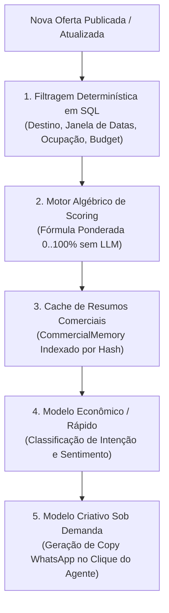

# PLANO DE EFICIÊNCIA DE TOKENS E ARQUITETURA DE IA
## RADAR DE OPORTUNIDADES & INTELIGÊNCIA COMERCIAL DE TURISMO
### Data: 2026-10-21 • Versão: 1.0-PROD • Baseline: Production

---

## 1. Princípio Fundamental de Arquitetura de IA

No módulo de Inteligência Comercial e Radar de Oportunidades, **é terminantemente proibido utilizar chamadas de Modelos de Linguagem (LLMs) para operações em massa, filtros de busca ou scoring preliminar**.

Uma agência com 5.000 contatos e 20 novas ofertas por semana geraria $5.000 \times 20 = 100.000$ chamadas de IA desnecessárias, torrendo cotas de tokens e introduzindo latência inaceitável.

A arquitetura do Waesy adota o pipeline estrito de **5 Camadas de Eficiência**:



---

## 2. As 5 Camadas de Eficiência

### Camada 1: Filtragem Determinística em SQL
Antes de qualquer cálculo, uma query SQL indexada descarta contatos inelegíveis:
- Exclusão imediata de contatos com `status = 'opted_out'` ou flag `do_not_contact = true`.
- Exclusão de interesses expirados (`expires_at < now()`).
- Pré-filtro por destinos compatíveis via operador de array PostgreSQL (`destinations && ARRAY[...]`).
- Pré-filtro por teto de orçamento com margem de tolerância de 20%.

### Camada 2: Motor Algébrico de Scoring (Deterministic Match)
O cálculo do score de compatibilidade (0 a 100%) é executado em microssegundos por funções puras em TypeScript/PostgreSQL (`computeOfferInterestMatch`):
$$\text{MatchScore} = (w_d \cdot S_d) + (w_t \cdot S_t) + (w_b \cdot S_b) + (w_p \cdot S_p) + (w_o \cdot S_o)$$
- **Consumo de Tokens:** **0 tokens**.
- **Custo Operacional:** **R$ 0,00**.
- **Latência:** **< 2ms** por par oferta-interesse.

### Camada 3: Memória Comercial Compacta (`CommercialMemory`)
Em vez de alimentar a IA com o histórico integral de conversas de 3 anos, o sistema mantém um resumo estruturado compacto atualizado incrementalmente:
```typescript
export interface CommercialMemory {
  destinationsSummary: string; // Ex: "Cancún ou Punta Cana"
  seasonPreference: string;     // Ex: "Férias de Janeiro"
  budgetCeilingFormatted: string; // Ex: "Até R$ 12.000 casal"
  knownObjections: string[];    // Ex: ["Achou voo com escala em PTY cansativo"]
  temperatureScore: number;     // Ex: 85
  lastInteractionDaysAgo: number;
}
```
- **Tamanho do Payload:** Reduz o prompt de ~4.000 tokens para **menos de 180 tokens** por solicitação.

### Camada 4: Roteamento de Modelos (Model Routing)
Tarefas analíticas simples consom modelos rápidos e econômicos do AI Pool:
- Classificação de sentimento de resposta do cliente (`positive`, `objection`, `unresponsive`): **Gemini 2.5 Flash / Groq Llama-3-8B**.
- Consumo: ~50 tokens por classificação.

### Camada 5: Geração de Abordagem Criativa Sob Demanda
A chamada ao modelo criativo ocorre **estritamente quando o agente clica no botão "Gerar Abordagem Personalizada"** no painel da oportunidade.
- Nunca roda em lote ou em background sem intenção humana explícita.
- O prompt recebe apenas o resumo da oferta e a `CommercialMemory` do cliente.

---

## 3. Governança e Contabilidade Global de Tokens

Todo consumo gerado pelo Radar Comercial passa obrigatoriamente pelo gateway unificado [`executeUnifiedAiCall`](file:///c:/Users/Excelência%20Tour%20SMO/Documents/waesy/src/services/api-orchestrator.functions.ts), garantindo:
1. **Identificação de Feature:** Registrado com a tag `feature: "opportunity_intelligence"`.
2. **Isolamento de Tenant:** Consumo debitado da cota da agência (`store_id`).
3. **Auditoria Transacional:** Registro em `ai_usage_ledger` contendo `tokens_prompt`, `tokens_completion`, `model_id`, `cost_cents` e `timestamp`.

---

## 4. Política de Degradação Graciosa (Fail Gracefully)

Se a agência atingir o teto mensal de tokens ou a API de IA ficar temporariamente indisponível:
1. **O Radar Comercial NÃO para:** O matching determinístico continua operando 100%.
2. **O Kanban NÃO quebra:** Todas as colunas, filtros e visualizações por mês/destino continuam funcionais.
3. **Ações do Agente:** O botão de gerar copy exibe um template determinístico canônico pré-formatado (sem IA), permitindo que o corretor copie a mensagem e atenda o cliente normalmente.
