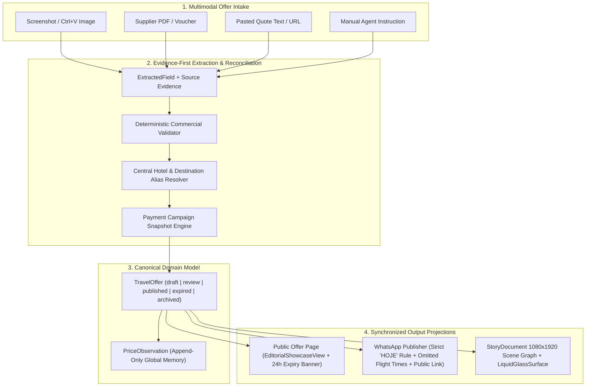

# ARCHITECTURE_GRAPH — Excelência Tour Offer & Story Pipeline

## Surface Synchronization Invariant
1. **Single Source of Truth**: `TravelOffer` holds the canonical commercial facts (`party`, `rooms`, `pricing`, `hotels`, `flights`, `inclusions`, `validity`, `paymentTermsSnapshot`).
2. **Derived Projections**:
   - **Public Offer Page** renders full itinerary, hotel catalog photos, room occupancy, and live/expired status (`expiresAt`).
   - **StoryDocument (9:16)** selects 2–4 high-impact inclusions with explicit reason codes (`INCLUDED_AND_PRIORITY_1..4`), fits the destination title (`fitStoryTitle`), and renders the price inside a configurable `GlassMaterial` card (`LiquidGlassSurface`).
   - **WhatsApp Copy** formats the commercial summary without flight times by default, enforces the calendar-day `"HOJE"` rule in `America/Sao_Paulo`, and appends the public offer link.
