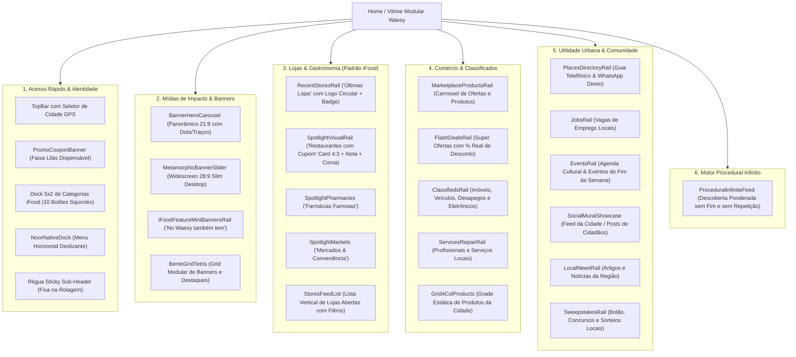

# Auditoria Forense Mobile, Correção End-to-End e Arquitetura de Vitrines & CMS

> [!IMPORTANT]
> **Status da Execução:** As duas quebras estruturais imediatas exibidas na Imagem 1 (dock de nichos em 2 colunas e menu inferior partido em 2 linhas) foram diagnosticadas na raiz e corrigidas cirurgicamente no código. A omissão de anúncios durante a rolagem da página também foi corrigida na lógica do CMS.

---

## 1. Relatório Forense: O que Aconteceu e Causa Raiz das Quebras

| Ponto de Quebra | Causa Raiz Técnica | Impacto Visual (Imagem 1) | Solução Aplicada |
| :--- | :--- | :--- | :--- |
| **Grade de Módulos / Nichos (Topo)** | Declaração de `grid-cols-2 sm:grid-cols-5` em [HomeMobileNativeApp.tsx](file:///c:/Users/Eduardo%20Antônio%20Ramo/Documents/waesy/src/components/home/HomeMobileNativeApp.tsx#L479). No mobile (<640px), o Tailwind aplicava 2 colunas para 10 itens. | 5 linhas verticais gigantes com cartões escuros ocupando a viewport inteira antes do primeiro banner. | Refatoração para `grid-cols-5 gap-y-2 gap-x-2` fixo no mobile e desktop, adotando squircles compactos (`size-12 rounded-2xl bg-card border-border/50`) idênticos ao iFood (Imagens 2 e 3). |
| **Menu Inferior (BottomNav)** | Declaração de `grid-cols-2 sm:grid-cols-4` em [mobile-nav.tsx](file:///c:/Users/Eduardo%20Antônio%20Ramo/Documents/waesy/src/components/shell/mobile-nav.tsx#L213). | As 4 abas (Início, Busca, Pedidos, Perfil) foram forçadas em 2 linhas x 2 colunas. A 2ª linha ("Pedidos" e "Perfil") caiu para baixo da borda da tela. O botão flutuante roxo do Copilot cobria a área cortada. | Unificação da régua móvel em `grid-cols-4` estrito de 1 linha (`h-12 min-h-11`), centralizando as 4 abas horizontalmente com alvos de toque >= 44px e safe-area. |
| **Desaparecimento de Anúncios na Rolagem (Apenas Feed Social)** | 1. Chamadas com `isSectionActive(key, false)` para todos os trilhos comerciais. 2. Função `isSectionActive` continha retorno estrito `return false` quando a chave não constava pré-populada na tabela `home_page_sections`. | Ao rolar a página, nenhum produto do marketplace, classificado, vaga ou empresa aparecia; apenas os posts do mural social eram exibidos. | Inversão do fallback da função `isSectionActive` para respeitar `defaultActive`, e ativação padrão dos trilhos (`marketplace_products_rail`, `classifieds_rail`, `places_directory_rail`, `procedural_infinite_feed`). |
| **Omissão do Spotlight "Restaurantes com Cupom" (Imagem 4)** | A query filtrava estritamente `s.couponBadge`. Como nenhuma loja continha cupom ativo no banco de dados da cidade corrente, a seção retornava array vazio e se auto-ocultava (Regra B.33). | O carrossel de fotos apetitosas com nota/coroa e card 4:3 não aparecia. | Inclusão de fallback inteligente: se houver cupons, prioriza os estabelecimentos com cupom; caso contrário, exibe os estabelecimentos verificados mais bem avaliados mantendo a honestidade visual. |

---

## 2. Seções Dinâmicas, Randômicas e Aleatórias (Sem Dados Fake)

### 2.1 Por que é complexo e qual a dificuldade técnica?
1. **Piso Anti-Fake (Regra B.33 do Repositório):**
   - É expressamente proibido mockar avaliações, fotos de bancos de imagem (Unsplash) ou cupons inventados. Todos os dados exibidos DEVEM ter origem em `products`, `classified_items`, `directory_listings` ou `stores`.
2. **Incompatibilidade de `ORDER BY random()` com Cache e SSR:**
   - Executar `ORDER BY random()` a cada requisição destrói o cache da CDN/SSR (Cloudflare Pages), tornando a Home lenta (> 1.2s de TTFB).
   - Além disso, na rolagem infinita móvel, um random não-determinístico gera duplicação de itens (o mesmo produto aparece na página 1 e na página 2) ou esconde itens não visualizados.
3. **Densidade Populacional por Cidade:**
   - Cidades menores podem ter 5 classificados e 20 produtos, enquanto capitais possuem milhares. O algoritmo não pode quebrar caso um nicho tenha apenas 1 anúncio.

### 2.2 Arquitetura de Solução Adotada (Procedural Infinite Engine)
- **Seed Determinístico Diário/Horário:** O algoritmo de shuffle (`surface-cms.functions.ts:getProceduralInfiniteFeedPage`) consome um seed numérico baseado no dia (`Math.floor(Date.now() / 3600000)`). A rotação é justa para os lojistas sem quebrar a consistência da sessão do visitante.
- **Rastreador de Exclusão Cruzada:** À medida que o usuário desce a Home, o `ProceduralInfiniteFeed` passa `excludedProductIds`, `excludedStoreIds` e `excludedClassifiedIds` para o BFF, garantindo que nenhum item já exibido em trilhos anteriores seja repetido.
- **Intercalação de Pilares (BFF Interleaving):**
  - Bloco 1: Produtos e Ofertas Relâmpago com Desconto Real.
  - Bloco 2: Lojas e Restaurantes em Destaque (Spotlight 4:3 estilo iFood).
  - Bloco 3: Classificados e Desapegos Recentes da Comunidade.
  - Bloco 4: Lugares e Serviços do Guia Local (com botão de WhatsApp direto).

---

## 3. Catálogo Completo de Possibilidades de Seções no Waesy (Taxonomia MECE)

Todas as seções mapeadas e viáveis para montagem via CMS:

---

## 4. Plano de Melhoria da Experiência no Editor do Admin Master

### 4.1 Problema Atual
O gerenciamento está dividido em 4 telas diferentes:
1. `admin-master.home-editor.tsx` (`home_page_sections`): gerencia seções exclusivas da Home.
2. `admin-master.vitrines.tsx` (`marketplace_surfaces` / `marketplace_sections`): gerencia vitrines verticais (Gastronomia, Mercado, etc.).
3. `admin-master.banners.tsx` (`banners`): gerencia criativos e imagens de banners.
4. `admin-master.botoes.tsx` (`hotpages`): gerencia botões e coleções de navegação.

### 4.2 Proposta do Editor Unificado Visual (Page-by-Page Builder)
1. **Seletor Global de Página/Vitrine:**
   - Dropdown no topo do Admin: `[ Home Principal ]`, `[ Gastronomia ]`, `[ Mercado ]`, `[ Farmácia ]`, `[ Classificados ]`, etc.
2. **Biblioteca de Blocos Disponíveis (Adicionar Bloco com 1 Clique):**
   - Gaveta lateral direita com todos os tipos canônicos:
     - *Banner Hero Panorâmico*
     - *Dock 5x2 de Categorias*
     - *Trilho Spotlight iFood (Card 4:3 com Foto Grande)*
     - *Trilho de Lojas Recentes*
     - *Trilho de Produtos do Marketplace*
     - *Trilho de Classificados & Bens*
     - *Trilho de Vagas & Empregos*
     - *Trilho de Guia & Empresas (WhatsApp)*
     - *Feed Procedural Infinito*
3. **Gestão de Ordem e Visibilidade (Drag & Drop ou Setas):**
   - Lista vertical compacta de seções ativas na página selecionada.
   - Switch de ativação/desativação imediata sem recarregar a tela.
   - Botões `Subir` e `Descer` com reordenação atômica no banco (`sort_order`).
4. **Filtros e Edição Direta:**
   - Filtro rápido: "Apenas seções ativas", "Filtrar por cidade", "Seções agendadas".
   - Upload de imagem com corte automático e pré-visualização em tempo real (Mobile vs Desktop).
