# COMMERCIAL IDENTITY MODEL — IDENTIDADE DE CONTATO PRÉ-CRM
## Fronteira Conceitual entre Memória Comercial e CRM Formal
**Data:** 2026-10-21  
**Módulo:** Turismo / Excelência Tour  

---

### 1. A Fronteira Zero-Pollution

No ecossistema Waesy, a integridade da base cadastral é uma invariante crítica:
- **`public.customers`**: Clientes com vínculo contratual, histórico de emissões ou compras pagas.
- **`public.leads_crm`**: Negociações ativas no funil de vendas com probabilidade real de fechamento.
- **`public.travel_commercial_contacts` (Novo)**: Memória comercial leve de passageiros que declararam interesse em viajar nos próximos 3 a 12 meses.

```mermaid
flowchart LR
    A[WhatsApp / Site / Lâmina] -->|Captura de Intenção| B[CommercialContact]
    B -->|Monitoramento Silencioso| C[TravelInterest Pool]
    C -->|Match de Oferta >= 80%| D[Alerta de Oportunidade]
    D -->|Abordagem Aceita / Reunião Agendada| E[leads_crm]
    E -->|Compra Concluída / Contrato Assinado| F[customers]
```

### 2. Regras de Deduplicação e Higienização

1. **Deduplicação Determinística por Telefone:**
   - O telefone é higienizado removendo caracteres não numéricos: `phone.replace(/\D/g, '')`.
   - Números brasileiros com ou sem nono dígito são normalizados para chave canônica única por loja (`store_id + phone_digits`).
   - Se o contato já existe no pré-CRM, a nova intenção (`TravelInterest`) é anexada ao contato existente (relação 1:N).

2. **Isolamento de Consentimento (LGPD):**
   - O contato comercial tem status `active`, `nurturing`, `unresponsive` ou `opted_out`.
   - Se o contato solicitar não receber ofertas (`opted_out`), o motor de matching silencia imediatamente qualquer oportunidade gerada para ele.
