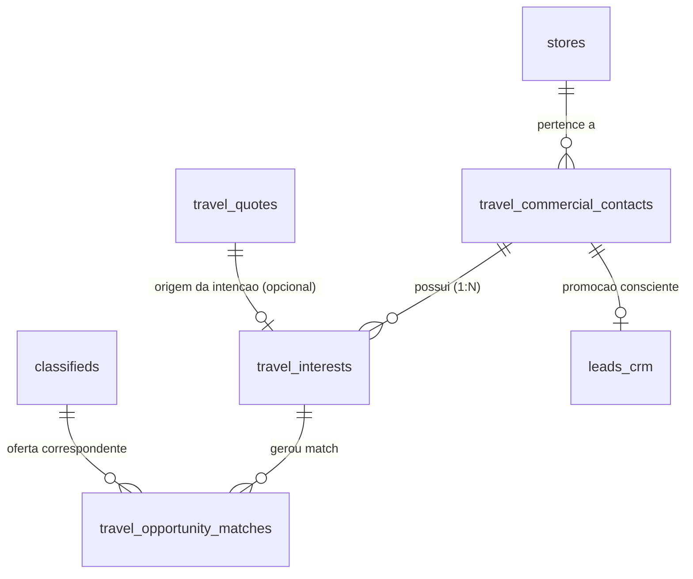

# COMMERCIAL INTELLIGENCE — MAPEAMENTO DE BANCO DE DADOS & RLS
## Especificação Estrutural de Tabelas, Índices e Políticas de Isolamento Multi-Tenant
**Data:** 2026-10-21  
**Migration Relacionada:** `supabase/migrations/20261022000003_travel_commercial_intelligence_backlog.sql`  

---

### 1. Diagrama de Relacionamentos (ERD)



---

### 2. Dicionário de Dados

#### Tabela 1: `public.travel_commercial_contacts`
Identidade de contato leve para memória comercial pré-CRM.

| Coluna | Tipo | Restrição | Descrição |
| :--- | :--- | :--- | :--- |
| `id` | UUID | PK, DEFAULT gen_random_uuid() | Identificador único do contato comercial. |
| `store_id` | UUID | NOT NULL, REFERENCES stores(id) | Tenant da agência. |
| `name` | TEXT | NOT NULL | Nome do contato / passageiro. |
| `phone` | TEXT | NOT NULL | Telefone com DDD (limpo / E.164). |
| `email` | TEXT | NULL | E-mail opcional. |
| `instagram_handle` | TEXT | NULL | Perfil no Instagram (ex: @usuario). |
| `city` | TEXT | NULL | Cidade de residência do viajante. |
| `preferred_channel` | TEXT | DEFAULT 'whatsapp' | Canal preferencial: 'whatsapp', 'phone', 'instagram', 'email'. |
| `status` | TEXT | DEFAULT 'active' | 'active', 'nurturing', 'unresponsive', 'promoted_to_crm', 'opted_out'. |
| `notes` | TEXT | NULL | Observações de relacionamento. |
| `linked_crm_lead_id` | UUID | NULL, REFERENCES leads_crm(id) | Preenchido APENAS após promoção explícita ao CRM. |
| `linked_customer_id` | UUID | NULL, REFERENCES customers(id) | Preenchido caso vire cliente com compra concluída. |
| `created_at` | TIMESTAMPTZ | NOT NULL DEFAULT now() | Data de cadastro. |
| `updated_at` | TIMESTAMPTZ | NOT NULL DEFAULT now() | Data da última atualização. |

#### Tabela 2: `public.travel_interests`
Intenção declarada e memória de viagem anual (1 Contato para N Interesses).

| Coluna | Tipo | Restrição | Descrição |
| :--- | :--- | :--- | :--- |
| `id` | UUID | PK, DEFAULT gen_random_uuid() | Identificador do interesse. |
| `contact_id` | UUID | NOT NULL, REFERENCES travel_commercial_contacts(id) | Contato titular. |
| `store_id` | UUID | NOT NULL, REFERENCES stores(id) | Tenant da agência. |
| `title` | TEXT | NOT NULL | Título sintético (ex: "Caribe em Família / Julho 2026"). |
| `destinations` | TEXT[] | NOT NULL DEFAULT '{}' | Destinos aceitos (ex: `['Punta Cana', 'Cancún', 'Caribe']`). |
| `destination_categories` | TEXT[] | DEFAULT '{}' | Categorias temáticas (ex: `['praia', 'resort', 'all_inclusive']`). |
| `preferred_origins` | TEXT[] | DEFAULT '{}' | Aeroportos de saída aceitos (ex: `['XAP', 'FLN', 'GRU']`). |
| `dates` | JSONB | NOT NULL DEFAULT '{}' | `{ flexibility, targetMonths, exactDepartureDate, preferredSeason, durationNightsRange }`. |
| `party` | JSONB | NOT NULL DEFAULT '{}' | `{ adults, children, childrenAges, roomConfiguration }`. |
| `budget` | JSONB | NOT NULL DEFAULT '{}' | `{ maxTotalBudgetCents, maxInstallmentCents, preferredInstallments, priceBasisPreference }`. |
| `inclusions_wanted` | TEXT[] | DEFAULT '{}' | Inclusões desejadas (`['all_inclusive', 'aereo_incluso', 'transfer', 'bagagem']`). |
| `hotel_preferences` | JSONB | DEFAULT '{}' | `{ minStars, preferredChains, preferredHotelNames }`. |
| `urgency` | TEXT | DEFAULT 'moderate' | 'immediate', 'moderate', 'exploring', 'future_trip'. |
| `status` | TEXT | DEFAULT 'open' | 'open', 'matched', 'nurturing', 'dormant', 'converted', 'cancelled'. |
| `source_inquiry_text` | TEXT | NULL | Transcrição original da mensagem ou pedido de WhatsApp/site. |
| `source_quote_id` | UUID | NULL, REFERENCES travel_quotes(id) | ID da cotação original caso tenha nascido do site. |
| `captured_by_user_id` | UUID | NULL, REFERENCES profiles(id) | Agente que registrou o interesse. |
| `expires_at` | TIMESTAMPTZ | NOT NULL | Expiração da intenção (padrão 180 a 365 dias). |
| `created_at` | TIMESTAMPTZ | NOT NULL DEFAULT now() | Data de registro. |
| `updated_at` | TIMESTAMPTZ | NOT NULL DEFAULT now() | Data de alteração. |

#### Tabela 3: `public.travel_opportunity_matches`
Matches determinísticos entre ofertas publicadas (`classifieds`) e intenções (`travel_interests`).

| Coluna | Tipo | Restrição | Descrição |
| :--- | :--- | :--- | :--- |
| `id` | UUID | PK, DEFAULT gen_random_uuid() | Identificador do match de oportunidade. |
| `store_id` | UUID | NOT NULL, REFERENCES stores(id) | Tenant da agência. |
| `interest_id` | UUID | NOT NULL, REFERENCES travel_interests(id) | Interesse correspondente. |
| `offer_id` | UUID | NOT NULL, REFERENCES classifieds(id) | Oferta correspondente (anúncio de turismo). |
| `contact_id` | UUID | NOT NULL, REFERENCES travel_commercial_contacts(id) | Contato a ser abordado. |
| `match_score` | NUMERIC | NOT NULL CHECK (match_score >= 0 AND match_score <= 100) | Pontuação composta (0..100). |
| `is_high_priority` | BOOLEAN | NOT NULL DEFAULT false | Verdadeiro se score >= 80. |
| `dimensions` | JSONB | NOT NULL DEFAULT '[]' | Decomposição em 5 pesos (destino, orçamento, datas, composição, inclusões). |
| `approach_draft` | TEXT | NOT NULL | Rascunho de abordagem para WhatsApp gerado pelo motor. |
| `offer_snapshot` | JSONB | NOT NULL DEFAULT '{}' | Snapshot imutável da oferta no momento do match. |
| `status` | TEXT | DEFAULT 'new' | 'new', 'reviewed', 'approached', 'engaged', 'promoted_to_crm', 'dismissed'. |
| `interaction_history` | JSONB | DEFAULT '[]' | Log de abordagens, respostas e objeções. |
| `matched_at` | TIMESTAMPTZ | NOT NULL DEFAULT now() | Momento da detecção. |
| `updated_at` | TIMESTAMPTZ | NOT NULL DEFAULT now() | Última alteração. |

---

### 3. Estratégia de Índices e Performance

1. **Índices GIN para Arrays de Busca:**
   - `idx_travel_interests_destinations`: `CREATE INDEX idx_travel_interests_destinations ON travel_interests USING GIN (destinations);`
   - `idx_travel_interests_inclusions`: `CREATE INDEX idx_travel_interests_inclusions ON travel_interests USING GIN (inclusions_wanted);`
2. **Índices B-Tree para Filtros do Radar:**
   - `idx_travel_interests_store_status`: `ON travel_interests(store_id, status);`
   - `idx_travel_interests_contact`: `ON travel_interests(contact_id);`
   - `idx_opportunity_matches_store_score`: `ON travel_opportunity_matches(store_id, match_score DESC);`
   - `idx_opportunity_matches_interest_offer`: `ON travel_opportunity_matches(interest_id, offer_id);` (Garante unicidade / anti-duplicação de alerta)

---

### 4. Políticas de Isolamento RLS (Zero-Trust)

Todas as 3 tabelas possuem `ENABLE ROW LEVEL SECURITY`.
Políticas baseadas na loja do colaborador autenticado (`workspace_members` / `profiles.store_id`):
```sql
CREATE POLICY "travel_commercial_contacts_store_isolation"
  ON public.travel_commercial_contacts FOR ALL
  USING (
    store_id IN (
      SELECT store_id FROM public.profiles WHERE id = auth.uid() AND role IN ('owner', 'admin', 'manager', 'seller', 'support')
    )
  );
```
Com o mesmo padrão aplicado a `travel_interests` e `travel_opportunity_matches`.
Visualização pública ou anônima é estritamente proibida (`DENY ALL` para roles `anon`).
