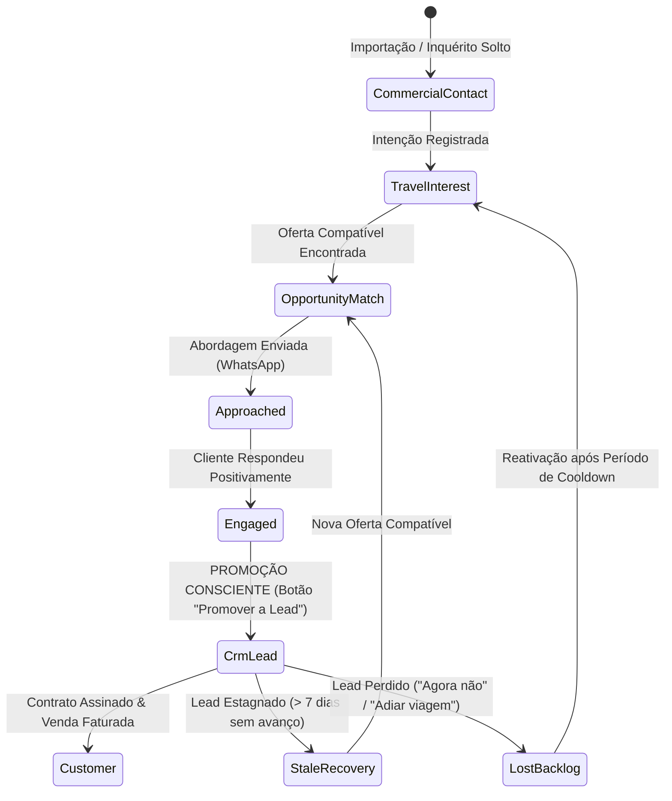

# FLUXO DE PROMOÇÃO E RECUPERAÇÃO ENTRE RADAR COMERCIAL E CRM
## INTEGRAÇÃO BIDIRECIONAL • EXCELÊNCIA TOUR / WAESY
### Data: 2026-10-21 • Versão: 1.0-PROD • Baseline: Production

---

## 1. Visão Geral da Segregação e Ciclo de Vida

O princípio arquitetural mais importante do ecossistema comercial é a **Não Poluição do CRM**:
- Um contato antigo importado por planilha ou um visitante curioso que perguntou sobre preços **NÃO É UM LEAD**.
- Ele reside na camada leve de **Inteligência Comercial** (`travel_commercial_contacts` e `travel_interests`).
- Ele só é promovido a **CRM Lead** (`leads_crm`) quando demonstra intenção concreta e voluntária de compra.



---

## 2. A Transação Atômica de Promoção ao CRM

A promoção é executada pela Server Function [`promoteOpportunityToCrmLeadFn`](file:///c:/Users/Excelência%20Tour%20SMO/Documents/waesy/src/services/travel-commercial-intelligence.functions.ts#L320-L400) sob transação atômica protegida:

```typescript
export async function promoteOpportunityToCrmLead(input: {
  matchId: string;
  customEstimatedBudgetCents?: number;
  assignedAgentProfileId?: string;
  notes?: string;
}) {
  // 1. Resgata o Match, o Interesse e o Contato Comercial
  // 2. Resolução de Identidade: Busca se o telefone/email já possui Lead existente no CRM
  // 3. Se existir Lead arquivado/perdido, REATIVA o lead preservando histórico
  // 4. Se não existir, invoca createLead() no crm.functions.ts com:
  //    - lead_source: "commercial_radar"
  //    - initial_stage: "qualifying"
  //    - estimated_budget: customEstimatedBudgetCents || interest.maxBudgetCents
  //    - custom_attributes: { source_match_id, source_interest_id, matched_offer_title }
  // 5. Atualiza travel_opportunity_matches.status = 'promoted_to_crm'
  // 6. Atualiza travel_commercial_contacts.linked_crm_lead_id = lead.id
}
```

### Garantias de Integridade da Promoção:
1. **Zero Duplicações de Identidade:** O número de telefone normalizado (`cleanPhone`) é a chave de unificação. Se a pessoa já constar na tabela de clientes ou leads, o registro existente é reutilizado.
2. **Vínculo Reverso no CRM:** O card do lead no CRM exibe o selo proeminente:
   `"Originado do Radar Comercial — Interesse: Punta Cana Janeiro (Match 92%)"`.
3. **Registro Auditado:** A promoção gera uma entrada no histórico da oportunidade (`travel_commercial_interactions`) indicando quem promoveu, data e hora.

---

## 3. O Fluxo de Retorno / Recuperação ao Backlog (Demotion)

### 3.1. Leads Estagnados (Stale Leads - Regra dos 7 Dias)
Quando um lead permanece no CRM sem nenhuma atividade ou interação por mais de 7 dias (`stale_after_days = 7`):
- O lead **não é excluído nem apagado do CRM**.
- Ele passa a ser espelhado na visualização inteligente **"Leads em Recuperação"** do Radar Comercial.
- Quando uma nova oferta de viagem compatível com o interesse original do lead for cadastrada, o agente recebe um alerta com a sugestão de reativação:
  `"O lead Carlos Silva está parado há 9 dias. Surgiu uma nova condição para Cancún em 15x de R$ 380."`.

### 3.2. Mapeamento de Motivos de Perda no CRM (Loss Reasons)
Se o lead for marcado como "Perdido" no CRM:
- **Motivos Aptos a Retorno ao Backlog:**
  - `"Preço acima do orçamento"` ➔ Retorna ao radar buscando ofertas mais baratas.
  - `"Adiou a viagem"` ➔ Permanece no backlog com snooze para reativação na data combinada.
  - `"Sem data definida no momento"` ➔ Continua monitorando campanhas sazonais.
- **Motivos Bloqueantes (Não Acionáveis):**
  - `"Não deseja ser contatado (Opt-out)"` ➔ Marca `do_not_contact = true` e bloqueia qualquer nova abordagem.
  - `"Número inválido / Spam"` ➔ Arquivado definitivamente.

---

## 4. Proteção contra Loop Infinito (Anti-Ping-Pong Guard)

Para impedir que um lead fique alternando diariamente entre CRM e Backlog:
1. **Janela de Cooldown de 14 Dias:** Após ser arquivado ou desqualificado, uma oportunidade não pode sugerir promoção automática para o mesmo destino durante 14 dias, a menos que o cliente tome a iniciativa de enviar uma nova mensagem.
2. **Versionamento de Interação:** Toda transição incrementa a coluna `interaction_version`, permitindo que o motor ignore eventos repetidos.
