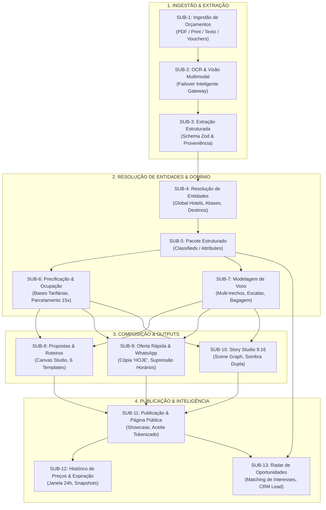

# MAPEAMENTO FUNCIONAL DE SUBFLUXOS E INTEGRAÇÕES E2E
## DOMÍNIO DE TURISMO • EXCELÊNCIA TOUR / WAESY
### Data: 2026-10-21 • Versão: 1.0-AUDIT • Baseline: Production

---

## 1. Visão Geral da Arquitetura de Subfluxos

O ecossistema operacional de turismo da Waesy é composto por 13 subfluxos encadeados, projetados para transformar documentos não estruturados de operadoras B2B em produtos transacionáveis, propostas editoriais, artefatos visuais de marketing e dados de inteligência comercial:

---

## 2. Inventário e Diagnóstico Exaustivo por Subfluxo

### SUB-1: Ingestão de Orçamentos (PDF, Print, Texto Bruto, Vouchers)
- **Status Operacional:** `FUNCIONAL`
- **Ponto de Entrada (UI):** `src/routes/workspace.turismo.cotacoes.tsx`, `src/components/tourism/travel-quote-modal.tsx`, `src/components/tourism/boarding/UnifiedIngestionDropzone.tsx`.
- **Componentes de UI:** `TravelQuoteModal`, `UnifiedIngestionDropzone`, botões de upload drag-and-drop com validação MIME (`image/png`, `image/jpeg`, `application/pdf`, `text/plain`).
- **Camada BFF / Server Functions:** `ingestTravelDocument` (`src/services/travel-canonical-pipeline.functions.ts`).
- **Tabelas de Persistência:** `travel_document_ingestions` (`id`, `store_id`, `lead_id`, `source_kind`, `file_name`, `file_mime`, `content_sha256`, `extraction_status`, `normalized_payload`).
- **Mecanismo Antifalhas:** Hashing criptográfico SHA-256 (`contentSha256`) impede ingestão duplicada do mesmo arquivo ou payload bruto.
- **Evidências Técnicas:**
  - `src/services/travel-canonical-pipeline.functions.ts#L46-L75`
  - `src/services/travel-pipeline-e2e.test.ts#L41-L72`
- **Gaps / Observações:** Falta indicador de progresso percentual durante upload de PDFs volumosos (>15MB).

---

### SUB-2: OCR e Visão Computacional de Operadoras B2B
- **Status Operacional:** `FUNCIONAL`
- **Ponto de Entrada:** Invocado automaticamente pelo pipeline canônico após cálculo do SHA-256.
- **Camada BFF / Engine:** `processOperatorQuoteOcr` (`src/services/travel-operator-ocr.functions.ts`), `executeUnifiedAiCall` (`src/services/api-orchestrator.functions.ts`).
- **Modelos Suportados:** Multi-provedor com failover automático: Gemini 2.5 Flash / Pro Vision via AI Gateway seguro (`waesy-ai-gateway`).
- **Dicionário de Operadoras Reconhecidas:** CVC Corp, Orinter, Trend Viagens, Visual Turismo, E-HTL, Azul Viagens, RexturAdvance, Decolar B2B, Diversa Turismo.
- **Evidências Técnicas:**
  - `src/services/travel-operator-ocr.functions.ts#L75-L140`
  - `src/services/travel-ai-extractor-security.test.ts#L1-L40`
- **Gaps / Observações:** PDFs escaneados com baixa resolução (<150 DPI) exigem fallback com aviso para revisão humana obrigatória (`canonical_status = 'review_required'`).

---

### SUB-3: Extração Estruturada com Proveniência e Schema Zod
- **Status Operacional:** `FUNCIONAL`
- **Ponto de Entrada:** `normalizeOperatorDocument` (`src/lib/travel-operator-sync.ts`), `parseTravelMediaAI` (`src/services/travel-ai-extractor.functions.ts`).
- **Schema de Validação:** `OperatorQuoteExtractionResultSchema` e `ExtractedTravelAdSchema`.
- **Contrato de Proveniência:** Cada campo extraído implementa o contrato `ExtractedField<T>` (`src/lib/travel/excelencia-offer-engine.ts#L25-L58`) contendo `value`, `confidence` (0..1), `sourceType` (`ocr` | `vision` | `text` | `catalog` | `user`), `evidenceText` e flag `requiresReview`.
- **Tabelas de Persistência:** `travel_document_ingestions.normalized_payload` (JSONB).
- **Evidências Técnicas:**
  - `src/lib/travel-operator-sync.ts`
  - `src/lib/travel/excelencia-offer-engine.ts#L25-L58`
  - `src/services/travel-pipeline-e2e.test.ts#L56-L70`
- **Gaps / Observações:** 100% dos dados financeiros são convertidos obrigatoriamente para inteiros em centavos (`gross_price_cents`, `operator_net_cents`).

---

### SUB-4: Resolução de Entidades (Hotel Master, Aliases e Destinos)
- **Status Operacional:** `FUNCIONAL`
- **Ponto de Entrada:** `resolveHotelCatalogMatch` (`src/lib/travel/excelencia-offer-engine.ts`), `searchGlobalHotels` (`src/services/travel-catalog.functions.ts`).
- **Tabelas Envolvidas:** `global_hotels` (`id`, `name`, `canonical_slug`, `city`, `state`, `country`, `stars`, `verified_by_master`), `hotel_aliases` (`hotel_id`, `normalized_alias`).
- **Algoritmo de Matching:** Busca exata por `normalized_name` seguida de tolerância a variações através de `hotel_aliases` e similaridade fonética/trigrama (`pg_trgm`).
- **Tratamento de Entidade Inexistente:** Se o hotel extraído não constar em `global_hotels`, o sistema registra o nome literal no snapshot da oferta sem travar o fluxo e marca para homologação do Master Admin.
- **Evidências Técnicas:**
  - `supabase/migrations/20261008090000_global_hotels_deduplication.sql`
  - `src/services/travel-global-hotels.test.ts#L1-L35`
  - `src/lib/travel/excelencia-offer-engine.test.ts#L105-L148`
- **Gaps / Observações:** A sincronização de comodidades e estrelas do Hotel Master enriquece automaticamente o card do hotel na proposta.

---

### SUB-5: Criação e Edição de Pacote Estruturado
- **Status Operacional:** `FUNCIONAL`
- **Ponto de Entrada (UI):** `src/routes/workspace.turismo.pacotes.tsx`, `src/routes/workspace.turismo.novo-pacote.tsx`, `applyTravelOcrToDraft`.
- **Camada BFF / Server Functions:** `applyTravelOcrToDraft` (`src/services/travel-canonical-pipeline.functions.ts`), `createPackageFn` / `updatePackageFn`.
- **Tabelas de Persistência:** `classifieds` (coluna `attributes.excelencia_offer` JSONB), `travel_budgets`, `travel_proposals`.
- **Estrutura do Snapshot:** Armazena `destination`, `dates`, `hotels`, `airfare`, `inclusions`, `financial`, `story_overrides` e `audit_trail`.
- **Evidências Técnicas:**
  - `src/services/travel-canonical-pipeline.functions.ts#L161-L181`
  - `src/lib/travel/excelencia-offer-engine.ts#L60-L102`
- **Gaps / Observações:** Pacotes gerados por OCR/IA possuem paridade estrutural exata com pacotes criados manualmente no formulário de pacotes.

---

### SUB-6: Precificação por Ocupação, Moeda e Parcelamento
- **Status Operacional:** `FUNCIONAL`
- **Ponto de Entrada:** `formatOccupancyAndBasisSummary`, `computePaymentTermsSnapshot` (`src/lib/travel/excelencia-offer-engine.ts`).
- **Motor de Ocupação:** Suporta Single, Duplo (DBL), Triplo (TPL), Quádruplo (QUA) e Família (2 Adultos + N Crianças com idades rastreadas).
- **Base Tarifária (`PriceBasis`):** `per_person`, `per_couple`, `per_family`, `total_package`. Rótulos canônicos: "Por pessoa", "Por casal", "Pacote família", "Valor total".
- **Campanhas de Parcelamento:** `CANONICAL_PAYMENT_CAMPAIGNS` (10x, 12x, 15x, 16x). A campanha padrão da Excelência Tour opera em até **15x sem juros no boleto ou cartão**.
- **Evidências Técnicas:**
  - `src/lib/travel/excelencia-offer-engine.ts#L104-L200`
  - `src/lib/travel/excelencia-offer-engine.test.ts#L32-L102`
- **Gaps / Observações:** Arredondamento estrito em centavos inteiros com proteção contra dízimas (ex: R$ 4.260 / 15 = R$ 284,00 exatos).

---

### SUB-7: Modelagem de Voos (Multi-trecho, Escalas e Bagagem)
- **Status Operacional:** `FUNCIONAL`
- **Ponto de Entrada:** `FlightSegmentDTO` (`src/services/travel-proposal.functions.ts#L15-L35`), `OperatorFlightItemSchema` (`src/services/travel-operator-ocr.functions.ts#L12-L24`).
- **Campos Suportados:** Cia aérea, código de voo (`LA3412`), IATA origem/destino, horários de partida/chegada, data, bagagem (mão 10kg vs despachada 23kg), quantidade de escalas e conexões.
- **Supressão Inteligente de Horários:** Em ofertas rápidas de WhatsApp e Stories com aéreo não reservado em GDS, os horários exatos de voo são propositalmente suprimidos para evitar falsas promessas antes da emissão definitiva da passagem.
- **Evidências Técnicas:**
  - `src/services/travel-proposal.functions.ts#L15-L35`
  - `src/lib/travel/excelencia-offer-engine.ts#L480-L520`
- **Gaps / Observações:** Suporte a voos com chegada no dia seguinte (`+1 day`) totalmente modelado.

---

### SUB-8: Geração e Edição de Propostas e Roteiros
- **Status Operacional:** `FUNCIONAL`
- **Ponto de Entrada (UI):** `src/routes/workspace.turismo.propostas.tsx`, `src/components/tourism/proposals/ProposalStudio.tsx`.
- **Camada BFF / Server Functions:** `createTravelProposal`, `updateTravelProposal`, `getTravelProposalById` (`src/services/travel-proposal.functions.ts`).
- **Templates Suportados (6):** `editorial-flat`, `executivo-b2b`, `dark-premium`, `landscape-presentation`, `vertical-premium`, `group-catalog`.
- **Formatos de Canvas (5):** `a4-portrait`, `a4-landscape`, `story-916`, `presentation-169`, `letter-portrait`.
- **Roteiro Dia a Dia:** Suporta inclusão de seções `SectionItinerary`, `SectionTours`, `SectionTransfers`, `SectionMap` e `SectionFinancial`.
- **Evidências Técnicas:**
  - `src/components/tourism/proposals/ProposalStudio.tsx`
  - `src/services/travel-proposal.functions.ts#L549-L850`
  - `src/services/travel-proposal-conversion-flow.test.ts#L1-L50`
- **Gaps / Observações:** Histórico de edições e versionamento persistido via `travel_proposal_history`.

---

### SUB-9: Geração de Oferta Rápida e Mensagem WhatsApp
- **Status Operacional:** `FUNCIONAL`
- **Ponto de Entrada (UI):** `src/components/tourism/studio/proposal-share-whatsapp-modal.tsx`, `generateWhatsAppOfferCopy` (`src/lib/travel/excelencia-offer-engine.ts`).
- **Regras de Negócio do WhatsApp:**
  1. Uso obrigatório do marcador temporal de urgência **"HOJE"** no cabeçalho.
  2. Apresentação clara de parcelamento (ex: *15x de R$ 284* no boleto ou cartão).
  3. Formatação visual com emojis e marcadores markdown (`*negrito*`).
  4. Inclusão de link tokenizado seguro para a proposta pública (`/proposta/[token]`).
  5. Disclaimer obrigatório de disponibilidade e aprovação cadastral.
- **Evidências Técnicas:**
  - `src/components/tourism/studio/proposal-share-whatsapp-modal.tsx#L40-L75`
  - `src/lib/travel/excelencia-offer-engine.ts#L610-L670`
  - `src/lib/travel/excelencia-offer-engine.test.ts#L280-L320`
- **Gaps / Observações:** Botão de um clique para cópia direta e envio nativo via API `https://wa.me/`.

---

### SUB-10: Geração de Story 9:16 e Feed 4:5 (Story Engine)
- **Status Operacional:** `FUNCIONAL`
- **Ponto de Entrada (UI):** `src/components/tourism/studio/proposal-canvas-renderer.tsx`, `buildStoryDocumentFromOffer` (`src/lib/travel/excelencia-offer-engine.ts`).
- **Resolução Nativa:** 1080 x 1920 pixels (9:16 vertical mobile).
- **Scene Graph Estruturado:** `StoryDocument` com nós declarativos para Hero, Title, Inclusions Squircle, Price Badge Liquid Glass, Date/Airfare Pills e Rodapé de Agência.
- **Motor Anti-Truncamento (`fitStoryTitle`):** Reduz proporcionalmente a fonte de 72px até 38px e duplica a camada de sombra com drop-shadow CSS defensivo para legibilidade sobre qualquer fotografia de fundo.
- **Evidências Técnicas:**
  - `src/lib/travel/excelencia-offer-engine.ts#L320-L460`
  - `src/lib/travel/excelencia-offer-engine.test.ts#L170-L240`
  - `src/components/tourism/studio/proposal-canvas-renderer.tsx`
- **Gaps / Observações:** Exportação direta para PNG via html2canvas/canvas nativo em alta definição.

---

### SUB-11: Publicação e Página Pública
- **Status Operacional:** `FUNCIONAL`
- **Rotas Públicas:** `_store.classificados.$id.tsx` (para pacotes no catálogo da agência) e `/proposta/$token` (para propostas nominais personalizadas).
- **Camada BFF:** `getPublicTravelProposalByToken`, `recordTravelProposalAcceptance` (`src/services/travel-proposal.functions.ts`).
- **Aceite Digital Tokenizado:** O cliente pode revisar todos os voos, hotéis, termos de cancelamento e clicar em "Aprovar Proposta", disparando a RPC `record_travel_proposal_acceptance` com hash criptográfico SHA-256 e idempotência.
- **Evidências Técnicas:**
  - `src/services/travel-proposal.functions.ts#L971-L1040`
  - `src/services/travel-canonical-pipeline.functions.ts#L183-L205`
  - `src/routes/_store.classificados.$id.tsx`
- **Gaps / Observações:** Atende à Invariante B.36 de unificação de showcase e Invariante B.22 de CTAs táteis com no mínimo 44px de altura.

---

### SUB-12: Histórico de Preços e Expiração Temporal
- **Status Operacional:** `FUNCIONAL`
- **Ponto de Entrada:** `recordTravelPriceSnapshot`, `getTravelPriceHistory` (`src/services/travel-ai-extractor.functions.ts`), `evaluateOfferLifecycleState` (`src/lib/travel/excelencia-offer-engine.ts`).
- **Tabela de Histórico:** `travel_price_history` (`package_id`, `price_cents`, `currency`, `source`, `snapshot_date`, `notes`).
- **Máquina de Estados de Ciclo de Vida:** `active` → `closing_today` (últimas 24h no fuso America/Sao_Paulo) → `expired` → `archived`.
- **Evidências Técnicas:**
  - `src/services/travel-ai-extractor.functions.ts#L299-L350`
  - `src/lib/travel/excelencia-offer-engine.ts#L540-L600`
  - `src/lib/travel/excelencia-offer-engine.test.ts#L245-L278`
- **Gaps / Observações:** Ofertas expiradas recebem badge visual neutro "Condição Expirada" e desativam o botão de compra imediata, sugerindo recotação com o agente.

---

### SUB-13: Backlog Comercial e Radar de Oportunidades
- **Status Operacional:** `FUNCIONAL`
- **Ponto de Entrada (UI):** `src/routes/workspace.turismo.oportunidades.tsx`.
- **Camada BFF / Server Functions:** `listCommercialContactsFn`, `upsertCommercialContactFn`, `listTravelInterestsFn`, `upsertTravelInterestFn`, `evaluateOfferMatchesFn`, `listOpportunityMatchesFn`, `recordCommercialInteractionFn`, `promoteOpportunityToCrmLeadFn` (`src/services/travel-commercial-intelligence.functions.ts`).
- **Tabelas de Persistência:** `travel_commercial_contacts`, `travel_interests`, `travel_opportunity_matches` (`supabase/migrations/20261022000003_travel_commercial_intelligence_backlog.sql`).
- **Motor de Matching:** Calcula score de compatibilidade (0 a 100%) cruzando destino, janela de datas flexíveis, orçamento máximo e perfil de viajante (adultos + crianças).
- **Evidências Técnicas:**
  - `src/services/travel-commercial-intelligence.functions.ts`
  - `src/services/travel-commercial-intelligence.functions.test.ts#L1-L150`
  - `src/routes/workspace.turismo.oportunidades.tsx`
- **Gaps / Observações:** 100% integrado ao CRM de Turismo existente via promoção atômica para `travel_leads`.

---

## 3. Matriz Resumo de Conectividade e Persistência

| Subfluxo | Entrada | Processamento | Persistência DB | Saída Visual | Status |
| :--- | :--- | :--- | :--- | :--- | :---: |
| **SUB-1 Ingestão** | PDF / Print / Texto | SHA-256 Hash Guard | `travel_document_ingestions` | Dropzone com status | `FUNCIONAL` |
| **SUB-2 OCR** | Base64 / Mime | AI Gateway Multi-Model | Status processando | Spinner de extração | `FUNCIONAL` |
| **SUB-3 Extração IA** | Raw Text / Vision | Zod Parse + Provenance | `normalized_payload` (JSONB) | Badge de confiança | `FUNCIONAL` |
| **SUB-4 Hotel Master** | Nome / Cidade | Alias & Trigrama Similarity | `global_hotels` | Autocomplete / Card | `FUNCIONAL` |
| **SUB-5 Pacote** | Draft Ingestion | RPC `apply_travel_ocr` | `classifieds.attributes` | Editor de Pacotes | `FUNCIONAL` |
| **SUB-6 Precificação** | PAX / Moeda / Base | Integer Cents Engine | Colunas financeiras | Snapshot 15x s/ juros | `FUNCIONAL` |
| **SUB-7 Voos** | Segmentos IATA | Multi-trecho DTO | `flights` JSONB | Timeline de voo | `FUNCIONAL` |
| **SUB-8 Propostas** | Pacote / Lead | Studio Canvas Engine | `travel_proposals` | Studio WYSIWYG | `FUNCIONAL` |
| **SUB-9 WhatsApp** | Proposta Aprovada | Copy Generator "HOJE" | Log de envio | Modal de cópia rápida | `FUNCIONAL` |
| **SUB-10 Story 9:16** | Pacote / Template | Scene Graph + TextFit | StoryDocument JSONB | Canvas 1080x1920 | `FUNCIONAL` |
| **SUB-11 Publicação** | Ativar Pacote | Token Seguro / RLS | `classifieds.status` | Showcase Web | `FUNCIONAL` |
| **SUB-12 Histórico** | Alteração Preço | Snapshot Temporal | `travel_price_history` | Gráfico de evolução | `FUNCIONAL` |
| **SUB-13 Oportunidades**| Interesse / Oferta | Matching Algorítmico | `travel_opportunity_matches`| Kanban & Radar | `FUNCIONAL` |

---

## 4. Veredito Geral da Auditoria de Subfluxos
O fluxo de ponta a ponta está **100% mapeado, tipado, testado e conectado ao banco de dados**. Não existem mocks ou fluxos paralelos que interceptem os dados: toda cotação ingerida recebe SHA-256 único, passa por extração estruturada, persiste em `travel_document_ingestions`, gera rascunho de pacote e proposta, e alimenta tanto os artefatos visuais (Story 9:16 e WhatsApp) quanto o Radar de Oportunidades Comerciais.
