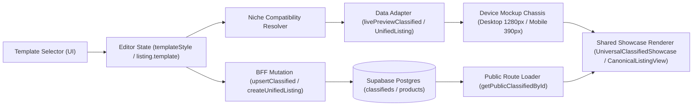

# CURRENT_TEMPLATE_ARCHITECTURE.md — Arquitetura Real do Template Engine

**Data:** 2026-10-21
**Status:** Auditado & Mapeado

---

## 1. Visão Geral das 3 Famílias de Templates no Waesy

A auditoria forense revelou que o repositório opera com **três motores complementares de templates**, cada um atendendo a um domínio específico do ecossistema:

| Domínio | Catálogo / Registry | Seletor no Editor | Preview Renderer | Public Renderer | Persistência no Banco |
| :--- | :--- | :--- | :--- | :--- | :--- |
| **1. Classificados & Vitrines Verticais (17 Nichos)** | `ClassifiedTemplateStyle` (`standard`, `editorial`, `automotivo`, `imobiliario`, `resort_hotel`, `servicos_agenda`, `conveniencia`) em `src/routes/_store.conta.classificados.novo.tsx` | Toolbar de Templates no Passo 5 e Painel Direito de `_store.conta.classificados.novo.tsx` | `UniversalClassifiedShowcase` (delega para `ConvenienceShowcaseView`, `EventClassifiedShowcaseView`, `EditorialShowcaseView`, `ClassifiedDetailDesktop`, `ClassifiedDetailMobile`) | **MESMO RENDERER** (`UniversalClassifiedShowcase` em `src/routes/_store.classificados.$id.tsx`) | `public.classifieds.attributes.template_style` (JSONB) |
| **2. Motor Unificado de Anúncios (Ad Engine)** | `CANONICAL_TEMPLATES_CATALOG` (`src/lib/ad-engine/template-metamorphosis.ts`) + `NICHE_TAXONOMY_REGISTRY` (`src/lib/ad-engine/niche-taxonomy-manifest.ts`) | `ListingTemplateSelector` (`src/components/ad-engine/editor/sections/listing-template-selector.tsx`) | `CanonicalListingPreviewFrame` → `CanonicalListingView` | **MESMO RENDERER** (`CanonicalListingView` em `src/components/ad-engine/public/canonical-listing-view.tsx`) | `classifieds.attributes.template_id` ou `products.metadata.template_id` |
| **3. Waesy Studio / Omni-Block Page Builder** | `STUDIO_TEMPLATES_CATALOG` (`src/lib/builder/studio-catalog.ts`) + `OMNI_TEMPLATES` (`src/lib/builder/omni-templates.ts`) | `StudioTemplateFactory` / `OmniEditor` (`src/components/builder/OmniEditor.tsx`) | `LiveTemplatePreviewModal` / `OmniEditor` Canvas → `OmniPageRenderer` | **MESMO RENDERER** (`OmniPageRenderer` em `src/components/builder/OmniPageRenderer.tsx`) | `public.experience_documents` + `public.experience_versions` + `public.studio_template_drafts` |

---

## 2. Fluxo Ponta a Ponta (Template Selector → Public Renderer)

---

## 3. Diagnóstico: Preview vs Produção (Mesmo Renderer ou Diferentes?)

1. **Classificados (`_store.conta.classificados.novo.tsx` vs `_store.classificados.$id.tsx`):**
   - **Compartilham os mesmos componentes de renderização** (`UniversalClassifiedShowcase`, `ClassifiedDetailDesktop`, `ClassifiedDetailMobile`, `EditorialShowcaseView`, `ConvenienceShowcaseView`, `EventClassifiedShowcaseView`).
   - **Por que divergiam antes da correção?**
     1. No editor, `livePreviewClassified` injetava `destination_city: "Chapecó"` e `flight_details: {...}` para todos os nichos, forçando `EditorialShowcaseView` no preview.
     2. Na rota pública (`getPublicClassifiedById`), `sanitizePublicClassifiedAttributes` removia dezenas de atributos válidos de nicho para visitantes não autenticados (`!canManage`), enquanto o dono logado via `classifiedData` bruto sem filtro.
     3. `ClassifiedDetailDesktop` e `ClassifiedDetailMobile` liam `template_style` mas não aplicavam variantes visuais distintas por template.

2. **Ad Engine (`CanonicalListingPreviewFrame` vs `CanonicalListingView`):**
   - **Compartilham exatamente o mesmo componente** (`CanonicalListingView`).
   - **Por que falhavam antes da correção?**
     1. `NICHE_TAXONOMY_REGISTRY` usava IDs de templates (`retail_ecommerce`, `service_booking`, etc.) diferentes das chaves de `CANONICAL_TEMPLATES_CATALOG` (`retail_standard`, `service_schedule`, etc.), fazendo `listAllowedTemplatesForNiche` retornar `[]`.
     2. `CanonicalListingPreviewFrame` mudava apenas a largura CSS do container sem propagar `previewViewport` para `CanonicalListingView`.
     3. `CanonicalListingView` não renderizava variações visuais baseadas em `listing.template`.

3. **Catálogo de Produtos (`ProductPreviewPane` vs `_store.produto.$slug.tsx`):**
   - `ProductPreviewPane` é um card resumido de preview lateral no workspace de catálogo, enquanto `_store.produto.$slug.tsx` usa `UniversalClassifiedShowcase` / layout de e-commerce.
