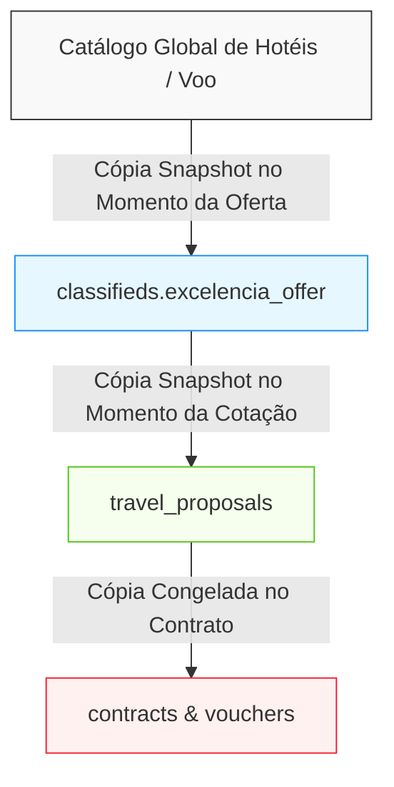

# DATA_OWNERSHIP_MAP.md — Mapa de Propriedade e Fonte da Verdade (SSOT)
## Mapeamento de Autoridade de Dados, Snapshots vs Dados Vivos e Ciclo de Vida
**Data:** 2026-10-21  
**Módulo:** Turismo, Viagens & Lazer / Waesy  
**Status:** Auditado com Evidências de Arquitetura  

---

### 1. Matriz de Propriedade de Dados (SSOT)

| Dado / Campo do Domínio | Entidade Proprietária (SSOT) | Tabela / Coluna de Origem | Consumidores / Projeções | Regra de Mutabilidade |
| :--- | :--- | :--- | :--- | :--- |
| **Nome Canônico do Hotel** | Catálogo Mestre de Hotéis | `public.global_hotels.name` | OCR, Sugestões de Busca, Auto-complete | **Dado Vivo:** Atualizado centralmente pela curadoria global. |
| **Hotel Selecionado no Pacote** | Instância da Oferta | `classifieds.attributes.excelencia_offer.hotels` | Vitrine Pública, Story 9:16, Lâmina Web | **Snapshot:** Imutável na oferta; não sofre efeito colateral se o cadastro global mudar. |
| **Título Comercial da Oferta** | Pacote no Marketplace | `public.classifieds.title` | Feed de Classificados, Buscas, SEO | **Dado do Tenant:** Editável pelo corretor enquanto o anúncio for rascunho/ativo. |
| **Título Visual do Story** | Documento Gráfico 9:16 | `classifieds.attributes.story_document.title` | Canvas do Story, Exportador PNG | **Override Visual:** Pode aplicar quebras de linha (`\n`) sem alterar o título comercial. |
| **Malha Aérea & Trechos de Voo** | Itinerário da Oferta | `excelencia_offer.airfare.segments` | Detalhe do Pacote, Lâmina de Voo | **Snapshot:** Registra número de voo, classe tarifária e horários contratados com a operadora. |
| **Condições de Pagamento** | Motor de Tarifas | `excelencia_offer.paymentTermsSnapshot` | Cards de Preço, Story, Proposta | **Snapshot Consistente:** Garante paridade entre valor da parcela no card e no checkout. |
| **Contato Inicial do Viajante** | Memória Comercial Pré-CRM | `public.travel_commercial_contacts` | Radar de Oportunidades, WhatsApp Copy | **Tenant CRM:** Preserva telefone, nome e histórico de preferências sem poluir o CRM formal. |
| **Negociação Formal do Lead** | CRM de Vendas | `public.leads_crm` | Funil de Vendas, Reuniões, Checklist | **Tenant CRM Ativo:** Gerenciado pelos corretores até o fechamento. |
| **Contrato Jurídico & Assinaturas** | Módulo de Contratos | `public.contracts` | Portal de Assinatura GovBR, Vouchers | **Imutável Pós-Assinatura:** Hash criptográfico SHA-256 e carimbo de tempo. |

---

### 2. Regras de Snapshot vs Dados Vivos (Prevenção de Efeito Borboleta)

1. **Princípio da Imutabilidade Histórica:**
   - Se o hotel *Iberostar Selection Praia do Forte* alterar sua razão social ou categoria de estrelas no cadastro mestre hoje, um contrato assinado há 2 meses **permanece 100% inalterado**.
2. **Princípio da Projeção Derivada:**
   - O Story Builder 9:16 nunca deve ser o ponto de entrada de dados de preço. O preço vem do modelo da oferta e o Story aplica apenas estilizações cosméticas (Liquid Glass, tipografia, contraste).
3. **Princípio do Isolamento de Rascunho:**
   - Alterações em lâminas em modo `draft` não afetam a visualização pública até que o corretor clique expressamente em "Publicar / Salvar Oferta".
