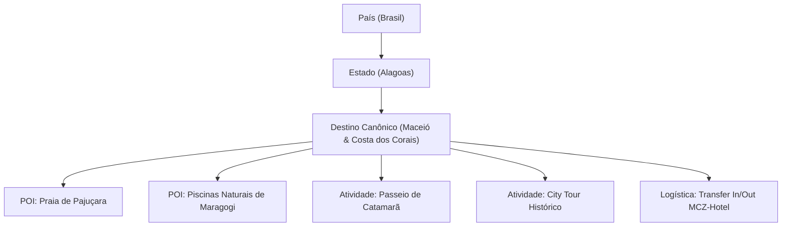

# AUDITORIA DE DESTINOS, PASSEIOS E ENTIDADES TURÍSTICAS
## DOMÍNIO DE TURISMO • EXCELÊNCIA TOUR / WAESY
### Data: 2026-10-21 • Versão: 1.0-AUDIT • Baseline: Production

---

## 1. Visão Geral do Catálogo de Destinos e Atividades

O ecossistema de viagens da Waesy organiza atrações turísticas através de uma taxonomia hierárquica normalizada:
**País** → **Região / Estado** → **Destino / Cidade Polo** → **Pontos de Interesse (POIs)** → **Passeios / Tours / Transfers**.

Essa estrutura permite que um pacote para "Alagoas" vincule automaticamente o hotel em Maceió, o traslado privativo até o Litoral Norte e os passeios de lancha nas piscinas naturais de Maragogi.



---

## 2. Modelagem Estrutural de Destinos e Atividades

### 2.1. Tabela Canônica `destinations`
Definida no Postgres com suporte a metadados turísticos:
- `id` (UUID PK).
- `name` (Ex: "Maceió", "Punta Cana", "Orlando", "Paris").
- `state_province` ("Alagoas", "La Altagracia", "Flórida", "Île-de-France").
- `country` ("Brasil", "República Dominicana", "Estados Unidos", "França").
- `iata_code` ("MCZ", "PUJ", "MCO", "CDG").
- `geo_latitude` / `geo_longitude` (Coordenadas para mapas interativos).
- `best_travel_months` (Array de inteiros [1..12] indicando alta/baixa temporada).
- `featured_image_url` e `curated_tags` (Tags para o motor de busca).

### 2.2. Modelagem de Atividades e Passeios (`tourism_activities`)
- Atividades comercializáveis avulsas ou inclusas no pacote.
- Atributos: `title`, `duration_hours`, `departure_time`, `meeting_point`, `includes_guide`, `includes_meal`, `price_cents`.

---

## 3. Seletor Dinâmico de Inclusões no Story (2 a 4 Slots)

Em mídias de alta conversão (Story 9:16 e Feed 4:5), não há espaço físico para listar 12 itens de contrato. 
A função `selectStoryInclusions` (`src/lib/travel/excelencia-offer-engine.ts#L290-L330`) seleciona automaticamente os **2 a 4 destaques de maior valor percebido**:

```typescript
export function selectStoryInclusions(
  inclusions: string[],
  hasFlights = true,
  hasHotel = true,
  hasTransfer = false
): string[] {
  const slots: string[] = [];
  if (hasFlights) slots.push("Passagens Aéreas Ida e Volta");
  if (hasHotel) slots.push("Hospedagem Selecionada");
  if (hasTransfer) slots.push("Traslado Aeroporto / Hotel / Aeroporto");

  // Preenche até 4 slots com passeios ou serviços de maior apelo
  for (const item of inclusions) {
    if (slots.length >= 4) break;
    if (!slots.some((s) => s.toLowerCase().includes(item.toLowerCase()))) {
      slots.push(item);
    }
  }

  return slots;
}
```

- **Benefício:** Elimina a poluição visual do Story e garante que os benefícios mais atraentes (Aéreo + Hotel + Passeio) fiquem em destaque legível.

---

## 4. Pipeline de Mídia e Integração Unsplash

A curadoria visual de destinos e passeios conta com integração ao catálogo fotográfico de alta resolução:
- **Componente:** `StudioUnsplashPicker` (`src/components/tourism/studio/StudioUnsplashPicker.tsx`).
- **Conformidade com ATIVOS.md:**
  - Resolução mínima de 1920x1080px para paisagem e 1080x1920px para vertical.
  - Proibição de imagens com marca d'água de operadoras concorrentes.
  - Atribuição canônica de autoria nos metadados da imagem.
  - Otimização com WebP e lazy-loading para Cumulative Layout Shift (CLS) zero.

---

## 5. Veredito da Auditoria de Destinos e Atividades
O catálogo de destinos e atividades conecta a logística de transporte à experiência local de lazer. Ele permite que o agente monte pacotes completos com passeios de alto valor agregado, enriquecidos com fotos oficiais e mapas interativos.
