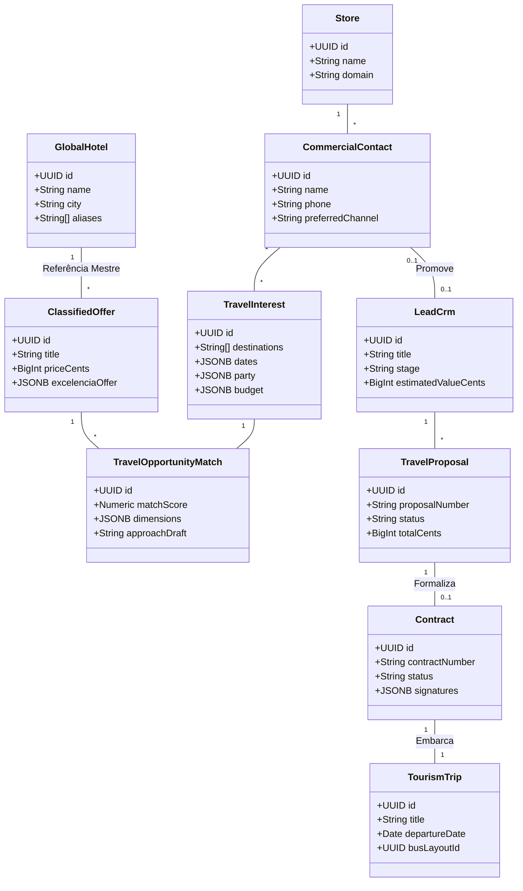

# DOMAIN_ONTOLOGY.md — Ontologia Canônica do Domínio de Turismo
## Taxonomia, Responsabilidades, Ciclo de Vida e Fonte da Verdade (SSOT)
**Data:** 2026-10-21  
**Módulo:** Turismo, Viagens & Lazer / Waesy  
**Status:** Auditado com Evidências do Código e Banco de Dados  

---

### 1. Dicionário Ontológico de Entidades Centrais

---

### 2. Matriz de Entidades: Responsabilidade, Ciclo de Vida e SSOT

| Conceito Conceitual | Nome Real no Sistema | Responsabilidade | Ciclo de Vida | Fonte da Verdade (SSOT) | Escopo |
| :--- | :--- | :--- | :--- | :--- | :--- |
| **Agência / Loja** | `stores` | Tenant proprietário de todas as operações, limites de equipe e marca. | Ativo, Suspenso, Inativo | `public.stores` | Tenant Root |
| **Contato Pré-CRM** | `travel_commercial_contacts` | Identidade leve para retenção de intenções anuais sem poluir funil de vendas. | `active` → `nurturing` → `promoted_to_crm` | `public.travel_commercial_contacts` | Tenant |
| **Intenção de Viagem** | `travel_interests` | Memória de destinos, datas flexíveis, orçamento e acompanhantes desejados. | `open` → `matched` → `converted` / `dormant` | `public.travel_interests` | Tenant |
| **Match de Oportunidade** | `travel_opportunity_matches` | Relação de alta compatibilidade entre uma oferta e uma intenção de viajante. | `new` → `reviewed` → `approached` → `promoted_to_crm` | `public.travel_opportunity_matches` | Tenant |
| **Lead de Negociação** | `leads_crm` | Oportunidade quente no funil com acompanhamento de proposta e fechamento. | `new` → `contacted` → `qualified` → `proposal` → `won` | `public.leads_crm` | Tenant |
| **Cotação de Entrada** | `travel_quotes` | Solicitação pontual submetida pelo cliente no formulário da vitrine pública. | `new` → `analyzing` → `quoted` → `won` / `lost` | `public.travel_quotes` | Tenant |
| **Proposta Comercial** | `travel_proposals` | Lâmina orçamentária personalizada gerada para um cliente específico. | `draft` → `sent` → `approved` → `rejected` | `public.travel_proposals` | Tenant |
| **Pacote / Oferta Vitrine** | `classifieds` (`category = 'travel'`) | Anúncio comercial público com fotos, hotel, trechos aéreos e parcelamento. | `draft` → `active` → `expired` → `archived` | `public.classifieds.attributes.excelencia_offer` | Tenant / Público |
| **Hotel Mestre (Master)** | `global_hotels` | Cadastro canônico de hotéis e resorts com aliases de OCR e coordenadas. | Ativo, Verificado | `public.global_hotels` | **Global** |
| **Destino Mestre** | `destinations` | Catálogo de cidades, países, regiões turísticas e aeroportos de apoio. | Ativo | `public.destinations` | **Global** |
| **Operação de Viagem** | `tourism_trips` | Viagem com data de saída marcada, manifesto de passageiros e alocação de ônibus. | `scheduled` → `boarding` → `in_transit` → `completed` | `public.tourism_trips` | Tenant |
| **Contrato Digital** | `contracts` | Instrumento jurídico formal amarrando valores, cancelamento e assinaturas digitais. | `draft` → `sent` → `signed` → `completed` | `public.contracts` | Tenant |
| **Artefato Visual Story** | `StoryDocument` (JSON) | Scene graph vetorial 9:16 com camadas, fotos, textos e superfícies Liquid Glass. | Efêmero / Persistido em `classifieds.attributes.story_document` | Snapshot Visual | Por Oferta |

---

### 3. Desambiguação de Conceitos Misturados (Anti-Confusão)

1. **`PACKAGE` ≠ `OFFER` ≠ `PROPOSAL` ≠ `STORY`:**
   - **`PACKAGE` (Pacote):** A especificação abstrata da experiência (Destino + 7 Noites + Voo + Hotel All Inclusive + Transfer).
   - **`OFFER` (Oferta):** Uma condição comercial pontual com preço, data de validade de bloqueio e condições de parcelamento (ex.: "R$ 4.890 em 10x sem juros válido até hoje às 23:59").
   - **`PROPOSAL` (Proposta):** A apresentação formal para um passageiro específico, contendo seus dados, opções comparativas e botão de aceite.
   - **`STORY` (Story 9:16):** A projeção gráfica orientada a impacto visual para redes sociais (Instagram/WhatsApp). O Story **não define preço**; ele consome o snapshot da oferta e aplica overrides tipográficos para caber no canvas.

2. **`HOTEL MASTER` ≠ `HOTEL SELECIONADO NA OFERTA`:**
   - O `Hotel Master` (`global_hotels`) é a entidade imutável no catálogo central contendo nome canônico, estrelas, endereço e histórico de aliases de operadoras.
   - O `Hotel Selecionado` na oferta (`TravelOfferHotel`) é um snapshot de contratação com regime alimentar específico (ex.: All-Inclusive), tipo de acomodação (ex.: Standard Vista Mar) e noites de estadia.
   - **Regra de Isolamento:** Atualizar o nome do hotel no catálogo global **nunca** altera retroativamente uma proposta aprovada ou um contrato assinado há 3 meses.

3. **`COMMERCIAL CONTACT` ≠ `CRM LEAD` ≠ `CUSTOMER`:**
   - `CommercialContact`: Identidade leve pré-CRM guardada na memória de intenções. Não entra no funil diário de vendas.
   - `Lead`: Registro formal de negociação ativa no funil (`leads_crm`).
   - `Customer`: Cadastro civil/fiscal completo com CPF, endereço e compras concluídas (`customers`).

---

### 4. Auditoria de Coerência Conceitual

| Conceito | Representação no Frontend | Representação no Backend | Banco de Dados | Classificação | Ação Realizada / Recomendada |
| :--- | :--- | :--- | :--- | :--- | :--- |
| **Preço em Centavos** | `price_cents` / `priceCents` | `number` (inteiro) | `BIGINT` | **CORRETO** | Padronizado em todo o motor sem dízimas de ponto flutuante. |
| **Trechos de Voo** | `FlightSegmentDTO` | `airfare.segments` | `JSONB` | **CORRETO** | Preserva origens, conexões e números de voo sem perda de dados. |
| **Memória Comercial** | `TravelInterest` | `travel-commercial-intelligence.ts` | `travel_interests` | **CORRETO** | Unificado via DEC-300 com RLS estrito. |
| **Histórico de Aliases** | `hotel_aliases` | `resolveHotelCatalogMatch` | `global_hotels.aliases` | **CORRETO** | Normalização NFD sem acentos e busca trigram. |
| **Story Scene Graph** | `StoryDocument` | `selectStoryInclusions` | `classifieds.attributes.story_document` | **CORRETO** | Snapshot visual persistido imutável. |
