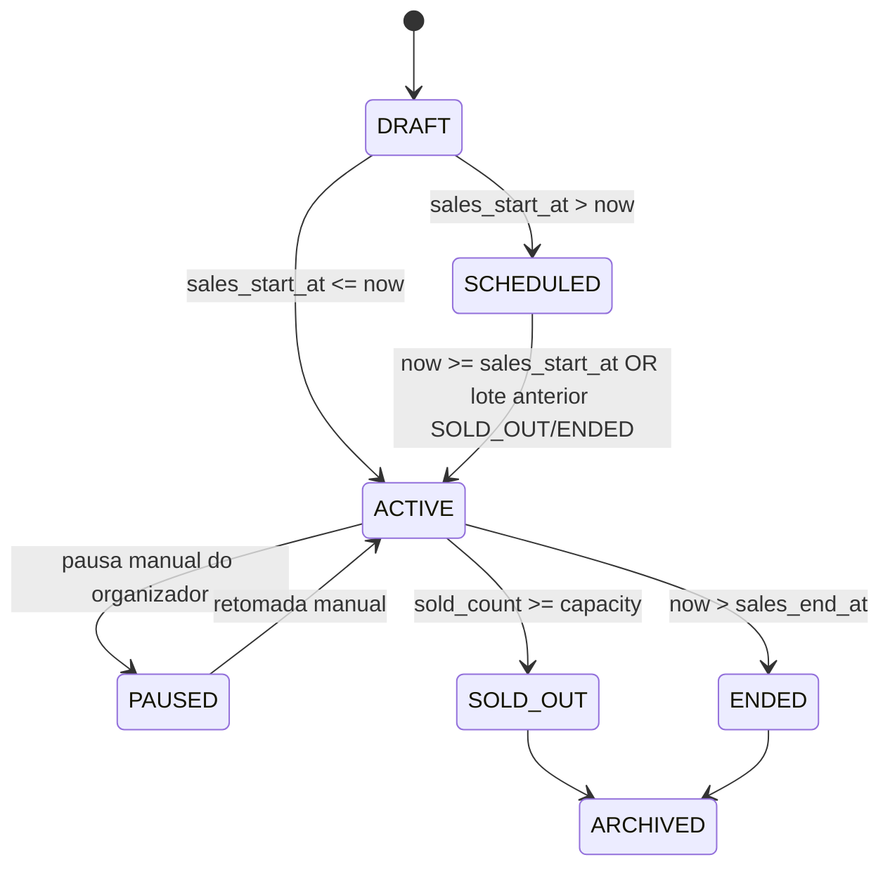

# EVENT_LOT_AUTOMATION_DESIGN — Máquina de Estados e Virada Automática de Lotes

## 1. Estados Canônicos do Lote (`EventTicketLotLifecycleState`)

## 2. Regras Determinísticas de Transição (`resolveEffectiveTicketLotState`)

| Condição Avaliada | Estado Resultante | Badge Exibido na UI | Comprável (`isPurchasable`) |
| :--- | :--- | :--- | :--- |
| `capacity > 0 && sold_count >= capacity` | `SOLD_OUT` | `"Esgotado"` | `false` |
| `now > sales_end_at` | `ENDED` | `"Vendas Encerradas"` | `false` |
| `status === "paused"` | `PAUSED` | `"Vendas Pausadas"` | `false` |
| `now < sales_start_at` (ou `coming_soon`) **sem** esgotamento do lote anterior | `SCHEDULED` | `"Abre em DD/MM"` ou `"Em Breve"` | `false` |
| `now < sales_start_at` (ou `coming_soon`) **com** lote anterior da mesma categoria em `SOLD_OUT` ou `ENDED` (`auto_advance_next_lot !== false`) | `ACTIVE` | `"Lote Ativo (Virada Automática)"` | `true` |
| Dentro da janela ativa e com saldo (`remaining_count > 0`) | `ACTIVE` | `"Disponível"` | `true` |

## 3. Persistência da Virada no Backend
- No Workspace (`src/services/events.functions.ts`): `checkAndRolloverEventLots(eventId, lotId)` atualiza o lote esgotado para `sold_out` e promove o próximo lote para `active` no banco.
- No Classificados (`src/services/classifieds-events.functions.ts`): `checkoutClassifiedEventTicket` incrementa `sold_count` no lote correspondente dentro de `classifieds.attributes.ticket_tiers` e marca `status = "sold_out"` ao atingir a capacidade, acionando a promoção imediata do próximo lote via `normalizeEventDomain`.
