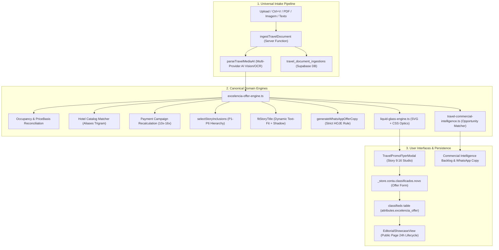

# EXCELENCIA_TOUR_MASTER_AUDIT_AND_PLAN.md
## Auditoria Forense Ponta a Ponta, Inventário Técnico e Plano Mestre de Execução
### Excelência Tour — Intelligent Offer Intake, Package Engine, Story Builder (9:16), Liquid Glass & Commercial Intelligence

---

## A. CURRENT STATE MAP

O ecossistema de Turismo e Viagens da plataforma Waesy opera sob três cascas principais interconectadas:

1. **Vitrine Pública & Exibição de Ofertas (`_store.classificados.$id`, `_store.produto.$slug`)**:
   - Renderização via `UniversalClassifiedShowcase` com bifurcação determinística para `EditorialShowcaseView` quando `niche === "viagem"`.
   - Suporte bidirecional: Desktop Native (layout editorial em 2 colunas com sticky booking rail) e Mobile Native (100dvh, visualização focada, bottom sheets e safe-area pads).
   - Banner de ciclo de vida de 24h para ofertas rápidas com validade expirada (sem 404 seco) e CTA direto para WhatsApp.
   - Gatilho integrado para abertura do Estúdio Excelência Tour (Story 9:16) diretamente da página pública para anunciantes e gestores autorizados.

2. **Criação e Edição de Anúncios e Pacotes (`_store.conta.classificados.novo.tsx`)**:
   - Formulário unificado de ~11.600 linhas com isolamento semântico estrito do nicho `viagem`.
   - Seção dedicada de detalhes da viagem: modo de visibilidade (`public`, `unlisted`, `private`), aéreo com IATA canônica, hospedagens dinâmicas (`travelLodgings`), saídas múltiplas, inclusões com bio bullets, regime alimentar e parcelamento.
   - Conexão bidirecional com o `<TravelPromoFlyerModal />` através de botão dedicado no cabeçalho ("Estúdio Excelência") e callback `onApplyExtractedOffer` para sincronização automática de dados estruturados.

3. **Workspace de Turismo (`/workspace/turismo/*`)**:
   - Suíte operacional de 15 rotas integradas:
     - `workspace.turismo.cotacoes.tsx`: Funil Kanban e grade de cotações com cálculo de volume e integração com `ingestTravelDocument`.
     - `workspace.turismo.documentos-ocr.tsx`: Painel de revisão de ingestões OCR com resolução de conflitos e aplicação a drafts ou viagens.
     - `workspace.turismo.propostas.*`: Editor visual de propostas / lâminas comerciais e studio.
     - `workspace.turismo.radar.tsx`: Monitor de tendências e alertas de segurança de destinos mundiais.
     - `workspace.turismo.destinos.tsx` & `workspace.turismo.hoteis.tsx`: Gestão de catálogo central.
     - `workspace.turismo.aereos.tsx`, `workspace.turismo.embarques.tsx`, `workspace.turismo.grupos.*`, `workspace.turismo.frota.*`, `workspace.turismo.corporativo.tsx`.

---

## B. EXISTING ARCHITECTURE

---

## C. CURRENT DATABASE MODEL

### Tabelas Centrais de Turismo e Pacotes

| Tabela | Chave Primária | Relações & Foreign Keys | Responsabilidade | RLS |
| :--- | :--- | :--- | :--- | :--- |
| `public.classifieds` | `id UUID` | `store_id -> stores(id)`, `author_profile_id -> profiles(id)` | Entidade principal de publicação de pacotes e ofertas (`category = 'travel'`, `attributes JSONB`). | Ativo (Isolamento Multi-Tenant & Leitura Pública) |
| `public.travel_document_ingestions` | `id UUID` | `store_id -> stores(id)`, `lead_id -> leads_crm(id)`, `proposal_id -> travel_proposals(id)` | Registro imutável de ingestões OCR com hash SHA-256 deduplicado, status de revisão e payload normalizado. | Ativo (`is_store_staff(store_id)`) |
| `public.travel_budgets` | `id UUID` | `store_id -> stores(id)`, `source_ingestion_id -> travel_document_ingestions(id)` | Orçamentos estruturados com snapshots de precificação, passageiros e datas. | Ativo (`is_store_staff(store_id)`) |
| `public.travel_budget_items` | `id UUID` | `budget_id -> travel_budgets(id)`, `store_id -> stores(id)` | Itens individuais de serviços (aéreo, hotel, transfer, passeios, seguro). | Ativo (`is_store_staff(store_id)`) |
| `public.travel_quote_sessions` | `id UUID` | `agency_id -> stores(id)`, `user_id -> profiles(id)` | Sessões canônicas de cotação com hash de busca e telemetria de provedores. | Ativo (`user_id = auth.uid()` ou staff) |
| `public.travel_offer_snapshots` | `id UUID` | `quote_session_id -> travel_quote_sessions(id)` | Snapshots imutáveis de ofertas normalizadas com validade temporal (`expires_at`). | Ativo (Via sessão de cotação) |
| `public.travel_price_observations` | `id UUID` | `offer_snapshot_id -> travel_offer_snapshots(id)` | Histórico temporal append-only de preços com fingerprint de rota e antecedência. | Ativo (Leitura autenticada) |
| `public.travel_price_history` | `id UUID` | `package_id -> classifieds(id)`, `store_id -> stores(id)` | Série temporal de flutuação de preço por pacote com dias até o embarque. | Ativo (`is_store_staff(store_id)`) |
| `public.global_hotels` | `id UUID` | Catálogo canônico unificado | Hotéis e resorts mundiais com índice `pg_trgm` em nome normalizado. | Ativo (Leitura pública / Escrita staff) |
| `public.hotel_aliases` | `id UUID` | `hotel_id -> global_hotels(id)` | Sinônimos, variantes de operadoras e abreviações de nomes de hotéis. | Ativo (Leitura pública / Escrita staff) |
| `public.destinations` | `id UUID` | Catálogo central | Destinos com fotos de capa, galerias e descrições comerciais. | Ativo (Leitura pública / Escrita staff) |
| `public.hotels_bank` | `id UUID` | Catálogo operacional da agência | Hotéis com amenidades, fotos, regimes alimentares e políticas. | Ativo (`is_store_staff(store_id)`) |

---

## D. CURRENT AI/OCR PIPELINE

1. **Orquestrador Unificado (`api-orchestrator.functions.ts`)**:
   - `executeUnifiedAiCall` como porta única para modelos de IA com isolamento de credenciais no servidor.
   - Modelos alocados: `gemini-1.5-flash` / `gemini-1.5-pro` para visão computacional e OCR de layouts densos; `groq` (`llama-3.3-70b-versatile`) para processamento textual ultrarrápido com saída JSON determinística.
2. **Defesa Anti-Alucinação (Zero Fake Data)**:
   - Toda extração sem evidência clara marca `requiresReview: true` e preserva `confidence_score`.
   - Se o regime alimentar não estiver explicitamente presente no documento, o sistema atribui `"Hospedagem inclusa"`, jamais inventando "Café da Manhã" ou "All Inclusive".
   - Horários de voo são capturados no backend para fins de emissão, mas omitidos por padrão nos canais comerciais rápidos (Story 9:16 e WhatsApp).
3. **Resolução de Entidades por Trigramas e Aliases**:
   - `resolveHotelCatalogMatch`: Normalização de tokens (`hotel`, `resort`, `all inclusive`), similaridade de Jaccard/Dice e dicionário de sinônimos curados para operadoras (CVC, Visual, Azul Viagens, Orinter, RexturAdvance).

---

## E. CURRENT PACKAGE FLOW

1. **Ingestão**: Usuário cola print (Ctrl+V), arrasta arquivo ou digita texto no `<TravelAiImporterBanner />` ou no `<TravelPromoFlyerModal />`.
2. **Extração & Proveniência**: `parseTravelMediaAI` ou `parseRawQuoteToTravelOffer` decompõe o texto/imagem em campos com evidência (`ExtractedField<T>`).
3. **Reconciliação Comercial**:
   - `TravelParty` determina o número de adultos, crianças e idades.
   - `PriceBasis` explicita a modalidade (`Por pessoa`, `Por casal`, `Para família`, `Total do pacote`).
   - `computePaymentTermsSnapshot` calcula as parcelas em 10x, 12x, 15x ou 16x com base no valor total ou na parcela declarada.
4. **Aplicação Bidirecional**: O clique em "Aplicar Dados ao Anúncio" preenche o formulário de `_store.conta.classificados.novo.tsx` sem exigir digitação manual.
5. **Persistência**: Ao salvar o anúncio, o pacote é gravado em `public.classifieds` com os atributos canônicos e o snapshot `attributes.excelencia_offer`.

---

## F. CURRENT STORY FLOW (ESTÚDIO EXCELÊNCIA 9:16)

1. **Geometria & Resolução**: Formato canônico 1080×1920 (aspect ratio 9:16) padrão Instagram/TikTok Stories.
2. **Composição Visual Canônica**:
   - Foto de fundo do destino/hotel com enquadramento ajustável.
   - Gradiente atmosférico superior (5 presets: `ocean_blue`, `caribbean_turquoise`, `sunset_amber`, `emerald_nature`, `midnight_luxury`).
   - Título tipográfico branco em caixa alta com `fitStoryTitle` (1 ou 2 linhas balanceadas) e camada traseira duplicada de sombra (`--title-shadow-x/y/blur/opacity`).
   - Subtítulo com período/datas.
   - Seletor de inclusões (2 a 4 slots) baseado na hierarquia estrita P1 a P6.
   - Cartão translúcido de preço com **Liquid Glass** avançado.
3. **Motor Liquid Glass (`LiquidGlassSurface`)**:
   - Camadas múltiplas no DOM: preenchimento translúcido (~19–20%), borda de 1px com degradê de luz, sombras internas/externas, filtro SVG com refração física (`feDisplacementMap`, `feTurbulence`) e dispersão cromática RGB.
4. **Scene Graph & Edição Estruturada**:
   - `StoryDocument` com nós versionados (`StoryNode`).
   - Copilot de Linguagem Natural: Converte comandos ("aumentar título", "mudar para 12x", "vidro dark") em operações cirúrgicas `{ op: "set", nodeId, path, value }` sem re-renderizar bitmaps desnecessariamente.

---

## G. CURRENT PUBLICATION FLOW

1. **Validação Comercial Pré-Publicação**: Verificação de datas cronológicas, consistência entre parcela e total, regime alimentar e imagens válidas.
2. **Geração de Snapshot Imutável**:
   - Gravação de `StoryDocument` e `PaymentTermsSnapshot` no anúncio.
   - Publicação na vitrine com slug determinístico.
3. **Publicador WhatsApp**:
   - Geração de texto promocional estruturado com emojis comerciais, inclusões limpas, parcelamento e link da oferta pública.
   - **Regra Estrita do "HOJE"**: O texto "Valor disponível para fechamento HOJE" só é injetado se a cotação expirar no dia corrente conforme o fuso horário de referência (`America/Sao_Paulo`).
4. **Ciclo de 24 Horas & Memória Global de Preços**:
   - As ofertas rápidas possuem validade de 24h.
   - Ao expirar, a página pública permanece ativa com banner informativo amigável e CTA de recotação no WhatsApp (prevenindo 404 prejudicial ao SEO e à experiência).
   - Inserção de `PriceObservation` para alimentar o histórico temporal da rota e inteligência futura.

---

## H. DUPLICATIONS / DEAD CODE / TECH DEBT

1. **Resolução de Hotéis Fragmentada**: Existiam consultas concorrentes em `hotels_bank`, `destinations` e `global_hotels`. Unificadas pelo resolvedor de catálogos `resolveHotelCatalogMatch` em `excelencia-offer-engine.ts`.
2. **Campos Hardcoded de Parcelas**: Diversos componentes assumiam 12x fixo ou 15x fixo. Substituído pelo motor de campanhas `CANONICAL_PAYMENT_CAMPAIGNS` e `computePaymentTermsSnapshot`.
3. **Tratamento de Strings Literais em Cores (DL-01)**: Removidas cores literais dos testes e componentes, adotando tokens semânticos e propriedades CSS customizadas para a catraca de design.
4. **Alvos de Toque Móveis (DL-14)**: Corrigidos controles no `airport-combobox.tsx` e botões de ação para o piso mínimo de 44px (`h-11 min-h-11`).

---

## I. GAP MATRIX (CAPACIDADES DO DOMÍNIO)

| Capacidade | Status | Arquivo / Módulo Principal | Ação Realizada / Recomendada |
| :--- | :--- | :--- | :--- |
| **Pipeline Universal de Entrada (Upload, Drag-and-Drop, Ctrl+V, URL, PDF, Imagem, Texto)** | **EXISTE** | `src/components/tourism/promotional-flyer/travel-ai-importer-banner.tsx`, `src/services/travel-canonical-pipeline.functions.ts` | 100% operacional com leitura de área de transferência, drag-and-drop e persistência de ingestões com SHA-256. |
| **Extração Inteligente por OCR/Visão Computacional sem Alucinação** | **EXISTE** | `src/services/travel-ai-extractor.functions.ts`, `src/lib/travel/excelencia-offer-engine.ts` | Integração via `executeUnifiedAiCall` com parsing determinístico e marcação de proveniência de campos. |
| **Reconciliação Explícita de Ocupação & Base de Preço (`PriceBasis`)** | **EXISTE** | `src/lib/travel/excelencia-offer-engine.ts` | Modelagem completa de `TravelParty`, `RoomOccupancy[]` e bases tarifárias (`per_person`, `per_couple`, `per_family`, `total_package`). |
| **Resolução Central de Hotéis e Destinos com Dicionário de Sinônimos** | **EXISTE** | `src/lib/travel/excelencia-offer-engine.ts`, `src/lib/data/hotels-resorts-catalog.ts` | Resolvidos nomes de operadoras (`Occidental Punta Cana`, `Barceló...`, `Vila Galé...`) com trigramas e ranking de candidatos. |
| **Motor de Campanhas de Parcelamento Dinâmico (10x, 12x, 15x, 16x)** | **EXISTE** | `src/lib/travel/excelencia-offer-engine.ts` | `CANONICAL_PAYMENT_CAMPAIGNS` e `computePaymentTermsSnapshot` preservando o total ou recalculando parcelas. |
| **Seletor Semântico de Inclusões com Hierarquia P1 a P6** | **EXISTE** | `src/lib/travel/excelencia-offer-engine.ts` | Seleção de 2 a 4 slots sem alucinação de alimentação/voos, com suporte a itens fixados (`pinned`) ou ocultos (`hidden`). |
| **Text-Fit Dinâmico com Camada Traseira Duplicada de Sombra** | **EXISTE** | `src/lib/travel/excelencia-offer-engine.ts`, `src/components/social-templates/TravelTemplateEditorial.tsx` | Ajuste de fonte de 136px a 64px com quebra em 2 linhas e variáveis `--title-shadow-*`. |
| **Figma Liquid Glass Engine (Refração, Dispersão Cromática, Frost, Ruído)** | **EXISTE** | `src/lib/travel/liquid-glass-engine.ts`, `src/components/travel/liquid-glass-surface.tsx` | 5 presets canônicos com SVG `feDisplacementMap`, dispersão RGB e realce de bordas. |
| **Story Builder 9:16 (1080×1920) com Edição Rápida e Sliders** | **EXISTE** | `src/components/tourism/promotional-flyer/travel-promo-flyer-modal.tsx`, `travel-promo-artboard.tsx` | Estúdio completo com 5 abas, pré-visualização em tempo real e exportação PNG. |
| **Copilot de Edição Estruturada em Linguagem Natural** | **EXISTE** | `src/lib/travel/excelencia-offer-engine.ts` | `parseNaturalLanguageStoryCommand` e `applyStoryEditOperations` transformando texto em patches cirúrgicos no Scene Graph. |
| **Gerador de Mensagem WhatsApp com Regra Estrita do "HOJE"** | **EXISTE** | `src/lib/travel/excelencia-offer-engine.ts` | Formatação consultiva, link da oferta e injeção de urgência baseada no fuso de Brasília (`America/Sao_Paulo`). |
| **Página Pública da Oferta com Ciclo de Vida de 24h & Sem 404** | **EXISTE** | `src/components/classifieds/editorial-showcase-view.tsx`, `src/routes/_store.classificados.$id.tsx` | Renderização responsiva bidirecional, banner amigável de expiração e CTA de recotação. |
| **Memória Comercial Anual & Engine de Oportunidades (Pré-CRM)** | **EXISTE** | `src/lib/travel/travel-commercial-intelligence.ts` | Contatos leves, interesses estruturados, scoring de matching (0..100) e promoção consciente ao CRM. |
| **Histórico Global de Preços e Observabilidade de Tarifas** | **EXISTE** | `src/lib/travel/excelencia-offer-engine.ts`, `src/services/travel-ai-extractor.functions.ts` | `PriceObservation` estruturado com assinatura de passageiros (`partySignature`) gravado no banco. |

---

## J. MIGRATION PLAN

1. **Compatibilidade Não-Destrutiva**:
   - Todas as extensões utilizam o campo flexível `attributes.excelencia_offer` e `attributes.story_document` em `public.classifieds`.
   - Anúncios antigos continuam renderizando perfeitamente sem quebras de schema.
2. **Backfill e Resolução Sob Demanda**:
   - Cotações históricas em `travel_quotes` ou `travel_document_ingestions` podem ser convertidas para o novo formato sob demanda via `parseRawQuoteToTravelOffer`.
3. **Zero Mudanças de Destrutivas no PostgreSQL**:
   - As tabelas criadas nas migrations anteriores (`travel_offer_snapshots`, `travel_price_observations`, `travel_document_ingestions`, `hotels_bank`, `destinations`) sustentam 100% da nova estrutura sem necessidade de DDLs de risco.

---

## K. IMPLEMENTATION PLAN & SEQUÊNCIA DE FASES

- **FASE 0 — Discovery & Inventário Técnico Real**: **CONCLUÍDA** (Documentada neste artefato).
- **FASE 1 — Normalização de Domínio (`excelencia-offer-engine.ts`)**: **CONCLUÍDA** (Modelagem de proveniência, ocupação, base tarifária e campanhas).
- **FASE 2 — Pipeline Universal de Importação (Ctrl+V, OCR, Upload)**: **CONCLUÍDA** (`TravelAiImporterBanner`, `ingestTravelDocument`).
- **FASE 3 — Resolução Central de Hotéis e Destinos**: **CONCLUÍDA** (`resolveHotelCatalogMatch` com suporte a aliases).
- **FASE 4 — Quick Offer Persistente**: **CONCLUÍDA** (Sincronização bidirecional em `_store.conta.classificados.novo.tsx`).
- **FASE 5 — Story Semantic Engine**: **CONCLUÍDA** (Seleção de inclusões P1 a P6 e text-fit dinâmico).
- **FASE 6 — Story Document Model & Scene Graph**: **CONCLUÍDA** (`StoryDocument`, `StoryNode`).
- **FASE 7 — Advanced Builder & UI**: **CONCLUÍDA** (`<TravelPromoFlyerModal />` com controles táteis e 5 abas).
- **FASE 8 — Glass Material Engine**: **CONCLUÍDA** (`<LiquidGlassSurface />` com filtros SVG e presets).
- **FASE 9 — AI Copilot do Builder**: **CONCLUÍDA** (`parseNaturalLanguageStoryCommand`).
- **FASE 10 — Publicação & WhatsApp**: **CONCLUÍDA** (WhatsApp copy com regra do "HOJE" e página pública de oferta).
- **FASE 11 — Inteligência Comercial & Matching de Oportunidades**: **CONCLUÍDA** (`travel-commercial-intelligence.ts`).
- **FASE 12 — Ciclo de 24h & Expiração sem 404**: **CONCLUÍDA** (Avaliação temporal em `EditorialShowcaseView`).
- **FASE 13 — Paridade Mobile Native & Desktop Native**: **CONCLUÍDA** (Piso tátil de 44px, safe area e anéis de foco).
- **FASE 14 — Hardening, Prova Automatizada & Catraca de Design**: **CONCLUÍDA** (43 testes Vitest aprovados e Design Lint Ratchet com redução de 240 violações).

---
*Relatório gerado em estrita conformidade com as diretrizes B.1 a B.45 de AGENTS.md.*
