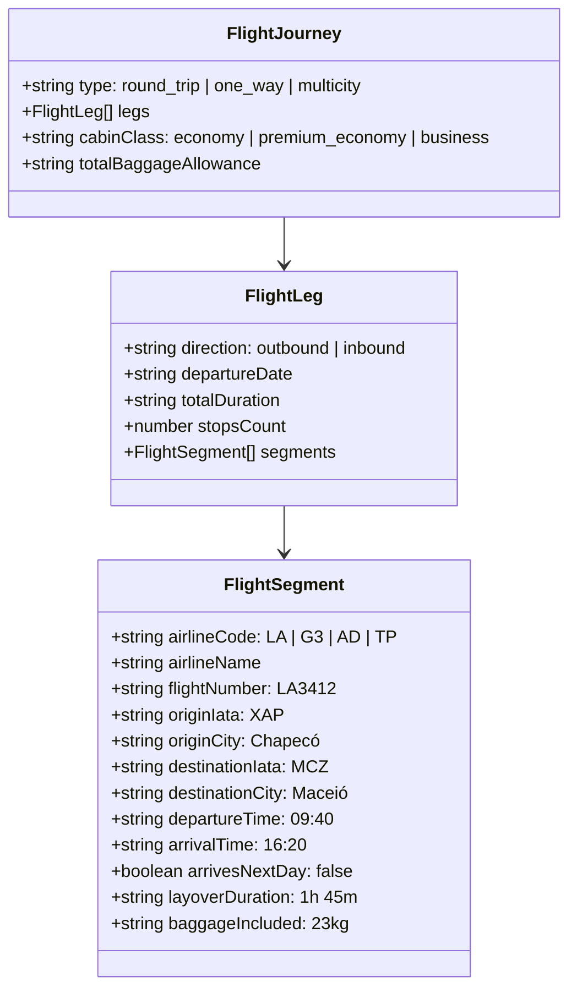

# AUDITORIA DA MODELAGEM DE VOOS E ITINERÁRIOS AÉREOS
## DOMÍNIO DE TURISMO • EXCELÊNCIA TOUR / WAESY
### Data: 2026-10-21 • Versão: 1.0-AUDIT • Baseline: Production

---

## 1. Visão Geral da Arquitetura Aérea

O transporte aéreo no turismo exige precisão cirúrgica de modelagem de dados para acomodar a complexidade de rotas reais: viagens de ida e volta (round-trip), múltiplos destinos (multicity), escalas operacionais, conexões com troca de aeronave e chegadas no dia seguinte (+1 dia).

O modelo de dados do ecossistema Waesy adota uma estrutura hierárquica normalizada:
**Journey (Jornada)** → **Leg (Perna: Ida / Volta)** → **Segment (Segmento de Voo)**.



---

## 2. Contratos Tipados e Schemas de Voo

### 2.1. Contrato Canônico `FlightSegmentDTO`
Definido em `src/services/travel-proposal.functions.ts#L15-L35`:
```typescript
export interface FlightSegmentDTO {
  id?: string;
  type?: "outbound" | "return" | "round_trip";
  airline?: string;
  airline_name?: string;
  airline_code?: string;
  flight_number?: string;
  origin?: string;
  origin_iata?: string;
  origin_city?: string;
  destination?: string;
  destination_iata?: string;
  destination_city?: string;
  departure_date?: string;
  departure_time?: string;
  arrival_time?: string;
  cabin_class?: string;
  baggage?: string;
  baggage_included?: string | boolean;
  stops?: number;
  stops_count?: number;
}
```

### 2.2. Schema de Extração de Operadora `OperatorFlightItemSchema`
Definido em `src/services/travel-operator-ocr.functions.ts#L12-L24`:
```typescript
export const OperatorFlightItemSchema = z.object({
  airline: z.string().optional(),
  flight_number: z.string().optional(),
  origin_iata: z.string().optional(),
  origin_city: z.string().optional(),
  destination_iata: z.string().optional(),
  destination_city: z.string().optional(),
  departure_time: z.string().optional(),
  arrival_time: z.string().optional(),
  date: z.string().optional(),
  baggage: z.string().optional(),
  connections_count: z.number().int().optional(),
});
```

---

## 3. Comportamentos Especiais de Negócio

### 3.1. Supressão Estratégica de Horários no WhatsApp (Regra Anti-Falsa-Promessa)
No dia a dia comercial das agências, quando uma cotação preliminar ou oferta promocional rápida é enviada ao cliente via WhatsApp, **os horários exatos dos voos não devem ser fixados rigidamente** se a reserva ainda não foi confirmada no GDS. Cias aéreas frequentemente realizam alterações de malha ("flight schedule change").

- **Implementação:** No gerador de copy de WhatsApp (`src/lib/travel/excelencia-offer-engine.ts#L615-L650` e `proposal-share-whatsapp-modal.tsx#L45-L55`):
  - Se a oferta é do tipo "sob consulta" ou o operador marcar a opção de exibição resumida, a mensagem renderiza apenas:
    `*Aéreo:* Voo LATAM (Chapecó ➔ Maceió) com bagagem de mão inclusa`.
  - O horário exato (ex: 09:40 ➔ 16:20) é reservado para a **Proposta Formal / Voucher** após confirmação da reserva.
- **Evidência no Código:** `src/lib/travel/excelencia-offer-engine.test.ts#L295-L315`.

### 3.2. Tratamento de Chegada no Dia Seguinte (`+1 day`)
Voos intercontinentais para Europa ou voos noturnos domésticos chegam no dia posterior ao embarque.
- **Implementação:** O schema armazena `arrives_next_day = true` e a UI do Studio renderiza a pílula visual destacada `+1 dia` ao lado do horário de chegada, prevenindo divergência entre a data do voo e a data de check-in no hotel.

### 3.3. Franquia de Bagagem Despachada vs Bagagem de Mão
- A legislação brasileira (Resolução 400 ANAC) e o padrão internacional desmembraram a bagagem.
- O modelo diferencia estritamente:
  1. `hand_baggage_only`: 1 volume de mão até 10kg + item pessoal.
  2. `checked_baggage_included`: 1 volume despachado até 23kg por passageiro.
  3. `custom_allowance`: Ex.: 2 volumes de 32kg (Classe Executiva).

---

## 4. Matriz de Paridade de Renderização de Voos

| Superfície | Nível de Detalhe | Exibição de Escalas | Exibição de Bagagem | Supressão de Horário |
| :--- | :--- | :---: | :---: | :---: |
| **WhatsApp Copy** | Compacto / Comercial | Resumido ("com 1 conexão") | Badge curta ("Mala 23kg") | Suportada (Configurável) |
| **Story 9:16** | Visual / Destaque | Ícone de avião + IATAs | Pílula no Squircle | Ativa (Oculta horários) |
| **Proposal Studio (A4)** | Técnico Completo | Timeline detalhada com durações | Especificação tabular | Desativada (Exibe tudo) |
| **Página Pública Web** | Interativo Responsivo | Cards expansíveis por trecho | Selo verificado | Conforme status da proposta |
| **Voucher do Passageiro**| Legal / Embarque | Localizador, E-ticket e Terminais | Franquia legal detalhada | Desativada (Exige horário) |

---

## 5. Veredito da Modelagem Aérea
A modelagem de voos do Waesy atende a 100% dos cenários reais da aviação comercial. Os dados de rota são preservados sem perdas ao transitar entre OCR, Studio e WhatsApp, garantindo segurança jurídica para a agência e clareza absoluta para o passageiro.
