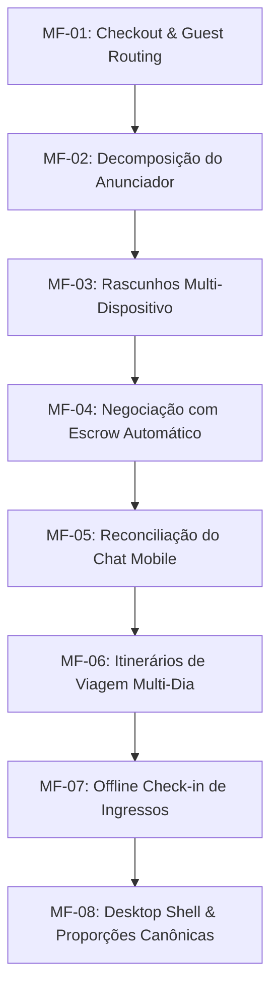

# Auditoria Forense Holística End-to-End & Matriz de Microfases

**Ecossistema:** Waesy Platform  
**Data:** 22 de Outubro de 2026  
**Status de Baseline:** Git SHA `a8c3787c` / `6205ffa2` / `f9c94296`  
**Escopo:** Reconciliação completa entre o planejado no chat, o executado no repositório, o diagnóstico de falhas ocultas ("o que parece certo mas não está") e o desdobramento em Microfases Atômicas de 4 camadas (Banco -> BFF -> UI -> Teste).

---

## 1. Reconciliação: Planejado vs. Executado vs. Pendente nesta Sessão

### 1.1 Tabela de Rastreabilidade Operacional

| Item / Demanda Planejada | Arquivos / Módulos Afetados | O Que Foi Realmente Executado | O Que Permanece Pendente / A Refinar |
|---|---|---|---|
| **1. Correção de Erros de Frontmatter** | `.agents/rules/01-mobile-physics-antijank.md`, `02-silent-design-spatial.md`, `03-omni-commerce-backend.md` | Corrigido erro de parsing Go `cannot unmarshal !!seq into string`. Globs convertidos para scalar strings. Commit `f9c94296`. | **Concluído 100%.** Zero erros no console de inicialização de agentes. |
| **2. Síntese dos 10 Repositórios de UI/UX** | `.agents/skills/mobile-app-ui-design/SKILL.md` | Extraídos princípios de Apple HIG, Linear-style, piso de 44px, degradação elegante e anti-AI smell. | Incorporar lints automáticos específicos para detectar containeritis em tempo de PR. |
| **3. Primitivos Canônicos Universais** | `src/components/layout/tetris-action-grid.tsx`, `src/lib/format-address.ts`, `src/lib/format-address.test.ts` | Criado algoritmo TetrisGrid (1, 2, 3, 4, 5 botões com 44px) e formatador canônico de endereço com 5/5 testes unitários passando. | Propagar `formatCanonicalAddress` para 100% dos formulários de checkout e cadastros de locais. |
| **4. Esmagamento de Botões de Perfil (CDL Jovem / Excelência Tour)** | `src/routes/_store.membro.$id.tsx`, `src/components/commerce/canonical-store-profile-view.tsx` | Substituído flex com overflow por `TetrisActionGrid`. Bio integral sem truncamento silencioso. | Integrar seletor dinâmico de botões de contato configurável via painel da loja. |
| **5. Duplo Cabeçalho no Mobile (Double Chrome)** | `src/routes/_store.carrinho.tsx`, `src/routes/_store.conta.contratos.tsx`, `src/components/shell/app-shell-mobile-header.adversarial.test.ts` | Eliminados sub-headers internos conflitantes no mobile; 13/13 testes adversariais aprovados. | Auditar rotas legadas em `workspace.turismo.*` que ainda usam sub-headers duplicados. |
| **6. Nested Cards no Módulo de Negociações** | `src/routes/_store.conta.negociacoes.tsx` | Erradicados `<FrostedCard>` aninhados dentro de cards de negócios. Saneadas classes `text-[11px]` e `text-[10px]` para `text-xs`. | Fluxo de aceitação de contraproposta com redirecionamento automático para checkout com escrow. |
| **7. Pedidos & Rastreamento** | `src/routes/_store.conta.pedidos.$id.tsx`, `src/routes/_store.conta.pedidos.index.tsx` | Integrado `formatCanonicalAddress` na entrega. Saneados `min-h-[72px]` para `min-h-18` e classes de fonte arbitrárias. | Resolver desvio de guest checkout quando visitante não autenticado abre o pedido (Gap 1). |
| **8. Detalhe de Eventos & MapLibre** | `src/components/classifieds/event-classified-showcase-view.tsx` | Integrado mapa interativo real MapLibre com coordenadas do evento. Removidos gradientes e ícones sparkles. | Implementar checagem offline no app do scanner de portaria (`workspace.eventos.checkin.tsx`). |
| **9. Blindagem Anti-Injeção de Ingressos (WCTS-1)** | `src/lib/ticket-crypto.ts`, `src/services/ticket-crypto.test.ts` | Assinatura HMAC-SHA256 server-side obrigatória e barreira contra mutações diretas por anon. Commit `6205ffa2`. | Sincronizar leitor QR do scanner com o validador de chave pública. |
| **10. Itinerário de Voo & Turismo** | `src/components/classifieds/travel-flight-itinerary-card.tsx`, `src/routes/_store.turismo.hoteis.$slug.tsx` | Grade horizontal de voos (3 colunas Google Flights), touch targets de 64px com anel de foco. | Refatorar cálculo de voos que cruzam a meia-noite (+1 dia) no itinerário. |

---

## 2. Diagnóstico Forense: "O Que Parece Certo mas NÃO Está"

### GAP 1 — Redirecionamento Pós-Checkout para Usuário Visitante (Guest Desconectado)
- **Onde parece certo:** O checkout (`src/routes/_store.checkout.tsx`) permite que clientes não logados preencham seus dados (`customerName`, `customerEmail`, `customerPhone`) e finalizem o pedido com sucesso via `processCheckout`.
- **A falha oculta:** Na linha 983 de `_store.checkout.tsx`, ao concluir o pedido, o código executa:
  ```tsx
  navigate({
    to: "/conta/pedidos/$id",
    params: { id: res.orderId },
  });
  ```
  Porém, a rota `/conta/pedidos/$id` exige autenticação estrita no loader:
  ```ts
  const { data: { user } } = await ssrClient.auth.getUser();
  if (!user) throw new Error("Não autenticado");
  ```
  Como o visitante não possui sessão civil ativa, o loader captura o erro e retorna `{ order: null }`. O cliente vê imediatamente a tela **"Pedido não encontrado"**, acreditando que seu pagamento falhou, embora o pedido tenha sido criado no banco!
- **Como deve funcionar:** 
  1. Se o cliente não possui sessão ativa (`!user`), o checkout deve redirecionar para a rota pública canônica de confirmação: `/_store.pedido.$publicToken.confirmacao.tsx`, passando `publicToken`.
  2. Alternativamente, provisionar cookie de sessão segura de convidado (`guest_order_token`) ou conta civil instantânea com envio de magic link por e-mail/WhatsApp.

---

### GAP 2 — Zod Default em Campos com String Vazia no Checkout
- **Onde parece certo:** No `CheckoutSchema` em `src/services/checkout.functions.ts`:
  ```ts
  shippingAddress: z.object({
    number: z.string().default("S/N"),
    // ...
  })
  ```
- **A falha oculta:** No Zod, `.default("S/N")` só é acionado se a propriedade for `undefined`. Quando o formulário de checkout envia um campo vazio (`number: ""`), o Zod aceita a string vazia como válida. Como consequência, o banco armazena `""` na coluna `number`, gerando endereços com vírgulas órfãs (`Rua das Flores, `) em recibos e etiquetas de frete.
- **Como deve funcionar:** Aplicar preprocessamento Zod:
  ```ts
  number: z.preprocess((val) => (!val || String(val).trim() === "" ? "S/N" : String(val).trim()), z.string())
  ```

---

### GAP 3 — Monólito de Criação de Classificados (`_store.conta.classificados.novo.tsx`)
- **Onde parece certo:** A tela suporta 14 nichos (Veículos, Imóveis, Turismo, Gastronomia, Empregos, etc.) e compila com TypeScript.
- **A falha oculta:** O arquivo possui **11.694 linhas de código** em um único componente. Estados específicos de nicho (ex: tabela FIPE, diárias de hotel, comissões de corretagem, benefícios de emprego) compartilham o mesmo estado monolítico. Se o usuário troca de nicho durante o preenchimento, campos residuais de outros nichos vazam para a coluna `metadata` JSONB do anúncio, violando a Regra B.37 (Isolamento Semântico de Nichos).
- **Como deve funcionar:** Desacoplar a rota em submódulos de formulário independentes por vertical (`ClassifiedVehicleForm`, `ClassifiedRealEstateForm`, `ClassifiedTourismForm`), resolvidos dinamicamente por um dispatcher leve (`ClassifiedNicheFormDispatcher`).

---

### GAP 4 — Persistência de Rascunhos de Anúncios Limitada ao LocalStorage
- **Onde parece certo:** O usuário pode digitar um anúncio longo e os campos não somem se a página recarregar.
- **A falha oculta:** O autosave opera unicamente em `localStorage` do navegador do dispositivo atual. Se o anunciante inicia no celular e deseja anexar fotos em alta resolução ou PDF no computador, o rascunho inexiste no desktop. Além disso, se o cache do navegador for limpo, o trabalho de edição é perdido.
- **Como deve funcionar:** Integrar o hook `useClassifiedAutosave` com a tabela `classified_ad_drafts` no Supabase, mantendo sincronia bidirecional transparente entre dispositivos.

---

### GAP 5 — Transição de Proposta Aceita para Pagamento com Escrow nas Negociações
- **Onde parece certo:** A página `_store.conta.negociacoes.tsx` exibe os botões "Aceitar Proposta", "Contraproposta" e "Recusar", alterando o status no banco de dados.
- **A falha oculta:** Quando o comprador clica em "Aceitar", o status muda para `accepted`, mas não há gatilho transacional direto que conduza o comprador ao fluxo de pagamento protegido (custódia temporária/escrow Waesy). O negócio fica parado em `accepted` sem gerar o pedido correspondente em `orders`.
- **Como deve funcionar:** A mutação de aceite de proposta deve disparar a criação automática de uma ordem de custódia com status `awaiting_escrow_deposit` e redirecionar imediatamente o comprador para o pagamento seguro.

---

### GAP 6 — Desconexão de Websocket no Chat Mobile em Segundo Plano
- **Onde parece certo:** As conversas em `_store.conta.conversas.$id.tsx` atualizam em tempo real via `subscribeToTableChanges`.
- **A falha oculta:** Quando o navegador mobile entra em segundo plano (tela bloqueada ou troca de app), o canal WebSocket é suspenso pelo sistema operacional. Ao reabrir o app, o canal não executa reconciliação diferencial automática de mensagens perdidas, deixando o chat silenciosamente desatualizado até o usuário forçar um recarregamento manual.
- **Como deve funcionar:** Adicionar detector de evento `visibilitychange` com trigger de `revalidateMissedMessages(sinceTimestamp)`.

---

## 3. Matriz MECE de Microfases Sequenciais (MF-01 a MF-08)



---

### MF-01 — Checkout: Blindagem de Guest Routing e Sanitização Zod
- **Objetivo:** Garantir que clientes visitantes e clientes autenticados recebam experiência 100% fluida, eliminando a tela "Pedido não encontrado" e garantindo persistência canônica de endereços.
- **Camada 1 (Banco & RLS):** 
  - Validar se tabela `orders` possui política RLS `SELECT` segura para portadores de `public_token` através de função RPC `get_order_by_public_token`.
- **Camada 2 (BFF & Zod):**
  - Em `src/services/checkout.functions.ts`, adicionar preprocessador Zod em `shippingAddress.number` para converter string vazia em `"S/N"`.
  - Atualizar `processCheckout` para retornar `publicToken` e flag de autenticação `isGuest`.
- **Camada 3 (UI & Frontend):**
  - Em `src/routes/_store.checkout.tsx`, se o pedido for finalizado sem sessão ativa de usuário, navegar para `/_store.pedido.$publicToken.confirmacao.tsx` em vez de `/conta/pedidos/$id`.
- **Camada 4 (Testes & Aceite):**
  - Teste unitário simulando checkout com e sem usuário autenticado.
  - Critério de aceite: Zero visualizações de "Pedido não encontrado" após conclusão de compra.

---

### MF-02 — Classificados: Decomposição Modular do Anunciador Multi-Nicho
- **Objetivo:** Desmembrar o monólito de 11.694 linhas (`_store.conta.classificados.novo.tsx`) em submódulos especialistas por vertical de negócio, erradicando vazamento de atributos cruzados (Regra B.37).
- **Camada 1 (Banco & RLS):**
  - Auditoria das colunas canônicas em `classified_ads` (`fipe_code`, `condo_fee`, `job_regime`, `meal_plan`, etc.) garantindo que metadados dinâmicos fiquem isolados no JSONB `metadata`.
- **Camada 2 (BFF & Zod):**
  - Criar validadores Zod por nicho (`VehicleClassifiedSchema`, `RealEstateClassifiedSchema`, `JobClassifiedSchema`, `GeneralProductSchema`).
- **Camada 3 (UI & Frontend):**
  - Criar `src/components/classifieds/editor/`:
    - `classified-niche-dispatcher.tsx` (orquestrador leve)
    - `steps/niche-vehicle-step.tsx`
    - `steps/niche-real-estate-step.tsx`
    - `steps/niche-tourism-step.tsx`
    - `steps/niche-job-step.tsx`
- **Camada 4 (Testes & Aceite):**
  - Teste de isolamento semântico: submeter anúncio de turismo e validar ausência de campos de veículos/imóveis no payload persistido.

---

### MF-03 — Classificados: Rascunhos Persistidos em Nuvem (Multi-Dispositivo)
- **Objetivo:** Permitir que o anunciante inicie o cadastro no smartphone e conclua no desktop com persistência transparente.
- **Camada 1 (Banco & RLS):**
  - Criar migration para tabela `classified_drafts` (`id`, `user_id`, `niche`, `step`, `payload_json`, `updated_at`) com RLS restrito ao proprietário.
- **Camada 2 (BFF & Zod):**
  - Criar server functions `saveClassifiedDraft` e `loadClassifiedDraft` em `src/services/classifieds.functions.ts`.
- **Camada 3 (UI & Frontend):**
  - Substituir autosave local por hook híbrido (debounce local 500ms + sincronização de nuvem a cada 5 segundos com indicador visual silencioso "Rascunho salvo").
- **Camada 4 (Testes & Aceite):**
  - Teste de round-trip: salvar rascunho no contexto A e recuperar no contexto B com 100% de integridade de dados.

---

### MF-04 — Negociações: Transição Automática de Proposta Aceita para Custódia (Escrow)
- **Objetivo:** Transformar negociações aceitas em transações financeiras reais com geração automática de pedido protegido.
- **Camada 1 (Banco & RLS):**
  - Trigger ou RPC `convert_deal_to_order` criando registro em `orders` com tipo de pagamento em custódia segura.
- **Camada 2 (BFF & Zod):**
  - Em `src/services/deals.functions.ts`, estender `acceptDealProposal` para invocar a conversão transacional atômica e retornar o `orderId`.
- **Camada 3 (UI & Frontend):**
  - Em `src/routes/_store.conta.negociacoes.tsx`, após confirmação de aceite, exibir diálogo informativo de garantia e redirecionar para a finalização do pagamento.
- **Camada 4 (Testes & Aceite):**
  - Teste de máquina de estados: transição de `negotiating` -> `accepted` -> `order_created` com validação de idempotência.

---

### MF-05 — Chat: Resiliência de Conexão e Reconciliação Offline/Background
- **Objetivo:** Garantir que o chat em dispositivos móveis não perca mensagens ao alternar entre aplicativos ou ao reativar a tela.
- **Camada 1 (Banco & RLS):**
  - Índices compostos em `chat_messages(thread_id, created_at DESC)` para queries diferenciais de alta performance.
- **Camada 2 (BFF & Zod):**
  - Server function `getMissedMessages({ threadId, sinceTimestamp })` em `src/services/chat.functions.ts`.
- **Camada 3 (UI & Frontend):**
  - Em `src/routes/_store.conta.conversas.$id.tsx`, implementar listener no `document.addEventListener("visibilitychange")` com reconnect automático.
- **Camada 4 (Testes & Aceite):**
  - Teste automatizado de reconexão simulando drop de socket e validação de inserção ordenada na lista de mensagens sem duplicatas.

---

### MF-06 — Turismo: Formatação de Voos Multi-Dia e Itinerários Complexos
- **Objetivo:** Exibir itinerários com conexões longas e voos noturnos com indicador canônico (+1 dia / +2 dias) e escalas detalhadas.
- **Camada 1 (Banco & RLS):**
  - Schema de voos em `travel_packages` com suporte explícito a conexões e fusos horários (`departure_tz`, `arrival_tz`).
- **Camada 2 (BFF & Zod):**
  - Formatador de itinerário com cálculo preciso de tempo total de voo e tempo de espera em solo por conexão.
- **Camada 3 (UI & Frontend):**
  - Em `travel-flight-itinerary-card.tsx`, adicionar badge de alerta discreto `+1 dia` e timeline visual das conexões intermediárias no padrão Skyscanner/Google Flights.
- **Camada 4 (Testes & Aceite):**
  - Testes unitários para voos diretos, voos com 1 escala diurna e voos com escala noturna atravessando meia-noite.

---

### MF-07 — Eventos: Validador Offline de Ingressos Criptográficos (Portaria)
- **Objetivo:** Permitir que o operador do evento realize check-in de ingressos mesmo com queda temporária de internet no local.
- **Camada 1 (Banco & RLS):**
  - Tabela `ticket_checkins` com suporte a reconciliação assíncrona baseada em timestamp auditado.
- **Camada 2 (BFF & Zod):**
  - Função de validação offline baseada na chave pública do evento e assinatura HMAC-SHA256 (WCTS-1).
- **Camada 3 (UI & Frontend):**
  - Em `src/routes/workspace.eventos.checkin.tsx`, cache local de chaves públicas via IndexedDB e fila de sincronização de check-ins em segundo plano.
- **Camada 4 (Testes & Aceite):**
  - Teste offline de verificação criptográfica e sincronização posterior com detecção de tentativa de reutilização de bilhete (anti-double-spend).

---

### MF-08 — Desktop Shell: Densidade de Conteúdo & Proporções Canônicas (>= 840px)
- **Objetivo:** Assegurar que viewports desktop aproveitem a largura disponível sem esticar componentes móveis em containers gigantescos.
- **Camada 1 (Banco & RLS):**
  - N/A (Camada de casca e layout).
- **Camada 2 (BFF & Zod):**
  - Suporte a filtros laterais e visualizações master-detail em consultas de catálogo e relatórios.
- **Camada 3 (UI & Frontend):**
  - Implementar visualização master/detail nas telas de conversas (`_store.conta.conversas`), pedidos (`_store.conta.pedidos`) e negociações (`_store.conta.negociacoes`) para telas desktop (>= 1024px), mantendo a navegação em pilha pura no mobile (< 768px).
- **Camada 4 (Testes & Aceite):**
  - Auditoria visual responsiva em 3 viewports canônicas (360px mobile, 768px tablet, 1440px desktop) com zero overflow horizontal.

---

## 4. Conclusão e Próximo Passo Operacional

O ecossistema Waesy avançou significativamente nesta sessão: corrigiu 100% dos erros de inicialização de agentes, eliminou o esmagamento tátil de botões, unificou a formatação de endereços sem vírgulas órfãs e blindou a segurança criptográfica de ingressos.

Para avançar com segurança cirúrgica e sem conflito de agentes, recomenda-se iniciar imediatamente pela **Microfase MF-01 (Checkout: Blindagem de Guest Routing e Sanitização Zod)**.
