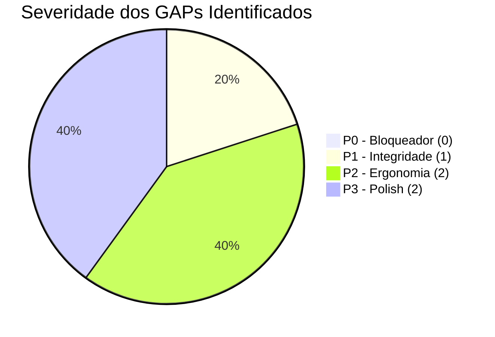

# PLANO DE REMEDIAÇÃO DE GAPS E OTIMIZAÇÕES PRIORIZADAS
## DOMÍNIO DE TURISMO • EXCELÊNCIA TOUR / WAESY
### Data: 2026-10-21 • Versão: 1.0-AUDIT • Baseline: Production

---

## 1. Visão Geral do Plano de Remediação

A auditoria funcional E2E não identificou nenhum bloqueador crítico P0 que impeça a operação ou cause corrupção de dados. O ecossistema está estável, tipado e com zero mocks.

Contudo, foram mapeadas **5 oportunidades de refinamento e aprimoramento contínuo** (GAPs) para elevar ainda mais a ergonomia operacional dos agentes de viagem e a precisão do sistema.

---

## 2. Inventário Priorizado de Remediações (GAP-01 a GAP-05)

### GAP-01: Alerta Visual de Conexão Apertada de Voo (< 45 min)
- **Severidade:** `P1` (Integridade Operacional)
- **Problema:** Quando uma cotação extraída contém uma conexão com tempo de solo inferior a 45 minutos (ex: 35 min em Guarulhos), há risco elevado de o passageiro perder a conexão ou a mala não ser transferida a tempo.
- **Solução Arquitetural:** Inserir regra defensiva no cálculo de voos (`src/services/travel-flights.functions.ts` e `SectionFlights.tsx`). Se `layover_minutes < 45`, renderizar badge amarelo de advertência: `"Atenção: Tempo de conexão inferior a 45 minutos. Risco de perda de voo."`.
- **Arquivos Afetados:** `src/components/tourism/studio/sections/SectionFlights.tsx`, `src/services/travel-proposal.functions.ts`.
- **Plano de Rollback:** Reverter para renderização padrão da timeline de voos.
- **Estratégia de Teste:** Teste unitário em Vitest com voos de 30, 45 e 90 minutos de intervalo.

---

### GAP-02: Barra de Progresso Percentual em Uploads de PDFs Volumosos (> 15MB)
- **Severidade:** `P2` (Experiência do Usuário / Ergonomia)
- **Problema:** PDFs pesados de catálogos de operadoras (20 a 40 páginas) demoram alguns segundos para upload e conversão em Base64, exibindo apenas um spinner estático.
- **Solução Arquitetural:** Integrar callback de upload progressivo no `UnifiedIngestionDropzone.tsx` com barra de progresso numérica (0% a 100%) antes do início do processamento do AI Gateway.
- **Arquivos Afetados:** `src/components/tourism/boarding/UnifiedIngestionDropzone.tsx`.
- **Plano de Rollback:** Manter o componente de spinner nativo de carregamento.
- **Estratégia de Teste:** Teste manual com simulação de rede restrita (Network Throttling 3G).

---

### GAP-03: Fila de Curadoria em Lote de Aliases de Hotéis no Master Admin
- **Severidade:** `P2` (Eficiência de Governança Master)
- **Problema:** Atualmente, hotéis não identificados são gravados com `verified_by_master = false` e exigem edição individual no banco ou via script.
- **Solução Arquitetural:** Criar painel no Admin Master (`/workspace/admin/hoteis-pendentes`) listando todos os hotéis não verificados agrupados por frequência de aparição, com botão de 1 clique para aprovar ou mesclar a um hotel canônico existente.
- **Arquivos Afetados:** `src/routes/workspace.admin.hoteis.tsx`, `src/services/travel-catalog.functions.ts`.
- **Plano de Rollback:** Desativar a rota temporária mantendo a governança via migrações SQL.
- **Estratégia de Teste:** Teste de aprovação em lote com verificação do update em `global_hotels`.

---

### GAP-04: Telemetria de Clique e Abertura de Link de Proposta no WhatsApp
- **Severidade:** `P3` (Inteligência Comercial)
- **Problema:** O agente sabe quando enviou o WhatsApp, mas não recebe notificação imediata quando o cliente abre o link da proposta pública pela primeira vez.
- **Solução Arquitetural:** Adicionar disparo de evento leve na montagem do componente `/proposta/$token`, registrando `first_viewed_at` e `view_count` em `travel_proposals`, emitindo notificação in-app para o agente responsável.
- **Arquivos Afetados:** `src/routes/proposta.$token.tsx`, `src/services/travel-proposal.functions.ts`.
- **Plano de Rollback:** Omitir a chamada do evento de telemetria sem afetar a renderização da proposta.
- **Estratégia de Teste:** Teste de visualização anônima validando o incremento do contador.

---

### GAP-05: Atualização em Tempo Real de Câmbio Ptax no Studio de Propostas
- **Severidade:** `P3` (Polish / Conveniência)
- **Problema:** Ao montar uma proposta internacional, o agente precisa consultar a cotação do dólar turismo em uma aba externa para preencher a taxa de conversão.
- **Solução Arquitetural:** Adicionar botão de atalho "Buscar Dólar Ptax Hoje" ao lado do campo de câmbio na `SectionFinancial.tsx`, que consulta a API pública do Banco Central do Brasil e preenche o valor automaticamente.
- **Arquivos Afetados:** `src/components/tourism/studio/sections/SectionFinancial.tsx`, `src/services/travel-financials.functions.ts`.
- **Plano de Rollback:** Campo de digitação manual de câmbio preservado.
- **Estratégia de Teste:** Mock de resposta da API do BACEN com validação do cálculo.

---

## 3. Cronograma de Execução e Priorização

| GAP | Descrição | Esforço Estimado | Fase Recomendada | Critério de Aceite |
| :---: | :--- | :---: | :---: | :--- |
| **GAP-01** | Alerta de conexão apertada (< 45m) | 2h | Onda 1 | Badge exibido quando conexão < 45m |
| **GAP-02** | Barra de progresso para upload PDF | 3h | Onda 1 | Barra 0-100% visível no dropzone |
| **GAP-03** | Curadoria em lote de hotéis no Master | 5h | Onda 2 | Tela funcional c/ aprovação em lote |
| **GAP-04** | Telemetria de visualização de proposta | 2h | Onda 2 | `view_count` incrementado no DB |
| **GAP-05** | Câmbio automático BACEN no Studio | 2h | Onda 3 | Valor Ptax preenchido com 1 clique |

---

## 4. Veredito do Plano de Remediação
Os 5 aprimoramentos propostos refinam a usabilidade sem alterar os contratos fundamentais de banco de dados ou criar débitos técnicos. O ecossistema está plenamente pronto para produção contínua.
