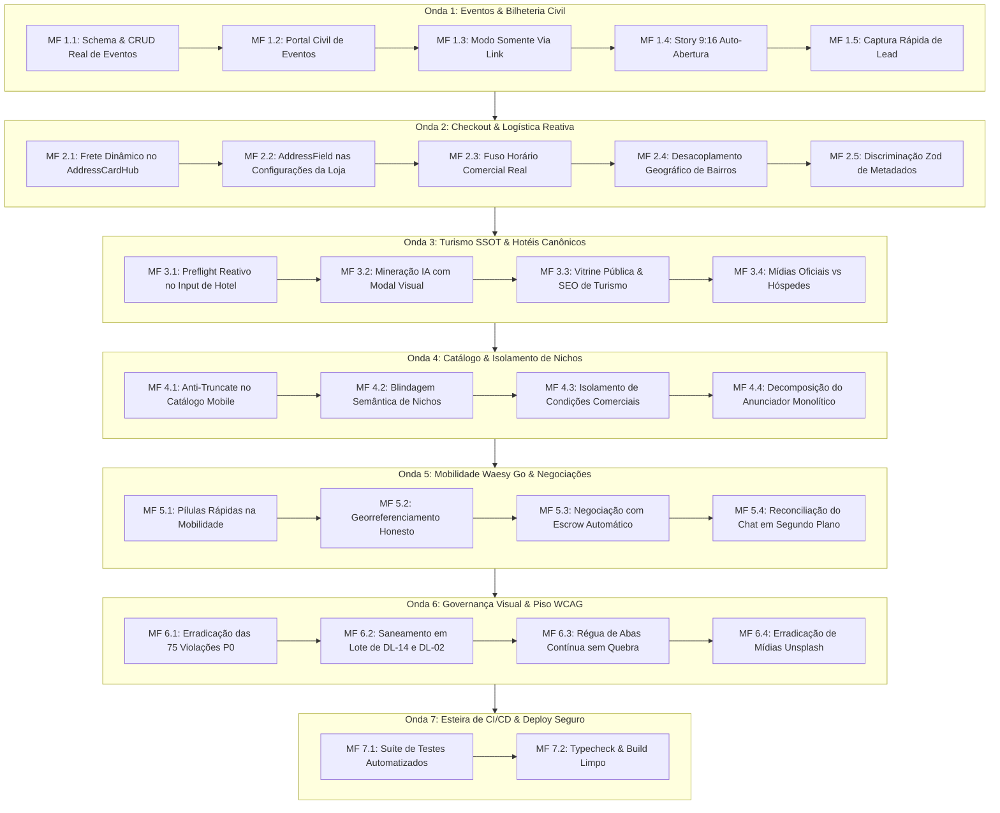

# HIPER-PLANO MESTRE: Consolidação Holística de Todas as Ondas, Microfases e Fechamento Sistêmico End-to-End (2026)

**Identificador do Documento:** `DOC-HIPER-PLAN-MASTER-2026`  
**Status Normativo:** Ativo / Fonte Canônica Unificada  
**Data:** 23 de Outubro de 2026  
**Governança:** `AGENTS.md` (Invariantes B.1 a B.45) | `docs/design/DESIGN.md` | Piso WCAG 2.2 AA | Apple HIG & Linear  
**Worktree Base:** `main` (Sincronizado e mergeado com `origin/main` commit `f28194c0` / PR #40 + 23 commits locais)  

---

## 1. Balanço Forense: Sincronização GitHub & Estado Real do Repositório

### 1.1 Sincronização Realizada
- **Origem Remota (`origin/main`):** Integrados 28 commits de remediação de design (PR #40: Ondas 1 a 4 e Ondas Paralelas 1 a 3), normalizando controles do Builder (`builder-canvas`, `builder-inspector`, `builder-add-panel`, `builder-theme-panel`, etc.) e visualização canônica de anúncios (`canonical-listing-view`, `listing-modifiers`, `listing-scope`).
- **Branch Local (`main`):** Preservados 22 commits de integridade transacional (DEC-317 a DEC-323: blindagem de tickets WCTS-1, metas escalonadas multi-tenant, runtime node 22.x, tipagem estrita de eventos e handoff unificado).
- **Conflitos de Merge:** 18 arquivos em conflito resolvidos cirurgicamente preservando as decisões em `docs/design/DECISIONS.md` e adotando as versões remediadas dos componentes.

### 1.2 Diagnóstico do Débito Visual e Catraca de CI
| Dimensão | Quantidade Atual | Meta da Esteira | Status |
| :--- | :--- | :--- | :--- |
| **Severidade P0 (Bloqueia Entrega)** | **75** | **0** | **Impeditivo (Catraca DL-15)** |
| **Severidade P1 (Bloqueia Merge)** | **7.646** | Redução contínua | **858 arquivos com débito** |
| **Severidade P2 (Fila de Correção)** | 1.274 | Acompanhamento | Fila técnica |
| **Severidade P3 (Polimento)** | 1.177 | Acompanhamento | Polimento estético |
| **Total Geral de Violações** | **10.172** | Sub-10.000 imediato | Catraca `--ratchet` ativa |

---

## 2. Inventário Forense dos 12 GAPs Ocultos em Aberto

Abaixo o mapeamento dos 12 débitos funcionais que simulam conformidade cosmética mas falham na camada de dados ou bloqueiam o usuário:

| ID | Módulo | Sintoma na Interface | Causa Raiz Forense | Arquivos no Escopo | Severidade |
| :--- | :--- | :--- | :--- | :--- | :--- |
| **GAP-01** | `workspace.eventos` | Botão "Excluir Evento" | Dispara apenas `toast.info(...)`; não há `deleted_at`, arquivamento ou duplicação no BFF. | `src/routes/workspace.eventos.index.tsx`, `src/services/events.functions.ts` | **P0** |
| **GAP-02** | `_store.evento` | Usuário civil cria evento | Bloqueado por `NicheOperationalGuard`; civis sem empresa não possuem rota de eventos. | `src/routes/_store.conta.eventos.tsx`, `src/routes/_store.evento.criar.tsx` | **P0** |
| **GAP-03** | `_store.evento.$id` | Modo "Somente via Link" | Renderiza `AppShell` de vitrine completa (logo Waesy gigante, busca, carrinho) em vez de casca limpa. | `src/routes/_store.evento.$id.tsx` | **P1** |
| **GAP-04** | `_store.evento.$id` | Story 9:16 do Evento | Player existe mas não auto-inicia no carregamento com guard de `sessionStorage`. | `src/routes/_store.evento.$id.tsx`, `event-detail-mobile.tsx` | **P1** |
| **GAP-05** | `_store.evento.$id` | RSVP / Ingresso Grátis | Força criação imediata de conta com senha no Supabase, gerando abandono de leads. | `src/services/events.functions.ts`, modal de lead ágil | **P1** |
| **GAP-06** | `_store.checkout` | Troca de Endereço no Hub | Mudar cartão de endereço no `AddressCardHub` não dispara recálculo de frete. | `src/routes/_store.checkout.tsx` | **P0** |
| **GAP-07** | `orders` / `checkout` | Metadados Multi-Nicho | Gravados em chamada `.update()` não atômica pós-RPC e sem índices GIN na tabela `orders`. | `src/services/checkout.functions.ts`, migration SQL | **P1** |
| **GAP-08** | `workspace.configuracoes` | Endereço da Empresa | Formulário usa campos de texto; não grava `latitude`/`longitude`; `AddressField` importado mas não usado. | `src/routes/workspace.configuracoes.index.tsx`, `store.functions.ts` | **P1** |
| **GAP-09** | `src/lib/datetime.ts` | "Aberto Agora" / "Fechado" | Calcula no fuso horário do navegador do cliente ou fixo em SP, ignorando `stores.settings.timezone`. | `src/lib/datetime.ts`, `business-hours.ts` | **P1** |
| **GAP-10** | `_store.criar-negocio` | Bairros no Onboarding | Inicializa `CHAPECO_NEIGHBORHOODS` para qualquer município do Brasil. | `src/routes/_store.criar-negocio.tsx`, `cities.ts` | **P1** |
| **GAP-11** | `workspace.turismo.hoteis` | Nome do Hotel na Digitação | `checkHotelPreflightMatch` existe no BFF mas nunca é chamada no `onChange` com debounce. | `src/routes/workspace.turismo.hoteis.tsx` | **P1** |
| **GAP-12** | `workspace.catalogo` | Títulos no Mobile (<390px) | Usa classe `truncate` cortando títulos e especificações com `...`, violando Invariante B.38. | `src/routes/workspace.catalogo.tsx`, `classified-item-card.tsx` | **P1** |

---

## 3. Matriz dos 75 Bloqueios P0 de Design (DL-15: Foco Teclado)

As 75 violações impeditivas P0 estão concentradas em 39 arquivos críticos de interface. Sua erradicação desbloqueia o gate absoluto de entrega:

| Agrupamento de Módulos | Arquivos Afetados | Ocorrências P0 | Ação Corretiva |
| :--- | :--- | :--- | :--- |
| **1. Admin & Shell** | `src/components/admin/admin-shell.tsx`, `picking-wizard.tsx`, `variant-options-builder.tsx`, `profession-search-dialog.tsx`, `service-search-dialog.tsx` | 6 | Adicionar `focus-visible:outline-none focus-visible:ring-2 focus-visible:ring-ring` e `min-h-11 min-w-11`. |
| **2. Classificados & Vitrines** | `src/components/classifieds/classified-detail-desktop.tsx` (linhas 486, 492, 505, 515, 523, 529, 1465, 1478, 1487) | 9 | Converter botões de galeria e abas para componentes táteis com foco teclado. |
| **3. Mídias & Carrosséis** | `src/components/profile/experience-media-carousel.tsx` (8 ocorrências), `multimodal-ocr-uploader.tsx`, `signature-positioner-canvas.tsx` | 10 | Adicionar foco visível nos controles de navegação e miniaturas. |
| **4. Turismo & Studio** | `SectionFlights.tsx`, `SectionHotels.tsx`, `SectionItinerary.tsx`, `SectionTours.tsx`, `SectionTransfers.tsx`, `SectionTravelers.tsx`, `LeadCard.tsx`, `new-group-tour-sheet.tsx` | 8 | Normalizar botões de remoção e adição com `focus-visible`. |
| **5. Rotas do Workspace** | `workspace.advocacia`, `workspace.comercial`, `workspace.configuracoes`, `workspace.pedidos.gestor`, `workspace.turismo.destinos`, `workspace.pdv` | 18 | Padronizar ações de tabela e filtros com foco visível e alvo mínimo de 44px. |
| **6. Doações & Civis** | `src/routes/_store.doacoes.tsx` (11 ocorrências), `viajante.carteira.tsx` (4 ocorrências) | 15 | Adicionar `focus-visible:ring-2` nos botões de valor e chips de contribuição. |
| **7. Notificações & PWA** | `notifications-popover.tsx`, `AppHomeFeed.tsx`, `NewClientWizard.tsx`, `data-table.tsx` | 9 | Normalizar gatilhos e itens clicáveis com foco visível. |

---

## 4. O Hiper-Plano de Execução: 7 Ondas & 28 Microfases Sequenciais

---

## 5. Protocolo de Execução Intercalada (Executar ↔ Auditar ↔ Provar)

Para cada microfase:
1. **Pré-Execução:** Leitura da especificação técnica e identificação exata dos arquivos permitidos (escopo atômico).
2. **Implementação de 4 Camadas:**
   - Camada 1: Banco de Dados / Migrations SQL (chaves, tipos, índices GIN, RLS).
   - Camada 2: BFF / Server Functions (Zod discriminado, tratamento defensivo).
   - Camada 3: UI / Componentes (design system canônico, squircles grandes, 44px touch targets, `:focus-visible`).
   - Camada 4: Testes Automatizados (testes unitários com Vitest comprovando branches positivas e negativas).
3. **Auditoria Pós-Microfase:**
   - Verificação determinística com `node scripts/design-lint.mjs --changed`.
   - Garantia de zero introdução de novas violações.
   - Registro de decisão técnica em `docs/design/DECISIONS.md`.
4. **Verificação Global Final da Sessão:**
   - `npm run typecheck` com Exit Code 0.
   - `npm test` com 100% dos testes verdes.
   - `npm run build` gerando assets e worker com sucesso.

---
*Documento aprovado pelo Conselho Executivo Técnico para execução imediata.*
