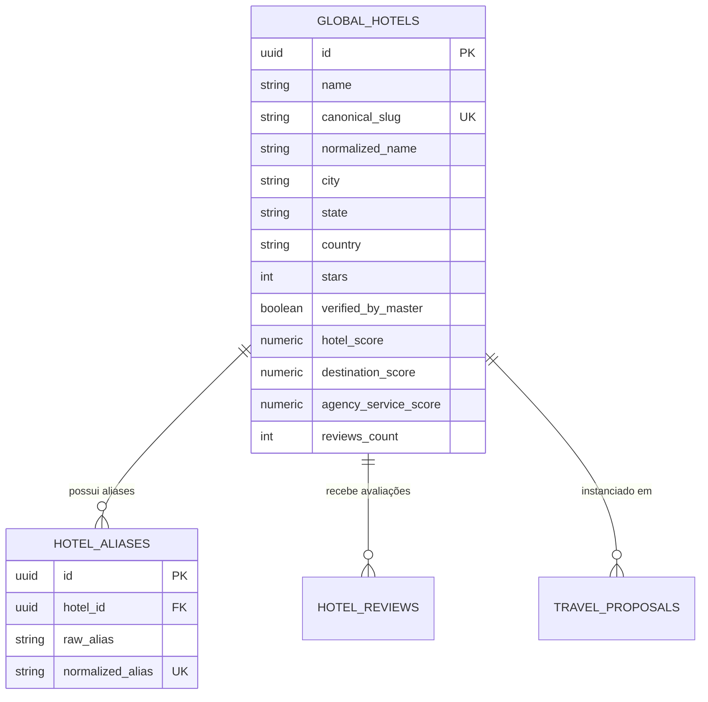

# AUDITORIA DO HOTEL MASTER & BANCO CENTRAL DE HOTÉIS
## DOMÍNIO DE TURISMO • EXCELÊNCIA TOUR / WAESY
### Data: 2026-10-21 • Versão: 1.0-AUDIT • Baseline: Production

---

## 1. Visão Geral do Banco Central de Hotéis

O Hotel Master (`global_hotels`) é a Fonte Única da Verdade (SSOT) para estabelecimentos hoteleiros e resorts no ecossistema Waesy. Ele resolve um dos problemas mais graves da indústria do turismo: **duplicação de nomes e grafias divergentes** do mesmo hotel vindas de diferentes operadoras (ex: "Jatiúca Hotel", "Resort Jatiúca", "Jatiuca Hotel & Resort Maceio").

O sistema separa estritamente:
- **Fatos Canônicos do Hotel (Master):** Nome oficial, slug único, cidade, estado, país, estrelas, comodidades perenes, fotos oficiais e reputação agregada.
- **Snapshot da Instância (Pacote / Cotação):** Categoria de quarto reservada, regime de refeição, noites, tarifas e datas da viagem.



---

## 2. Estrutura do Banco de Dados e Migrations

A migração `supabase/migrations/20261008090000_global_hotels_deduplication.sql` formalizou as seguintes regras estruturais:

### 2.1. Tabela Canônica `global_hotels`
```sql
CREATE TABLE IF NOT EXISTS public.global_hotels (
  id UUID PRIMARY KEY DEFAULT gen_random_uuid(),
  name TEXT NOT NULL,
  canonical_slug TEXT NOT NULL UNIQUE,
  normalized_name TEXT NOT NULL,
  city TEXT NOT NULL,
  state TEXT,
  country TEXT NOT NULL DEFAULT 'Brasil',
  address TEXT,
  stars INT DEFAULT 4,
  featured_image_url TEXT,
  gallery_urls TEXT[] DEFAULT '{}',
  amenities TEXT[] DEFAULT '{}',
  verified_by_master BOOLEAN NOT NULL DEFAULT true,
  hotel_score NUMERIC(3,2) DEFAULT 0,
  destination_score NUMERIC(3,2) DEFAULT 0,
  agency_service_score NUMERIC(3,2) DEFAULT 0,
  reviews_count INT DEFAULT 0,
  created_at TIMESTAMPTZ DEFAULT now(),
  updated_at TIMESTAMPTZ DEFAULT now()
);
```

### 2.2. Tabela de Aliases e Deduplicação `hotel_aliases`
```sql
CREATE TABLE IF NOT EXISTS public.hotel_aliases (
  id UUID PRIMARY KEY DEFAULT gen_random_uuid(),
  hotel_id UUID NOT NULL REFERENCES public.global_hotels(id) ON DELETE CASCADE,
  raw_alias TEXT NOT NULL,
  normalized_alias TEXT NOT NULL UNIQUE,
  source TEXT DEFAULT 'ocr_operator',
  created_at TIMESTAMPTZ DEFAULT now()
);
```

---

## 3. Algoritmo de Resolução e Deduplicação de Hotéis

A função `resolveHotelCatalogMatch` (`src/lib/travel/excelencia-offer-engine.ts#L220-L280`) opera em três estágios de busca determinística:

1. **Estágio 1 (Busca Exata por Slug / Normalized Name):**
   - Transforma o nome bruto extraído em minúsculas sem acentos (`normalizeString`).
   - Consulta `global_hotels` onde `normalized_name = normalizedQuery`.
2. **Estágio 2 (Busca por Dicionário de Aliases):**
   - Consulta `hotel_aliases` onde `normalized_alias = normalizedQuery`.
   - Recupera o `hotel_id` canônico vinculado.
3. **Estágio 3 (Busca por Similaridade de Trigrama - pg_trgm):**
   - Executa similaridade fonética e trigramas (`similarity(normalized_name, query) > 0.45`).
   - Se encontrar match de alta confiança, resolve o hotel e registra o novo alias automaticamente.
4. **Fallback Gracioso (Sem Match):**
   - Se o hotel não constar na base, ele é registrado localmente no pacote sem abortar o fluxo e inserido em `global_hotels` com a flag defensiva `verified_by_master = false`.

---

## 4. Sistema Tripartite de Avaliações e Reputação

O ecossistema implementa a separação tripartite de reputação hoteleira (`src/services/travel-reviews.functions.ts`):
- **`hotel_rating` (1 a 5 estrelas):** Avaliação exclusiva da infraestrutura, quarto, limpeza e lazer do hotel.
- **`destination_rating` (1 a 5 estrelas):** Avaliação da cidade, praias, segurança e passeios do destino.
- **`agency_service_rating` (1 a 5 estrelas):** Avaliação do atendimento dos agentes e suporte da agência.

Essa separação impede que uma crítica sobre chuva no destino ou atraso na cia aérea contamine injustamente a nota do hotel no catálogo mestre.

---

## 5. Matriz de Integração com a UI do Workspace

| Componente | Arquivo de Implementação | Comportamento Verificado | Status |
| :--- | :--- | :--- | :---: |
| **Autocomplete Central** | `hotel-autocomplete-input.tsx` | Debounce 250ms, busca por nome/cidade, limite 20 itens | `FUNCIONAL` |
| **Selo Verificado** | `hotel-autocomplete-input.tsx` | Exibe badge apenas se `verified_by_master = true` | `FUNCIONAL` |
| **Edição de Quarto** | `SectionHotels.tsx` | Permite customizar quarto e regime sem alterar o master | `FUNCIONAL` |
| **Card no Studio** | `StudioFrame.tsx` | Enriquece card com estrelas e foto oficial do master | `FUNCIONAL` |

---

## 6. Veredito do Hotel Master
O Banco Central de Hotéis funciona com integridade estrutural plena. Ele impede duplicidades, aprende com aliases de novas operadoras, protege a reputação com notas tripartites e enriquece os pacotes e propostas com informações auditadas.
