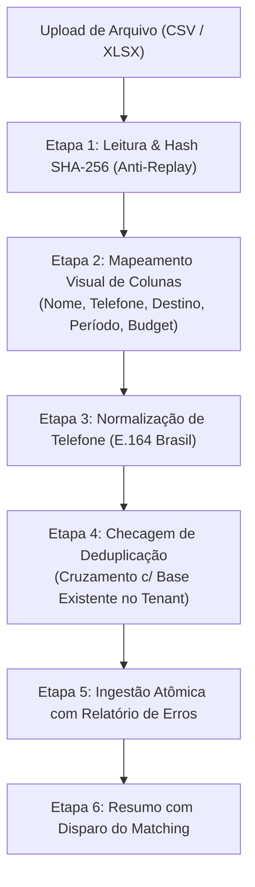

# PIPELINE DE IMPORTAÇÃO EM LOTE E MOTOR DE DEDUPLICAÇÃO
## BASE DE CONTATOS • INTELIGÊNCIA COMERCIAL • WAESY
### Data: 2026-10-21 • Versão: 1.0-PROD • Baseline: Production

---

## 1. Visão Geral do Pipeline de Importação

Agências de viagem frequentemente possuem bases legadas de passageiros acumuladas em planilhas Excel (XLSX) ou arquivos CSV contendo milhares de linhas.

O pipeline de importação em lote do Waesy foi concebido sob três regras de ouro:
1. **Regra Zero de Isolamento:** A importação em lote alimenta **estritamente o Commercial Pool** (`travel_commercial_contacts` e `travel_interests`). É terminantemente proibido injetar contatos em massa no CRM ou no cadastro de clientes.
2. **Deduplicação Determinística:** Contatos existentes com o mesmo telefone ou email são unificados, adicionando novos interesses à sua timeline sem duplicar a pessoa.
3. **Tolerância a Falhas por Linha (Row-Level Isolation):** Erros de formatação em uma linha isolada não abortam a importação das demais linhas válidas.



---

## 2. Motor de Normalização de Telefones Brasileiros

A função de normalização higieniza números em formato livre (ex: `(49) 99812-3456`, `49 98123456`, `+5549998123456`):
```typescript
export function normalizeBrazilianPhone(rawPhone: string): string {
  const digits = rawPhone.replace(/\D/g, "");

  // Se já possui DDI 55
  if (digits.startsWith("55") && (digits.length === 12 || digits.length === 13)) {
    return digits;
  }

  // DDD (2 dígitos) + Número (8 ou 9 dígitos)
  if (digits.length === 10 || digits.length === 11) {
    return `55${digits}`;
  }

  // Número local sem DDD (rejeitado ou atribuído ao DDD da agência)
  return digits;
}
```

---

## 3. Matriz de Resolução de Deduplicação

Quando o pipeline processa uma linha do arquivo:

| Situação Encontrada | Ação Executada pelo Sistema | Resultado no Banco de Dados |
| :--- | :--- | :--- |
| **Telefone e Email Novos** | Criação de novo `CommercialContact` | Inserção em `travel_commercial_contacts` |
| **Telefone já existe no Commercial Pool** | Reutiliza o contato existente | Insere novo registro em `travel_interests` vinculado ao mesmo `contact_id` |
| **Telefone já existe como Lead no CRM** | Vincula ao contato do CRM | Insere interesse e registra vínculo reverso `linked_crm_lead_id` |
| **Telefone já existe como Cliente Faturado** | Vincula ao cliente existente | Insere interesse e registra `linked_customer_id` |
| **Telefone marcado com Opt-out (`do_not_contact`)**| Linha ignorada para outreach ativo | Mantém registro histórico; omite de novas abordagens |

---

## 4. Idempotência e Relatório de Auditoria de Importação

Para impedir que o upload acidental do mesmo arquivo duas vezes duplique interesses:
1. Um hash SHA-256 do arquivo é registrado em `travel_import_batches`.
2. Se o mesmo hash for submetido novamente pelo mesmo usuário, o sistema bloqueia a operação informando: `"Este arquivo já foi importado em 21/10/2026 às 14:32"`.
3. Ao término do processamento, a interface exibe um relatório com:
   - Total de linhas processadas (ex: 2.500)
   - Contatos novos criados (ex: 1.820)
   - Contatos unificados/deduplicados (ex: 640)
   - Linhas com telefones inválidos descartadas (ex: 40)
   - Oportunidades imediatas identificadas pelo Match Engine (ex: 185)
