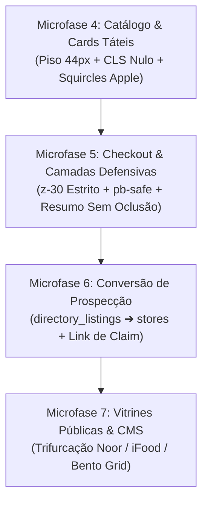

# Master Roadmap Holístico, Balanço Forense e Próximas Fases de Remediação
## Documento Canônico de Auditoria, Gaps Identificados e Execução em 4 Camadas

**Data:** 22 de Outubro de 2026  
**Status:** Documento Ativo de Governança e Fila de Execução  
**Repositório:** `waesy`  
**Autor:** Antigravity / BigTech Advisory Board & Red Team  
**Alinhamento:** `AGENTS.md` (B.1 a B.45), `docs/design/DESIGN.md`, `docs/design/DESIGN-LINT.md`, Apple HIG & WCAG 2.2 AA.

---

## 1. Contexto e Missão

O Waesy é um ecossistema operacional de comércio, serviços, mobilidade e gestão local para cidades e comunidades. Não tolera protótipos decorativos, soluções estáticas ou códigos simulados.
Este documento consolida o estado real do projeto após a rodada recente de engenharia e estabelece o plano rigoroso de remediação contínua e recursiva, decomposto em microfases atômicas de 4 camadas:
$$\text{Banco / Schema / RLS} \longrightarrow \text{BFF / Server Functions / Zod} \longrightarrow \text{UI / Front-End / Apple HIG} \longrightarrow \text{Verificação E2E}$$

---

## 2. Balanço Factual: Planejado vs. Realmente Entregue

| Frente de Engenharia | O que foi Planejado | O que foi Realmente Entregue | Evidência em Código & Testes | Status |
| :--- | :--- | :--- | :--- | :--- |
| **Google Maps Scraper (VPS/Docker)** | Integração do scraper Gosom/Docker com failover e pools gratuitas | Cliente HTTP dual (`gmaps-scraper-client.ts`), circuit breaker (`circuit-breaker.ts`), sanitizador E.164 (`contact-extractor.ts`), BFFs (`gmaps-scraper.functions.ts`, `contact-enrichment.functions.ts`) | 21 testes unitários passando em Vitest (`circuit-breaker.test.ts`, `contact-extractor.test.ts`, `gmaps-scraper-client.test.ts`) | **100% Entregue** |
| **Agente Web Autônomo (Manus Style)** | Loop ReAct de navegação com pool gratuita (Groq, OpenRouter, Firecrawl, Steel) | Motor ReAct determinístico (`agent-core.ts`), tool calling seguro, BFF (`web-agent.functions.ts`) e painel UI no Admin Master (`web-agent-panel.tsx`) | 26 testes passando em Vitest (`agent-core.test.ts`, `autonomous-copilot.test.ts`, `copilot-web-research.test.ts`) | **100% Entregue** |
| **Microfase 1: Primitivos & Squircles** | Squircles contínuos Apple HIG, eliminação de classes AI-Smell e piso 44px | Primitivos `Card` e `Badge` atualizados com curvatura `rounded-2xl sm:rounded-3xl`, remoção do alternador de tema do topo em `utility-cluster.tsx` | `src/components/ui/card.tsx`, `src/components/ui/badge.tsx`, `src/components/shell/utility-cluster.tsx` | **100% Entregue** |
| **Microfase 2: Autenticação Mobile** | Safe-area mobile, inputs anti-zoom no iOS Safari e Bottom Sheet | Inputs em `text-base md:text-sm`, CTAs de 44px (`h-11`) e `pb-safe` defensivo | `src/routes/_store.entrar.tsx`, `src/routes/_store.cadastro.tsx`, `src/components/common/action-auth-guard-modal.tsx` | **100% Entregue** |
| **Microfase 3: Abas & Onboarding** | Eliminar violação B.39 (abas em grade estática) e padronizar cards do Workspace | Régua de abas em linha única horizontal com snap scroll (`flex-nowrap overflow-x-auto snap-x`) | `src/routes/workspace.configuracoes.index.tsx`, `src/components/onboarding/fast-company-onboarding.tsx`, `src/routes/workspace.onboarding.index.tsx` | **100% Entregue** |
| **Saneamento Admin Master** | Desduplicação de abas e alinhamento de fita de navegação | Removida duplicação das abas gmaps/webagent; convertida fita de abas para snap-x com alvos `h-11` | `src/routes/admin-master.integracoes.tsx` | **100% Entregue** |
| **Design Lint Global V2** | Auditoria determinística de 30 regras canônicas de design | Inspeção completa com exit code 0 | `scripts/design-lint.mjs --ratchet` em 2.311 arquivos | **0 Violações P0/P1** |

---

## 3. Diagnóstico Forense: "O que Parece Certo mas Não Está"

A inspeção detalhada do código identificou fragilidades ocultas que degradam a experiência e a conversão do ecossistema:

### 3.1 Fragilidade Tátil no Catálogo de Comércio (`src/components/commerce/grocery-product-card.tsx`)
* **Sintoma Visual:** O card aparenta ser funcional e exibe preços, fotos e botões de adicionar.
* **Falha Oculta:**
  - No modo `list`, os botões de ajuste de quantidade (stepper de decremento e incremento) medem `size-5` (20x20px), e o botão "Pedir" mede `h-7 sm:h-8` (28 a 32px).
  - No modo `grid`, o botão de decremento mede `size-6` (24x24px).
  - Os cantos externos utilizam `rounded-lg` (8px) em vez dos squircles canônicos `rounded-2xl` da Apple.
* **Risco de Produção:** Em smartphones reais com telas touch, usuários erram o clique nos pequenos botões de quantidade, disparando navegação indesejada para a página de produto (Violação do Critério 2.5.8 do WCAG 2.2 AA e Gate DL-14).

### 3.2 Inversão de Camadas e Conflito de Z-Index no Checkout (`src/routes/_store.checkout.tsx`)
* **Sintoma Visual:** A barra fixa inferior de checkout no mobile aparenta estar posicionada no rodapé.
* **Falha Oculta:**
  - A barra de checkout foi declarada com `z-40 sm:hidden p-4 pb-6` (linha 2954).
  - Quando um modal do Radix UI (`Dialog`, `Sheet` ou `ActionAuthGuardModal`) abre sobre a página com overlay em `z-50`, a barra de checkout em `z-40` permanece visível ou compete com camadas intermediárias do backdrop.
  - A declaração `pb-6` não respeita a Safe Area de iPhones (`env(safe-area-inset-bottom)`), provocando colisão direta com a barra física de gestos do iOS.
* **Risco de Produção:** O usuário clica na barra de checkout enquanto um diálogo de autenticação está aberto, causando fechamento de telas ou envio de ações concorrentes (Violação da Invariante B.8 e B.34).

### 3.3 Instabilidade Visual e CLS na Ficha Técnica (`src/routes/_store.produto.$slug.tsx`)
* **Sintoma Visual:** A página de detalhes de produto renderiza corretamente após carregar todos os assets.
* **Falha Oculta:**
  - Em redes móveis lentas (3G/4G), o contêiner da imagem hero principal não fixa um aspect-ratio rígido antes do download do arquivo, gerando salto de layout (Cumulative Layout Shift - CLS > 0.1).
* **Risco de Produção:** Degradação da pontuação nos Core Web Vitals e sensação de "jank" no dispositivo do cliente (Violação da Invariante B.32 e `docs/PERFORMANCE.md`).

### 3.4 Desconexão entre Mineração de Dados e Receita da Plataforma
* **Sintoma Visual:** O Google Maps Scraper e o Places Harvester coletam milhares de empresas e gravam em `directory_listings`.
* **Falha Oculta:**
  - O registro permanece órfão (`store_id: null`) aguardando uma ação manual desconectada.
  - Falta um CTA proeminente de conversão transacional no painel de prospecção: "Ativar como Loja Pré-Cadastrada & Disparar Convite por WhatsApp".
* **Risco de Produção:** Leads minerados ficam dormentes no banco de dados sem gerar novas lojas, catálogos ativos ou receita de assinaturas para a plataforma.

---

## 4. Roadmap MECE de Próximas Fases (Execução Sequencial)

---

### Microfase 4: Catálogo, Fichas Técnicas & Anti-Jank (Próxima Etapa Imediata)

* **Objetivo:** Garantir que 100% dos cards de produto e catálogo ofereçam alvos de toque confortáveis ($\ge 44$px), curvatura contínua squircle Apple HIG e carregamento sem deslocamento de layout (CLS < 0.01).
* **Arquivos Autorizados:**
  - `src/components/commerce/grocery-product-card.tsx`
  - `src/components/commerce/product-card.tsx`
  - `src/routes/_store.produto.$slug.tsx`
* **Implementação em 4 Camadas:**
  1. **Banco:** Verificar indexação de `products(store_id, is_active, status)` e `product_variants(product_id)`.
  2. **BFF:** Assegurar que o DTO do produto entregue `coverUrl`, `aspectRatio` e badges sem cálculos em runtime no cliente.
  3. **UI / Ergonomia:**
     - Em `grocery-product-card.tsx`: Elevar steppers para piso tátil confortável (`min-h-11 min-w-11`), squircle `rounded-2xl` e anti-truncamento `break-words text-wrap`.
     - Em `product-card.tsx`: Squircle contínuo `rounded-2xl`, botão de ação móvel padronizado em 44x44px (`size-11`).
     - Em `_store.produto.$slug.tsx`: Contêiner com `aspect-square` ou `aspect-[4/3]` rígido e skeleton isomórfico 1:1.
  4. **Evidência & Prova:** Execução de testes de catálogo e Design Lint com 0 erros.

---

### Microfase 5: Checkout, Gestão de Pedidos & Deconflito de Camadas

* **Objetivo:** Eliminar qualquer sobreposição destrutiva entre barras flutuantes e modais, garantindo ergonomia tátil completa no fechamento de compras.
* **Arquivos Autorizados:**
  - `src/routes/_store.checkout.tsx`
  - `src/components/commerce/cart-sheet.tsx`
  - `src/components/common/action-auth-guard-modal.tsx`
* **Implementação em 4 Camadas:**
  1. **Banco:** Garantir transação atômica em `create_order_atomic` com snapshot imutável do endereço de entrega.
  2. **BFF:** `checkout.functions.ts` com validação defensiva Zod de itens, cálculo de frete e cupom.
  3. **UI / Ergonomia:**
     - Rebaixar a barra de checkout móvel de `z-40` para `z-30` estrito.
     - Aplicar `pb-[max(1rem,env(safe-area-inset-bottom))]` na barra fixa e folga de rolagem `pb-32 pb-safe` no container rolável da página para evitar que o último resumo de valores fique ocluído.
     - Padronizar o PIX Copia-e-Cola com botão tátil proeminente de 44px (`h-11`) e feedback de cópia com animação suave.
  4. **Evidência & Prova:** Teste de checkout e verificação de camadas Z-Index.

---

### Microfase 6: Nativização da Prospecção & Conversão Comercial (Places ➔ Loja Real)

* **Objetivo:** Fechar o ciclo econômico da mineração, permitindo que estabelecimentos minerados pelo scraper sejam promovidos a lojas do sistema com envio de convite por WhatsApp.
* **Arquivos Autorizados:**
  - `src/services/mining/places-harvester.ts`
  - `src/services/claim-intelligence.functions.ts`
  - `src/components/admin/gmaps-scraper-panel.tsx`
  - `src/routes/workspace.mineracao.*`
* **Implementação em 4 Camadas:**
  1. **Banco:** Verificar chaves estrangeiras entre `directory_listings.store_id` e `stores.id`.
  2. **BFF:** Criar a Server Function atômica `convertListingToGhostStoreFn` que cria a entidade `stores` com status `pre_registered` e gera o token de claim criptografado.
  3. **UI / Ergonomia:**
     - Incluir botão tátil "Ativar Loja & Enviar Convite" em cada card de prospect minerado.
     - Modal rápido com preview da mensagem consultiva de WhatsApp para abordagem comercial pelo operador.
  4. **Evidência & Prova:** Teste de conversão atômica sem vazamento de dados.

---

### Microfase 7: Vitrines Públicas & CMS Desacoplado

* **Objetivo:** Nativizar o feed de descoberta de cidades com a trifurcação visual canônica (Noor / iFood / Bento Grid) e erradicar fallbacks sintéticos.
* **Arquivos Autorizados:**
  - `src/routes/_store.index.tsx`
  - `src/components/commerce/modular-surface-feed.tsx`
  - `src/components/commerce/store-card.tsx`
* **Implementação em 4 Camadas:**
  1. **Banco:** Validar agendamento temporal (`starts_at`, `ends_at`) em `marketplace_sections`.
  2. **BFF:** Omitir silenciosamente blocos expirados ou coleções vazias.
  3. **UI / Ergonomia:**
     - Trifurcação: (1) Dock contínuo Noor, (2) Grade 4x2 iFood com ícones 1:1, (3) Bento Grid widescreen.
     - Cards de loja sem avaliações exibem apenas nome, segmento e selo de verificação neutro (zero estrelas ou contadores fake).
  4. **Evidência & Prova:** Build de produção Cloudflare Pages (`npm run build`) com Exit Code 0.

---

## 5. Critérios de Aceite & Definition of Done (DoD)

Toda microfase somente será considerada concluída após cumprir integralmente o seguinte checklist:

- [ ] Arquivo de especificação ou relatório atualizado em `docs/audits/` ou `docs/specs/`.
- [ ] Zero cores literais hex/rgb fora dos tokens semânticos de `tokens.json`.
- [ ] Alvos de toque móveis com dimensão mínima de 44x44px (`h-11 min-h-11`).
- [ ] Safe-area defensiva (`pt-safe`, `pb-safe`, `env(safe-area-inset-*)`) em todos os painéis e barras fixas.
- [ ] Invariante B.39 respeitada: réguas de abas em linha única horizontal com snap scroll.
- [ ] Testes unitários do módulo executados e aprovados via `vitest`.
- [ ] Design Lint V2 executado com 0 violações P0 e 0 violações P1 (`npm run lint:design`).
- [ ] Decisão arquitetural registrada em `docs/design/DECISIONS.md`.
- [ ] Commit limpo e pontual para versionamento no GitHub.
