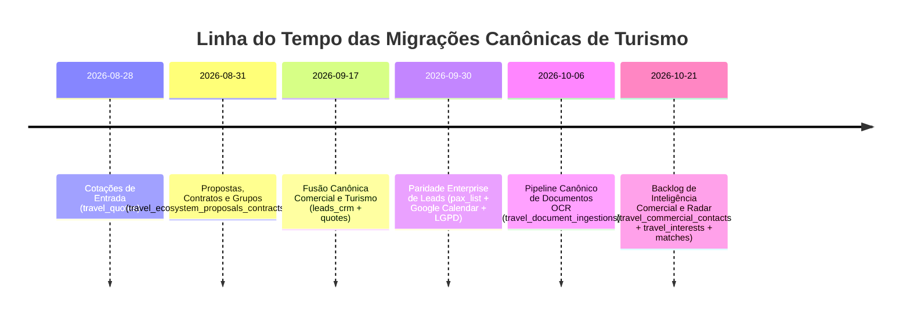

# MIGRATION_PLAN.md — Plano de Migrações de Banco de Dados e Compatibilidade
## Princípio da Adição Idempotente, Zero Downtime e Isolamento Multi-Tenant
**Data:** 2026-10-21  
**Módulo:** Banco de Dados / Supabase Postgres / Waesy  
**Status:** Auditado e Documentado  

---

### 1. Cláusula Pétrea de Migrações (Invariante B.1 a B.41)

1. **Nunca executar `DROP TABLE`, `DROP COLUMN` ou `TRUNCATE`:** A integridade de dados históricos e transacionais é inviolável.
2. **Sempre utilizar `IF NOT EXISTS`:** Toda criação de tabela, coluna ou índice deve ser estritamente idempotente.
3. **Ativar RLS Imediatamente:** Toda tabela nova deve conter `ALTER TABLE ... ENABLE ROW LEVEL SECURITY;` e políticas para roles de staff no mesmo arquivo de migração.

---

### 2. Registro de Migrações do Domínio de Turismo

| Migration | Arquivo SQL | Efeito Estrutural | Verificação RLS |
| :--- | :--- | :--- | :---: |
| **M1** | `20260828000500_travel_quotes.sql` | Cria tabela de cotações anônimas/públicas. | Insert anônimo permitido; leitura restrita. |
| **M2** | `20260831140000_travel_ecosystem_proposals_contracts_groups.sql` | Cria propostas, contratos digitais e viagens de grupo. | Staff por store_id. |
| **M3** | `20260917000000_commercial_and_tourism_deep_fusion.sql` | Expande `leads_crm` com pontuação algorítmica e pax_count. | Staff por store_id. |
| **M4** | `20260930030000_crm_leads_commercial_enterprise_parity.sql` | Adiciona reuniões Google Calendar, PCD/TEA e magic token. | Staff por store_id + RPC segura. |
| **M5** | `20261006120000_canonical_travel_document_pipeline.sql` | Ingestão OCR com deduplicação SHA-256 e extrações. | Staff por store_id. |
| **M6** | `20261022000003_travel_commercial_intelligence_backlog.sql` | Memória de intenções pré-CRM e matching de oportunidades. | Staff por store_id; índices GIN em destinos. |
