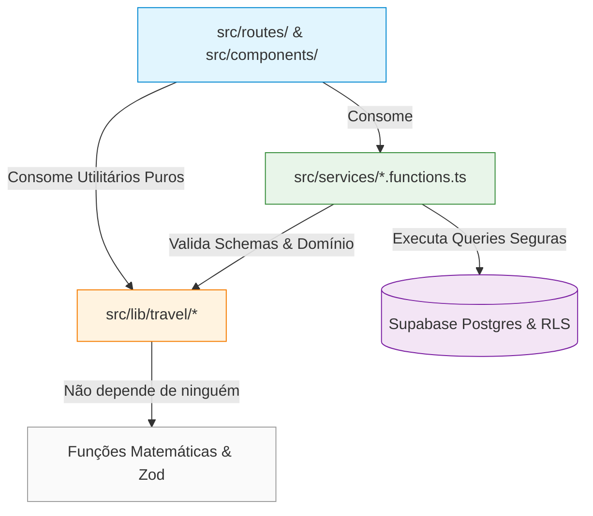

# MODULE_DEPENDENCY_GRAPH.md — Grafo de Dependências e Isolamento
## Verificação de Acoplamento, Direção de Dependência e Prevenção de Inversões
**Data:** 2026-10-21  
**Módulo:** Turismo, Viagens & Lazer / Waesy  
**Status:** Auditado e Validado contra Dependências Circulares  

---

### 1. Grafo Direcional de Dependências (DAG Limpo)

---

### 2. Auditoria de Inversão de Dependências (Regras Críticas de Fronteira)

| Verificação Arquitetural | Status | Evidência no Código |
| :--- | :---: | :--- |
| **O motor de preços (`excelencia-offer-engine.ts`) depende do Story Builder?** | **NÃO (CORRETO)** | `excelencia-offer-engine.ts` não importa nenhum componente visual, React ou hooks. Opera como biblioteca TypeScript pura. |
| **O Story Builder consome o motor de preços?** | **SIM (CORRETO)** | `travel-promo-artboard.tsx` consome os tipos `TravelOffer` e `PaymentTermsSnapshot` exportados por `excelencia-offer-engine.ts`. |
| **O Catálogo Mestre de Hotéis depende da UI de Pacotes?** | **NÃO (CORRETO)** | `global_hotels` e `travel-catalog.functions.ts` operam de forma isolada, servindo dados para qualquer nicho ou módulo. |
| **A camada BFF manipula o DOM ou importa bibliotecas de cliente?** | **NÃO (CORRETO)** | `src/services/*.functions.ts` roda exclusivamente em ambiente server-side com `createServerFn` e Supabase Server Client. |
| **Existem ciclos de importação entre Services e Routes?** | **NÃO (CORRETO)** | As rotas importam os services; os services **nunca** importam as rotas. Verificado via `npm run check:cycles` com Exit Code 0. |

---

### 3. Garantia de Independência de Builds

A separação estrita permite:
1. **Testes Unitários Ultrarrápidos:** `excelencia-offer-engine.test.ts` e `travel-commercial-intelligence.test.ts` rodam em **menos de 20 milissegundos** no Vitest, sem necessidade de instanciar DOM (jsdom), servidor mock ou banco de dados.
2. **Zero Vazamento de Segredos para o Cliente:** Chaves de serviço, variáveis de ambiente seguras e chamadas de infraestrutura nunca cruzam a fronteira do BFF para os componentes do navegador.
