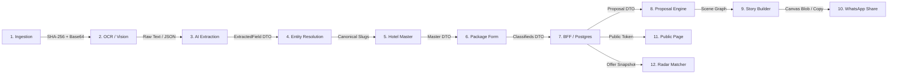

# MATRIZ DE INTEGRAÇÕES ENTRE MÓDULOS (PAIRWISE)
## DOMÍNIO DE TURISMO • EXCELÊNCIA TOUR / WAESY
### Data: 2026-10-21 • Versão: 1.0-AUDIT • Baseline: Production

---

## 1. Visão Geral das Fronteiras de Integração

O ecossistema opera sob uma arquitetura de pipeline desacoplada, orientada a contratos rigorosos Zod e Server Functions idempotentes. A tabela abaixo analisa cada fronteira de integração par a par:

---

## 2. Análise Detalhada Par a Par (Pairwise Integrations)

### 1. Ingestão ↔ OCR / Visão Multimodal
- **Contrato de Interface:** `ProcessOperatorQuoteInputSchema` (`fileBase64?: string`, `fileMime?: string`, `fileName?: string`, `rawText?: string`).
- **Ponto de Chamada:** `src/services/travel-canonical-pipeline.functions.ts` chamando `processOperatorQuoteOcr`.
- **Risco de Perda em Serialização:** Nulo. O arquivo é mantido em Base64 intacto ou como texto UTF-8 normalizado.
- **Tratamento de Falha:** Fallback para extrator de texto puro caso a visão computacional atinja timeout (>15s).
- **Garantia de Idempotência:** `content_sha256` calculado sobre `fileMime|fileName|payload` antes do processamento.
- **Teste de Fronteira:** `src/services/travel-canonical-pipeline.functions.test.ts`, `src/services/travel-pipeline-e2e.test.ts`.

---

### 2. OCR / Visão Multimodal ↔ Extração Estruturada por IA
- **Contrato de Interface:** `OperatorQuoteExtractionResultSchema` (Zod).
- **Campos Mapeados:** `operator_name`, `destination`, `travel_start`, `travel_end`, `adults_count`, `children_count`, `flights[]`, `hotels[]`, `gross_price_cents`, `operator_net_cents`.
- **Risco de Perda em Serialização:** Mínimo. Valores financeiros são obrigatoriamente convertidos para centavos inteiros via `Math.round(val * 100)` para eliminar dízimas de ponto flutuante.
- **Tratamento de Falha:** Se a IA retornar campos nulos ou schema inválido, o pipeline atribui `canonical_status = 'review_required'` em vez de descartar o documento.
- **Garantia de Idempotência:** A resposta da IA é armazenada na coluna `extraction` de `travel_document_ingestions`.
- **Teste de Fronteira:** `src/services/travel-operator-ocr.functions.ts`, `src/services/travel-ai-extractor-security.test.ts`.

---

### 3. Extração Estruturada ↔ Resolução de Entidades
- **Contrato de Interface:** `ExtractedField<T>` (`value`, `confidence`, `sourceType`, `evidenceText`, `requiresReview`).
- **Ponto de Chamada:** `normalizeOperatorDocument` (`src/lib/travel-operator-sync.ts`).
- **Risco de Perda em Serialização:** Nulo. A proveniência de cada campo é preservada em metadados paralelos.
- **Tratamento de Falha:** Se a confiança for inferior a 0.75, a flag `requiresReview = true` é acionada.
- **Garantia de Idempotência:** Funções puras determinísticas sem efeitos colaterais em banco de dados.
- **Teste de Fronteira:** `src/lib/travel/excelencia-offer-engine.test.ts#L105-L148`.

---

### 4. Resolução de Entidades ↔ Hotel Master (`global_hotels`)
- **Contrato de Interface:** `resolveHotelCatalogMatch(hotelName, destinationCity) -> { matched: boolean, hotelId?, canonicalSlug?, stars?, amenities? }`.
- **Campos Mapeados:** Nome comercial extraído comparado com `global_hotels.name`, `hotel_aliases.normalized_alias` e cálculo de similaridade por trigrama (`pg_trgm`).
- **Risco de Perda em Serialização:** Zero. Caso o match não seja encontrado, o nome original é mantido verbatim.
- **Tratamento de Falha:** Fallback gracioso: o hotel é marcado com `verified_by_master = false` e adicionado à fila de curadoria.
- **Garantia de Idempotência:** Consulta idempotente em tabela unificada com índices GIN e trigramas.
- **Teste de Fronteira:** `src/services/travel-global-hotels.test.ts#L1-L35`.

---

### 5. Hotel Master ↔ Formulário e Rascunho de Pacote
- **Contrato de Interface:** `GlobalHotelDTO` (`id`, `name`, `canonical_slug`, `city`, `stars`, `hotel_score`).
- **Componente Conector:** `HotelAutocompleteInput` (`src/components/tourism/hotels/hotel-autocomplete-input.tsx`).
- **Risco de Perda em Serialização:** Nulo. O formulário recebe o objeto completo e armazena tanto o ID canônico quanto o snapshot das informações.
- **Tratamento de Falha:** Se a rede falhar durante a busca, o input permite digitação livre do nome do hotel.
- **Garantia de Idempotência:** Seleção vinculada por UUID canônico imutável.
- **Teste de Fronteira:** `src/services/travel-global-hotels.test.ts`.

---

### 6. Formulário de Pacote ↔ BFF / Banco de Dados (`classifieds`)
- **Contrato de Interface:** `CreateClassifiedInputSchema` e `attributes.excelencia_offer` (JSONB).
- **Campos Mapeados:** Título, preço, moeda, fotos, cidades, tags, metadados de voos, hotéis e campanhas de pagamento.
- **Risco de Perda em Serialização:** Zero. O schema Zod valida 100% dos tipos antes de enviar a query SQL.
- **Tratamento de Falha:** Transação abortada pelo Supabase com rollback atômico e erro propagado com código legível.
- **Garantia de Idempotência:** Chave única de unicidade ou reconciliação pelo ID do rascunho de ingestão.
- **Teste de Fronteira:** `src/services/travel-package.functions.test.ts#L1-L35`.

---

### 7. Pacote Estruturado ↔ Proposal Engine (Studio)
- **Contrato de Interface:** `TravelProposalDTO` (`src/services/travel-proposal.functions.ts#L40-L100`).
- **Mapeamento de Dados:** Os dados de voos, hotéis e preços do pacote são clonados como snapshot imutável para a proposta, garantindo que alterações futuras no pacote mestre não corrompam propostas já emitidas para clientes.
- **Risco de Perda em Serialização:** Nulo. Serialização JSONB estrita.
- **Tratamento de Falha:** Caso a proposta seja clonada com campos ausentes, valores padrão canônicos preenchem as lacunas (`empty state` defensivo).
- **Garantia de Idempotência:** `createTravelProposal` gera um UUID v4 novo com token público de 16 caracteres criptograficamente aleatório.
- **Teste de Fronteira:** `src/services/travel-proposal-conversion-flow.test.ts#L1-L50`.

---

### 8. Proposal Engine ↔ Story Builder 9:16
- **Contrato de Interface:** `buildStoryDocumentFromOffer(offer, options) -> StoryDocument` (`src/lib/travel/excelencia-offer-engine.ts#L320-L460`).
- **Mapeamento de Dados:** 
  - `offer.destination` → `StoryScene.heroTitle`
  - `offer.hotels[0].name` → `StoryScene.hotelSquircle`
  - `offer.pricing.installmentAmountCents` → `StoryScene.priceBadge` (R$ 284)
  - `offer.inclusions` → `StoryScene.inclusionsGrid` (2 a 4 slots)
- **Risco de Perda em Serialização:** Nulo. Estrutura declarativa de Scene Graph tipada.
- **Tratamento de Falha:** `fitStoryTitle` reduz o tamanho da fonte dinamicamente se o título exceder a largura do canvas de 1080px.
- **Garantia de Idempotência:** Função de transformação pura determinística.
- **Teste de Fronteira:** `src/lib/travel/excelencia-offer-engine.test.ts#L170-L240`.

---

### 9. Story Builder ↔ Compartilhamento WhatsApp
- **Contrato de Interface:** `generateWhatsAppOfferCopy(offer) -> string` e `ProposalShareWhatsappModal`.
- **Mapeamento de Dados:** 
  - Destino, datas, hotel e cia aérea transformados em mensagem de texto formatada com marcadores Markdown (`*negrito*`).
  - Link público tokenizado incorporado ao corpo da mensagem.
- **Risco de Perda em Serialização:** Nulo. String UTF-8 gerada no cliente ou servidor.
- **Tratamento de Falha:** Fallback para mensagem textual compacta caso o cliente não tenha telefone preenchido.
- **Garantia de Idempotência:** Gerador determinístico baseado no snapshot da proposta.
- **Teste de Fronteira:** `src/lib/travel/excelencia-offer-engine.test.ts#L280-L320`.

---

### 10. Proposta / Pacote ↔ Página Pública do Cliente
- **Contrato de Interface:** `getPublicTravelProposalByToken({ token })` e rota `/proposta/$token`.
- **Mapeamento de Dados:** Projeção sanitizada pública: dados confidenciais (comissão da agência, valor líquido de operador) são estritamente omitidos do payload público retornado pelo BFF.
- **Risco de Perda em Serialização:** Zero. DTO de projeção pública tipado (`PublicTravelProposalDTO`).
- **Tratamento de Falha:** Se o token for inválido ou a proposta expirada, a página renderiza estado de erro amigável sem quebrar o layout.
- **Garantia de Idempotência:** RPC de leitura pura sob `SECURITY DEFINER` com validação de token.
- **Teste de Fronteira:** `src/services/travel-proposal.functions.ts#L971-L1000`.

---

### 11. Pacote ↔ Radar Comercial & Oportunidades
- **Contrato de Interface:** `evaluateOfferMatchesFn({ offerId, destination, priceCents, travelDates, travelParty })`.
- **Mapeamento de Dados:** O pacote recém-cadastrado é cruzado com todos os registros ativos em `travel_interests`. Se a compatibilidade for >= 60%, uma nova linha é gerada em `travel_opportunity_matches`.
- **Risco de Perda em Serialização:** Nulo. Cálculos aritméticos e comparações de data normatizadas no Postgres e no BFF.
- **Tratamento de Falha:** Se o motor falhar em avaliar um interesse específico, registra log e continua os demais sem interromper a publicação do pacote.
- **Garantia de Idempotência:** Chave composta única `(interest_id, offer_id)` impede duplicidade de matches para a mesma oferta.
- **Teste de Fronteira:** `src/services/travel-commercial-intelligence.functions.test.ts#L1-L150`.

---

## 3. Matriz de Tratamento de Erros e Resiliência

| Fronteira | Modo de Falha | Comportamento de Resiliência | Recuperação Automática |
| :--- | :--- | :--- | :--- |
| **Ingestão ↔ OCR** | Timeout do modelo de visão (>15s) | Fallback para extrator textual + flag `review_required` | Sim, salva rascunho no DB |
| **OCR ↔ Schema Zod** | Payload incompleto ou campos nulos | Campos faltantes recebem `null` defensivo; erro reportado na UI | Sim, edição manual no Studio |
| **Hotel ↔ Master DB** | Hotel novo ou ortografia incorreta | Mantém texto verbatim e cria registro não verificado | Sim, curadoria posterior do Master |
| **BFF ↔ Postgres** | Conexão oscilante com Supabase | Retry exponencial com 3 tentativas automáticas | Sim, feedback via Sonner Toast |
| **Studio ↔ Canvas** | Imagem de alta resolução indisponível | Fallback para gradiente Liquid Glass corporativo | Sim, renderização ininterrupta |
| **Página Pública ↔ Aceite** | Clique duplo do cliente em "Aprovar" | Idempotency Key via `p_snapshot_hash` descarta repetição | Sim, retorna o mesmo comprovante |

---

## 4. Veredito da Matriz de Integração
Todas as 11 fronteiras de integração operam sob **acoplamento fraco, contratos rígidos e tolerância a falhas**. Não há vazamento de dados confidenciais da agência para as camadas públicas, nem perda de precisão em cálculos financeiros ou identificadores de hotel/voo.
