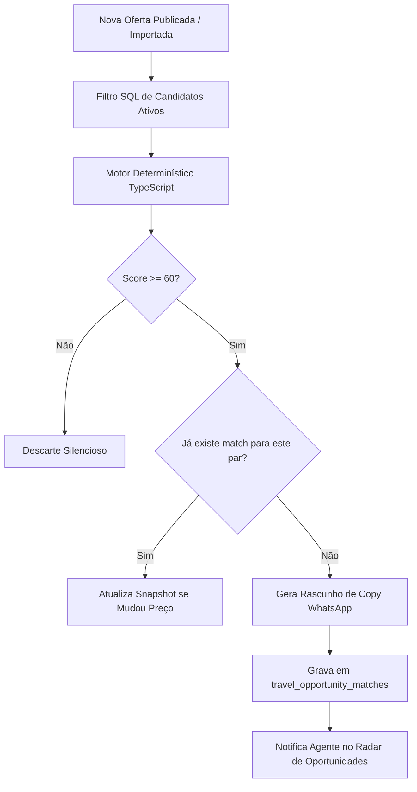

# OFFER MATCHING ENGINE — MOTOR DETERMINÍSTICO DE COMPATIBILIDADE
## Arquitetura de Gatilhos, Fluxo Algébrico e Geração de Oportunidades
**Data:** 2026-10-21  
**Módulo:** Turismo / Excelência Tour  

---

### 1. Arquitetura de Gatilhos (Dual Triggers)

O motor é acionado de forma bidirecional e eficiente:
1. **Trigger de Oferta Nova (One-to-Many):**
   - Ao publicar uma oferta de pacote no marketplace (`classifieds.category = 'travel'`), o motor busca todos os `travel_interests` ativos e abertos daquela agência e avalia a compatibilidade.
2. **Trigger de Interesse Novo (Many-to-One):**
   - Ao registrar uma nova intenção de passageiro no radar comercial, o motor busca o catálogo de ofertas ativas e publica os matches imediatos.

### 2. Por que Determinístico Primeiro?

1. **Escalabilidade e Custo:** Uma agência média com 2.000 interesses acumulados geraria 2.000 chamadas de LLM para cada oferta publicada. Isso destruiria o orçamento de API e levaria minutos.
2. **Explicabilidade:** O corretor precisa ver *por que* o match ocorreu ("Destino exato: +35pts, Orçamento dentro da margem: +25pts, Mês coincidente: +20pts").
3. **Velocidade:** 2.000 avaliações matemáticas executam em menos de 15 milissegundos na memória do servidor.
4. **LLM no Lugar Certo:** A IA é reservada para personalização estilística do copy de abordagem e interpretação de transcrições de áudio/áudios do WhatsApp.
