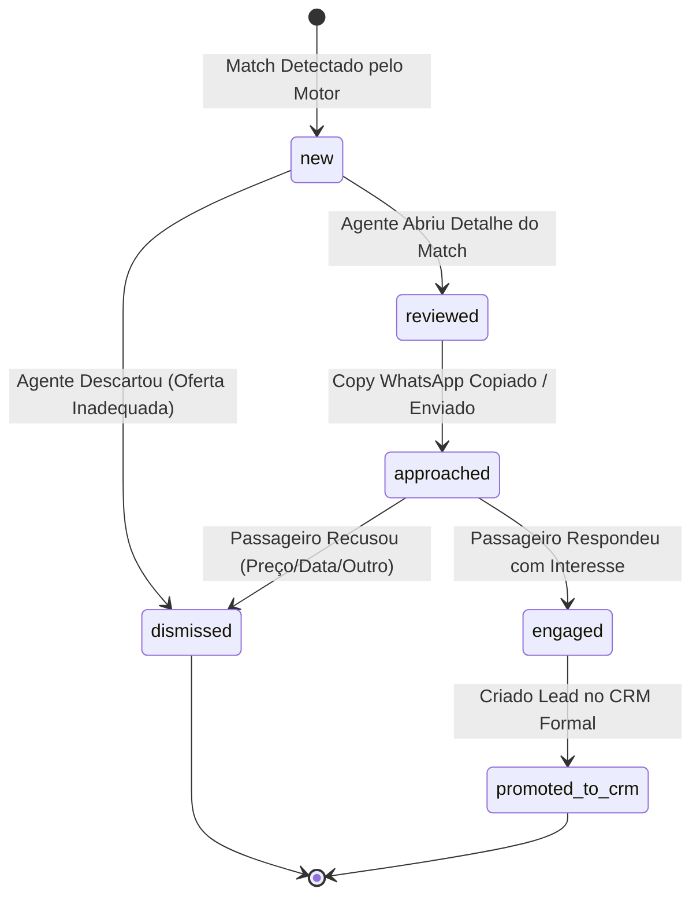

# OPPORTUNITY LIFECYCLE — CICLO DE VIDA DA OPORTUNIDADE DE VENDA
## Estados de Transição, Ações do Agente e Rastreabilidade de Interações
**Data:** 2026-10-21  
**Módulo:** Turismo / Excelência Tour  

---

### 1. Máquina de Estados da Oportunidade (`TravelOpportunityMatch`)

### 2. Definição Estrita dos Estados

1. **`new` (Nova Oportunidade):**
   - Gerada pelo motor de matching determinístico após a publicação de uma nova oferta ou lote.
   - Apresentada no topo do Radar de Oportunidades com badge de alta prioridade se `match_score >= 80`.

2. **`reviewed` (Em Revisão pelo Agente):**
   - O corretor abriu a lâmina de inspeção lateral para avaliar a decomposição do score e a adequação da oferta antes de mandar mensagem.

3. **`approached` (Abordagem Enviada):**
   - O corretor clicou no botão tátil "Copiar Abordagem WhatsApp" ou "Enviar pelo WhatsApp Web".
   - O timestamp e o rascunho de mensagem são salvos em `interaction_history`.

4. **`engaged` (Engajamento Positivo):**
   - O passageiro demonstrou interesse, fez perguntas sobre o hotel ou pediu opções de datas adicionais.

5. **`promoted_to_crm` (Promovido ao CRM):**
   - O agente formalizou a negociação clicando em "Promover ao CRM".
   - Um registro é inserido em `public.leads_crm` com todas as dimensões herdadas, histórico de interações e vínculo com o anúncio original.
   - O status do contato comercial é atualizado para `promoted_to_crm`.

6. **`dismissed` (Descartado com Motivo):**
   - Oportunidade arquivada com tipificação de objeção: `price_too_high`, `dates_changed`, `already_traveled`, `no_interest` ou `other`.
   - Alimenta o aprendizado do motor para calibrar pesos futuros.
