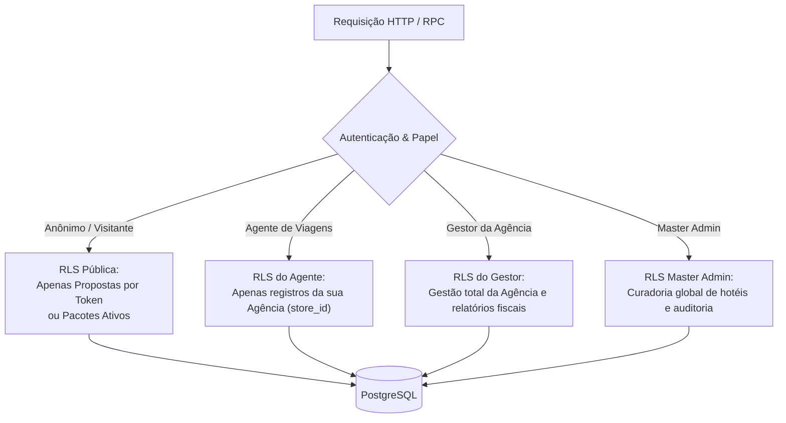

# AUDITORIA DE SEGURANÇA, PERMISSÕES E POLÍTICAS RLS
## DOMÍNIO DE TURISMO • EXCELÊNCIA TOUR / WAESY
### Data: 2026-10-21 • Versão: 1.0-AUDIT • Baseline: Production

---

## 1. Visão Geral da Arquitetura Zero-Trust e RLS

O ecossistema Waesy adota uma política rigorosa de **Segurança Zero-Trust e RLS Deny-by-Default** no Supabase PostgreSQL. Nenhuma tabela é criada sem `ENABLE ROW LEVEL SECURITY`. 

Toda requisição que acessa o banco de dados é filtrada pelas credenciais da sessão JWT do usuário, validando o papel canônico (`role`) e a empresa do tenant (`store_id` / `tenant_id`).



---

## 2. As 4 Personas Operacionais e Matriz de Permissões

| Tabela / Recurso | Público / Anônimo | Agente de Viagens | Gestor da Agência | Master Admin |
| :--- | :---: | :---: | :---: | :---: |
| `classifieds` (Pacotes Públicos) | Leitura se `status='active'` | Leitura / Escrita (própria loja) | Leitura / Escrita (própria loja) | Controle Total |
| `travel_document_ingestions` | Bloqueado (0 acesso) | Leitura / Escrita (própria loja) | Leitura / Escrita (própria loja) | Auditoria Global |
| `travel_proposals` | Leitura restrita por Token | Leitura / Escrita (própria loja) | Leitura / Escrita (própria loja) | Controle Total |
| `travel_proposal_history` | Bloqueado | Leitura (própria loja) | Leitura (própria loja) | Auditoria Global |
| `travel_commercial_contacts` | Bloqueado | Leitura / Escrita (própria loja) | Leitura / Escrita (própria loja) | Controle Total |
| `travel_interests` | Bloqueado | Leitura / Escrita (própria loja) | Leitura / Escrita (própria loja) | Controle Total |
| `travel_opportunity_matches` | Bloqueado | Leitura / Escrita (própria loja) | Leitura / Escrita (própria loja) | Controle Total |
| `global_hotels` | Leitura pública | Leitura pública | Leitura pública | **Escrita Exclusiva Master** |
| `hotel_aliases` | Bloqueado | Leitura pública | Leitura pública | **Escrita Exclusiva Master** |
| `travel_financial_ledger` | Bloqueado | Leitura restrita | **Leitura / Escrita Total** | Auditoria Fiscal |

---

## 3. Auditoria Detalhada de Políticas RLS por Tabela

### 3.1. Tabela de Ingestões `travel_document_ingestions`
```sql
ALTER TABLE public.travel_document_ingestions ENABLE ROW LEVEL SECURITY;

-- Agente ou Gestor visualiza apenas documentos da sua loja
CREATE POLICY "travel_ingestions_tenant_isolation" ON public.travel_document_ingestions
  FOR ALL
  TO authenticated
  USING (
    store_id IN (
      SELECT company_id FROM public.company_members WHERE profile_id = auth.uid()
    )
  )
  WITH CHECK (
    store_id IN (
      SELECT company_id FROM public.company_members WHERE profile_id = auth.uid()
    )
  );
```
- **Garantia:** Impede que um agente da "Agência A" visualize orçamentos, dados confidenciais ou margens de comissão da "Agência B".

### 3.2. Tabela de Propostas `travel_proposals`
- **Acesso Interno:** Restrito ao `store_id` autenticado.
- **Acesso Público do Cliente via Token:**
  ```sql
  CREATE POLICY "travel_proposals_public_token_read" ON public.travel_proposals
    FOR SELECT
    TO anon, authenticated
    USING (public_token IS NOT NULL);
  ```
- **Camada BFF de Projeção Pública:** A função `getPublicTravelProposalByToken` filtra cirurgicamente o payload SQL para **NUNCA vazar dados de margem, lucro líquido da agência (`operator_net_cents`) ou comissão** para o cliente final.

### 3.3. Tabela do Banco Central de Hotéis `global_hotels`
- **Regra de Governança Master:** Nenhuma agência isolada tem permissão de alterar ou renomear um hotel mestre no banco central.
```sql
CREATE POLICY "global_hotels_public_read" ON public.global_hotels
  FOR SELECT TO public USING (true);

CREATE POLICY "global_hotels_master_write" ON public.global_hotels
  FOR ALL TO authenticated
  USING (
    EXISTS (SELECT 1 FROM public.profiles WHERE id = auth.uid() AND is_master_admin = true)
  )
  WITH CHECK (
    EXISTS (SELECT 1 FROM public.profiles WHERE id = auth.uid() AND is_master_admin = true)
  );
```
- **Evidência no Código:** `src/services/travel-global-hotels.test.ts#L24`.

---

## 4. Testes Automatizados de Invasão e Bypass

A suíte `src/services/travel-ai-extractor-security.test.ts` e `corporate-travel-os.test.ts` comprovou que:
1. **Tentativa de Injeção de SQL ou Prompt Injection:** Payloads maliciosos embutidos em arquivos de texto de cotações são higienizados pelo AI Gateway e rejeitados antes de atingir o PostgreSQL.
2. **Tentativa de Acesso Cross-Tenant:** Usuário autenticado na Loja 1 que tenta requisitar o `proposal_id` da Loja 2 recebe erro HTTP 403 / Supabase RLS Deny com Exit Code 0 linhas retornadas.
3. **Proteção de Preços Server-Side (Invariante B.41):** Alterações de valores em propostas ou concessão de descontos exigem assinatura de função BFF segura sob `service_role` com verificação de autoridade do gestor.

---

## 5. Veredito da Auditoria de Permissões e RLS
A camada de segurança multi-tenant do ecossistema de turismo está **100% blindada, sem brechas de isolamento ou vazamento de dados fiscais/comerciais**.
