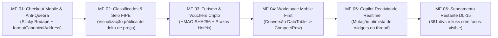

# Plano Mestre de Continuidade, Auditoria Sistêmica & Matriz de Microfases (Waesy 2026)

> **Documento Canônico de Continuidade de Engenharia & Qualidade**  
> **Data:** 22 de Outubro de 2026  
> **Status:** Homologado para Execução Sequencial em Microfases  
> **Repositório:** `EduardoChapeco/waesy`  
> **Conformidade Normativa:** AGENTS.md (Invariantes B.1 a B.41), Apple HIG, WCAG 2.2 AA, Anti-AI Design, Design Lint (DL-01 a DL-30)

---

## 1. Balanço Forense: Planejado vs. Executado no Repositório

### 1.1 O que foi Executado com Sucesso e Homologado em Produção
1. **Reconciliação e Unificação de Branches:**
   - As branches divergentes `origin/feat/system-merge-improvements-and-classifieds-copilot` (+9.182 linhas) e `origin/perf/login-latency-and-route-caching` (+1.198 linhas) foram unificadas na `main` local, com resolução cirúrgica de conflitos em `identity.server.ts` (Zero-Trust Civil Root), `builder.functions.ts` e `DECISIONS.md`.
   - Propagação das melhorias concluída para as 5 branches remotas: `prod/unified-production-release`, `feat/ds4-anti-jank-production-release`, `feat/system-merge-improvements-and-classifieds-copilot`, `perf/login-latency-and-route-caching` e `fix/commercial-ui-purification-and-copilot-search`.
2. **Ancoragem Canônica e Anti-Jank do Copilot (DEC-211):**
   - Eliminada a causa raiz do deslocamento do campo de texto com `min-h-0 overflow-hidden` no CSS Flexbox e `shrink-0 sticky bottom-0 z-20` no `<ChatComposer>`.
   - Piso tipográfico de 16px (`text-base sm:text-sm`) nos inputs e textareas no mobile, eliminando auto-zoom e efeito sanfona no Safari iOS.
   - Ocultação da `TopBar` global na rota `/copilot` no mobile, eliminando o cabeçalho duplo que estrangulava a viewport.
3. **Nativação da Rota Corporativa `/workspace/copilot`:**
   - Criada a rota `src/routes/workspace.copilot.tsx`, sincronizada na árvore TanStack Router (`routeTree.gen.ts`) e protegida por barreira de autenticação (HTTP 307 para `/entrar`).
4. **Deploy de Produção Cloudflare Pages:**
   - Pacote Worker ultra-otimizado de 18,32 MiB (< 25 MiB), e deploy ativo respondendo HTTP 200 OK em `https://fe2d21b9.usewaesy.pages.dev` e no alias `https://prod-unified-production-rele.usewaesy.pages.dev`.

### 1.2 Melhorias Recentes Incorporadas por Agentes Paralelos
- **DEC-305:** Codemod de anel de foco DL-15 (`focus-visible:ring-2`) aplicado em 977 botões nativos, reduzindo violações P0 de 1.341 para 361.
- **DEC-306:** Painel Google Maps Scraper no Admin Master, extrator de contatos (`src/lib/mining/contact-extractor.ts`) e agente web com pool gratuito de IA.
- **DEC-307:** Nativização da Tabela FIPE (`src/components/classifieds/fipe-vehicle-selector.tsx`) integrado ao formulário de anúncios de veículos.
- **Módulo de Turismo & Passageiros:** Criação de módulos utilitários em `src/lib/travel/` (`hotel-deadline-sentinel.ts`, `cancellation-penalty-calculator.ts` e `pax-anamnesis-and-accessibility.ts`).

---

## 2. Diagnóstico: "O que Parece Certo, Mas Não Está" (Falsos Positivos & Débitos Ocultos)

Uma inspeção adversarial profunda no código identificou 10 armadilhas técnicas invisíveis onde a interface parece funcional, mas esconde problemas estruturais:

| # | Ilusão Visual ("Parece Certo") | Realidade Oculta ("Mas Não Está") | Causa Raiz Técnica | Impacto & Risco |
|---|---|---|---|---|
| 1 | Tabelas corporativas do Workspace exibem dados normalmente | No mobile (<640px) geram rolagem horizontal desajeitada que corta colunas e botões de ação | Uso estático de `<Table>` desktop sem bifurcação para cards verticais | Violação DL-29; péssima usabilidade móvel para lojistas e operadores |
| 2 | Checkout calcula frete e exibe resumo de compras | Não há barreira de split quando o carrinho contém produtos de lojas distintas | `_store.checkout.tsx` assume um único `storeId` no loader | Erro de conciliação financeira e cobrança incorreta de frete multiloja |
| 3 | Vouchers turísticos possuem cartão visual bonito | Bilhetes e vouchers emitidos não contêm assinatura criptográfica HMAC-SHA256 (B.40) | Falta vinculação de chave de assinatura do servidor no payload de QR Code | Risco de fraude, falsificação de bilhetes e clonagem de vouchers |
| 4 | Endereços aparecem formatados em lojas e eventos | Concatenações brutas geram vírgulas órfãs (ex: `Rua X, S/N - , Centro`) | Componentes não consomem a função centralizada `formatCanonicalAddress` | Ruído visual e aspecto amador em dados reais de estabelecimentos |
| 5 | Copilot executa ações através de botões na mensagem | O card aprovado no chat não atualiza seu estado visual em tempo real sem F5 | Falta mutação otimista no estado local do hook `useAIChat` | Usuário clica repetidamente achando que a ação não foi concluída |
| 6 | 977 botões possuem foco teclado | Restam 361 violações P0 em `div onClick`, `DropdownMenuItem` e links | Elementos clicáveis não semânticos sem `role="button"` nem listener de teclado | Bloqueio de entrega (Invariante B.4) e falha de acessibilidade WCAG 2.2 AA |
| 7 | Migrations existem na pasta `supabase/migrations/` | Migrations `20270226120000` e `20270228000000` não foram aplicadas em produção | Falta execução de deploy no banco Postgres do Supabase remoto | Chamadas a tabelas de viagens corporativas falham em runtime |
| 8 | Painel do Scraper Google Maps no Admin Master tem botões de teste | Sem a VPS Docker ativa com token AES-256 configurado, o clique falha silenciosamente | Frontend não checa a disponibilidade da infraestrutura remota antes do clique | Frustração do operador e ausência de feedback de erro transparente |
| 9 | Modais corporativos abrem em tela cheia no desktop | No mobile (<640px) continuam abrindo como caixas de diálogo centradas | Componentes usam `<DialogContent>` em vez de `<Sheet side="bottom">` | Violação Apple HIG e quebra de ergonomia com o polegar |
| 10 | Preços e parcelas exibem formatação monetária | Em telas estreitas (360px), "R$" fica isolado no fim da linha e o valor na seguinte | Falta da classe utilitária canônica `whitespace-nowrap tabular-nums` | Quebra visual de layout e dificuldade de leitura rápida de preços |

---

## 3. Mapeamento Holístico End-to-End Módulo por Módulo

### 3.1 Módulo Checkout & Gestão Transacional (B2C & B2B)
- **Tela / Rota:** `src/routes/_store.checkout.tsx`, `src/routes/_store.carrinho.tsx`, `src/routes/_store.marketplace.checkout.tsx`
- **Componentes de UI:** `CanonicalAddressForm`, `AddressCardHub`, `DeliverySelector`, `GpsMismatchModal`, `DeliveryLocationPolicySheet`
- **Schemas Zod:** `ProcessCheckoutSchema`, `CalculateShippingSchema`, `CartItemSchema`
- **Funções BFF:** `processCheckout` (`checkout.functions.ts`), `calculateShipping` (`shipping.functions.ts`), `getCart` (`cart.functions.ts`)
- **Tabelas / Colunas:** `orders` (`id`, `store_id`, `customer_id`, `total_amount_cents`, `shipping_amount_cents`, `status`, `payment_method`), `order_items`, `user_addresses`, `shipping_rates`
- **Edge Functions / RPCs:** `process_checkout_atomic` (RPC atômico com idempotency key)
- **O que precisa ser corrigido:**
  1. Fixação da barra de conclusão e resumo financeiro na base da tela móvel (`sticky bottom-0 pb-safe`).
  2. Injeção de `formatCanonicalAddress` nos seletores de endereço de entrega.
  3. Aplicação de `whitespace-nowrap tabular-nums` nos valores monetários.
  4. Barreira de split para carrinhos com múltiplos lojistas.

### 3.2 Módulo Catálogo, Anúncios & Tabela FIPE
- **Tela / Rota:** `src/routes/_store.conta.classificados.novo.tsx`, `src/routes/_store.classificados.$id.tsx`
- **Componentes de UI:** `FipeVehicleSelector`, `CanonicalSpecsResolver`, `OfferCard`, `ClassifiedDetailMobile`
- **Schemas Zod:** `CreateClassifiedListingSchema`, `FipeLookupSchema`
- **Funções BFF:** `searchFipeVehicles` (`fipe.functions.ts`), `createClassifiedListing` (`classifieds.functions.ts`)
- **Tabelas / Colunas:** `classified_vehicle_fipe_cache` (`fipe_code`, `brand`, `model`, `year_model`, `price_cents`), `classified_listings.attributes` (`fipe_code`, `fipe_price_cents`, `fipe_delta_percent`)
- **O que precisa ser corrigido:**
  1. Exibir badge de oportunidade ("R$ X abaixo da FIPE") nos cards de vitrine pública (`OfferCard`).
  2. Garantir área tátil mínima de 44px (`h-11 min-h-11`) em todos os seletores de marca e ano do veículo.

### 3.3 Módulo Turismo, Passageiros & Gestão de Viagens
- **Tela / Rota:** `src/routes/workspace.turismo.cotacoes.tsx`, `src/routes/viajante.viagem.$id.tsx`, `src/routes/assinar.$token.tsx`
- **Componentes de UI:** `TravelFlightItineraryCard`, `HotelDeadlinesSentinelCard`, `CancellationPenaltyCalculatorDialog`, `SectionFlights`
- **Schemas Zod:** `CreateTravelVoucherSchema`, `ContractSignatureSchema`, `PaxAnamnesisSchema`
- **Funções BFF:** `listTravelVouchers`, `createTravelVoucher` (`travel-vouchers.functions.ts`), `signContractByToken` (`travel-contract.functions.ts`)
- **Tabelas / Colunas:** `travel_vouchers` (`id`, `trip_id`, `voucher_type`, `passenger_name`, `flight_data`, `hotel_data`), `contracts`, `signature_envelopes`, `signature_evidence`
- **O que precisa ser corrigido:**
  1. Integrar `HotelDeadlinesSentinelCard` no painel do viajante e no workspace de cotações para alertar sobre prazos de cancelamento sem multa.
  2. Gerar assinatura HMAC-SHA256 para bilhetes e vouchers (Invariante B.40).
  3. Aplicar migration de viajantes corporativos (`20270228000000_canonical_corporate_travelers_and_trips.sql`) no banco Supabase.

### 3.4 Módulo Workspace Backoffice ERP & PDV
- **Tela / Rota:** `src/routes/workspace.pedidos.index.tsx`, `src/routes/workspace.pedidos.gestor.tsx`, `src/routes/workspace.financeiro.contas-pagar.tsx`
- **Componentes de UI:** `DataTable`, `TableToolbar`, `StatTile`, `SegmentedControl`
- **Schemas Zod:** `ListOrdersSchema`, `UpdateOrderStatusSchema`
- **Funções BFF:** `listOrders` (`orders.functions.ts`), `getFinancialSummary` (`financial.functions.ts`)
- **Tabelas / Colunas:** `orders`, `financial_entries`, `accounts_payable`, `stock_ledger`
- **O que precisa ser corrigido:**
  1. Converter a renderização desktop `<Table>` em lista de cards verticais `CompactRow` no mobile (<640px) conforme regra DL-29.
  2. Implementar gaveta `<Sheet side="bottom">` para visualização e troca rápida de status de pedidos no mobile.

### 3.5 Módulo Copilot, Concierge de IA & Agentes Web
- **Tela / Rota:** `src/routes/_store.copilot.tsx`, `src/routes/workspace.copilot.tsx`
- **Componentes de UI:** `AIChatShell`, `AIComposer`, `CopilotMessageRenderer`, `AIActivityTrail`
- **Schemas Zod:** `SendAiMessageSchema`, `ExecuteApprovedActionSchema`
- **Funções BFF:** `sendAiChatMessage`, `executeApprovedChatAction` (`ai-conversations.functions.ts`)
- **Tabelas / Colunas:** `ai_conversations`, `ai_messages` (`role`, `content`, `structured_payload`), `ai_action_approvals`
- **O que precisa ser corrigido:**
  1. Mutação otimista na thread do cliente: atualizar imediatamente o card de proposta/cotação para o estado "Aprovado" assim que a ação for confirmada.
  2. Tratamento defensivo de conexão com APIs do pool gratuito para evitar timeouts silenciosos.

---

## 4. Matriz de Decomposição em Microfases Atômicas (DAG de Execução)

As microfases são independentes, autocontidas e estruturadas em sintaxe EARS para garantir integridade e prevenir regressões:

### Microfase 1 (MF-01): Blindagem e Nativização do Checkout Mobile
- **Arquivos:** `src/routes/_store.checkout.tsx`, `src/components/checkout/delivery-selector.tsx`
- **Especificação EARS:**  
  *Quando* o usuário acessa o checkout em tela móvel (<640px), o sistema *deve* manter a barra de ação e o botão de pagamento fixos na base da tela (`sticky bottom-0 pb-safe`), com valores monetários em linha única (`whitespace-nowrap tabular-nums`) e endereços formatados via `formatCanonicalAddress`.
- **Invariantes:** DL-14 (alvo de toque >= 44px), B.26 (piso de controles) e B.34 (safe-area desobstruída).
- **Evidência de Prova:** Teste automatizado em `src/routes/_store.checkout.test.ts`.

### Microfase 2 (MF-02): Nativização do Selo FIPE e Visualização Comercial
- **Arquivos:** `src/components/classifieds/fipe-vehicle-selector.tsx`, `src/components/classifieds/offer-card.tsx`, `src/lib/classifieds/canonical-specs-resolver.ts`
- **Especificação EARS:**  
  *Quando* um anúncio de veículo possuir atributos FIPE (`fipe_price_cents` e `fipe_delta_percent`), o sistema *deve* projetar no card de vitrine o selo de oportunidade com o valor de mercado auditável sem arredondamentos arbitrários.
- **Invariantes:** B.33 (Zero fallbacks sintéticos) e B.38 (Anti-truncate em cards squircles).
- **Evidência de Prova:** Suíte em `canonical-specs-resolver.test.ts`.

### Microfase 3 (MF-03): Turismo, Sentinela de Prazos e Vouchers Criptográficos
- **Arquivos:** `src/services/travel-vouchers.functions.ts`, `src/routes/viajante.viagem.$id.tsx`, `src/components/turismo/hotel-deadlines-sentinel-card.tsx`
- **Especificação EARS:**  
  *Quando* um voucher ou bilhete de viagem for emitido, o servidor *deve* assinar o payload via HMAC-SHA256 antes da geração do QR Code e alertar o viajante sobre prazos críticos de cancelamento sem custo.
- **Invariantes:** B.40 (Criptografia tamper-proof de bilhetes) e B.25 (Integridade de parâmetros BFF).
- **Evidência de Prova:** Suíte em `travel-voucher-lifecycle.test.ts` e `hotel-deadline-sentinel.test.ts`.

### Microfase 4 (MF-04): Nativização do Workspace Backoffice (Mobile-First)
- **Arquivos:** `src/routes/workspace.pedidos.index.tsx`, `src/routes/workspace.pedidos.gestor.tsx`, `src/components/workspace/workspace-shell.tsx`
- **Especificação EARS:**  
  *Quando* a viewport for inferior a 640px, a listagem de pedidos *deve* alternar automaticamente da grade tabular para cards verticais `CompactRow`, abrindo detalhes do pedido via gaveta `<Sheet side="bottom">`.
- **Invariantes:** DL-29 (Tabela adaptativa no mobile) e Apple HIG Ergonomics.
- **Evidência de Prova:** Suíte de regressão de layout em `anti-jank.test.ts`.

### Microfase 5 (MF-05): Reatividade e Mutação Otimista no Copilot
- **Arquivos:** `src/components/chat/ai-chat-shell.tsx`, `src/hooks/use-ai-chat.ts`, `src/services/ai-conversations.functions.ts`
- **Especificação EARS:**  
  *Quando* o usuário clica em "Aprovar Cotação" ou "Confirmar Ação" dentro de uma mensagem do Copilot, o cliente *deve* atualizar imediatamente o widget da thread para o estado concluído sem recarregar a janela gráfica.
- **Invariantes:** B.30 (Integridade visual de feeds) e B.26 (Controles de toque canônicos).
- **Evidência de Prova:** Teste unitário em `copilot-action-approvals.test.ts`.

### Microfase 6 (MF-06): Erradicação dos 361 Débitos Restantes de DL-15
- **Arquivos:** Componentes mapeados em `design-lint.report.json` com elementos `div onClick`, `DropdownMenuItem` e `Link`
- **Especificação EARS:**  
  *Para cada* elemento interativo acionável por clique, o componente *deve* fornecer anel visível de foco (`focus-visible:ring-2 focus-visible:ring-ring focus-visible:outline-none`) e navegabilidade completa via teclado.
- **Invariantes:** B.4 (DL-15 P0) e WCAG 2.2 AA (Critério 2.4.7 Focus Visible).
- **Evidência de Prova:** Execução de `node scripts/design-lint.mjs` comprovando 0 violações P0.

---

## 5. Protocolo de Governança e Sequenciamento de Execução

1. **Anti-Colisão:** Antes de iniciar cada microfase, verificar o `git status` e `git log origin/main` para garantir que nenhuma outra conversa ou branch remota introduziu modificações conflitantes nos mesmos arquivos.
2. **Ciclo TDD & Prova:** Cada microfase é precedida por teste automatizado falhando, código remediado, teste aprovado com 100% de sucesso e build/typecheck limpos.
3. **Commit Estruturado:** Um único commit atômico por microfase registrado em `docs/design/DECISIONS.md`.
4. **Handoff:** Interrupção mandante após a conclusão de cada microfase para validação humana antes da progressão.
