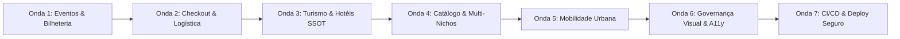

# PLANO-MESTRE GLOBAL: Auditoria Forense, Mapeamento de Pendências e Todas as Próximas Ondas de Engenharia (2026)

**Identificador do Documento:** `DOC-AUDIT-MASTER-2026-GLOBAL`  
**Status Normativo:** Ativo / SSOT Absoluta do Repositório  
**Data de Emissão:** 22 de Outubro de 2026  
**Governança:** `AGENTS.md` (Invariantes B.1 a B.45) | `docs/design/DESIGN.md` | Piso WCAG 2.2 AA | Padrão Apple HIG & Linear  
**Destino de Versionamento:** GitHub (`origin/main` / branches de sustentação)  

---

## ÍNDICE GERAL

1. [Sumário Executivo & Diagnóstico Forense da Sessão](#1-sumário-executivo--diagnóstico-forense-da-sessão)
2. [Matriz Comparativa: O Que Foi Executado vs. O Que Parece Certo Mas Não Está](#2-matriz-comparativa-o-que-foi-executado-vs-o-que-parece-certo-mas-não-está)
3. [Inventário Forense dos 12 Débitos Ocultos Estruturais](#3-inventário-forense-dos-12-débitos-ocultos-estruturais)
4. [As 7 Ondas de Engenharia & Decomposição MECE em Microfases](#4-as-7-ondas-de-engenharia--decomposição-mece-em-microfases)
   - [Onda 1: Eventos, Luma-Style Showcase & Bilheteria Civil](#onda-1-eventos-luma-style-showcase--bilheteria-civil)
   - [Onda 2: Checkout Transacional, Logística & Plataforma de Endereços](#onda-2-checkout-transacional-logística--plataforma-de-endereços)
   - [Onda 3: Turismo SSOT, Hotéis Canônicos & Universal Niche Cards](#onda-3-turismo-ssot-hotéis-canônicos--universal-niche-cards)
   - [Onda 4: Catálogo de Produtos, Imóveis, Veículos & Multi-Nichos](#onda-4-catálogo-de-produtos-imóveis-veículos--multi-nichos)
   - [Onda 5: Mobilidade Urbana (Waesy Go) & Serviços Locais](#onda-5-mobilidade-urbana-waesy-go--serviços-locais)
   - [Onda 6: Governança Visual, Anti-AI Smell & Acessibilidade WCAG 2.2 AA](#onda-6-governança-visual-anti-ai-smell--acessibilidade-wcag-22-aa)
   - [Onda 7: Esteira de CI/CD, Provas Automatizadas & Auditoria Pré-Deploy](#onda-7-esteira-de-cicd-provas-automatizadas--auditoria-pré-deploy)
5. [Contrato de Execução Multi-Agente & Protocolo de Não-Colisão](#5-contrato-de-execução-multi-agente--protocolo-de-não-colisão)
6. [Registro de Decisões e Critérios de Conclusão (Definition of Done)](#6-registro-de-decisões-e-critérios-de-conclusão-definition-of-done)

---

## 1. Sumário Executivo & Diagnóstico Forense da Sessão

O ecossistema operacional Waesy passou por uma série de aprimoramentos arquiteturais nas camadas centrais de persistência e segurança transacional:
- **Plataforma Canônica de Endereços (DEC-304):** Paridade Mercado Livre com instruções de entrega, pin no mapa via MapLibre, normalização de CEP e procedimentos atômicos no PostgreSQL (`save_user_address_atomic`, `set_default_user_address_atomic`).
- **Segurança Criptográfica de Ingressos (DEC-318):** Blindagem anti-injeção WCTS-1 com assinatura HMAC-SHA256 server-side.
- **Universal Niche Card (DEC-263):** Padronização squircle em 2 colunas para 7 verticais de negócio.
- **Turismo & Hotelaria SSOT (DEC-317 / DEC-319):** Catálogo de resorts canônicos, metas escalonadas e persistência multi-tenant.

Apesar desses avanços comprovados por testes automatizados, uma auditoria forense detalhada de ponta a ponta (Banco de Dados ↔ Funções BFF ↔ Telas e Modais) revelou que diversas rotas apresentam **conformidade apenas cosmética**, simulando funcionalidades que não possuem vínculo relacional profundo ou que bloqueiam o usuário final por ausência de rotas civis e acoplamento indevido.

Este documento estabelece o backlog exaustivo e imutável para as próximas fases de engenharia, servindo como guia estrito para desenvolvedores e agentes autônomos.

---

## 2. Matriz Comparativa: O Que Foi Executado vs. O Que Parece Certo Mas Não Está

| Módulo / Funcionalidade | O Que Foi Realmente Executado (Verde) | O Que Parece Certo Mas NÃO Está (Débito Oculto) | Severidade |
| :--- | :--- | :--- | :--- |
| **Eventos: Gestão & CRUD** | Telas de cockpit, subpainéis de PDV, validador QR Code de portaria (`workspace.eventos.*`). | O botão "Excluir Evento" dispara apenas um toast informativo; não há soft-delete (`deleted_at`), arquivamento real ou duplicação. | **P0** |
| **Eventos: Acesso Civil** | Rota pública de detalhe (`_store.evento.$id.tsx`) e classificados de eventos. | Civis não possuem rota para criar eventos; a criação exige estar dentro de `/workspace/eventos/`, que bloqueia usuários sem loja de eventos aprovada. | **P0** |
| **Eventos: Modo Link-Only** | Campo de status e visualização de evento. | Quando configurado como restrito a link, a página ainda renderiza o `AppShell` da vitrine (logo gigante da Waesy, busca urbana, barra comercial) em vez de casca limpa de evento. | **P1** |
| **Eventos: Story 9:16** | Player 9:16 existe dentro de `event-classified-showcase-view.tsx`. | O story não abre automaticamente no carregamento da página principal do evento (`_store.evento.$id.tsx`). | **P1** |
| **Eventos: Captura de Lead** | Modal de compra com barreira de login `ActionAuthGuardModal`. | Visitantes que desejam se inscrever ou confirmar RSVP são forçados a criar senha no Supabase imediatamente, gerando alta taxa de abandono. | **P1** |
| **Checkout: Frete Reativo** | `AddressCardHub` integrado e seleção de endereço na tela `_store.checkout.tsx`. | Ao selecionar um endereço diferente no hub, o hook de frete NÃO dispara recálculo; o valor e o prazo ficam congelados no primeiro CEP carregado. | **P0** |
| **Checkout: Metadados** | Formulário captura passageiros, troco, talheres e agendamentos. | Dados persistidos em JSONB genérico (`orders.checkout_niche_metadata`) sem validação Zod discriminada e sem índices GIN. | **P1** |
| **Loja: Geolocalização** | Aba de configurações com inputs de endereço (`workspace.configuracoes.index.tsx`). | Formulário utiliza inputs manuais de texto sem capturar latitude e longitude da loja, quebrando o motor de frete por raio Waesy Go / MotoLink. | **P1** |
| **Loja: Horários & Status** | Selos dinâmicos "Aberto Agora" / "Fechado" nas vitrines. | `isStoreOpenNow` calcula o status utilizando o relógio local do navegador do cliente em vez do fuso horário da loja (`stores.settings.timezone`). | **P1** |
| **Onboarding de Negócios** | Criação de lojas em 4 etapas com rollback atômico (`onboarding.functions.ts`). | Zonas de entrega carregam estaticamente a constante `CHAPECO_NEIGHBORHOODS` para qualquer município cadastrado no Brasil. | **P1** |
| **Turismo: Preflight de Hotéis** | Função BFF `checkHotelPreflightMatch` implementada. | O input de nome do hotel em `workspace.turismo.hoteis.tsx` não invoca a busca no BFF; o operador digita sem saber se o hotel já existe no banco central. | **P1** |
| **Design: Catálogo Mobile** | Catálogo do lojista responsivo no desktop (`workspace.catalogo.tsx`). | Em viewports móveis de 360px a 390px, títulos compostos usam `truncate` e são cortados com reticências em vez de quebrar em 2 linhas legíveis. | **P1** |

---

## 3. Inventário Forense dos 12 Débitos Ocultos Estruturais

### GAP 01: Ações Fictícias de Gestão no Workspace de Eventos
- **Localização:** `src/routes/workspace.eventos.index.tsx` (linhas 441-446) e `src/services/events.functions.ts`.
- **Sintoma Visual:** O usuário clica no menu de ações do card de evento (`CrudActionsMenu`) e seleciona "Excluir Evento".
- **Defeito Oculto:** O handler executa apenas: `toast.info("Para desativar este evento, altere o status dos lotes para encerrado.")`. Não há chamada ao banco de dados, não há exclusão lógica (`deleted_at`), e a função `duplicateEvent` sequer foi implementada no BFF.
- **Impacto:** O produtor não consegue remover eventos de teste, arquivar edições passadas ou duplicar eventos recorrentes.

### GAP 02: Inexistência de Rota de Criação de Eventos para Usuários Civis
- **Localização:** `src/routes/workspace.eventos.index.tsx` (linha 209).
- **Sintoma Visual:** Usuário comum tenta criar um evento próprio (aniversário, encontro, evento beneficente, torneio).
- **Defeito Oculto:** A única interface de criação de eventos está em `/workspace/eventos/`, que é envolvida por `<NicheOperationalGuard targetNiche="events">`. Usuários civis ou lojas de outros segmentos são redirecionados com mensagem de acesso não autorizado.
- **Impacto:** Viola a premissa de ecossistema aberto onde membros civis podem organizar eventos sem obrigatoriedade de abrir uma empresa no Waesy.

### GAP 03: Ausência de Isolamento no Modo "Somente Via Link"
- **Localização:** `src/routes/_store.evento.$id.tsx` (linhas 270-315).
- **Sintoma Visual:** O produtor cria um evento e marca a visibilidade como "Não listado / Somente via link".
- **Defeito Oculto:** A página é carregada dentro de `_store`, herdando o cabeçalho completo da plataforma (logo grande da Waesy, busca por produtos, seletor de cidades, carrinho).
- **Impacto:** Quebra a identidade visual do evento privado/corporativo e confunde o convidado com elementos comerciais de vitrine.

### GAP 04: Story 9:16 Desconectado da Abertura Automática
- **Localização:** `src/routes/_store.evento.$id.tsx` e `src/components/events/event-detail-mobile.tsx`.
- **Sintoma Visual:** A página do evento carrega normalmente como tela de texto e botões estáticos.
- **Defeito Oculto:** O player de stories 9:16 (1920x1080) exige clique manual em classificados e não possui hook de inicialização automática ao carregar a URL pública.
- **Impacto:** Perda de engajamento visual instantâneo inspirado na experiência de redes sociais (Luma / Instagram).

### GAP 05: Fricção Excessiva e Barreiras de Cadastro de Leads
- **Localização:** `src/components/common/action-auth-guard-modal.tsx` e `src/routes/_store.evento.$id.tsx`.
- **Sintoma Visual:** Visitante tenta confirmar presença (RSVP) ou reservar ingresso gratuito e recebe modal exigindo criação de conta com senha.
- **Defeito Oculto:** O sistema não possui endpoint de "Lead Rápido" que captura Nome Completo + Celular + Consentimento LGPD de contato comercial, postergando a criação de credenciais formais.
- **Impacto:** Abandono massivo de inscrições por parte de visitantes casuais.

### GAP 06: Frete Estático / Congelado na Troca de Endereço no Checkout
- **Localização:** `src/routes/_store.checkout.tsx` (linhas 150-250) e `src/components/address/address-card-hub.tsx`.
- **Sintoma Visual:** O cliente possui múltiplos endereços salvos (ex.: São Paulo e Rio de Janeiro) e clica em outro card no hub.
- **Defeito Oculto:** O estado do formulário altera o ID do endereço selecionado, mas não dispara o hook `calculateShipping({ destinationCep })`. O resumo financeiro mantém o valor e o prazo do endereço original.
- **Impacto:** Cobrança incorreta de frete, risco de prejuízo logístico para a loja ou cancelamento de pedido por divergência de valores.

### GAP 07: Metadados Multi-Nicho em JSONB Desestruturado
- **Localização:** `src/services/checkout.functions.ts` (linha 494) e tabela `orders`.
- **Sintoma Visual:** O checkout processa pedidos de turismo, gastronomia e serviços.
- **Defeito Oculto:** Campos como dados de passageiros, talheres descartáveis e turnos de agendamento são gravados em colunas JSONB soltas (`orders.checkout_niche_metadata`) após a execução da RPC de checkout via uma chamada `.update()` secundária não-atômica.
- **Impacto:** Se a chamada secundária falhar por instabilidade, o pedido é criado sem os metadados necessários para a operação do lojista.

### GAP 08: Endereço da Loja sem Captura de Latitude/Longitude
- **Localização:** `src/routes/workspace.configuracoes.index.tsx` e `src/services/store.functions.ts`.
- **Sintoma Visual:** A loja preenche seu endereço comercial nas configurações.
- **Defeito Oculto:** O formulário usa campos de texto planos em vez do primitivo `AddressField`. Nenhuma coordenada GPS (`latitude`, `longitude`) é gravada na tabela `stores`.
- **Impacto:** O cálculo dinâmico de raio de atendimento e a cotação por quilometragem do Waesy Go / MotoLink falham ou utilizam distância zero.

### GAP 09: Status da Loja ("Aberto/Fechado") Dependente do Horário do Cliente
- **Localização:** `src/lib/business-hours.ts` e `src/components/commerce/business-hours-editor.tsx`.
- **Sintoma Visual:** Clientes visualizam o selo "Aberto Agora" na vitrine pública.
- **Defeito Oculto:** A verificação executa `new Date().getDay()` e `new Date().getHours()` no contexto do navegador do usuário. Um cliente acessando em viagem ou com fuso horário desconfigurado vê o comércio fechado em pleno expediente local.
- **Impacto:** Perda de vendas e pedidos recusados injustificadamente.

### GAP 10: Zonas de Entrega com Bairros de Chapecó Hardcoded
- **Localização:** `src/routes/_store.criar-negocio.tsx` (linhas 28 e 145) e `src/components/commerce/neighborhoods-manager.tsx`.
- **Sintoma Visual:** Comerciante de outra localidade (Florianópolis, Curitiba, São Paulo) cria seu negócio.
- **Defeito Oculto:** A tela carrega a constante `CHAPECO_NEIGHBORHOODS` como bairros pré-cadastrados para ativação de frete.
- **Impacto:** Poluição do banco de dados e cobrança de taxas de entrega em regiões inexistentes para a cidade em questão.

### GAP 11: Preflight Anti-Duplicação de Hotéis Desconectado da Digitação
- **Localização:** `src/routes/workspace.turismo.hoteis.tsx` e `src/services/travel-catalog.functions.ts`.
- **Sintoma Visual:** Agência de turismo digita o nome de um resort conhecido para adicionar ao seu portfólio.
- **Defeito Oculto:** A função `checkHotelPreflightMatch` existe no BFF mas não é invocada no `onChange` do input de nome. O operador não recebe feedback de que o resort já existe no catálogo SSOT central.
- **Impacto:** Duplicação de hotéis na base e desperdício de tempo de cadastro para o operador.

### GAP 12: Truncamento Severo de Textos no Catálogo Mobile
- **Localização:** `src/routes/workspace.catalogo.tsx` e cards de listagem.
- **Sintoma Visual:** Visualização do catálogo em telas móveis estreitas (<390px).
- **Defeito Oculto:** Títulos de produtos e serviços aplicam a classe CSS `truncate`, cortando o nome do produto no meio e impedindo a leitura de variações importantes.
- **Impacto:** Violação direta da Invariante B.38 de integridade textual plena e prejuízo à usabilidade móvel.

---

## 4. As 7 Ondas de Engenharia & Decomposição MECE em Microfases



---

### ONDA 1: Eventos, Luma-Style Showcase & Bilheteria Civil

#### Microfase 1.1 — Schema & CRUD Real de Eventos
* **Objetivo:** Transformar a gestão de eventos em um CRUD completo e relacional, eliminando toasts fictícios de exclusão.
* **Camada 1 (Banco de Dados):**
  - Migration SQL adicionando colunas na tabela `events`:
    ```sql
    ALTER TABLE events 
      ADD COLUMN IF NOT EXISTS deleted_at timestamptz DEFAULT NULL,
      ADD COLUMN IF NOT EXISTS archived_at timestamptz DEFAULT NULL,
      ADD COLUMN IF NOT EXISTS visibility text DEFAULT 'public' CHECK (visibility IN ('public', 'unlisted_link_only')),
      ADD COLUMN IF NOT EXISTS status text DEFAULT 'published' CHECK (status IN ('draft', 'published', 'archived'));

    CREATE INDEX IF NOT EXISTS idx_events_active ON events (store_id) WHERE deleted_at IS NULL;
    CREATE INDEX IF NOT EXISTS idx_events_visibility ON events (visibility) WHERE deleted_at IS NULL;
    ```
* **Camada 2 (BFF & Server Functions):**
  - Em `src/services/events.functions.ts`:
    - `softDeleteEvent({ data: { eventId: string } })`: atualiza `deleted_at = now()`.
    - `archiveEvent({ data: { eventId: string } })`: alterna entre arquivado e ativo.
    - `duplicateEvent({ data: { eventId: string } })`: duplica registro do evento, cópia de lotes e setores como rascunho com sufixo `(Cópia)`.
    - `updateEventVisibility({ data: { eventId: string, visibility: 'public' | 'unlisted_link_only' } })`.
* **Camada 3 (UI & Componentes):**
  - Em `src/routes/workspace.eventos.index.tsx`:
    - Conectar as ações do `CrudActionsMenu` para chamar as server functions reais.
    - Invalidação reativa via `router.invalidate()`.
    - Modal de confirmação para exclusão com desfazer via toast ou confirmação explícita.
* **Camada 4 (Testes & Evidência):**
  - Testes unitários em `src/services/__tests__/event-crud-lifecycle.test.ts` validando exclusão lógica, duplicação e alternância de visibilidade.

#### Microfase 1.2 — Portal Civil de Eventos
* **Objetivo:** Permitir que qualquer membro civil crie e gerencie eventos sem a obrigatoriedade de possuir loja ou empresa aprovada.
* **Camada 1 (Banco de Dados):**
  - Assegurar que a coluna `events.profile_id` suporte chave estrangeira para `profiles.id` e `store_id` seja opcional (`NULLable`).
* **Camada 2 (BFF):**
  - Em `upsertEvent`: se a sessão autenticada não possuir `store_id`, gravar `profile_id = user.id`.
  - Criar `listCivilianEvents`: retorna eventos pertencentes ao `profile_id` logado.
* **Camada 3 (UI):**
  - Criar nova rota `src/routes/_store.conta.eventos.tsx`: painel simplificado para civis com lista de eventos criados, contagem de presenças e botão de criação.
  - Criar rota rápida de cadastro `src/routes/_store.evento.criar.tsx` com formulário de 1 tela: Título, Data/Hora, Local/Online, Imagem de Capa e Lote Gratuito.
* **Camada 4 (Testes):**
  - Teste de integração simulando usuário com role civil criando evento com sucesso sem possuir registro em `stores`.

#### Microfase 1.3 — Modo "Somente Via Link" com Badge Minimalista Waesy
* **Objetivo:** Permitir eventos privados e corporativos sem a interferência da vitrine comercial do marketplace.
* **Camada 3 (UI):**
  - Em `src/routes/_store.evento.$id.tsx`:
    - Detectar se `event.visibility === 'unlisted_link_only'`.
    - Se verdadeiro, suprimir o cabeçalho comercial global (`TopBar`, `UtilityCluster`, busca e barra de departamentos).
    - Renderizar casca limpa de página de evento: foco total no banner, título, data, mapa e ingressos.
    - No canto inferior direito, renderizar badge flutuante discreta, minimalista e não concorrente (`z-30`):
      ```tsx
      <div className="fixed bottom-4 right-4 z-30 pointer-events-auto">
        <a 
          href="/" 
          target="_blank" 
          rel="noopener noreferrer" 
          className="inline-flex items-center gap-1.5 px-3 py-1.5 rounded-full bg-background/80 hover:bg-background border border-border/60 text-xs font-medium text-muted-foreground hover:text-foreground backdrop-blur-md shadow-sm transition-all focus-visible:ring-2 focus-visible:ring-primary"
        >
          <span className="size-1.5 rounded-full bg-primary animate-pulse" />
          <span>Feito com amor por Waesy</span>
        </a>
      </div>
      ```
* **Camada 4 (Testes):**
  - Teste de renderização comprovando ausência dos elementos do `TopBar` comercial quando `visibility === 'unlisted_link_only'`.

#### Microfase 1.4 — Story 9:16 (1920x1080) com Auto-Abertura
* **Objetivo:** Experiência imersiva de abertura automática inspirada no Luma e Instagram Stories.
* **Camada 1 & 2 (DB & BFF):**
  - Campos `events.story_media_url (text)`, `events.story_media_type (text)` e `events.story_auto_open (boolean DEFAULT true)`.
* **Camada 3 (UI):**
  - Em `src/routes/_store.evento.$id.tsx`:
    - Se `event.story_auto_open && event.story_media_url` e o visitante ainda não visualizou nesta sessão (controlado via `sessionStorage`), abrir automaticamente o Story Viewer.
    - No Mobile: tela cheia 1080x1920, barra de progresso horizontal de 5 segundos, botão discreto "X" no canto superior direito respeitando a safe-area (`top-[max(1rem,env(safe-area-inset-top))]`), pausa ao segurar a tela.
    - No Desktop: modal centralizado mantendo a proporção 9:16 com fundo escurecido e botão de fechar acessível via tecla `Escape`.
* **Camada 4 (Testes):**
  - Teste de ciclo de vida do Story Viewer (pausa, avanço, fechamento e persistência na sessão).

#### Microfase 1.5 — Captura Rápida de Lead & Banner PWA do Evento
* **Objetivo:** Reduzir fricção de confirmação de presença e habilitar instalação do web app do evento.
* **Camada 2 (BFF):**
  - Criar `registerEventLead` em `src/services/events.functions.ts`:
    - Input: `{ event_id, full_name, phone, contact_consent, rsvp_status }`.
    - Grava na tabela `event_leads`. Se for novo lead, cria profile temporário e agenda e-mail de convite para definir senha.
* **Camada 3 (UI):**
  - Modal ágil de confirmação de presença sem solicitar senha na primeira interação.
  - Opção na Sheet de edição do evento para ativar pop-up do PWA com texto personalizado ("Instalar app do evento para ter seu ingresso offline").
* **Camada 4 (Testes):**
  - Teste automatizado de criação de lead e incremento atômico de contadores de presença.

---

### ONDA 2: Checkout Transacional, Logística & Plataforma de Endereços

#### Microfase 2.1 — Sincronização Dinâmica de Frete no Checkout
* **Objetivo:** Tornar o cálculo de frete estritamente reativo à seleção de cartões no `AddressCardHub`.
* **Camada 2 (BFF):**
  - Garantir que `calculateShipping` em `src/services/checkout.functions.ts` receba `destinationCep` ou `addressId` e retorne as opções de entrega atualizadas.
* **Camada 3 (UI):**
  - Em `src/routes/_store.checkout.tsx`:
    - Adicionar `onAddressSelect` no `AddressCardHub` disparando re-cotação de frete imediata.
    - Exibir skeleton sutil apenas no bloco de frete durante o recálculo, sem desestruturar a tela (nulo layout shift).
    - Atualizar o resumo financeiro (`cartSummary.shippingFee` e total) em tempo real.
* **Camada 4 (Testes):**
  - Teste E2E simulando clique entre dois cartões de endereço de cidades distintas e comprovando a atualização do total a pagar.

#### Microfase 2.2 — Integração do `AddressField` nas Configurações da Loja
* **Objetivo:** Garantir que o estabelecimento salve endereço canônico com coordenadas geográficas exatas.
* **Camada 2 (BFF):**
  - Atualizar `saveStoreSettingsSchema` em `src/services/store.functions.ts` para validar `latitude: z.number().optional()` e `longitude: z.number().optional()`.
* **Camada 3 (UI):**
  - Em `src/routes/workspace.configuracoes.index.tsx`:
    - Substituir os inputs de texto dispersos pelo componente canônico `AddressField`.
    - Conectar com mapa interativo para ajuste fino do pin.
    - Salvar coordenadas nas colunas `stores.latitude` e `stores.longitude`.
* **Camada 4 (Testes):**
  - Teste de gravação de configurações comprovando persistência de float com 6 casas decimais.

#### Microfase 2.3 — Normalização de Fuso Horário Comercial
* **Objetivo:** Status da loja ("Aberto Agora" / "Fechado") calculado no fuso horário da sede da empresa.
* **Camada 2 (BFF / Lib):**
  - Refatorar `isStoreOpenNow` em `src/lib/business-hours.ts` utilizando `Intl.DateTimeFormat` configurado para `storeTimezone || "America/Sao_Paulo"`.
* **Camada 3 (UI):**
  - Exibir indicador com horário do estabelecimento: "Abre hoje às 18:00 (Horário de Brasília)".
* **Camada 4 (Testes):**
  - Testes unitários com clientes simulados em fusos UTC-4, UTC+0 e UTC+1 consultando loja em UTC-3.

#### Microfase 2.4 — Desacoplamento Geográfico no Onboarding de Lojas
* **Objetivo:** Eliminar a constante de bairros de Chapecó e habilitar busca dinâmica por município.
* **Camada 2 (BFF):**
  - Criar `getNeighborhoodsByCity` em `src/services/public-apis.functions.ts` consultando `neighborhoods(city_id)`.
* **Camada 3 (UI):**
  - Em `src/routes/_store.criar-negocio.tsx`:
    - Remover importação de `CHAPECO_NEIGHBORHOODS`.
    - Carregar bairros dinamicamente a partir da cidade preenchida no endereço.
    - Se a cidade não tiver bairros cadastrados, permitir digitação rápida com `AddNeighborhoodPill`.
* **Camada 4 (Testes):**
  - Teste de cadastro de loja em outra capital comprovando zonas de frete personalizadas.

#### Microfase 2.5 — Discriminação Zod de Metadados de Pedido
* **Objetivo:** Tipagem estrita e índices de banco para pedidos multi-nicho.
* **Camada 1 (Banco de Dados):**
  - Criar migração SQL com índices GIN em `orders`:
    ```sql
    CREATE INDEX IF NOT EXISTS idx_orders_niche_meta_gin ON orders USING GIN (checkout_niche_metadata);
    CREATE INDEX IF NOT EXISTS idx_orders_custom_fields_gin ON orders USING GIN (custom_fields);
    ```
* **Camada 2 (BFF):**
  - Criar discriminated union no Zod em `checkout.functions.ts` para Turismo, Gastronomia e Serviços.
* **Camada 4 (Testes):**
  - Teste de validação rejeitando payloads corrompidos ou com campos cruzados inválidos.

---

### ONDA 3: Turismo SSOT, Hotéis Canônicos & Universal Niche Cards

#### Microfase 3.1 — Preflight Reativo no Workspace de Hotéis
* **Objetivo:** Evitar duplicidade de resorts e hotéis através de checagem em tempo real na digitação.
* **Camada 3 (UI):**
  - Em `src/routes/workspace.turismo.hoteis.tsx`:
    - Adicionar hook com debounce de 300ms no input de nome do hotel, invocando `checkHotelPreflightMatch`.
    - Ao detectar correspondência no catálogo central, exibir alerta amigável com opção: "Vincular ao Resort Canônico Central" com 1 toque.
* **Camada 4 (Testes):**
  - Teste de interface validando exibição do card de correspondência e autopreenchimento.

#### Microfase 3.2 — Mineração IA com Modal Visual
* **Objetivo:** Ingestão acelerada de hotéis colando link oficial da hospedagem.
* **Camada 3 (UI):**
  - Na Sheet de hotéis, adicionar botão proeminente de 44px: "Minerar por Link Oficial".
  - Modal para colar URL; feedback de progresso durante o scraping/extração Zod; autopreenchimento de comodidades, fotos e regras.
* **Camada 4 (Testes):**
  - Teste da esteira de mineração mockando resposta de extração HTML.

#### Microfase 3.3 — Atalhos de SEO & Vitrine Pública de Turismo
* **Objetivo:** Facilitar a conferência da página pública canônica indexada.
* **Camada 3 (UI):**
  - Adicionar botão de ação nos cards de hotéis e destinos no Workspace direcionando para `/_store/turismo/hoteis/$slug` e `/_store/turismo/destinos/$slug`.
  - Integrar o trilho de resorts e hotéis centrais na vitrine pública `_store.turismo.index.tsx`.
* **Camada 4 (Testes):**
  - Teste de rota e renderização do Schema.org (`Hotel` e `TouristDestination`).

#### Microfase 3.4 — Mídias Estruturadas & Player de Vídeo Institucional
* **Objetivo:** Separar imagens oficiais de imagens de hóspedes e suportar vídeo institucional do resort.
* **Camada 1 & 2 (DB & BFF):**
  - Categorização em `hotels_bank.media_gallery`: `{ url, category: 'official' | 'guest', caption }`.
  - Coluna `hotels_bank.video_tour_url (text)`.
* **Camada 3 (UI):**
  - Renderizar galeria com filtros de aba ("Fotos Oficiais", "Fotos de Hóspedes") e player nativo `<video>`.
* **Camada 4 (Testes):**
  - Teste de renderização da galeria respeitando a Invariante B.33 (sem fallbacks falsos).

---

### ONDA 4: Catálogo de Produtos, Imóveis, Veículos & Multi-Nichos

#### Microfase 4.1 — Anti-Truncate no Catálogo Mobile
* **Objetivo:** Erradicar reticências silenciosas em títulos e especificações móveis.
* **Camada 3 (UI):**
  - Em `src/routes/workspace.catalogo.tsx` e `classified-item-card.tsx`:
    - Substituir `truncate` por `break-words text-wrap: pretty leading-snug line-clamp-2`.
    - Garantir altura mínima de 44px (`h-11 min-h-11`) em todos os botões de ação e status de estoque.
* **Camada 4 (Testes):**
  - Verificação de layout em viewport de 360px sem quebra horizontal.

#### Microfase 4.2 — Blindagem Semântica de Nichos (Invariante B.37)
* **Objetivo:** Impedir vazamento de campos de um nicho para outro.
* **Camada 2 & 3 (Lib & UI):**
  - Refatorar `canonical-specs-resolver.ts` para verificar rigorosamente a categoria ativa antes de inspecionar colunas herdadas do banco.
* **Camada 4 (Testes):**
  - Testes unitários com matriz de 7 nichos comprovando zero atributos cruzados indevidos.

#### Microfase 4.3 — Isolamento da Aba de Condições Comerciais
* **Objetivo:** Separar parâmetros de preço, parcelamento e pagamento do conteúdo descritivo.
* **Camada 3 (UI):**
  - Em `_store.classificados.$id.tsx` e `_store.produto.$slug.tsx`:
    - Centralizar parcelamento, juros e chaves PIX exclusivamente na aba "Condições Comerciais / Reserva".
* **Camada 4 (Testes):**
  - Validação de integridade de layout nas abas editoriais.

---

### ONDA 5: Mobilidade Urbana (Waesy Go) & Serviços Locais

#### Microfase 5.1 — Pílulas de Endereços Rápidos na Mobilidade
* **Objetivo:** Acelerar solicitação de corridas com 1 toque para Casa ou Trabalho.
* **Camada 2 (BFF):**
  - Expor `getUserFavoriteAddresses` alimentado pela plataforma canônica de endereços.
* **Camada 3 (UI):**
  - Em `src/routes/_store.mobilidade.tsx`:
    - Renderizar pílulas táteis ("Casa", "Trabalho", "Favorito") na barra de destino.
    - Preenchimento instantâneo de coordenadas e cotação de tarifa fixa Waesy Go (R$ 0,99).
* **Camada 4 (Testes):**
  - Teste de preenchimento e cálculo de estimativa de rota.

#### Microfase 5.2 — Georreferenciamento Honesto em Classificados
* **Objetivo:** Erradicar estimativas de quilometragem falsas quando não há sinal GPS.
* **Camada 2 (BFF):**
  - Em `classifieds.functions.ts`: calcular distância esférica apenas se houver telemetria real concedida pelo usuário.
* **Camada 3 (UI):**
  - Exibir selo neutro de localização ("Bairro, Cidade") quando a distância exata não puder ser calculada.
* **Camada 4 (Testes):**
  - Teste de conformidade com a Invariante B.33 (Honestidade em Estabelecimentos & Lojas).

---

### ONDA 6: Governança Visual, Anti-AI Smell & Acessibilidade WCAG 2.2 AA

#### Microfase 6.1 — Limpeza do Cabeçalho Global (Design Silencioso)
* **Objetivo:** Eliminar artefatos decorativos e alternadores de tema que poluem a visão inicial.
* **Camada 3 (UI):**
  - Higienizar `src/components/shell/utility-cluster.tsx` e `src/components/shell/top-bar.tsx`.
  - Remover referências a `ThemeToggle`. Manter exclusivamente: Localização Master, Carrinho, Notificações e Perfil (todos com altura canônica de 44px).
* **Camada 4 (Testes):**
  - Design-lint com 0 violações em `top-bar.tsx`.

#### Microfase 6.2 — Erradicação Completa de Mídia Sintética (Unsplash)
* **Objetivo:** Cumprir com rigor a Invariante B.33 (Zero Fallbacks Sintéticos).
* **Camada 2 & 3 (Lib & UI):**
  - Remover as 6 URLs residuais do Unsplash em `city-editorial-images.ts` e `business-curation-bootstrap.ts`.
  - Artigos ou comércios sem foto devem renderizar layout tipográfico editorial puro.
* **Camada 4 (Testes):**
  - Varredura regex no repositório comprovando 0 ocorrências de `images.unsplash.com` em código de produção.

#### Microfase 6.3 — Piso Universal de Acessibilidade & Ergonomia Tátil
* **Objetivo:** Garantir conformidade irrestrita com o piso WCAG 2.2 AA e Apple HIG.
* **Camada 3 (UI):**
  - Revisar botões e links secundários garantindo altura mínima de 44px (`h-11 min-h-11`).
  - Anéis de foco teclado visíveis (`:focus-visible:ring-2 focus-visible:ring-primary`).
  - Contraste de cor verificado (>= 4.5:1 para texto normal, >= 3:1 para controles).
* **Camada 4 (Testes):**
  - Execução de `scripts/design-lint.mjs` com 0 violações DL-14, DL-15, DL-16 e DL-17.

#### Microfase 6.4 — Régua de Abas em Linha Única Horizontal
* **Objetivo:** Erradicar empilhamento vertical de abas no mobile (Invariante B.39).
* **Camada 3 (UI):**
  - Padronizar todos os componentes `TabsList` com `flex flex-nowrap overflow-x-auto no-scrollbar`.
* **Camada 4 (Testes):**
  - Verificação de layout móvel em telas de 360px a 430px.

---

### ONDA 7: Esteira de CI/CD, Provas Automatizadas & Auditoria Pré-Deploy

#### 7.1 Protocolo Estrito de Verificação Quádrupla
Antes de qualquer merge em `main` ou deploy em produção, o ciclo de verificação deve aprovar as 4 etapas com código de saída 0:
```bash
# 1. Compilação TypeScript Completa (Exit Code 0 obrigatório)
npm run typecheck

# 2. Design-Lint Determinístico nos arquivos modificados (0 P0, 0 P1)
node scripts/design-lint.mjs --changed

# 3. Suíte de Testes Automatizados (100% dos testes verdes)
npm test

# 4. Build de Produção Cloudflare Worker
npm run build
```

---

## 5. Contrato de Execução Multi-Agente & Protocolo de Não-Colisão

O repositório opera sob desenvolvimento contínuo e multithread com agentes e desenvolvedores em paralelo. Para garantir segurança total contra perda de código ou conflitos de merge:
1. **Escopo Atômico Delimitado:** Cada microfase toca exclusivamente nos arquivos declarados em sua especificação.
2. **Preservação de Áreas em Mineração Paralela:** Proibido alterar simultaneamente arquivos das pastas sob gestão ativa de outros agentes (`mining/`, `gmaps-scraper/`, `infotravel/`, `fipe/`).
3. **Commit Atômico com Mensagem Padronizada:** Cada microfase concluída gera commit com mensagem estruturada:
   `feat(<dominio>): <descricao da microfase> (DEC-XXX)`
4. **Atualização do Log de Decisões:** Cada entrega registra sua decisão, contexto e evidências em `docs/design/DECISIONS.md`.

---

## 6. Registro de Decisões e Critérios de Conclusão (Definition of Done)

Para que qualquer microfase deste plano mestre seja declarada concluída, os seguintes critérios devem ser auditados:
- [ ] Especificação técnica registrada e aprovada neste plano mestre.
- [ ] Schema SQL e migração aplicados no Supabase com integridade referencial e índices GIN/B-Tree.
- [ ] Funções BFF com validação Zod completa e desestruturação defensiva de parâmetros (Regra B.25).
- [ ] Interface do usuário em conformidade com o padrão Squircle Apple/Linear, sem classes arbitrárias (`DL-02`), sem `!important` (`DL-04`) e com touch targets >= 44px (`DL-14`).
- [ ] Omissão automática de contêineres e abas vazias (Regra B.33).
- [ ] Suíte de testes automatizados com 100% de aprovação.
- [ ] Verificação limpa de `npm run typecheck` e `npm run build`.
- [ ] Registro de decisão arquitetural documentado em `docs/design/DECISIONS.md`.

---
*Este documento é a Fonte Única da Verdade normativa aprovada para versionamento no GitHub.*
