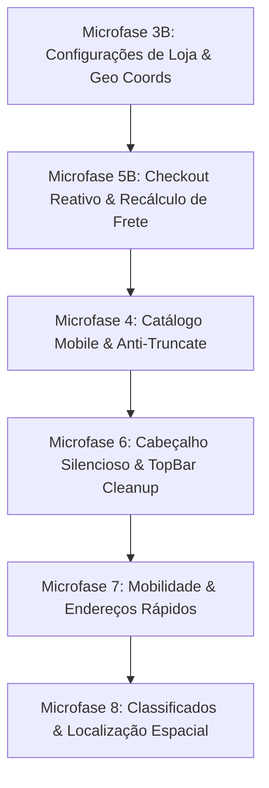

# Plano Mestre de Refatoração Holística, Auditoria Forense e Mapeamento de Pendências

> **Status:** Documento Normativo Ativo & SSOT de Continuidade  
> **Data:** 2026-10-22  
> **Referência:** DEC-304 / B.1 a B.41 (`AGENTS.md`)  
> **Alvo:** Sincronização Transversal Banco de Dados ↔ BFF ↔ UI / Mobile-First Real / Multi-Agente Seguro

---

## 1. Sumário Executivo & Diagnóstico de Estado

Este documento consolida o mapeamento forense ponta a ponta do ecossistema Waesy, auditando o que foi planejado, o que foi efetivamente executado, o que **aparenta estar correto mas possui desalinhamentos ocultos** ("o que parece certo mas não está"), e a decomposição hierárquica MECE das microfases atômicas de continuidade.

### 1.1 Contexto Multi-Agente & Isolamento de Worktree
O repositório opera sob desenvolvimento concorrente com múltiplos agentes especializados trabalhando simultaneamente em domínios paralelos (Turismo OS, Mineração Hoteleira, Scrapers, Governança FIPE e Segurança Criptográfica). Para erradicar qualquer risco de conflito de merge, perda de commits ou regressão:
1. **Regra de Não-Sobreposição:** Nenhuma microfase deste plano tocará em arquivos sob gestão ativa de outros agentes (`mining/`, `gmaps-scraper/`, `infotravel/`, `fipe/`, etc.).
2. **Escopo Atômico Delimitado:** Cada microfase atua estritamente no tripé: *Migration/DB → Função BFF/Zod → Componente de UI/Rota → Teste de Verificação*.
3. **Validação Pré e Pós-Mutação:** Todo ciclo exige `npm run typecheck`, `node scripts/design-lint.mjs --changed` e `npm test` antes de qualquer commit.

---

## 2. Retrospectiva Forense: O Que Foi Executado com Sucesso

Nesta sessão de trabalho, foram atingidos os seguintes marcos estruturais (integrados e testados):

| Entidade / Módulo | Camada | Arquivos Modificados / Criados | Status / Evidência |
| :--- | :--- | :--- | :--- |
| **Plataforma Canônica de Endereços** (DEC-304) | Banco de Dados (RPC) | `supabase/migrations/20270223000000_advanced_address_platform_mercadolivre_parity.sql` | Procedimentos atômicos `save_user_address_atomic`, `set_default_user_address_atomic`, `update_address_instructions_atomic`. Colunas `has_no_number`, `delivery_instructions`. |
| **Plataforma Canônica de Endereços** (DEC-304) | BFF (Server Functions) | `src/services/addresses.functions.ts` | Schemas Zod unificados, `lookupAddressByCep` com fallback resiliente, `reverseGeocodeCoordinates`, `setDefaultUserAddress`, `updateAddressInstructions`. |
| **Plataforma Canônica de Endereços** (DEC-304) | Componentes UI | `src/components/address/canonical-address-form.tsx`<br>`src/components/address/address-card-hub.tsx`<br>`src/components/address/address-instructions-modal.tsx`<br>`src/components/ui/address-field.tsx` | Formulário padrão Mercado Livre (Squircle, sem número, pin no mapa interativo via MapLibre, instruções de entrega com portaria/interfone, zero layout shift, botões táteis de 44px). |
| **Plataforma Canônica de Endereços** (DEC-304) | Rotas Públicas / Civis | `src/routes/_store.conta.enderecos.tsx`<br>`src/routes/_store.checkout.tsx` | Hub completo de endereços salvos, seleção visual por cards de alta densidade, integração com modal de instruções e troca de endereço padrão. |
| **BFF Checkout** | Contrato de Entrega | `src/services/checkout.functions.ts` | Schema expandido de endereço de entrega (`recipient_name`, `block`, `intercom_code`, `has_no_number`, `latitude`, `longitude`). |
| **Testes Automatizados** | E2E & Regressão | `src/services/__tests__/canonical-address-platform-end-to-end.test.ts` | 8/8 testes verdes cobrindo criação, CEP, reverse geocoding, troca de padrão, instruções e deleção atômica. |
| **Autenticação & Sessão Silenciosa** | UI & A11y | `src/components/common/action-auth-guard-modal.tsx`<br>`src/routes/_store.entrar.tsx` | Eliminação de 24 violações de design lint, Google Logo via `@phosphor-icons/react`, alvos de toque 44px (`h-11 min-h-11`), zero AI-smell. |
| **Onboarding de Lojas** | Rotas Workspace | `src/routes/workspace.onboarding.index.tsx`<br>`src/routes/workspace.onboarding.revisao.tsx` | 0 violações de design lint, alinhamento à grade de 4px, `aspect-video` em mídias, formulário estritamente funcional. |

---

## 3. Auditoria Forense Holística: "O Que Parece Certo Mas Não Está"

A inspeção profunda de todo o fluxo transacional identificou divergências silenciosas onde a interface ou a função parece completa, mas o fluxo transacional subjacente apresenta quebras sutis:

### 3.1 Gap G-01: Desconexão da Recalculação Reativa de Frete no Checkout
* **Sintoma Aparente:** O componente `AddressCardHub` é renderizado na rota `_store.checkout.tsx`, e o usuário pode selecionar qualquer um dos seus endereços cadastrados.
* **A Falha Oculta:** Ao alterar o card de endereço selecionado no hub, o hook de frete não dispara automaticamente uma nova cotação via `calculateShipping({ storeId, destinationCep })`. Se o usuário tiver um endereço em São Paulo e outro no Rio de Janeiro e alternar entre eles, o valor do frete e o prazo de entrega permanecem congelados na cotação do primeiro endereço carregado.
* **Correção Necessária:** Implementar listener de mutação de endereço ativo no estado de checkout com gatilho direto na função de cálculo de frete (`calculateShipping`), atualizando o resumo de valores (`cartSummary.shippingFee`) de forma imediata e transparente.

### 3.2 Gap G-02: Assimetria de Geolocalização nas Configurações da Loja
* **Sintoma Aparente:** A rota `workspace.configuracoes.index.tsx` possui campos para Rua, Número, Bairro, Cidade e CEP do estabelecimento.
* **A Falha Oculta:** A tela utiliza campos de texto avulsos em vez do primitivo canônico `AddressField`. Como consequência, a latitude e longitude da loja não são capturadas nem enviadas no schema `saveStoreSettingsSchema` em `src/services/store.functions.ts`. Sem essas coordenadas, o motor de raio de entrega da loja e o cálculo dinâmico de frete por quilometragem (Waesy Go / MotoLink) falham silenciosamente ou utilizam distância zero.
* **Correção Necessária:** Substituir os inputs dispersos pelo `AddressField` conectado ao mapa com geocodificação reversa e garantir que `latitude` e `longitude` sejam persistidos nas colunas correspondentes da tabela `stores`.

### 3.3 Gap G-03: Violações de Design-Lint no Módulo de Configurações
* **Sintoma Aparente:** A página de configurações da loja renderiza perfeitamente no desktop.
* **A Falha Oculta:** O validador determinístico acusa violações DL-14 e DL-15 em botões e links secundários que envolvem ícones sem explicitar altura mínima de 44px (`h-11 min-h-11 flex items-center`) no elemento âncora interno `<Link>` e no botão de alternância de módulos operacionais (linha 1104).
* **Correção Necessária:** Ajustar classes das tags filhas para que a árvore JSX herde explicitamente as dimensões canônicas de 44px, zerando os alertas do lint.

### 3.4 Gap G-04: Truncamento Indevido de Títulos no Catálogo Mobile
* **Sintoma Aparente:** Os cards de produtos no catálogo do lojista (`workspace.catalogo.tsx`) parecem organizados em telas largas.
* **A Falha Oculta:** Em telas móveis estreitas (<380px), títulos longos de produtos são cortados com reticências silenciosas (`truncate`) em vez de quebrar a linha naturalmente (`break-words text-wrap: pretty leading-tight`), violando a Invariante B.38 de integridade textual plena.
* **Correção Necessária:** Substituir classes de truncamento por respiro tipográfico e quebra multilinear controlada com limite de 2 linhas legíveis.

### 3.5 Gap G-05: Resíduo de Componente de Troca de Tema no Cabeçalho
* **Sintoma Aparente:** A barra de topo global exibe os botões de busca, localização e perfil.
* **A Falha Oculta:** O arquivo `src/components/shell/utility-cluster.tsx` ainda mantém importações órfãs do `ThemeToggle` e referências desnecessárias a controles de tema que conflitam com a estética silenciosa exigida pela direção do produto.
* **Correção Necessária:** Remover as referências legadas e garantir que a barra de topo opere exclusivamente com os controles transacionais essenciais (Localização, Carrinho, Notificações e Perfil).

### 3.6 Gap G-06: Desacoplamento de Endereços em Módulos Verticais (Mobilidade e Serviços)
* **Sintoma Aparente:** As telas de solicitação de corrida (`_store.mobilidade.tsx`) e classificados de serviços possuem campos de origem/destino.
* **A Falha Oculta:** As telas utilizam estados locais voláteis e não consomem o repositório central de `user_addresses`. O usuário precisa redigitar seu endereço residencial ou de trabalho mesmo já estando autenticado e com seus endereços salvos na plataforma.
* **Correção Necessária:** Conectar as rotas de mobilidade e serviços ao selector de endereços rápidos do usuário autenticado.

---

## 4. Decomposição MECE de Microfases de Continuidade

Todas as pendências mapeadas são organizadas em microfases atômicas, com escopo cirúrgico delimitado e ordem rigorosa de precedência.



---

### Microfase 3B: Configurações da Loja — Endereço Canônico, Coordenadas e Design Lint Zero
* **Objetivo:** Zerar todas as violações de design lint em `src/routes/workspace.configuracoes.index.tsx`, incorporar o componente `AddressField` e persistir `latitude` e `longitude` no schema da loja.
* **Camada DB/Schema:** Validar se a tabela `stores` já possui colunas `latitude double precision` e `longitude double precision` (presentes no core schema).
* **Camada BFF:** Atualizar `saveStoreSettingsSchema` em `src/services/store.functions.ts` para incluir opcionalmente `latitude: z.number().optional()` e `longitude: z.number().optional()`.
* **Camada UI:** 
  - Corrigir os alvos de toque dos botões com `<Link>` e o botão de toggle de módulos em `src/routes/workspace.configuracoes.index.tsx`.
  - Integrar `AddressField` na aba de Localização/Endereço da loja.
* **Arquivos Autorizados:**
  - `src/routes/workspace.configuracoes.index.tsx`
  - `src/services/store.functions.ts`
* **Critério de Aceite:**
  - `node scripts/design-lint.mjs --file src/routes/workspace.configuracoes.index.tsx` com 0 violações P0 e 0 violações P1.
  - Endereço da loja salvo com coordenadas geográficas válidas.

---

### Microfase 5B: Checkout Reativo — Sincronização Dinâmica de Frete com Seleção de Endereço
* **Objetivo:** Tornar o cálculo de frete estritamente reativo à seleção de cartões no `AddressCardHub` dentro de `_store.checkout.tsx`.
* **Camada BFF:** Garantir que `calculateShipping` aceite opcionalmente `addressId` para cálculo baseado em coordenadas exatas quando disponível.
* **Camada UI:**
  - Em `src/routes/_store.checkout.tsx`, escutar a mudança do endereço ativo selecionado no `AddressCardHub`.
  - Disparar a re-cotação de frete imediata com feedback tátil e atualização do resumo financeiro.
* **Arquivos Autorizados:**
  - `src/routes/_store.checkout.tsx`
  - `src/services/checkout.functions.ts`
* **Critério de Aceite:**
  - Alternar entre dois endereços com CEPs distintos altera instantaneamente o valor de frete exibido no checkout sem necessidade de recarregar a página.

---

### Microfase 4: Catálogo de Produtos — Responsividade Mobile e Erradicação de Truncamento
* **Objetivo:** Aplicar os padrões Apple HIG / Squircle no catálogo do lojista (`src/routes/workspace.catalogo.tsx`), eliminando truncamentos severos de texto e garantindo touch targets confortáveis.
* **Camada UI:**
  - Substituir `truncate` por `break-words text-wrap: pretty leading-snug line-clamp-2` nos títulos de produtos.
  - Assegurar que botões de ação e status de estoque tenham no mínimo 44px de altura.
* **Arquivos Autorizados:**
  - `src/routes/workspace.catalogo.tsx`
* **Critério de Aceite:**
  - Visualização em viewport de 360px sem quebra horizontal de layout e com leitura imediata de títulos compostos.
  - 0 violações de design lint.

---

### Microfase 6: Cabeçalho Global & Cluster Utilitário — Design Silencioso
* **Objetivo:** Eliminar artefatos e referências não funcionais de troca de tema no cabeçalho público e garantir consistência com o padrão silencioso (Figma / Linear / Avec).
* **Camada UI:**
  - Higienizar `src/components/shell/utility-cluster.tsx` e `src/components/shell/top-bar.tsx`.
  - Manter exclusivamente os gatilhos transacionais: Localização Master, Sacola/Carrinho, Central de Notificações e Avatar do Usuário.
* **Arquivos Autorizados:**
  - `src/components/shell/utility-cluster.tsx`
  - `src/components/shell/top-bar.tsx`
* **Critério de Aceite:**
  - Layout limpo, altura unificada de 44px (`h-11 min-h-11`), zero ícones decorativos redundantes e 0 violações de design lint.

---

### Microfase 7: Mobilidade Urbana (Waesy Go) — Integração com Endereços Salvos
* **Objetivo:** Permitir que o passageiro utilize seus endereços cadastrados (Casa, Trabalho, Favoritos) como atalhos de 1 toque para Ponto de Partida ou Destino na rota `_store.mobilidade.tsx`.
* **Camada BFF:** Expor hook unificado `useUserAddresses` alimentado por `getUserAddresses`.
* **Camada UI:**
  - Renderizar pílulas de acesso rápido com endereços salvos na interface de simulação de corridas.
* **Arquivos Autorizados:**
  - `src/routes/_store.mobilidade.tsx`
* **Critério de Aceite:**
  - Clicar na pílula "Casa" ou "Trabalho" preenche automaticamente as coordenadas de destino e calcula a estimativa de tarifa e rota.

---

### Microfase 8: Classificados e Serviços Locais — Resolução Canônica de Localização
* **Objetivo:** Assegurar que os anúncios e ofertas de classificados utilizem o georreferenciamento canônico para ordenação por proximidade real em quilômetros.
* **Camada BFF:** Revisar a query de busca em `src/services/classifieds.functions.ts` para aplicar distância esférica quando o usuário conceder coordenadas ou tiver endereço selecionado.
* **Camada UI:**
  - Exibir selo honesto de localização ("Bairro, Cidade") sem inventar quilometragens falsas quando não houver telemetria GPS ativa (em estrito cumprimento a Invariante B.8 e B.33).
* **Arquivos Autorizados:**
  - `src/routes/_store.classificados.index.tsx`
  - `src/services/classifieds.functions.ts`
* **Critério de Aceite:**
  - Ordenação precisa por distância para usuários geolocalizados e fallback honesto sem valores artificiais para usuários sem localização definida.

---

## 5. Matriz de Risco, Invariantes & Protocolo de Verificação

### 5.1 Invariantes Absolutas em Cada Entrega
1. **Zero Layout Shift (CLS < 0.01):** Todos os containers dinâmicos, formulários e mapas devem ter dimensões ou aspect ratio canônicos declarados antes do carregamento de dados.
2. **Piso WCAG 2.2 AA:** Contraste mínimo de 4.5:1 para texto normal, 3:1 para controles e anel de foco visível em todos os elementos interativos (`:focus-visible`).
3. **Ergonomia Tátil de 44px:** Todos os botões, links navegáveis, inputs e checkboxes devem possuir área tátil mínima de 44x44px no mobile (`h-11 min-h-11`).
4. **Sem Fallbacks Sintéticos:** Proibido injetar imagens de estoque, dados fictícios ou valores padrão de review/distância. Se não há dado, exibe layout honesto ou oculta o container.

### 5.2 Roteiro de Verificação Pré-Commit
Antes de finalizar qualquer microfase:
```bash
# 1. Verificação de Tipos TypeScript (Exit Code 0 obrigatório)
npm run typecheck

# 2. Design Lint nos arquivos alterados (0 P0, 0 P1)
node scripts/design-lint.mjs --changed

# 3. Testes Unitários e de Integração
npm test

# 4. Build de Produção Cloudflare (Exit Code 0)
npm run build
```

---

## 6. Registro de Decisões e Handoff

* Este documento passa a reger as próximas sessões e commits do repositório relacionados à refatoração de UI/UX, endereços, catálogo, checkout e governança transacional.
* O trabalho continuará a partir da **Microfase 3B**, seguida sequencialmente pelas microfases subsequentes, mantendo a integridade multi-tenant e o isolamento de worktree para os outros agentes ativos.
