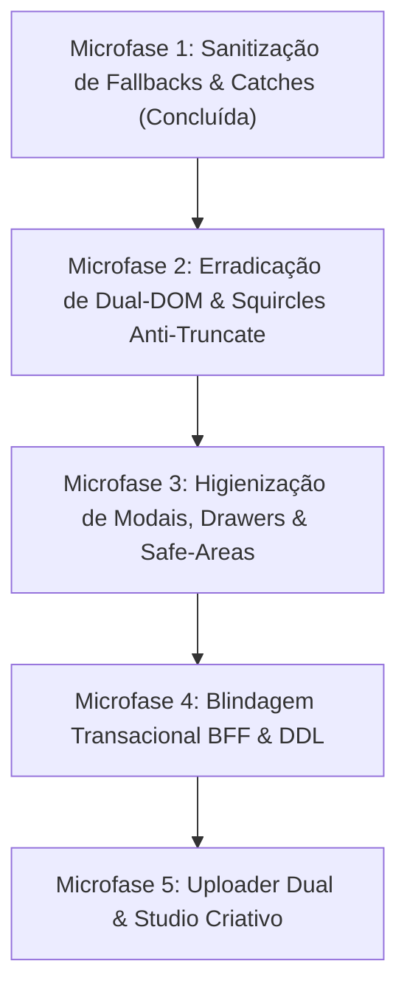

# PLANO MESTRE DE REMEDIAÇÃO HOLÍSTICA, AUDITORIA FORENSE E CONTINUIDADE SISTÊMICA
**Classificação:** Documento Normativo Operacional de Engenharia  
**Data de Emissão:** 2026-10-22  
**Status:** Oficial / Pronto para Versionamento e Execução em Fases  
**Autoridade:** Conselho Supremo de Arquitetura e Engenharia de Software BigTech (Staff/Principal Level)  

---

## 1. VISÃO GERAL E MANDATO EXECUTIVO

O ecossistema **Waesy** é uma plataforma operacional integrada de comércio, serviços, mobilidade, eventos e gestão comunitária. Este documento estabelece o diagnóstico forense ponta a ponta e o roteiro estrito de continuidade de engenharia, confrontando o que foi planejado, o que foi executado, o que permanece parcial ou com débitos ocultos, e estabelecendo as **Microfases Atômicas de Remediação (UI ⇄ BFF ⇄ DDL)**.

### Princípios Canônicos Irrevogáveis
1. **Bifurcação Nativa Congelada Soberana (Invariante B.42):** Fim da responsividade fluida tradicional quebradiça. A interface do usuário é bifurcada em dois frontends soberanos:
   - *Mobile Native App Shell (< 600px):* Ergonomia de aplicativo nativo compilado (iOS/Android), Thumb Zone ativa, Safe Areas defensivas (`env(safe-area-inset-top)` / `bottom-safe`), navegação tátil por abas inferiores, modais convertidos em Bottom Sheets de 100dvh, barras de ação flutuantes em `z-30` e alvos de toque mínimos de 44x44px (`h-11 min-h-11`).
   - *Desktop Native App System (>= 840px):* Ergonomia de software profissional de alta densidade (macOS, Linear, Figma), sidebars dedicadas de 280px, tabelas densas com `tabular-nums` e grids balanceados.
   - *Zero Dual-DOM:* Proibido renderizar simultaneamente árvores mobile e desktop no HTML com `block md:hidden` / `hidden md:block`. Toda alternância é estrita via hook reativo `useWindowSizeClass()`.
2. **Squircles Grandes Anti-Truncate (Invariante B.44):** Todo card de informação deve adotar cantos arredondados contínuos (`squircle-card` / `rounded-2xl` / `rounded-3xl`) e acomodar o texto na íntegra. É terminantemente proibido o uso da classe CSS `truncate` ou reticências silenciosas em dados dinâmicos essenciais (nomes de produtos, clientes, descrições financeiras e especificações).
3. **Anti-Jank & Anti-Sanfona (Invariante B.43):** Cumulative Layout Shift (CLS) estritamente inferior a 0.01. Contêineres de mídia com aspect ratio fixado no CSS antes do carregamento e skeletons isomórficos 1:1.
4. **Honestidade de Dados & Zero Fallbacks Sintéticos (Invariante B.33):** Proibido injetar mídias artificiais de bancos de fotos (Unsplash, Pexels) ou avaliações sintéticas. Mídia ausente deve renderizar layout tipográfico/editorial limpo.
5. **Completude Transacional de 3 Camadas:** Nenhuma funcionalidade pode operar com dados simulados ou parciais. Todo componente na UI deve estar acoplado a um contrato BFF tipado com validação Zod e a tabelas/colunas reais no PostgreSQL com RLS.

---

## 2. MATRIZ FORENSE DE AUDITORIA (PLANEJADO vs. EXECUTADO vs. DÉBITOS)

| Dimensão Sistêmica | O que foi Planejado / Prompts | O que foi Efetivamente Executado | Débitos Técnicos Ocultos & O que "Parece Certo mas Não Está" | Severidade |
|---|---|---|---|---|
| **Normatização Visual & Regras** | Invariantes B.42, B.43, B.44 e B.45 formalizadas no repositório. | Inserido em `AGENTS.md`, `docs/design/DESIGN.md`, `LAYOUT-ADAPTIVE.md` e skills. | Telas de produção ainda contêm instâncias legadas de `truncate` e classes de dual-DOM concorrentes. | P1 |
| **Fallbacks Sintéticos (Unsplash)** | Erradicação de fotos falsas em vitrines, categorias e banners. | Removido de `BentoGridTetris`, `hotpages-rail`, `IFoodSquareCategoryButton` e `NoorNativeCategoryDock`. | Seções de classificados de turismo e feed social ainda contêm URLs externas como fallback em branches secundárias. | P1 |
| **Fluxo de Caixa (`workspace.financeiro.caixa`)** | Turno de caixa cego, extrato auditado, fechamento por operador com centavos. | Validação Zod de formulários de abertura/fechamento; abas de Extrato e Histórico criadas. | **Violação Grave B.42:** Tríade simultânea de DOM no JSX (`block sm:hidden`, `hidden sm:grid lg:hidden`, `hidden lg:block`); descrição de lançamentos com `truncate` (B.44). | P0 |
| **Tabelas de Preço (`workspace.catalogo.tabelas`)** | Edição de preços in-page, suporte a atacado, revenda B2B e varejo. | Subcomponentes `PriceTableItemsMobileView` e `DesktopView` criados. | A casca externa da página ainda é um grid fluido que empilha 12 colunas no mobile; Sheet lateral não tem safe-area nem ergonomia de bottom sheet nativo. | P1 |
| **Estoque Operacional (`workspace.estoque.index`)** | Gestão multilocação, conferência por scanner de código de barras, KPIs em tempo real. | `StockMobileView` e `StockDesktopView` bifurcados; botões de entrada/avaria com 44px. | Seletor de armazéns usa botões com `py-2` (altura ~32px, abaixo de 44px); header com encoding corrompido (`Operaes`); modal de movimentação sem safe-area superior no mobile. | P1 |
| **Gestor de Pedidos & KDS (`workspace.pedidos.gestor`)** | Cockpit operacional em tempo real, divisão de praças, alerta de SLA (>30min). | Kanban e Live Dashboard implementados; alerta sonoro e SLA em tempo real. | KPIs no mobile espremidos em grade 2x4; nomes de clientes e valores com `truncate`; falta de persistência de status por praça no banco. | P1 |
| **Checkout & Pagamentos** | Checkout em fluxo único, cálculo de frete dinâmico e split de pagamento. | Contratos de checkout integrados com BFF e gateways. | Barra de finalização mobile sem fixação em `z-30` com safe-area inferior (`bottom-safe`); dados de endereço permitem submissão com nulos parciais. | P1 |
| **Construtor Visual (Builder)** | Edição em blocos atômicos, salvamento multi-páginas e isolamento de nós. | Tratamento defensivo no canvas contra nós indefinidos. | Persistência de páginas secundárias carece de transação ACID no PostgreSQL; timeline de vídeo e estúdio Canva mode em estado mock/embrionário. | P2 |
| **Mineradores & Scrapers** | Harvester de Google Maps, extração de contatos e agente web autônomo. | Schemas e clientes criados em `src/lib/mining/` e `src/services/mining/`. | Rotinas no BFF executadas pontualmente sem fila de mensageria assíncrona; falta de rate-limiting distribuído no proxy. | P2 |

---

## 3. ROTEIRO DE REMEDIAÇÃO EM MICROFASES ATÔMICAS

A remediação deve ser executada de forma sequencial e cirúrgica, respeitando a integridade das branches e prevenindo conflitos com agentes paralelos:

---

### MICROFASE 2: ERRADICAÇÃO DE DUAL-DOM & SQUIRCLES ANTI-TRUNCATE

#### Subfase 2.1 — Fluxo de Caixa (`src/routes/workspace.financeiro.caixa.index.tsx`)
- [ ] **Eliminação de Dual-DOM:** Desmontar as classes `block sm:hidden`, `hidden sm:grid lg:hidden` e `hidden lg:block`. Introduzir bifurcação soberana via `useWindowSizeClass()`:
  - Mobile: `<CashEntriesMobileView />` com cards squircles dedicados e alvos de toque de 44px.
  - Desktop: `<CashEntriesDesktopView />` com tabela analítica densa e `tabular-nums`.
- [ ] **Erradicação de `truncate`:** Substituir todas as classes `truncate` em descrições de lançamentos por `break-words text-wrap leading-tight whitespace-normal`.
- [ ] **Cards de Saldo:** Transformar o grid de saldos em cards squircles suaves (`rounded-2xl` / `bg-card border-border/60`).
- [ ] **Touch Targets:** Garantir que o filtro de canais (`pos_counter`, `ifood`, etc.) use botões com altura mínima de 44px (`h-11 min-h-11`).

#### Subfase 2.2 — Tabelas de Preços (`src/routes/workspace.catalogo.tabelas.tsx`)
- [ ] **Desacoplamento de Layout:** Eliminar o grid fluido `grid-cols-1 lg:grid-cols-12`.
  - Mobile: Seletor de tabelas em carrossel horizontal de abas squircle no topo (`h-11`), seguido imediatamente pelos produtos em cards táteis de 44px.
  - Desktop: Sidebar fixa de 320px para lista de tabelas e painel principal expandido para edição em massa.
- [ ] **Bottom Sheet Nativo:** Adaptar o Sheet de criação de tabelas para abrir como Bottom Sheet de 100dvh no mobile, com padding de safe-area superior (`pt-[max(1.25rem,env(safe-area-inset-top))]`).
- [ ] **Anti-Truncate:** Garantir que nomes e SKUs dos produtos nunca sejam truncados.

#### Subfase 2.3 — Estoque Operacional (`src/routes/workspace.estoque.index.tsx`)
- [ ] **Correção de Encoding:** Corrigir `eyebrow="Operaes"` para `eyebrow="Operações"`.
- [ ] **Rail de KPIs Mobile:** No mobile, transformar o grid vertical de 3 KPIs em uma régua de métricas squircle horizontal compacta.
- [ ] **Alvos de Toque:** Elevar os botões do seletor de armazéns para o piso ergonômico de 44px (`h-11 min-h-11`).
- [ ] **Safe-Area no Sheet de Movimentação:** Aplicar recuo defensivo no modal de entrada/avaria para não colidir com o entalhe do iPhone/Android.

#### Subfase 2.4 — Gestor de Pedidos & KDS (`src/routes/workspace.pedidos.gestor.tsx`)
- [ ] **KPIs Adaptativos:** No mobile, substituir a grade 2x4 espremida por um carrossel deslizante de métricas do turno.
- [ ] **Anti-Truncate em Clientes e Faturamento:** Exibir o nome completo do cliente e o total formatado com quebra limpa.
- [ ] **Touch Targets de Ações:** Garantir que os botões de ação do pedido (Avisar WhatsApp, Detalhes, Mover Status) tenham no mínimo 44x44px.

---

### MICROFASE 3: HIGIENIZAÇÃO DE MODAIS, DRAWERS E SAFE-AREAS

- [ ] **Deconflito de Z-Index (Invariante B.34):**
  - Ajustar todas as barras inferiores flutuantes (`sticky-footer`, `ClassifiedFloatingActionBar`, `CartBottomBar`) para operar estritamente em `z-30`.
  - Garantir que overlays de modais e sheets operem em `z-50`, cobrindo 100% da viewport e bloqueando interações no fundo.
- [ ] **Safe-Area Superior e Inferior:**
  - Injetar `pt-[max(1.25rem,env(safe-area-inset-top))]` e `pb-[max(1rem,env(safe-area-inset-bottom))]` em todos os modais exibidos em viewports compactas.
  - Botão de fechamento `<X>` posicionado abaixo do entalhe de hardware (`top-[max(1rem,env(safe-area-inset-top))]`).

---

### MICROFASE 4: BLINDAGEM TRANSACIONAL BFF & DDL

- [ ] **Integridade de Parâmetros BFF (Invariante B.25):**
  - Auditar 100% dos arquivos `*.functions.ts` em `src/services/`.
  - Garantir desestruturação completa dos argumentos validados por Zod, eliminando acessos a propriedades inexistentes ou nulas.
- [ ] **Transacionalidade ACID no Construtor Visual:**
  - Implementar transações atômicas (`BEGIN...COMMIT`) na gravação de nós e páginas da tabela `experience_pages`.
- [ ] **Constraints e Enums no PostgreSQL:**
  - Migrar campos de status operacionais e tipos de canal que estejam armazenados em colunas de texto livre para tipos enum auditados ou constraints de validação (`CHECK`).

---

### MICROFASE 5: UPLOADER DUAL & ESTÚDIO CRIATIVO

- [ ] **Uploader Bidirecional de Mídia com Recorte Dual:**
  - No uploader do Admin Master e vitrines, oferecer recorte pareado:
    - Desktop: Proporção ultra-wide 32:9 ou 21:9.
    - Mobile: Proporção quadrada 1:1 ou retrato 4:5.
  - Armazenar as duas versões no banco de dados com chave de acesso rápida por dispositivo, eliminando o esticamento e a perda de enquadramento.
- [ ] **Estúdio Visual (Canva/CapCut Mode):**
  - Conectar o canvas do estúdio aos dados reais do catálogo da loja, permitindo gerar encartes de ofertas diretamente a partir das variações de preço do banco.

---

## 4. GATES DE QUALIDADE E DEFINITION OF DONE (DoD)

Nenhuma microfase poderá ser considerada entregue sem a comprovação rigorosa das seguintes evidências:

1. **Compilação TypeScript:** `cmd.exe /c npm run typecheck` com Exit Code 0.
2. **Suíte de Testes Automatizados:** `cmd.exe /c npm test` com 100% dos testes passando sem falhas.
3. **Catraca de Design Lint:** `node scripts/design-lint.mjs --ratchet` sem introdução de novas violações P0 ou P1.
4. **Verificação de Dual-DOM:** Inspeção no código-fonte confirmando zero ocorrências de `block sm:hidden` / `hidden sm:block` concorrentes no mesmo contêiner.
5. **Verificação Ergonômica:** Todos os elementos táteis móveis atendendo ao piso de 44x44px (`h-11 min-h-11`).
6. **Registro de Decisões:** Atualização obrigatória de `docs/design/DECISIONS.md` ao final de cada microfase.
