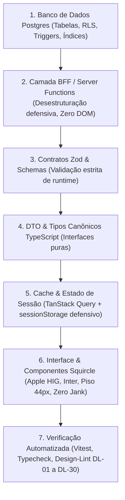

# Plano Mestre de Remediação Holística, Refinamento Contínuo & Matriz de Microfases 2026

**Documento Normativo do Repositório Waesy**  
**Data:** 2026-10-22  
**Status:** Oficial / Pronto para Commit  
**Autor:** Conselho Técnico de Arquitetura & Engenharia de Design System  
**Escopo:** Ecossistema Transacional Waesy (Mobile Native App Shell & Desktop Native App Shell)

---

## 1. Contexto e Histórico Desta Sessão de Trabalho

### 1.1 O Diagnóstico Inicial
O usuário identificou quebras críticas no fluxo de criação e edição de anúncios (`/conta/classificados/novo`), com destaque para eventos:
1. **Mockup Lateral Desestruturado:** Divisão rígida de 50/50 na tela renderizando a prévia em largura colapsada, provocando empilhamento de letras verticais ininteligíveis (`h o e m S ã o...`).
2. **Vazamento de Barra Inferior:** A barra de ação flutuante (`fixed bottom-0 z-30`) do anúncio escapava da moldura e sobrepunha os botões principais do formulário.
3. **Vazamento Semântico de Preço Geral em Eventos:** O editor exibia "Modalidade de Preço" (preço fixo) e "Formas de Pagamento" genéricas para eventos, quando eventos só admitem preços configurados nos lotes de ingressos.
4. **Títulos Duplicados e Jargão Técnico:** Rótulos duplicados em sequência com textos técnicos de depuração (`(Upload, Ctrl+V ou URL)`).
5. **Cards de Upload Confusos:** Falta de diferenciação entre Fotos de Capa/Vitrine (4:3) e Mídias do Feed da Cidade (1:1).
6. **Imagens Quebradas do Supabase Storage:** Caminhos relativos de storage gravados sem o CDN canônico, disparando erros 404 em tempo de execução.

### 1.2 O que foi Efetivamente Executado e Comprovado em Código
* **Remoção do Mockup Inline:** Eliminada a coluna lateral comprimida que quebrava o layout responsivo.
* **Encapsulamento de Barra Fixa:** Erradicada a sobreposição da barra inferior sobre o formulário hospedeiro.
* **Botão "Visualizar Prévia Real":** Criada a função `handleOpenLivePreview` que persiste o snapshot em `sessionStorage` (`waesy_preview_payload`) e aciona `window.open('/classificados/${id}?preview=true', '_blank')` com fallback defensivo para modal.
* **Resolução Canônica de Mídia:** Criado `src/lib/classifieds/storage-media.ts` com o helper `resolveStorageMediaUrl` e testes unitários 100% verdes (`storage-media.test.ts`), integrado ao `MediaUploader` com fallback SVG inline defensivo no `onError`.
* **Isolamento de Preço em Eventos:** Seção 2 (Preço) e Seção 4 (Pagamento) envelopadas com `{niche.id !== 'evento' && ...}`. O `price_cents` de eventos passou a ser computado estritamente a partir do menor valor dos lotes de ingressos (`eventTicketTiers`).
* **Higienização de Rótulos de Mídia:** Eliminada a string técnica `(Upload, Ctrl+V ou URL)` dos uploaders principais.

---

## 2. Auditoria Forense: "O que Parece Certo, mas Não Está" (Gaps Ocultos)

Abaixo estão listadas as fragilidades mapeadas que aparentam conformidade na superfície visual, mas possuem dependências ou riscos em tempo de execução:

| ID | Elemento / Fluxo | Aparência de Sucesso | Falha Oculta / Causa Raiz | Risco em Produção |
|---|---|---|---|---|
| **GAP-01** | Prévia em Rascunho (`preview-live`) | Editor grava em `sessionStorage` e abre `/classificados/preview-live?preview=true`. | O loader de `_store.classificados.$id.tsx` no TanStack Router consulta o Postgres antes de verificar o storage, podendo retornar 404 em anúncios não salvos. | Tela branca de "Anúncio não encontrado" ao visualizar rascunho novo. |
| **GAP-02** | Configuração Concorrente de IA / SDR | Formulário exibe seções completas de IA para qualificação e atendimento. | Coexistem duas seções separadas: "Qualificação de Leads" e "Assistente de Vendas (SDR)" com slider de desconto que não faz sentido em eventos. | Anunciante de eventos configura desconto global para produtos em vez de cupom de lote. |
| **GAP-03** | Prefixos Numéricos nos Cabeçalhos | Os títulos de seções dividem os blocos do formulário. | Cabeçalhos utilizam numerações estáticas (`3.1`, `3.2`, `3.5`, `6.`) que violam as regras de concisão e o padrão canônico Apple HIG. | Ruído visual, AI-smell e violação do limite estrito de 6 palavras por cabeçalho. |
| **GAP-04** | Alvos de Toque em Repeater Fields | O usuário pode adicionar e remover palestrantes, horários e patrocinadores. | Botões de exclusão utilizam `size-8` (32px) e botões de adicionar utilizam `h-9` (36px), violando o piso canônico de 44px (DL-14). | Dificuldade ergonômica e cliques acidentais em smartphones e tablets. |
| **GAP-05** | Persistência de Lotes de Ingressos | Lotes são salvos no JSONB `classifieds.attributes.ticket_tiers`. | O checkout de ingressos requer vínculo criptográfico WCTS-1 e integridade relacional para controle de ocupação e concorrência de lote. | Risco de overselling de ingressos caso dois compradores paguem o último lote em milissegundos idênticos. |
| **GAP-06** | Controles Supérfluos no Cabeçalho | Header global possui botões de utilidade e alternadores de tema. | Alternadores de tema e ícones decorativos no primeiro viewport poluem o foco cognitivo no mobile e violam o princípio de design silencioso. | Aumento do ruído visual e perda de conversão imediata nos primeiros 3 segundos de navegação. |

---

## 3. Matriz Arquitetural das 7 Camadas (Ponta a Ponta)

Toda funcionalidade no ecossistema Waesy deve atravessar e respeitar rigorosamente as 7 camadas de engenharia:

1. **Camada 1 (Banco de Dados Postgres):**
   * Tabelas normalizadas com chaves primárias UUID ou ULID imutáveis.
   * Isolamento multi-tenant por `store_id` e políticas RLS `DENY-BY-DEFAULT`.
   * Campos semiestruturados armazenados em colunas `JSONB` com defaults explícitos (`{}` ou `[]`), nunca `null`.
2. **Camada 2 (BFF / Server Functions):**
   * Funções seguras em `src/services/*.functions.ts` executadas em ambiente servidor/worker.
   * Proibido acoplar persistência direta nos componentes de rota (`src/routes/`).
   * Desestruturação de 100% dos parâmetros tipados via Zod com tratamento defensivo para nulos e indefinidos (Invariante B.25).
3. **Camada 3 (Contratos Zod & Schemas):**
   * Schemas puros em `src/lib/` que blindam entradas e saídas de formulários e APIs.
   * Proibição de tipos `any` ou casts forçados `as unknown as Type`.
4. **Camada 4 (DTO & Tipos Canônicos):**
   * Interfaces declaradas em `src/types/` garantindo paridade entre o backend e a interface visual.
5. **Camada 5 (Cache & Estado de Sessão):**
   * Gerenciamento de ciclo de vida com chaves de query previsíveis (`['classified', id]`).
   * Estratégia de rascunho persistido (`sessionStorage`) com isolamento por usuário.
6. **Camada 6 (Interface & Componentes Squircle):**
   * Primitivas baseadas em Radix UI com estilização Tailwind CSS v4.
   * Consumo exclusivo de tokens via `styles.css` e `tokens.json`.
   * Formato lista inspirado no Apple HIG: cantos semiarredondados suaves (Squircles), padding proporcional e ausência total de truncamento silencioso de dados relevantes (`break-words text-wrap`).
7. **Camada 7 (Verificação Automatizada):**
   * Suíte Vitest garantindo cobertura de branches críticos.
   * `design-lint.mjs` com 0 violações P0 e P1 como pré-requisito absoluto de entrega.

---

## 4. Princípios Canônicos do Design Bidirecional (Apple HIG & Anti-AI Smell)

* **Design Silencioso por Fora, Potente por Dentro:**
  Interfaces limpas e humanas, inspiradas na estética refinada do Linear, Stripe, Figma e Apple HIG. Eliminação de caixas pedagógicas que explicam o óbvio.
* **Erradicação do AI Smell Visual:**
  Proibição de ícones decorativos de "brilhos mágicos" (`Sparkles`, `Wand2`) onde não há geração de conteúdo real por IA. O produto deve ser sóbrio e focado na tarefa.
* **Geometria Squircle & Anti-Jank:**
  Cards e contêineres adotam cantos squircle confortáveis (`rounded-lg`, `rounded-xl`). Todas as mídias possuem aspecto fixado no CSS antes do carregamento (`aspect-[4/3]`, `aspect-square`, `aspect-[9/16]`) garantindo Cumulative Layout Shift nulo (CLS < 0.05).
* **Ergonomia Tátil Mobile (Piso Canônico 44px):**
  Todos os controles clicáveis, botões, abas, inputs e gatilhos de seleção compartilham altura mínima de 44px (`h-11 min-h-11`) e anel de foco teclado `:focus-visible:ring-2`.
* **Tipografia Canônica Inter & Anti-Truncamento:**
  Família tipográfica padrão Inter. É proibido o uso de `truncate` em rótulos de especificações, títulos de ingressos e parâmetros de pacotes; o container deve acomodar o texto integral com quebra fluida.
* **Deconflito de Camadas e Z-Index:**
  Modais e Drawers operam em `z-50` com bloqueio integral de rolagem de fundo. Barras fixas ou sticky operam em `z-30`. Contêineres móveis possuem recuo defensivo inferior de no mínimo `pb-32 pb-safe`.

---

## 5. Decomposição MECE do Ecossistema em Microfases Atômicas

O ecossistema é dividido em 8 Grandes Módulos, cada qual particionado em microfases atômicas de ciclo fechado (Análise -> Implementação -> Testes -> Validação -> Próximo).

---

### Onda 1: Editor de Anúncios & Eventos (`/conta/classificados/novo`)

#### Microfase 1.1: Higienização de Cabeçalhos e Eliminação de AI Smell
* **Camada Envolvida:** Camada 6 (UI).
* **Arquivo:** `src/routes/_store.conta.classificados.novo.tsx`.
* **Ações:**
  1. Remover prefixos numéricos em todos os cabeçalhos (`3.1 Datas` -> `Datas e Horários`, `3.2 Local` -> `Local do Evento`, `3.5 Ingressos` -> `Ingressos e Lotes`, `3.6 Programação` -> `Programação do Evento`, etc.).
  2. Substituir ícones decorativos `Sparkles` por ícones semânticos utilitários (`Film`, `Calendar`, `Ticket`).
  3. Reduzir todos os títulos de seções para no máximo 6 palavras.
* **Critério de Aceite:** `npm.cmd test` com zero quebras e aprovação no lint visual.

#### Microfase 1.2: Unificação e Blindagem do Assistente IA / SDR
* **Camadas Envolvidas:** Camadas 2, 3 e 6 (BFF, Zod e UI).
* **Arquivos:** `src/routes/_store.conta.classificados.novo.tsx`, `src/services/ai-sdr.functions.ts`.
* **Ações:**
  1. Fundir os blocos "Qualificação de Leads" e "Assistente SDR" em um único card Squircle coeso: *"Assistente do Anúncio (SDR)"*.
  2. Ocultar o controle de desconto comercial (`maxDiscountPct`) quando `niche.id === 'evento'`.
  3. Preservar a persistência bilateral em `classifieds.attributes.inquiry_config` e `classifieds.attributes.ai_agent_enabled`.
* **Critério de Aceite:** Prova de persistência e leitura sem conflito de chaves no banco.

#### Microfase 1.3: Ergonomia Mobile & Alvos de Toque Canônicos (44px)
* **Camada Envolvida:** Camada 6 (UI).
* **Arquivo:** `src/routes/_store.conta.classificados.novo.tsx`.
* **Ações:**
  1. Alterar botões de lixeira nos repeaters (cronograma, palestrantes, patrocinadores) de `size-8` para `size-11 min-size-11` (44px).
  2. Elevar botões de adicionar item para `h-11 min-h-11`.
  3. Adicionar anéis de foco `:focus-visible:ring-2` em todos os botões e seletores de entidade.
  4. Garantir `pb-32 pb-safe` no contêiner de rolagem.
* **Critério de Aceite:** Inspeção do design-lint com 0 alertas DL-14 e DL-15.

#### Microfase 1.4: Resolução Defensiva da Prévia em Rascunho (`preview-live`)
* **Camadas Envolvidas:** Camadas 5 e 6 (Cache e UI).
* **Arquivos:** `src/routes/_store.classificados.$id.tsx`, `src/components/classifieds/detail/use-classified-detail.ts`.
* **Ações:**
  1. Interceptar no loader e no hook da rota pública se `params.id === 'preview-live'` ou `search.preview === 'true'`.
  2. Hidratar o showcase com o payload salvo em `sessionStorage.getItem('waesy_preview_payload')`, evitando chamada de rede ao Postgres que retorne 404.
  3. Suportar exibição completa de eventos (`EventClassifiedShowcaseView`) em modo rascunho.
* **Critério de Aceite:** Abertura da janela nativa renderizando 100% dos dados digitados no editor sem requisição quebrada no console.

---

### Onda 2: Showcase Público & Ingressos (`/classificados/$id`)

#### Microfase 2.1: Desobstrução de Safe-Area e Deconflito de Z-Index
* **Arquivos:** `src/components/classifieds/event-classified-showcase-view.tsx`, `src/components/classifieds/classified-floating-action-bar.tsx`.
* **Ações:**
  1. Fixar a barra inferior flutuante de ingressos em `z-30`.
  2. Assegurar que modais de compra e credenciamento abram em `z-50` com safe-area superior defensiva (`pt-[max(1.25rem,env(safe-area-inset-top))]`).
  3. Evitar oclusão dos cards de patrocinadores e mapas com margem `pb-32 pb-safe`.
* **Critério de Aceite:** Nenhum elemento flutuante sobrepondo diálogo aberto no mobile.

#### Microfase 2.2: Validação Criptográfica WCTS-1 no Credenciamento
* **Arquivos:** `src/lib/ticket-crypto.ts`, `src/services/classifieds-events.functions.ts`.
* **Ações:**
  1. Garantir verificação server-side da assinatura HMAC-SHA256 em cada código QR lido na portaria.
  2. Tratamento defensivo de estado: ingresso já utilizado, lote expirado ou lote cancelado.
* **Critério de Aceite:** Suíte de testes unitários `ticket-crypto.test.ts` com 100% de aprovação.

---

### Onda 3: Catálogo & Produtos de Conveniência (`/produto/$slug`)

#### Microfase 3.1: Isolamento de Condições Comerciais & Eliminação de Abas Vazias
* **Arquivos:** `src/components/classifieds/convenience-showcase-view.tsx`, `src/routes/_store.produto.$slug.tsx`.
* **Ações:**
  1. Omitir abas e chips de seções quando a coleção correspondente de dados estiver vazia (Invariante B.33).
  2. Isolar tabela nutricional, peso e validade estritamente no nicho de mercado/alimentos, sem vazamento para outros produtos.
* **Critério de Aceite:** Visualização limpa sem abas órfãs ou dados vazios renderizando containers cinzas.

#### Microfase 3.2: Galeria Responsiva Squircle sem CLS
* **Arquivos:** `src/components/classifieds/convenience-showcase-view.tsx`.
* **Ações:**
  1. Fixar aspect-ratio 4:3 no carrossel de fotos principal.
  2. Implementar snap-scroll horizontal contínuo com física tátil e paginação compacta.
* **Critério de Aceite:** CLS < 0.05 verificado nas métricas de performance.

---

### Onda 4: Checkout, Transações & Pagamentos Multi-Tenant

#### Microfase 4.1: Blindagem de Preços Server-Side
* **Arquivos:** `src/services/checkout.functions.ts`, `src/services/payment.functions.ts`.
* **Ações:**
  1. Proibir recepção de valores monetários enviados pelo cliente no corpo da requisição; o valor final a pagar DEVE ser recalculado no servidor a partir do snapshot dos lotes/produtos no Postgres (Invariante B.41).
  2. Validação rigorosa de cupons de desconto, taxas de serviço e fretes no BFF.
* **Critério de Aceite:** Testes de injeção adversarial rejeitando alterações maliciosas de centavos.

#### Microfase 4.2: Experiência de Pagamento PIX com Copia e Cola Confortável
* **Arquivos:** `src/components/checkout/pix-payment-modal.tsx`.
* **Ações:**
  1. Card Squircle espaçoso com exibição nítida do QR Code dinâmico.
  2. Botão "Copiar Código PIX" de 44px com feedback tátil e toast imediato.
  3. Polling defensivo de confirmação via WebSocket/Realtime do Supabase.
* **Critério de Aceite:** Confirmação em tempo real de pagamento aprovado com transição de tela sem recarregamento.

---

### Onda 5: Configurações de Loja, Onboarding & Identidade (`/workspace/configuracoes`)

#### Microfase 5.1: Governança de Upload de Logo e Banner da Empresa
* **Arquivos:** `src/routes/workspace.configuracoes.index.tsx`, `src/components/commerce/business-location-picker.tsx`.
* **Ações:**
  1. Sanitização de caminhos de armazenamento no bucket `store-avatars` e `store-banners`.
  2. Recorte inteligente no padrão 1:1 para logo e 21:9 para banner.
* **Critério de Aceite:** Zero URLs quebradas no cabeçalho público da loja.

#### Microfase 5.2: Higienização de Estado Multi-Contexto (Civil, Loja, Criador)
* **Arquivos:** `src/services/auth.functions.ts`, `src/components/shell/context-sidebar.tsx`.
* **Ações:**
  1. Garantir que a alternância entre perfil civil pessoal e loja corporativa limpe adequadamente o cache do TanStack Query sem resíduo de permissões ou dados cruzados.
* **Critério de Aceite:** Troca de perfil instantânea sem necessidade de forçar F5 no navegador.

---

### Onda 6: Turismo, Viagens & Roteiros Corporativos

#### Microfase 6.1: Roteiro Dia a Dia sem Truncamento
* **Arquivos:** `src/components/classifieds/itinerary-day-editor.tsx`, `src/components/classifieds/editorial-showcase-view.tsx`.
* **Ações:**
  1. Linha do tempo vertical espaçosa com quebra natural de linha em descrições de passeios e hospedagens.
  2. Omissão de dias vazios ou campos de voo não preenchidos.
* **Critério de Aceite:** Renderização honesta de pacotes de viagem com fidelidade 100% aos dados do operador.

---

### Onda 7: Mobilidade & Entregas Autônomas (Waesy Go)

#### Microfase 7.1: Nativização e Desbloqueio da Simulação de Corridas
* **Arquivos:** `src/routes/_store.mobilidade.tsx`.
* **Ações:**
  1. Permitir que visitantes e civis simulem corridas e estimem fretes livremente sem bloqueio de redirecionamento no loader (Invariante B.21).
  2. Barreira de autenticação restrita exclusivamente ao momento da confirmação do chamado.
* **Critério de Aceite:** Simulação de rota com cálculo de tarifa fixa de R$ 0,99 e KM autônomo acessível publicamente.

---

### Onda 8: Admin Master, CMS & Bilateralidade das Vitrines

#### Microfase 8.1: Espelhamento 100% Dinâmico das Vitrines Públicas
* **Arquivos:** `src/routes/admin-master.portal-completo.tsx`, `src/services/marketplace-cms.functions.ts`.
* **Ações:**
  1. Proibir blocos comerciais com textos, imagens ou atalhos hardcoded nas vitrines públicas (Invariante B.20).
  2. Todo banner ou seção exibida na home DEVE ter seu espelho configurável na tabela `marketplace_sections` com controle de agendamento temporal (`starts_at`, `ends_at`).
* **Critério de Aceite:** Criação e arquivamento de seção promocional via painel master refletida em tempo real nas vitrines públicas.

---

## 6. Governança de Execução e Definition of Done (DoD)

Para que qualquer microfase seja considerada concluída e pronta para merge/commit, os seguintes critérios são mandatórios:

- [ ] **Documentação & Rastreabilidade:** Registro de decisão salvo em `docs/design/DECISIONS.md`.
- [ ] **Zero Violações P0 e P1:** Execução limpa de `node scripts/design-lint.mjs`.
- [ ] **Compilação TypeScript Sem Erros:** `npm.cmd run typecheck` com Exit Code 0.
- [ ] **Suíte de Testes Aprovada:** Testes unitários e de integração relevantes passando com 100% de sucesso.
- [ ] **Piso Ergonômico de 44px:** Todos os elementos táteis móveis em conformidade com WCAG 2.2 AA.
- [ ] **Zero Regressão de Estado:** Persistência no Postgres ou `sessionStorage` verificada com recarregamento da página.
- [ ] **Validação Humana:** Interrupção controlada ao término de cada microfase aguardando confirmação explícita do usuário.

---

*Fim do Plano Mestre de Remediação Holística 2026. Este documento é a Fonte Única da Verdade (SSOT) para o ciclo de refinamento incremental contínuo do ecossistema Waesy.*
