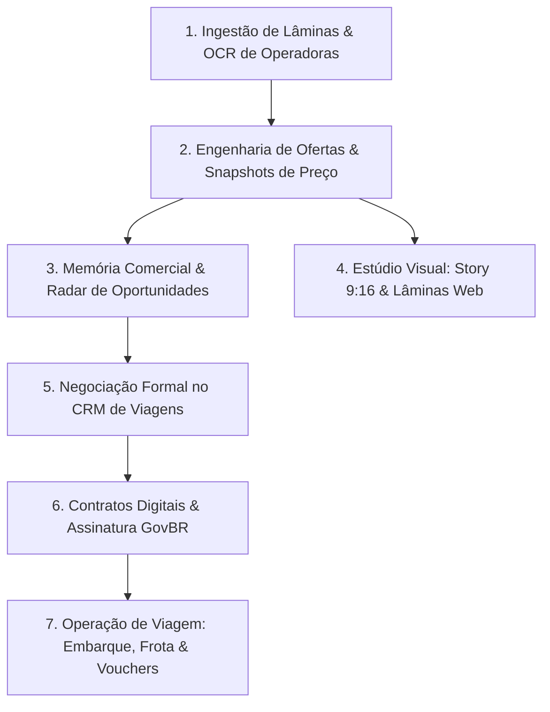

# PRODUCT_CONCEPT_MAP.md — Mapa Conceitual do Produto
## Reconstrução Canônica: Conceito, Atores, Capacidades e Invariantes
**Data:** 2026-10-21  
**Domínio:** Ecossistema Operacional Integrado Waesy / Vertical Turismo & Viagens (Excelência Tour)  
**Status:** Auditado e Reconstruído  

---

### 1. O Que Este Sistema É?

O **Waesy** (com a vertical **Excelência Tour**) é um **Sistema Operacional de Negócios e Turismo de Alta Densidade**, AI-native e multi-superfície (Desktop Native System + Mobile Native App).
Ele **NÃO É**:
- Uma rede social genérica de fotos descartáveis.
- Um agregador de links de afiliados ou classificados rasos.
- Um protótipo ou conjunto de telas cosméticas sem persistência.
- Um CRM genérico inchado de contatos frios.

Ele **É**:
- O motor operacional completo de uma agência de viagens moderna emissiva, receptiva e corporativa.
- Uma memória comercial viva que retém e cruza intenções de viajantes com bloqueios e promoções de operadoras durante o ano inteiro.
- Um estúdio de engenharia visual de ofertas (Story 9:16, PDF vetorial, Lâminas Comerciais, Vitrine Pública).
- Uma central de liquidação transacional de contratos com assinatura digital ICP-Brasil/GovBR, controle de assentos rodoviários/aéreos e emissão auditada de vouchers criptografados.

---

### 2. Atores do Sistema

| Ator | Papel no Domínio | Nível de Acesso (RLS) | Superfícies Principais |
| :--- | :--- | :--- | :--- |
| **Viajante Civil / Passageiro** | Busca pacotes, expressa intenções, assina contratos, visualiza vouchers e realiza check-in. | `anon` (leitura pública de vitrines) ou `authenticated` (`role = 'customer'`). | PWA Mobile Native (`/viajante/*`, `/_store/*`). |
| **Agente / Corretor de Turismo** | Atende passageiros, ingere PDFs de operadoras via OCR, gera cotações e propostas, dispara abordagens WhatsApp. | `authenticated` (`role in ('seller', 'support')`). | Desktop Workspace (`/workspace/turismo/*`). |
| **Gestor / Gerente de Agência** | Gerencia margens, comissões de operadores, bloqueios aéreos, frota e despacho de viagens. | `authenticated` (`role in ('manager', 'admin')`). | Desktop Workspace + Mobile Sheets. |
| **Sócio / Proprietário da Agência** | Acesso financeiro total, contratos corporativos B2B, emissão fiscal e regras de markup. | `authenticated` (`role = 'owner'`). | Desktop Workspace (`/workspace/*`). |
| **Gestor Corporativo (B2B)** | Solicita viagens de colaboradores, aprova alçadas, controla saldo de crédito (EMD) e centros de custo. | `authenticated` (`role = 'corporate_admin'`). | Portal Corporativo (`/workspace/empresa/*`). |
| **IA / Copilot Operacional** | Normaliza dados de OCR, desmembra trechos aéreos, calcula parcelamentos e redige abordagens consultivas. | `service_role` com auditoria e contabilidade de tokens. | Background Workers & Server Functions BFF. |

---

### 3. As Sete Capacidades Centrais do Produto

1. **Capacidade 1: Ingestão Inteligente e OCR de Operadoras:**
   - Transforma flyers, lâminas e PDFs das operadoras (CVC, Orinter, ViagensPromo, EHTL, Azul Viagens) em entidades estruturadas com rastreabilidade de extração (`ExtractedField<T>`).
2. **Capacidade 2: Engenharia Canônica de Ofertas:**
   - Normaliza regimes alimentares, cálculos de parcelamento no padrão brasileiro (ex.: 10x ou 12x sem juros), taxas de embarque e regras de CHD (criança grátis).
3. **Capacidade 3: Memória Comercial & Radar de Oportunidades:**
   - Mantém um banco perene de intenções de passageiros (multidestinos, flexibilidade de datas, teto de parcela) e roda matching determinístico algébrico contra ofertas recém-lançadas.
4. **Capacidade 4: Estúdio Visual Multi-Formato:**
   - Story Builder 9:16 com engine de renderização em alta resolução (1080×1920), superfícies Liquid Glass e Lâminas Comerciais para visualização do cliente.
5. **Capacidade 5: Negociação Formal no CRM:**
   - Funil de vendas estruturado em 5 estágios com rastreabilidade de histórico, lista completa de acompanhantes e requisitos de saúde/mobilidade (PCD, TEA).
6. **Capacidade 6: Formalização Jurídica e Contratos Digitais:**
   - Geração de minutas jurídicas com amarração de parcelas, integradas à assinatura eletrônica e verificação pública com carimbo de tempo.
7. **Capacidade 7: Cockpit de Viagem e Despacho de Embarque:**
   - Mapa interativo de assentos em ônibus/vans (`vehicle_layouts`), manifesto de passageiros, check-in por QR Code e carteira digital de vouchers.

---

### 4. Matriz de Velocidade Operacional e Autonomia da IA

| Ação do Sistema | Velocidade Esperada | Nível de Autonomia | Justificativa Arquitetural |
| :--- | :--- | :--- | :--- |
| **Cálculo de Preços & Parcelas** | Instantâneo (< 5ms) | 100% Algébrico | Regra matemática pura; proibido envolver LLM. |
| **Matching de Oportunidade** | Instantâneo (< 20ms) | 100% Determinístico | Cruzamento matricial de 5 pesos (Destino, Orçamento, Datas, Família, Inclusões). |
| **Extração OCR de Documento** | Assíncrono (1 a 4s) | IA com Revisão Humana | LLM extrai campos com confiança; o corretor revisa na interface antes de salvar. |
| **Redação de Copy WhatsApp** | Sob demanda (< 500ms) | IA Assistida | LLM estiliza rascunho consultivo; corretor edita e clica para enviar. |
| **Emissão de Contrato Digital** | Síncrono (< 1s) | Humano Obrigatório | Ação jurídica vinculante; exige conferência dos dados do passageiro. |
| **Promoção de Oportunidade a Lead** | Síncrono (< 300ms) | Humano Obrigatório | Impede poluição do CRM formal por ações automáticas em lote. |

---

### 5. Escopo e Fronteiras de Dados (Global vs Tenant vs Usuário)

- **Dados Globais (Compartilhados por Todos os Tenants):**
  - Catálogo mestre de destinos turísticos (`destinations`).
  - Banco central de hotéis e resorts com aliases de normalização (`global_hotels`, `hotel_aliases`).
  - Tabela de companhias aéreas e aeroportos IATA/ICAO (`airline_companies`).
  - Tabela FIPE e bases regulatórias.
- **Dados por Tenant / Agência (`store_id` isolado por RLS):**
  - Contatos pré-CRM e interesses de viagem (`travel_commercial_contacts`, `travel_interests`).
  - Oportunidades comerciais (`travel_opportunity_matches`).
  - Cotações, propostas e orçamentos (`travel_quotes`, `travel_proposals`).
  - Contratos e assinaturas (`contracts`, `contract_signatures`).
  - Viagens em grupo, manifesto de passageiros e frota (`tourism_trips`, `trip_passengers`).
  - Carteira financeira, comissões a receber e faturas (`travel_commissions`, `corporate_invoices`).
- **Dados por Usuário / Perfil:**
  - Preferências visuais, notificações lidas e rascunhos voláteis locais.
- **Dados Históricos Imutáveis (Snapshots com Prova de Tempo):**
  - Minutas contratuais assinadas e envelopes de assinatura (`contracts`).
  - Snapshots de preços observados em ofertas (`travel_price_observations`, `travel_offer_snapshots`).
  - Registro de auditoria financeira e conciliação (`customer_debt_ledger`, `payment_refunds`).
