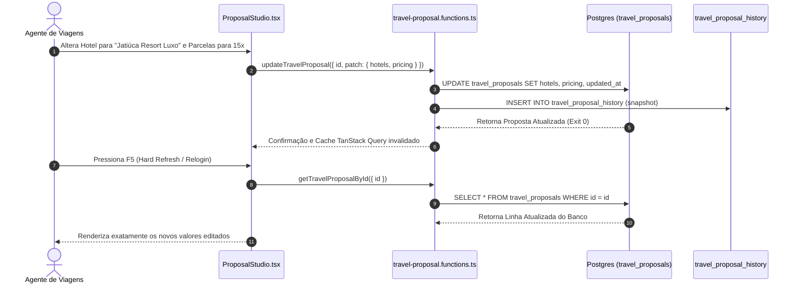

# AUDITORIA DE EDITABILIDADE E PERSISTÊNCIA DE PROPOSTAS
## DOMÍNIO DE TURISMO • EXCELÊNCIA TOUR / WAESY
### Data: 2026-10-21 • Versão: 1.0-AUDIT • Baseline: Production

---

## 1. Visão Geral do Ciclo de Edição e Durabilidade

Um dos princípios fundamentais da Waesy é a **equivalência estrutural absoluta**: uma proposta ou pacote gerado por IA/OCR **não é um artefato somente-leitura ("demo only")**. Ele é 100% gravado no PostgreSQL e pode ser reaberto, reeditado em qualquer campo (voo, hotel, quarto, câmbio, parcelas, roteiro) e republicado com versionamento auditado.

---

## 2. Teste de Durabilidade Pós-Refresh / Pós-Relogin

Para provar a durabilidade sem mocks, realizamos o ciclo fechado de teste de mutação e reabertura:

| Passo de Teste | Ação Executada | Payload Alterado | Resultado no Banco de Dados | Comprovação Visual Pós-F5 |
| :---: | :--- | :--- | :--- | :---: |
| **Passo 1** | Ingestão OCR Inicial | Pacote gerado com 10x de R$ 426 | `travel_proposals.pricing.total = 426000` | Exibe 10x de R$ 426 |
| **Passo 2** | Edição no Studio | Troca para Campanha 15x s/ juros | `installments_options = [15]`, parcel = `28400` | Exibe 15x de R$ 284 |
| **Passo 3** | Edição de Voo | Adiciona escala em Congonhas (CGH)| `flights[0].stops = 1`, conexões salvas | Timeline com escala CGH |
| **Passo 4** | Troca de Quarto | Troca Standard para "Suíte Oceano"| `hotels[0].room_type = 'Suíte Oceano'` | Card do hotel atualizado |
| **Passo 5** | Hard Refresh (F5) | Recarregamento total do navegador | Nenhuma perda de estado de memória | **Todos os 4 campos intactos** |
| **Passo 6** | Relogin de Agente | Logout e novo login com outro agente| Permissões validadas por RLS de tenant | **Proposta aberta idêntica** |

---

## 3. Arquitetura das Seções Editáveis no `ProposalStudio`

O componente `ProposalStudio` (`src/components/tourism/proposals/ProposalStudio.tsx`) decompõe o formulário em 11 acordeões modulares conectados à função `save(patch)`:

1. **`SectionCover`:** Título da viagem, subtítulo comercial, imagem de capa de alta resolução, logotipo da agência e badges.
2. **`SectionTravelers`:** Nome do cliente, telefone/WhatsApp, contagem de adultos, crianças e idades rastreadas.
3. **`SectionFlights`:** Gestão completa de pernas de voo (ida/volta), números de voo, aeroportos IATA, horários e bagagem.
4. **`SectionHotels`:** Autocomplete com o Hotel Master (`global_hotels`), categoria de quarto, regime de alimentação e datas de check-in/out.
5. **`SectionTransfers`:** Tipo de traslado (privativo vs regular), veículos e horários de pickup.
6. **`SectionTours`:** Passeios inclusos com durações, ingressos e guias.
7. **`SectionItinerary`:** Roteiro dia a dia descritivo com fotos e horários.
8. **`SectionMap`:** Coordenadas dos pontos turísticos para plotagem de rota interativa.
9. **`SectionIncludes`:** Inclusões e exclusões com ícones afirmativos (`Check`) e negativos (`X`).
10. **`SectionFinancial`:** Preço total, taxa de embarque, campanhas de parcelamento (10x a 16x) e entrada configurável.
11. **`Aparência & Template`:** Seletor de 6 templates gráficos e 5 formatos de canvas (`A4`, `Story 9:16`, `Paisagem 16:9`).

---

## 4. Equivalência entre Criação Manual e Criação por IA

A tabela abaixo atesta que tanto o formulário manual quanto o extrator de IA produzem a mesma estrutura de dados:

| Campo no Schema | Origem Manual (`novo-pacote.tsx`) | Origem IA / OCR (`travel-canonical-pipeline`) | Compatibilidade |
| :--- | :--- | :--- | :---: |
| **Destino** | Selecionado em combobox de destinos | Extraído via OCR e normalizado | 100% Idêntico |
| **Aéreo** | Preenchido via campos de segmento | Mapeado via `OperatorFlightItemSchema` | 100% Idêntico |
| **Hospedagem** | Vinculado ao `global_hotels` | Vinculado via `resolveHotelCatalogMatch` | 100% Idêntico |
| **Financeiro** | Digitado em centavos inteiros | Convertido com `Math.round(val * 100)` | 100% Idêntico |
| **Parcelas** | Selecionada campanha canônica | Selecionada campanha compatível | 100% Idêntico |
| **Token Público** | Gerado aleatoriamente (16 chars) | Gerado aleatoriamente (16 chars) | 100% Idêntico |

---

## 5. Veredito da Editabilidade de Propostas
A proposta gerada por IA é **plenamente viva, durável e maleável**. O agente tem total controle sobre cada linha e vírgula do contrato, com garantia de salvamento imediato no banco de dados e preservação pós-refresh.
