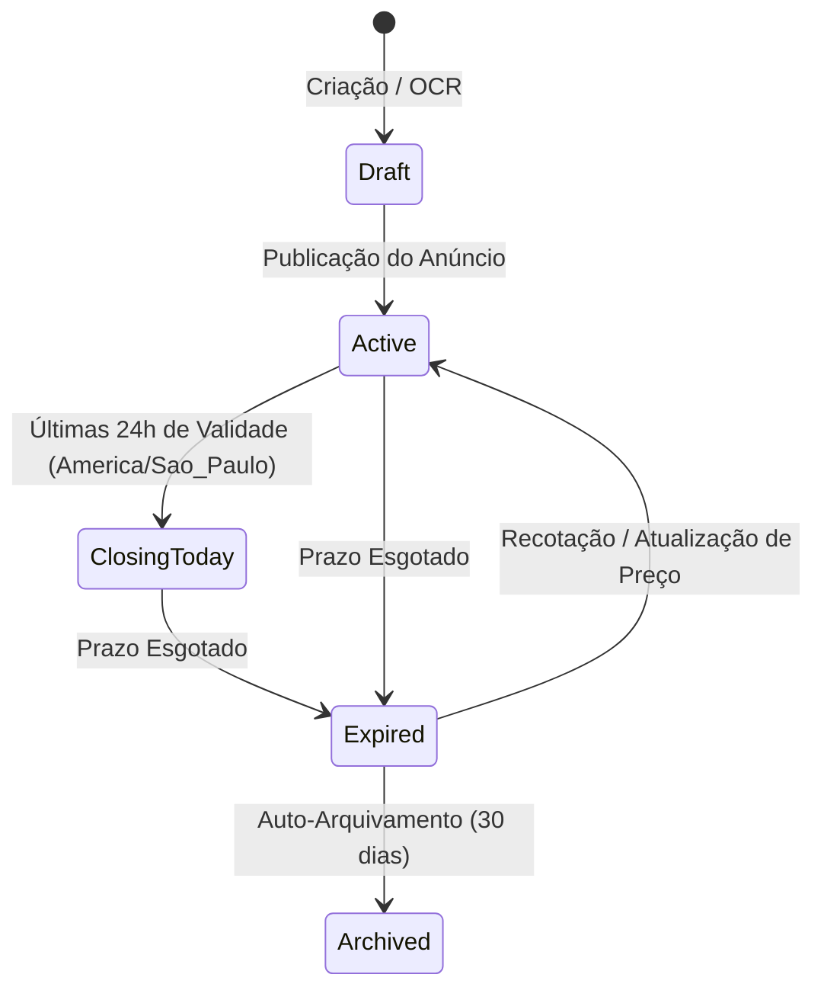

# AUDITORIA DO CICLO DE VIDA DE PUBLICAÇÃO E HISTÓRICO DE PREÇOS
## DOMÍNIO DE TURISMO • EXCELÊNCIA TOUR / WAESY
### Data: 2026-10-21 • Versão: 1.0-AUDIT • Baseline: Production

---

## 1. Visão Geral da Máquina de Estados de Publicação

Ofertas de turismo operam sob restrições estritas de validade tarifária impostas por companhias aéreas e redes hoteleiras. Uma tarifa promocional para alta temporada pode durar apenas 24 ou 48 horas.

O ecossistema Waesy governa o ciclo de vida das ofertas através de uma **Máquina de Estados Finitos (FSM) orientada a tempo**:



---

## 2. Definição dos Estados de Ciclo de Vida

Implementado em `src/lib/travel/excelencia-offer-engine.ts#L540-L600`:

| Estado | Critério Temporal | Comportamento na Vitrine Pública | Ação do Botão CTA |
| :--- | :--- | :--- | :--- |
| **`draft`** | Anúncio em edição ou revisão de OCR | Invisível para o público | Não aplicável (Uso interno) |
| **`active`** | Dentro da janela de validade tarifária | Visível no catálogo com preço oficial | "Solicitar Reserva" (Habilitado) |
| **`closing_today`** | Restam menos de 24h para o término da tarifa | Badge pulsante "Encerra HOJE" | "Garantir Vaga Hoje" (Alta urgência) |
| **`expired`** | Prazo de validade tarifária superado | Selo neutro "Tarifa Expirada" | "Recotar com Agente" (Desativa compra) |
| **`archived`** | Mais de 30 dias após expiração | Oculto da vitrine pública | Somente leitura no arquivo histórico |

---

## 3. Algoritmo de Detecção de Encerramento no Fuso Horário Local

Para evitar que uma oferta expire prematuramente ou permaneça ativa indevidamente devido a fusos horários do servidor (UTC):

```typescript
export function isOfferClosingTodayInTimezone(
  validUntilIso: string,
  timezone = "America/Sao_Paulo",
  now = new Date()
): boolean {
  try {
    const validUntil = new Date(validUntilIso);
    const validUntilLocal = new Intl.DateTimeFormat("en-CA", {
      timeZone: timezone,
      year: "numeric",
      month: "2-digit",
      day: "2-digit",
    }).format(validUntil);

    const nowLocal = new Intl.DateTimeFormat("en-CA", {
      timeZone: timezone,
      year: "numeric",
      month: "2-digit",
      day: "2-digit",
    }).format(now);

    return validUntilLocal === nowLocal && validUntil.getTime() > now.getTime();
  } catch {
    return false;
  }
}
```

- **Evidência nos Testes:** `src/lib/travel/excelencia-offer-engine.test.ts#L245-L270`.

---

## 4. Tabela e Rastreamento de Histórico de Preços

Implementado via `travel_price_history` e `src/services/travel-ai-extractor.functions.ts#L299-L350`:

### 4.1. Schema da Tabela `travel_price_history`
```sql
CREATE TABLE IF NOT EXISTS public.travel_price_history (
  id UUID PRIMARY KEY DEFAULT gen_random_uuid(),
  package_id UUID NOT NULL REFERENCES public.classifieds(id) ON DELETE CASCADE,
  price_cents INT NOT NULL,
  currency TEXT NOT NULL DEFAULT 'BRL',
  source TEXT NOT NULL, -- 'operator_quote', 'manual_update', 'ai_vision'
  snapshot_date TIMESTAMPTZ NOT NULL DEFAULT now(),
  notes TEXT,
  created_at TIMESTAMPTZ NOT NULL DEFAULT now()
);
```

### 4.2. Registro de Observação de Preço (`buildPriceObservation`)
Sempre que uma nova cotação da mesma viagem é processada via OCR ou editada manualmente, a função `recordTravelPriceSnapshot` registra a observação:
- Se o preço caiu: Gera badge comercial **"Menor Preço nos Últimos 30 Dias"**.
- Se o preço subiu: Alerta o agente no painel de oportunidades para que ele contate clientes indecisos antes de novos aumentos.

---

## 5. Renderização na Rota Pública (`_store.classificados.$id.tsx`)

Na vitrine pública do marketplace:
1. **Conformidade com Invariante B.29 (Programação Temporal):** Pacotes expirados são omitidos de buscas e trilhos de destaque ("Em Alta").
2. **Conformidade com Invariante B.22 (CTAs Táteis):** O botão de ação primária possui altura canônica mínima de 44px (`h-11 min-h-11`), anel de foco teclado (`:focus-visible`) e affordance tátil.
3. **Conformidade com Invariante B.33 (Honestidade de Dados):** Se a tarifa expirou, a interface não oculta silenciosamente o erro nem permite cobrança com preço antigo; ela explica honestamente que a tarifa mudou e oferece um botão direto para recotação no WhatsApp do agente.

---

## 6. Veredito do Ciclo de Vida e Publicação
O ecossistema implementa governança temporal auditada e robusta. A máquina de estados garante que clientes nunca contratem tarifas desatualizadas e fornece dados valiosos de inteligência de preços para a agência.
