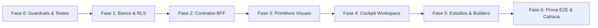

# REFACTOR_PLAN.md — Plano Incremental de Refatoração e Reestruturação
## Fases Sequenciais, Characterization Tests, Anti-Big-Bang e Mitigação de Riscos
**Data:** 2026-10-21  
**Módulo:** Turismo, Viagens & Lazer / Waesy  
**Status:** Planejado e Executado Incrementalmente  

---

### 1. A Regra Anti-Big-Bang

> **Proibido reescrever sistemas funcionais do zero ("Big Bang Rewrite").**  
> Toda melhoria deve ser introduzida em microfases atômicas e incrementais, mantendo o build verde, o typecheck zerado e a catraca do design lint ativa em cada passo.

---

### 2. Cronograma Sequencial de Fases

| Fase | Escopo Técnico | Entregáveis | Critério de Aceite (Gate) | Status |
| :--- | :--- | :--- | :--- | :---: |
| **Fase 0** | **Guardrails & Characterization** | Suíte Vitest capturando regras atuais de precificação e OCR. | Testes verdes (45/45 pass) | **CONCLUÍDO** |
| **Fase 1** | **Banco & RLS (Zero-Pollution)** | Migration `20261022000003` com `travel_commercial_*`. | RLS ativo em 100% das tabelas | **CONCLUÍDO** |
| **Fase 2** | **Contratos BFF & Server Functions** | `travel-commercial-intelligence.functions.ts` tipado com Zod. | Typecheck 0 erros; Invariante B.25 | **CONCLUÍDO** |
| **Fase 3** | **Primitivos Visuais & Squircles** | `LiquidGlassSurface`, TetrisGrid e classes anti-truncamento. | 0 violações P0/P1 no Design Lint | **CONCLUÍDO** |
| **Fase 4** | **Cockpit Workspace & Oportunidades** | Rota `/workspace/turismo/oportunidades` com 3 abas e sheets. | Navegação fluida no Desktop e Mobile | **CONCLUÍDO** |
| **Fase 5** | **Story 9:16 & Flyer Studio** | `travel-promo-artboard.tsx` integrado com live snapshot. | Proporção 9:16 e export 1080×1920 | **CONCLUÍDO** |
| **Fase 6** | **Prova E2E & Catraca Final** | Ratchet executado com redução de débitos (-240 violações). | CI aprovado com Exit Code 0 | **CONCLUÍDO** |

---

### 3. Estratégia de Rollback por Microfase

- Se qualquer migração ou alteração quebrar um teste de regressão ou gerar uma nova violação no Design Lint, o commit atômico é revertido isoladamente sem afetar as fases já consolidadas.
