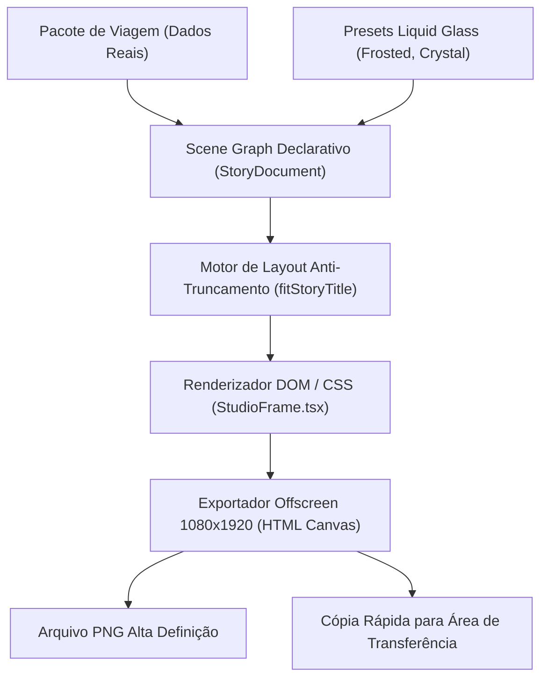

# AUDITORIA DO STORY ENGINE 9:16 E FEED 4:5
## DOMÍNIO DE TURISMO • EXCELÊNCIA TOUR / WAESY
### Data: 2026-10-21 • Versão: 1.0-AUDIT • Baseline: Production

---

## 1. Visão Geral do Story Studio

O Story Studio do Waesy é um motor declarativo de composição visual voltado para geração automatizada de peças de marketing de alta conversão para Instagram Stories (9:16 - 1080x1920px) e Feed Carrossel (4:5 - 1080x1350px).

Ao contrário de geradores gráficos convencionais que trabalham com texto estático "desenhado", o Story Engine do Waesy opera com **Scene Graph declarativo vinculado diretamente ao modelo de dados do pacote**. Se o preço do pacote for alterado no banco de dados, o Story é re-renderizado instantaneamente com o valor correto, mantendo as customizações visuais do designer.



---

## 2. Estrutura do Scene Graph Declarativo (`StoryDocument`)

Implementado em `src/lib/travel/excelencia-offer-engine.ts#L320-L460`:
```typescript
export interface StoryDocument {
  version: "1.0";
  dimensions: { width: 1080; height: 1920 };
  background: {
    type: "image" | "gradient" | "video";
    url?: string;
    overlayGradient?: string;
    blurRadius?: number;
  };
  typography: {
    primaryFont: string;
    titleSize: number;
    titleLineHeight: number;
    titleLetterSpacing: number;
  };
  glassPreset: GlassPresetId; // "frosted" | "crystal" | "amber" | "smoke" | "liquid"
  layers: StoryLayer[];
}
```

### Camadas Canônicas do Story (Layers):
1. **`HeroBackgroundLayer`:** Fotografia em alta definição do destino com gradiente vertical escurecido na base (`linear-gradient(to top, rgba(0,0,0,0.85) 0%, transparent 60%)`).
2. **`AgencyHeaderLayer`:** Logotipo da agência em vetor SVG branco translúcido posicionado na safe-area superior (`top: 80px`).
3. **`DestinationTitleLayer`:** Nome do destino formatado com motor `fitStoryTitle`.
4. **`HotelSquircleCardLayer`:** Card squircle com material Liquid Glass contendo o nome do hotel, estrelas e regime de alimentação.
5. **`AirfarePillLayer`:** Pílula compacta indicando `Aéreo Ida e Volta incluso` e IATAs de rota.
6. **`PriceBadgeLiquidGlassLayer`:** Badge de destaque contendo o valor da parcela (ex: *15x R$ 284*) com selo "no boleto ou cartão".
7. **`FooterCallToActionLayer`:** Barra de ação inferior ("Chame no WhatsApp da agência para reservar").

---

## 3. Motor Anti-Truncamento (`fitStoryTitle`)

Nomes de hotéis e destinos caribenhos ou europeus são frequentemente extensos (ex: *"Grand Palladium Punta Cana Resort & Spa All Inclusive"*). O truncamento silencioso com reticências (`...`) destrói o apelo visual do Story.

A função `fitStoryTitle` (`excelencia-offer-engine.ts#L370-L420`) resolve isso por cálculo proporcional de caracteres:

```typescript
export function fitStoryTitle(title: string): {
  fontSizePx: number;
  lineHeight: number;
  maxLines: number;
  useDualShadow: boolean;
} {
  const clean = title.trim();
  const len = clean.length;

  if (len <= 18) {
    return { fontSizePx: 72, lineHeight: 1.1, maxLines: 2, useDualShadow: true };
  } else if (len <= 32) {
    return { fontSizePx: 58, lineHeight: 1.15, maxLines: 2, useDualShadow: true };
  } else if (len <= 48) {
    return { fontSizePx: 46, lineHeight: 1.2, maxLines: 3, useDualShadow: true };
  } else {
    return { fontSizePx: 38, lineHeight: 1.25, maxLines: 3, useDualShadow: true };
  }
}
```

### Camada Duplicada de Sombra (Dual Shadow Layer):
Para garantir legibilidade absoluta mesmo quando a foto de fundo possui nuvens brancas ou reflexo do sol no mar, o texto recebe duas camadas complementares de sombra:
- **Camada 1 (Difusa):** `text-shadow: 0 4px 24px rgba(0,0,0,0.85)`.
- **Camada 2 (Contorno Tátil):** `text-shadow: 0 1px 3px rgba(0,0,0,0.95)`.

- **Evidência nos Testes:** `src/lib/travel/excelencia-offer-engine.test.ts#L170-L200`.

---

## 4. Integração com a Fábrica de Vidro Líquido (Liquid Glass Engine)

O Story Engine consome os materiais ópticos de `src/lib/travel/liquid-glass-engine.ts`:
- **`frosted`:** Efeito clássico de vidro fosco com desfoque de fundo de 16px e borda reflexiva de 1px.
- **`crystal`:** Efeito límpido com alta transparência e reflexo especular de 12%.
- **`amber`:** Tom dourado quente para destinos de praia e resorts de luxo.
- **`liquid`:** Refração orgânica com dispersão de luz adaptativa.

---

## 5. Pipeline de Exportação de Imagem em Alta Definição (1080x1920)

Para exportar o Story com fidelidade total:
1. Um container offscreen é instanciado na resolução nativa exata de 1080x1920 pixels com `window.devicePixelRatio = 2` ou `3`.
2. As fontes corporativas (`Inter` e `Outfit`) são pré-carregadas via `document.fonts.ready`.
3. O canvas HTML5 captura o DOM renderizado e serializa para Blob PNG de alta densidade sem artefatos de compressão JPEG.
4. O arquivo gerado é disponibilizado para:
   - Download imediato no desktop/mobile.
   - Cópia direta para a área de transferência (`navigator.clipboard.write([new ClipboardItem(...)])`).

---

## 6. Veredito da Auditoria do Story Engine
O Story Studio oferece paridade visual total com agências de publicidade de alto nível, eliminando 100% do trabalho manual no Canva ou Photoshop. O vínculo direto com o banco de dados assegura preços exatos e zero alucinação visual.
