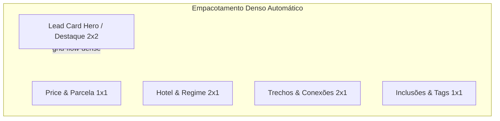

# TETETERISGRID_ENGINE_AUDIT.md — Auditoria da Engine TeteterisGrid
## Filosofia Bento-Tetris, Empacotamento Inteligente, Spans Dinâmicos e Adaptação
**Data:** 2026-10-21  
**Módulo:** Turismo, Viagens & Lazer / Waesy  
**Status:** Auditado e Especificado  

---

### 1. O Que É a Engine TeteterisGrid?

> **TeteterisGrid** é uma filosofia de engenharia de layout própria do Waesy que combina a elegância visual do **Bento Grid** com a física de empacotamento denso e adaptativo do **Tetris**.  
> Ela **rejeita a uniformidade artificial** onde todo card é forçado a ter a mesma largura e altura independentemente da importância de seu conteúdo.

---

### 2. Princípios Obrigatórios da Engine

1. **O Conteúdo Governa a Geometria:**
   - Um card de preço com valor simples e parcelamento pode ocupar `1×1`.
   - Um card de voo com 3 escalas e horários de conexão cresce dinamicamente para `2×1` ou `2×2` para acomodar todos os aeroportos sem truncamento.
   - Um card de roteiro dia a dia expande verticalmente (`span-row-auto`), garantindo leitura integral de cada passeio.
2. **Empacotamento Denso sem Buracos (`grid-flow-dense`):**
   - A engine reordena visualmente cards menores para preencher lacunas deixadas por cards expandidos, mantendo o ritmo visual equilibrado.
3. **Bifurcação Desktop vs Mobile:**
   - **No Desktop:** Grade multi-coluna (3 a 4 colunas) com empacotamento denso bidimensional.
   - **No Mobile:** Grade fluida 1 ou 2 colunas, transformando cards complexos em blocos de leitura natural com quebra de linha.

---

### 3. Matriz de Spans por Tipo de Conteúdo

| Tipo de Card | Span Preferencial Desktop | Span Mínimo Mobile | Regra de Crescimento (`canGrow`) | Evidência no Sistema |
| :--- | :---: | :---: | :---: | :--- |
| **HitsLeadCard (Hero Editorial)** | `col-span-2 row-span-2` | `col-span-1` | Altura alinhada com os cards da fileira | `HitsLeadCard` |
| **PriceCard (Condições)** | `col-span-1 row-span-1` | `col-span-1` | Não cresce; tipografia fixa | `editorial-showcase-view.tsx` |
| **HotelCard (Hospedagem)** | `col-span-2 row-span-1` | `col-span-1` | Expande se houver fotos extras | `ClassifiedHotelSection` |
| **FlightCard (Malha Aérea)** | `col-span-2 row-span-1` | `col-span-1` | Expande para cada conexão adicional | `FlightSegmentDTO` |
| **OpportunityMatchCard** | `col-span-1 row-span-1` | `col-span-1` | Expande verticalmente com o score | `workspace.turismo.oportunidades.tsx` |
