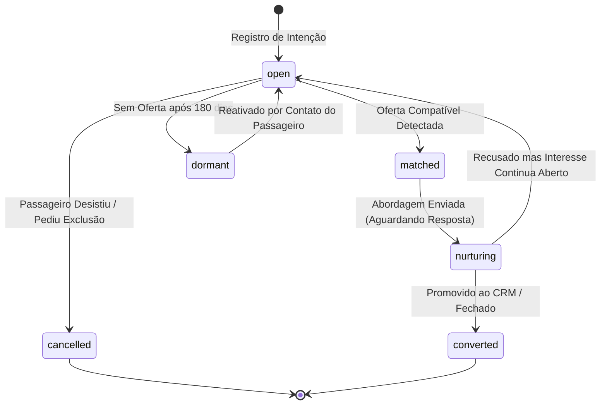

# TRAVEL INTEREST MODEL — MODELO DE INTENÇÃO E MEMÓRIA DE VIAGEM
## Especificação Estrutural do Objeto de Interesse do Passageiro
**Data:** 2026-10-21  
**Módulo:** Turismo / Excelência Tour  

---

### 1. Anatomia do Interesse Comercial (`TravelInterest`)

Um passageiro não procura apenas "um produto"; ele expressa uma intenção com diferentes graus de flexibilidade.
O modelo captura essa intenção sem forçar escolhas prematuras:

1. **Multidestinos Semânticos:**
   - Lista aberta de destinos desejados: `["Punta Cana", "Caribe", "Cancún", "Aruba"]`.
   - Categorias correlacionadas: `["praia", "resort", "all_inclusive", "internacional"]`.
   - Origens permitidas: `["XAP", "FLN", "GRU"]`.

2. **Flexibilidade Temporal Modular:**
   - `exact_dates`: Exige ida e volta em datas específicas (ex: 15/07/2026 a 22/07/2026).
   - `specific_month`: Aberto para viajar dentro de meses específicos (ex: `["2026-07", "2026-08"]`).
   - `specific_season`: Temporada preferida (ex: `school_holidays`, `low_season`, `summer`).
   - `flexible_anytime`: Aberto o ano inteiro se a promoção for irresistível.

3. **Envelope Financeiro de Viabilidade:**
   - Teto total em centavos: `maxTotalBudgetCents`.
   - Teto da parcela mensal: `maxInstallmentCents` (fator crucial de decisão no turismo brasileiro, ex: até 12x de R$ 500,00).
   - Base de preço comparada: `per_person`, `per_couple` ou `total_package`.

4. **Composição da Família / Grupo:**
   - Adultos: `number` (mínimo 1).
   - Crianças e idades: `childrenAges: number[]` (essencial para política de CHD grátis em resorts).
   - Configuração de quarto: `single`, `double`, `triple`, `family`.

5. **Inclusões Críticas:**
   - Tags obrigatórias: `["all_inclusive", "aereo_incluso", "transfer", "bagagem_despachada"]`.

---

### 2. Ciclo de Vida do Interesse

