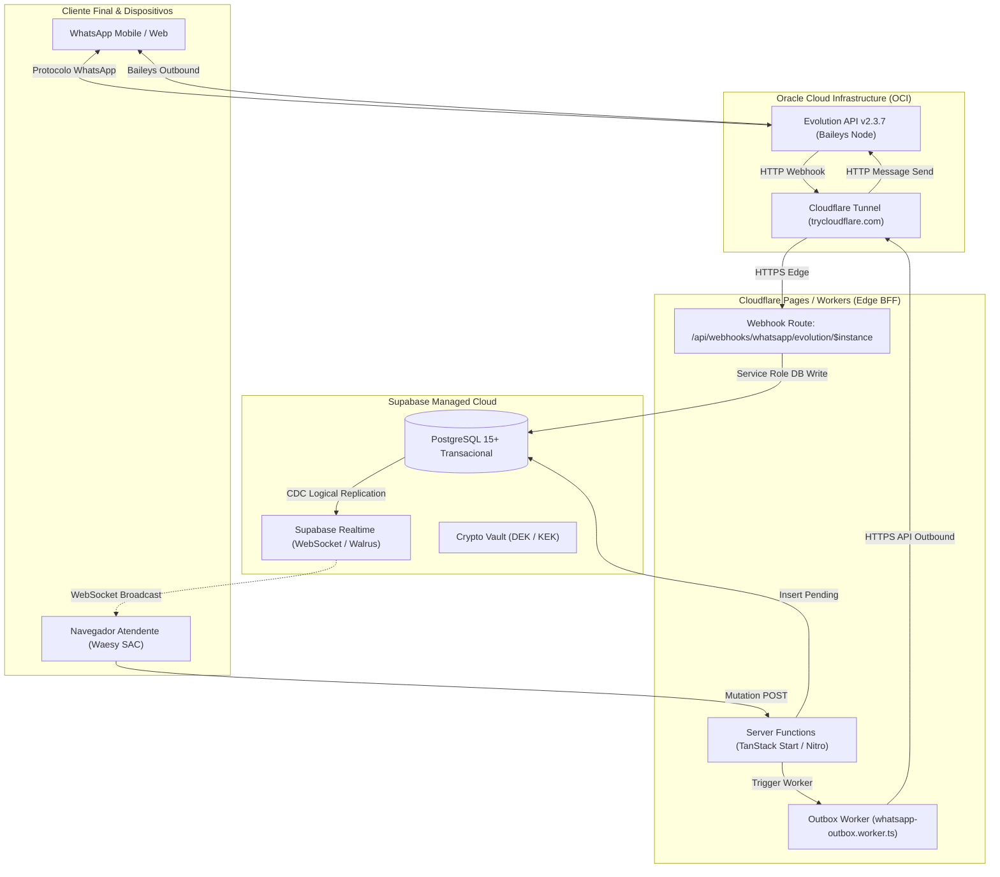
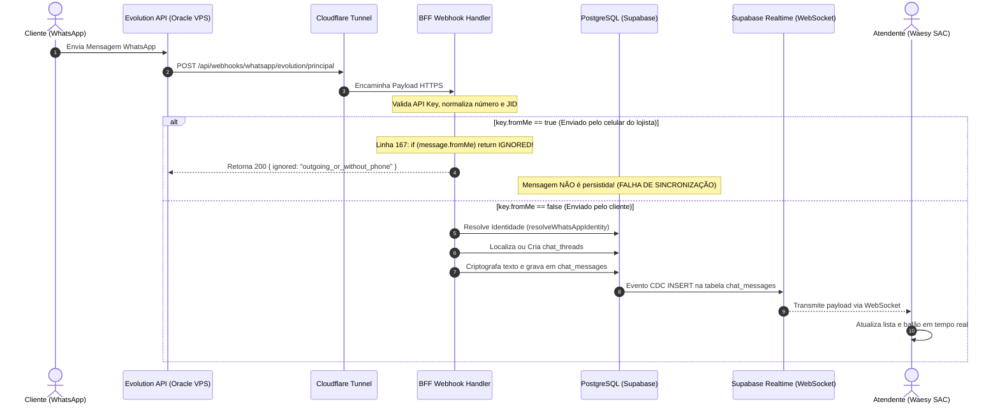
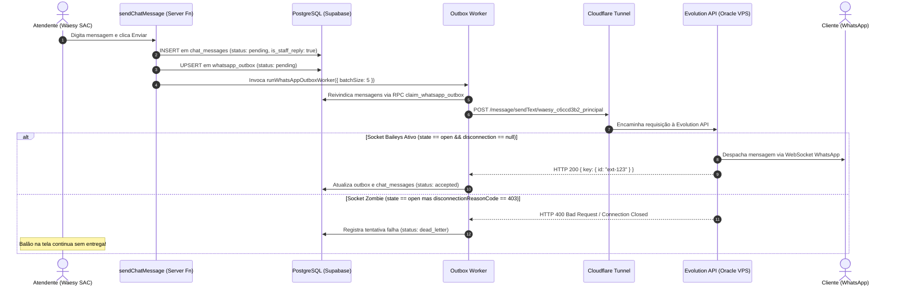

# DOCUMENTO 02 — ARQUITETURA ATUAL E FLUXOS REAIS DE COMUNICAÇÃO
**Projeto:** Waesy All-in-One Platform / Excelência Tour  
**Data da Auditoria:** 2026-11-11  
**Comitê Técnico:** Arquiteto Principal de Software e Engenheiros de Sistemas Distribuídos  

---

## 1. Visão Geral da Arquitetura Distribuída

O Waesy opera sob uma arquitetura híbrida Edge-Serverless com Gateway Dedicado em Cloud Externa:

---

## 2. Fluxo Real de Comunicação: Mensagem Recebida (Inbound)

---

## 3. Fluxo Real de Comunicação: Mensagem Enviada pelo Chat (Outbound)

---

## 4. Pontos Únicos de Falha (SPOF) & Lacunas Estruturais

1. **Dependência de Túnel Efêmero (`trycloudflare.com`):**
   - A URL base do gateway é um Quick Tunnel sem domínio dedicado (`feb-genre-kathy-indicator.trycloudflare.com`). Se o processo `cloudflared` na VPS for reiniciado, a URL muda e o backend perde total comunicação com o WhatsApp.
2. **Descarte Silencioso de Mensagens do Próprio Aparelho (`fromMe: true`):**
   - A regra de descarte no webhook impede que o histórico de mensagens enviadas pelo aplicativo WhatsApp no celular do atendente seja importado para o sistema.
3. **Ausência de Revalidação Real de Socket (Zombie State 403):**
   - A verificação de status confia no endpoint `/instance/connectionState`, que relata `open` mesmo após o WhatsApp ter desconectado a sessão por código 403.
4. **Acoplamento Realtime com Políticas RLS Estritas:**
   - O canal WebSocket de `chat_messages` exige sessão autenticada com vínculo explícito em `workspace_members`. Se o token JWT do atendente expirar ou se a thread for desatribuída, eventos em tempo real deixam de ser entregues silenciosamente.
