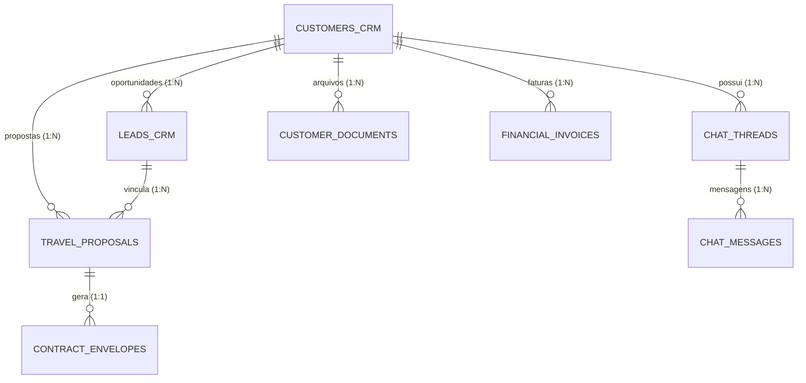

# DOCUMENTO 05 — INTEGRAÇÃO CRM 360°, IDENTIDADE E RELACIONAMENTOS
**Projeto:** Waesy All-in-One Platform / Excelência Tour  
**Data da Auditoria:** 2026-11-11  
**Comitê Técnico:** Arquiteto de CRM e Sistemas Comerciais, Especialista em Bancos de Dados  

---

## 1. Modelo de Identidade Canônica do Cliente

O Waesy implementa um modelo de identidade unificada centrado no registro soberano de cliente (`customers_crm`), desacoplado de contas de acesso civil (`auth.users`), garantindo governança estrita de agência de turismo B2C e B2B:



### Regras de Normalização Telefônica (E.164 Brasileiro)
O Brasil possui heterogeneidade de numeração móvel (9 dígitos com DDD) e telefonia fixa (8 dígitos). O conector aplica normalização determinística:
1. Extração de dígitos brutos: `cleanDigits = phone.replace(/\D/g, "")`.
2. DDI implícito: se `cleanDigits.length === 10 || cleanDigits.length === 11`, prefixa `55`.
3. Validação de Nono Dígito: buscas na tabela `customers_crm` e `chat_threads` utilizam operadores de fallback defensivo:
   ```sql
   WHERE phone = '+55499****6233' OR phone = '+5549****6233'
   ```
   Isso impede que clientes antigos cadastrados com 8 dígitos gerem duplicatas ao interagir via WhatsApp moderno.

---

## 2. A Visão 360° no Hub de Atendimento (`Customer360Sidebar`)

Ao abrir uma conversa em `/workspace/atendimento`, o painel lateral consolida automaticamente:

1. **Dados Cadastrais Soberanos:**
   - Nome completo, telefone, e-mail, CPF/CNPJ, canal de origem e data da primeira interação.
   - Botão de edição direta com salvamento atômico em `customers_crm`.
2. **Histórico Comercial & Viagens:**
   - Propostas emitidas, status de aprovação (Rascunho, Enviada, Aprovada, Recusada).
   - Destinos cotados, passageiros vinculados e data prevista da viagem.
   - Histórico de pedidos e reservas confirmadas.
3. **Resumo Financeiro & LTV:**
   - Total em compras acumulado (LTV).
   - Faturas abertas, comprovantes Pix e identificação de adimplência/inadimplência.
4. **Governança de Grupos de WhatsApp:**
   - Se a conversa for classificada como grupo (`@g.us`), o dossiê adapta sua casca para "Dossiê do Grupo WhatsApp", omitindo métricas individuais de pessoa física e focando em notas operacionais da equipe.

---

## 3. Integração com o Kanban Comercial (`workspace.comercial.tsx`)

### Fluxo de Conversão Atendimento -> Oportunidade
1. **Regra de Ouro Anti-Poluição:**
   - Uma mensagem recebida no WhatsApp **NÃO** cria automaticamente um novo card no funil de vendas. Mensagens de clientes recorrentes ou dúvidas pós-venda devem permanecer no SAC sem inflar o funil comercial.
2. **Criação Deliberada ou Qualificada por IA:**
   - O atendente clica no botão "Criar Oportunidade de Venda" no painel 360° do cliente.
   - O sistema invoca `createLead` em `src/services/crm.functions.ts`.
   - A função busca o cliente em `customers_crm`; se não existir, cadastra-o; se existir, vincula o `customer_id` existente.
   - Um novo card é gerado na coluna inicial ("Novo Lead" / "Qualificação") associado ao atendente responsável.
3. **Movimentação do Card:**
   - A mudança de etapa no Kanban (`persistLeadMove`) é registrada na timeline de atividades do cliente (`lead_activities`), visível instantaneamente para qualquer operador que abra o chat daquele contato.
