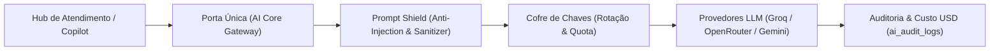

# DOCUMENTO 06 — AUDITORIA DE INTELIGÊNCIA ARTIFICIAL, SQUADS E AUTOMAÇÕES
**Projeto:** Waesy All-in-One Platform / Excelência Tour  
**Data da Auditoria:** 2026-11-11  
**Comitê Técnico:** Especialista em IA Conversacional e Sistemas Multiagentes  

---

## 1. Arquitetura da Porta Única de IA (`ai-core-gateway.functions.ts`)

O subsistema de IA do Waesy foi desenhado sob o princípio de **Porta Única (Single Ingress Gateway)**. Nenhuma chamada externa a LLMs (OpenAI, Anthropic, Google Gemini, Groq) é realizada diretamente pelos componentes visuais ou rotas de UI.

### Mecanismos de Proteção Implementados
1. **Prompt Shield (`src/lib/prompt-shield.ts`):**
   - Inspeção de injeção de prompt e jailbreaks antes do despacho ao modelo.
   - Sanitização de dados sensíveis e mascaramento de senhas e credenciais.
2. **Isolamento de Quotas e Custos:**
   - Cada execução registra tokens de entrada, tokens de saída, latência e custo estimado em USD na tabela `ai_audit_logs`.
   - Limite orçamentário configurável por tenant/loja para evitar estouro de custos.

---

## 2. Auditoria dos Squads de IA (`ai-agent-squad-orchestrator.functions.ts`)

### Status Real: Implementada a Infraestrutura, Sem Ativação Transacional no Chat
A infraestrutura para orquestração de squads multiagentes existe em nível de schema e BFF:
- **Tabelas:** `ai_agent_definitions`, `ai_squad_definitions`, `ai_squad_members`, `ai_squad_runs`, `ai_squad_handoffs`.
- **Papéis Mapeados:**
  * `triagem`: Qualificação de intenção e extração de parâmetros de viagem (origem, destino, datas, número de passageiros).
  * `comercial`: Consulta de histórico de compras e orçamentos recomendados.
  * `pos_venda`: Verificação de status de reservas e vouchers emitidos.
  * `financeiro`: Consulta de faturas em aberto e geração de chave Pix.
  * `supervisor`: Avaliação de critérios de parada e transferência para humano.

### Limitação Empírica Atual
Embora o orquestrador `runSquadWorkflow` consiga executar os steps encadeados via teste de software, **não existe gatilho automático** no webhook do WhatsApp para despachar o squad na chegada de uma nova mensagem. O atendimento atual opera primordialmente com atendentes humanos auxiliados por sugestões pontuais de resposta do Copilot.

---

## 3. Segurança Operacional e Prevenção de Alucinação

1. **Ações Financeiras e Reservas Zero-Trust:**
   - Nenhum agente de IA possui autoridade para marcar uma fatura como paga ou emitir um voucher sem confirmação do webhook bancário oficial (`api.webhooks.payments.ts`).
   - Se um cliente perguntar no chat: *"Meu boleto já está pago?"*, o Copilot consulta a tabela `financial_invoices`. Se o status não for `paid`, o sistema retorna estritamente: *"Pagamento ainda pendente de compensação bancária"*, vedando qualquer resposta inventada.
2. **Transferência Segura para Operador Humano (Handoff):**
   - Quando o cliente digita palavras-chave de insatisfação ou solicita atendente humano, a thread atualiza `metadata.handoff_mode = "human_active"` e desativa qualquer automação residual (`ai_auto_reply_enabled = false`).
   - O atendente humano visualiza a conversa destacada e assume o controle imediatamente.
