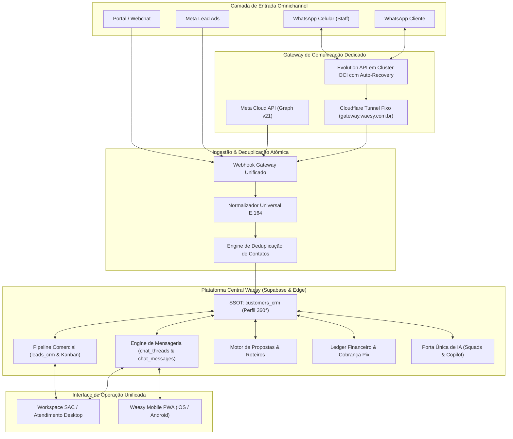

# DOCUMENTO 10 — VISÃO ARQUITETURAL RECOMENDADA E EVOLUÇÃO DO SISTEMA ALL-IN-ONE
**Projeto:** Waesy All-in-One Platform / Excelência Tour  
**Data da Auditoria:** 2026-11-11  
**Comitê Técnico:** Arquiteto Principal de Software e Engenheiro de Sistemas Distribuídos  

---

## 1. Princípios da Plataforma Unificada All-in-One

Para que o Waesy atenda plenamente às operações críticas de uma agência de turismo de alto padrão como a Excelência Tour, a arquitetura deve consolidar 4 pilares inegociáveis:

1. **Fonte Única da Verdade para o Cliente (Canonical Customer SSOT):**
   - O cliente possui uma única chave soberana (`customer_id` em `customers_crm`). Não existem cadastros dissociados entre Chat, Leads, Propostas, Vouchers e Faturas.
2. **Sincronização Absoluta e Bilateral (Zero-Drop Messaging):**
   - Nenhuma mensagem, enviada pelo sistema ou pelo smartphone pessoal do lojista, pode ser descartada.
   - Idempotência rigorosa garantida por chaves compostas e hashing SHA256.
3. **Ergonomia Silenciosa Padrão Apple / Linear:**
   - Menos texto decorativo, mais velocidade de operação.
   - Pílulas compactas, piso tátil de 44px e zero truncamento de nomes de viajantes.
4. **Inteligência Artificial Assistida com Guardrails Determinísticos:**
   - IA atua como aceleradora comercial (qualificação, extração de dados de roteiros e geração de orçamentos), sob aprovação humana estrita para fechamento de contratos e emissão de cobranças.

---

## 2. Diagrama da Arquitetura Alvo Recomendada

---

## 3. Estratégia de Transição Suave (Zero-Downtime Migration)

1. **Fase 1: Correção Imediata do Webhook (Em Produção):**
   - Habilitar o processamento de mensagens com `fromMe === true` para que as conversas do WhatsApp físico passem a entrar no Waesy imediatamente.
2. **Fase 2: Instalação do Cloudflare Tunnel Permanente na VPS Oracle:**
   - Criar túnel com token de autenticação gerenciado via systemd, fixando a URL em `gateway.waesy.com.br`.
3. **Fase 3: Otimização do Realtime no Atendimento:**
   - Adicionar o canal de broadcast para forçar reload atômico das mensagens na tela do atendente assim que um evento for gravado pelo webhook.
4. **Fase 4: Integração Visual Chat ⇄ Funil de Vendas:**
   - Exibir no topo do chat o estágio do funil do cliente e permitir a movimentação do lead diretamente da barra lateral.
