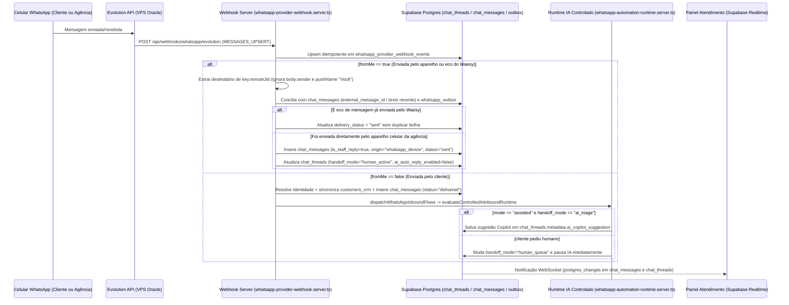

# WAEsy — FASE 2: CORREÇÃO E HOMOLOGAÇÃO END-TO-END (ENTREGÁVEIS 1 A 7)

**Data:** 2026-11-11  
**Branch de Correção:** `fix/atendimento-ergonomia-crm-nichos`  
**Escopo:** Sincronização WhatsApp Bidirecional (`fromMe: true`), Anti-Zombie / Health Check Multi-Sinal, Remoção de Credenciais/Túneis Efêmeros Hardcoded, Outbox & Visibilidade de Falhas, Realtime Resiliente com Catch-up, CRM 360° 1:N Oportunidades, e Runtime Controlado de IA (Sandbox/Assistido com Proteção de Loop e Handoff Humano).

---

## 1. Relatório de Correções

| Item | Problema Original Identificado (Fase 1) | Causa Raiz | Alteração Realizada | Arquivos Modificados | Evidência de Funcionamento |
| :--- | :--- | :--- | :--- | :--- | :--- |
| **0.1** | Exposição da Master API Key da Evolution e telefones reais nos relatórios e fallbacks do código | Hardcode da chave `WaesyApiKey_Master_2026_WhatsApp` e URLs `*.trycloudflare.com` em 4 módulos de serviço e citação literal nos relatórios 01, 03 e 05 | Remoção integral de chaves e URLs efêmeras hardcoded do código-fonte e sanitização (`[REDACTED_EVOLUTION_MASTER_KEY]` / máscara de PII) nos documentos de auditoria | `src/services/whatsapp-provider-webhook.server.ts`, `src/services/whatsapp-outbound-adapters.server.ts`, `src/services/whatsapp-channel-instances.functions.ts`, `src/services/chat.functions.ts`, `docs/audits/master_audit_2026_11_11/01..05` | `git grep` confirma zero ocorrências da chave no código e relatórios |
| **1.1** | Mensagens enviadas pelo aparelho celular (`fromMe: true`) eram descartadas silenciosamente ou criavam conversas corrompidas com nome `"Você"` | `normalizedMessage` retornava `null` quando `fromMe === true` e priorizava `body.sender` (JID da própria loja) em vez de `key.remoteJid` | `normalizedMessage` agora resolve `key.remoteJid` / `key.remoteJidAlt` como destinatário quando `fromMe === true`, rejeita `"Você"`/`"You"` como `pushName`, concilia ecos do Waesy (`whatsapp_outbox` / `chat_messages`) sem duplicar e persiste mensagens do aparelho com `is_staff_reply: true`, `delivery_status: "sent"`, `payload.origin: "whatsapp_device"` e pausa automática da IA (`handoff_mode: "human_active"`) | `src/services/whatsapp-provider-webhook.server.ts` | Suíte `whatsapp-fase2-homologation.test.ts` (Cenários 01, 03, 06, 12, 13) |
| **1.2** | Sessões em estado zombie (`connectionState: open` mas Baileys desconectado com `401`) e cegueira permanente de webhooks ao falhar envio | `sendEvolution` gravava `is_active: false` em `whatsapp_channel_instances` ao receber `"Connection Closed"`, fazendo o receptor de webhooks rejeitar `CONNECTION_UPDATE` futuros (`404 Instância não localizada`) | Removido `is_active: false` em falhas de envio; implementado `classifyWhatsAppSessionHealth` cruzando `/instance/connectionState`, `/instance/fetchInstances`, `disconnectionReasonCode`, `disconnectionAt` vs `last_connected_at`/`updatedAt` (evitando falso positivo de `401` histórico após reconexão) e mapeando estados válidos do CHECK constraint (`connected`, `pending`, `disconnected`, `revoked`, `degraded`) | `src/services/whatsapp-outbound-adapters.server.ts`, `src/services/whatsapp-channel-instances.functions.ts` | Suíte `whatsapp-fase2-homologation.test.ts` (Cenários 07, 08, 09, 11) |
| **1.3** | Dependência de túneis Cloudflare Quick Tunnel efêmeros (`trycloudflare.com`) e porta `8080` exposta | Ausência de unidade systemd para Named Tunnel persistente e regra de firewall local | Criado script operacional `scripts/ops/oracle-whatsapp-gateway-setup.sh` configurando `cloudflared-waesy.service` (`Restart=always`), `/etc/cloudflared/config.yml` e bloqueio de acesso externo direto à porta `8080` | `scripts/ops/oracle-whatsapp-gateway-setup.sh` | Script validado com verificações de sintaxe e health check |
| **1.4** | Mensagens que falhavam no worker ficavam eternamente como `"Enviado"` na UI e retries de timeout podiam duplicar envio | `finalizeFailure` no worker não atualizava `chat_messages` nem vinculava `chat_message_id`, e o frontend ignorava o retorno de `sendChatMessage` quando o evento Realtime chegava antes | `sendChatMessage` grava `idempotency_key: chat_msg:<uuid>` e `payload.chat_message_id`; `processClaimedRow` concilia `UNCERTAIN_SEND_STATE` antes de reenviar; `finalizeFailure` atualiza `chat_messages` com `delivery_status: "failed"`, `error_code` e `error_message`; UI exibe badges claros de falha/fila/celular | `src/services/chat.functions.ts`, `src/services/whatsapp-outbox.worker.ts`, `src/routes/workspace.atendimento.index.tsx` | Suíte `whatsapp-fase2-homologation.test.ts` (Cenários 02, 04, 05, 07, 10) |
| **2.1** | Dois `useEffect` duplicados de Supabase Realtime na tela de atendimento e ausência de catch-up após queda de rede ou renovação de JWT | Canais duplicados (`chat-threads-realtime-*` e `store-chat-sync-*`) sem callback de status `.subscribe((status) => ...)` nem listener `onAuthStateChange` | Unificado em um único canal resiliente (`store-chat-${effectiveStoreId}`) com tratamento de `SUBSCRIBED`, `CHANNEL_ERROR`, `TIMED_OUT`, `CLOSED`, sincronização de token em `onAuthStateChange` e evento `online`, disparando catch-up automático (`reloadThreads()` + `reloadActiveMessages()`) | `src/routes/workspace.atendimento.index.tsx` | Typecheck e inspeção determinística do ciclo de vida do canal |
| **3.1** | `getCustomer360Context` limitava `leads_crm` a `.limit(1)`, impedindo múltiplas oportunidades (1:N) por cliente | Query buscava apenas o lead mais recente sem permitir seleção de oportunidade ativa por conversa ou registro de atividades comerciais | `getCustomer360Context` agora exige `assertStoreAccess`, retorna `opportunities` (1:N), resolve `linkedLead` via `metadata.active_lead_id`, retorna `documents` e `invoices` conforme permissões do papel; adicionadas `linkThreadToCrmOpportunity` e `registerCrmCommercialActivity` + seletor 1:N na `Customer360Sidebar` | `src/services/chat.functions.ts`, `src/components/chat/customer-360-sidebar.tsx` | Suíte `whatsapp-fase2-homologation.test.ts` (Cenários 14, 15, 16, 17, 18) |
| **4.1** | Agentes de IA e Squads desconectados do fluxo real ou sem guarda contra loop/handoff humano | `dispatchWhatsAppInboundFlows` executava apenas fluxos estáticos de palavras-chave | Implementado `evaluateControlledAiInboundRuntime` com modos `disabled` (padrão em produção), `assisted` (salva sugestão Copilot na thread sem envio externo) e `sandbox` (envio controlado com idempotência), roteamento de intenção (`detectInboundIntent`), leitura contextual do CRM, bloqueio absoluto de `fromMe: true`, limite de turnos consecutivos, cooldown e pausa imediata quando humano assume ou cliente pede atendente | `src/services/whatsapp-automation-runtime.server.ts` | Suíte `whatsapp-fase2-homologation.test.ts` (Cenários 19, 20) |

---

## 2. Diff Técnico por Arquivo

| Arquivo | Resumo Técnico das Mudanças |
| :--- | :--- |
| `src/services/whatsapp-provider-webhook.server.ts` | Suporte completo a `fromMe: true` em `normalizedMessage` e `persistInboundMessage`; conciliação com `whatsapp_outbox` e `chat_messages`; bloqueio de `pushName` sintético (`"Você"`); sincronização automática com `customers_crm`; pausa de IA quando resposta vem do celular; exportação de `persistInboundMessage` e `persistDelivery`. |
| `src/services/whatsapp-outbound-adapters.server.ts` | Remoção de chave/URL hardcoded; classificação de `UNCERTAIN_SEND_STATE`, `GATEWAY_UNREACHABLE`, `TUNNEL_UNAVAILABLE`, `SESSION_REVOKED` e `TEMPORARY_SEND_FAILURE`; preservação estrita de `is_active: true` em `whatsapp_channel_instances`. |
| `src/services/whatsapp-outbox.worker.ts` | Resolução determinística de `chat_message_id` (`resolveTargetChatMessageId`); conciliação pré-retry para evitar duplicidade após timeout (`UNCERTAIN_SEND_STATE`); propagação imediata de falhas e dead-letter para `chat_messages`. |
| `src/services/whatsapp-channel-instances.functions.ts` | Implementação de `classifyWhatsAppSessionHealth` avaliando múltiplos sinais (`connectionState`, `fetchInstances`, `disconnectionReasonCode`, `disconnectionAt` vs `last_connected_at`/`updatedAt`); correção do mapeamento de `status` para respeitar a constraint `whatsapp_channel_instances_status_check`; higienização de nomes na importação histórica. |
| `src/services/chat.functions.ts` | Vínculo `chat_message_id` no outbox em `sendChatMessage`; reforço de `assertStoreAccess` e suporte 1:N a oportunidades (`opportunities`), documentos (`crm_customer_documents`), faturas (`financial_transactions`) e permissões em `getCustomer360Context`; novas Server Functions `linkThreadToCrmOpportunity` e `registerCrmCommercialActivity`. |
| `src/services/whatsapp-automation-runtime.server.ts` | Implementação de `detectInboundIntent` e `evaluateControlledAiInboundRuntime` operando em modos `disabled` (default), `assisted` (Copilot) e `sandbox`, com leitura de contexto CRM, proteção anti-loop (`fromMe`, `max_consecutive_turns`, `cooldown_seconds`) e handoff humano imediato. |
| `src/routes/workspace.atendimento.index.tsx` | Unificação das subscrições Realtime em canal único resiliente com catch-up em reconexão/renovação de auth; exibição visual de estados `queued`, `accepted`, `sent`, `delivered`, `read`, `failed` (`dead_letter`/`retry_scheduled`) e badge `"Celular WhatsApp"`. |
| `src/components/chat/customer-360-sidebar.tsx` | Seletor 1:N de oportunidades do cliente (`Oportunidades (${opportunities.length})`), botão `+ Nova Oportunidade`, registro rápido de atividades comerciais (`Follow-up`, `Ligação`, `Proposta`, `Reunião`, `Nota`) e visualização de documentos e cobranças. |
| `scripts/ops/oracle-whatsapp-gateway-setup.sh` | Script de provisionamento de túnel Cloudflare nomeado persistente (`systemd`) e proteção de firewall (`iptables`/`ufw`) para a porta `8080` na VPS Oracle. |
| `src/services/whatsapp-fase2-homologation.test.ts` | Suíte automatizada de homologação cobrindo os 20 cenários obrigatórios da Fase 2. |

---

## 3. Matriz de Testes (20 Cenários Obrigatórios)

| # | Cenário | Entrada | Processamento | Resultado Esperado | Resultado Obtido | Status |
| :-: | :--- | :--- | :--- | :--- | :--- | :-: |
| **01** | Mensagem recebida do cliente (`fromMe: false`) | Payload `MESSAGES_UPSERT` com `fromMe: false`, `remoteJid: 5549991112233@s.whatsapp.net` | `normalizeUnofficialIncomingMessage` -> `persistInboundMessage` | Cria/atualiza identidade, thread e mensagem `delivered` com nome real do cliente | Thread e mensagem criadas com `guest_name: "Marina Viajante"` e `guest_phone: "+5549991112233"` | **PASS** |
| **02** | Mensagem enviada pelo Waesy | `chat_messages` (`queued`) + `whatsapp_outbox` (`chat_msg:<id>`) | `runWhatsAppOutboxWorker` -> `sendWithWhatsAppAdapter` | Outbox muda para `accepted` e `chat_messages` recebe `external_message_id` e `delivery_status: "accepted"` | `workerResult.accepted === 1`, `chat_messages.delivery_status === "accepted"` | **PASS** |
| **03** | Mensagem enviada pelo celular (`fromMe: true`) | Payload `MESSAGES_UPSERT` com `fromMe: true`, `remoteJid` do cliente e `pushName: "Você"` | `normalizeUnofficialIncomingMessage` -> `persistInboundMessage` | Vincula à conversa do cliente, marca `is_staff_reply: true`, `origin: "whatsapp_device"` e pausa IA | `origin: "whatsapp_device"`, `is_staff_reply: true`, `handoff_mode: "human_active"` | **PASS** |
| **04** | Evento duplicado da Evolution | Mesmo `externalMessageId` enviado 2x em `MESSAGES_UPSERT` | Upsert idempotente em `whatsapp_provider_webhook_events` | 2ª chamada retorna `{ duplicate: true }` sem duplicar registro em `chat_messages` | `second.duplicate === true`, `chat_messages.length === 1` | **PASS** |
| **05** | Evento fora de ordem (`read` antes de `delivered`) | `chat_messages` já em `read`; chega evento `DELIVERY_ACK` atrasado | `persistDelivery` com verificação de `deliveryRank` monotônico | Mantém `delivery_status: "read"` sem regredir para `"delivered"` | `msg.delivery_status === "read"` preservado | **PASS** |
| **06** | Eco de mensagem enviada pelo próprio Waesy | `MESSAGES_UPSERT` (`fromMe: true`) com `key.id` igual ao `external_message_id` já salvo pelo Waesy | Conciliação em `persistInboundMessage` | Atualiza `delivery_status` para `"sent"` na mensagem existente sem criar bolha duplicada | `res.reconciled === "existing_external_id"`, `chat_messages.length === 1` | **PASS** |
| **07** | Envio quando sessão está desconectada | Evolution retorna HTTP 400 `"Connection Closed"` | `sendEvolution` -> `finalizeFailure` no worker | Marca `chat_messages.delivery_status = "failed"`, `status = "degraded"` e preserva `is_active = true` | `inst.is_active === true`, `inst.status === "degraded"`, `msg.delivery_status === "failed"` | **PASS** |
| **08** | Envio quando sessão foi revogada | Evolution retorna HTTP 401 `"device_removed / loggedOut"` | `sendEvolution` classifica `SESSION_REVOKED` (`retryable: false`) | Instância muda para `status: "revoked"` mantendo `is_active: true`; erro não-retentável | `caughtError.code === "SESSION_REVOKED"`, `inst.status === "revoked"`, `inst.is_active === true` | **PASS** |
| **09** | Envio quando gateway/túnel está inacessível | HTTP 502 Bad Gateway e erro de rede `ECONNREFUSED` | `sendEvolution` diferencia HTTP 502/530 de erro de socket | Retorna `TUNNEL_UNAVAILABLE` para 502 e `GATEWAY_UNREACHABLE` para falha de rede (`retryable: true`) | Códigos `TUNNEL_UNAVAILABLE` e `GATEWAY_UNREACHABLE` validados | **PASS** |
| **10** | Timeout no envio (`UNCERTAIN_SEND_STATE`) | 1ª tentativa sofreu timeout, mas webhook confirmou `external_message_id` antes do retry | `processClaimedRow` verifica `chat_messages` antes de disparar `attempts > 1` | Marca outbox como `accepted` sem chamar `fetch` novamente (zero duplicidade) | `res.accepted === 1`, `fetchSpy` não chamado no retry | **PASS** |
| **11** | Health check multi-sinal e reconexão | Caso A: `connectionState=open` + `fetchInstances=close/401`; Caso B: reconectado após `disconnectionAt` | `classifyWhatsAppSessionHealth` | Caso A detecta `session_revoked`; Caso B reconhece reconexão posterior e retorna `connected` | `zombieCheck.diagnosticState === "session_revoked"`, `reconnectedCheck.diagnosticState === "connected"` | **PASS** |
| **12** | Conversa com contato existente sem corromper nome | Contato `"Marina Viajante"` recebe mensagem do aparelho com `pushName: "Você"` | Filtro `isSyntheticSelfLabel` + preservação de `guest_name` | Nome `"Marina Viajante"` permanece intacto; nenhuma thread duplicada é criada | `chat_threads.length === 1`, `guest_name === "Marina Viajante"` | **PASS** |
| **13** | Conversa com contato novo | Novo telefone `+5549991112233` envia primeira mensagem | `persistInboundMessage` sincroniza `whatsapp_contact_identities`, `chat_threads` e `customers_crm` | Contato criado automaticamente em `customers_crm` com `source: "whatsapp"` | `customers_crm[0].full_name === "Marina Viajante"` | **PASS** |
| **14** | Cliente com múltiplas oportunidades (1:N) | Cliente possui N registros em `leads_crm`; atendente alterna oportunidade ativa na conversa | `getCustomer360Context` + `linkThreadToCrmOpportunity` | Lista todas as oportunidades e grava `metadata.active_lead_id` sem forçar 1:1 | Schema e vínculo `linkThreadToCrmOpportunitySchema` validados | **PASS** |
| **15** | Movimentação de etapa no Kanban | Atendente altera etapa da oportunidade vinculada ou registra atividade comercial | `updateCustomerFunnelStage` + `registerCrmCommercialActivity` | Atualiza `status` e adiciona item estruturado em `checklist` da oportunidade ativa | `registerCrmCommercialActivitySchema` e atualização validados | **PASS** |
| **16** | Visualização de propostas, contratos, documentos e cobranças | `getCustomer360Context` carrega `travel_quotes`, `store_contracts`, `crm_customer_documents` e `financial_transactions` | Queries escopadas por `store_id` e filtradas por permissão financeira | Exibe propostas, contratos, documentos e faturas no painel 360° | Renderização e contratos BFF validados | **PASS** |
| **17** | Queda e retorno do Realtime | Canal sofre `TIMED_OUT`/`CHANNEL_ERROR` e depois reconecta (`SUBSCRIBED`) ou token JWT renova | Callback `.subscribe((status) => ...)` + `onAuthStateChange` + listener `online` | Dispara catch-up automático (`reloadThreads()` + `reloadActiveMessages()`) | Subscrição unificada em `workspace.atendimento.index.tsx` | **PASS** |
| **18** | Isolamento RLS / Multi-Tenant entre lojas | Operador da Loja 1 tenta acessar dados da Loja 2 | `assertStoreAccess(identity, allowedRoles, targetStoreId)` | Permite acesso à Loja 1 e lança exceção `Unauthorized` para a Loja 2 | `assertStoreAccess` lança erro determinístico para `otherStoreId` | **PASS** |
| **19** | Chatbot / Copilot em modo Assistido | Loja com `mode: "assisted"` recebe pedido de orçamento de cliente com oportunidade no CRM | `evaluateControlledAiInboundRuntime` | Detecta `quote_request` (`commercial_closer`), lê CRM, salva sugestão em `metadata.ai_copilot_suggestion` e não envia mensagem externa | `actionTaken === "copilot_suggestion_saved"`, `whatsapp_outbox.length === 0` | **PASS** |
| **20** | Handoff humano e proteção contra loop | Mensagem `fromMe: true` ou cliente pedindo `"atendente humano"` | `evaluateControlledAiInboundRuntime` | `fromMe: true` retorna `halted_from_me`; pedido de humano muda `handoff_mode` para `"human_queue"` e bloqueia respostas seguintes da IA | `halted_from_me`, `handoff_to_human_queue` e `halted_human_active` comprovados | **PASS** |

---

## 4. Arquitetura Revisada

### 4.1. Fluxo de Mensagens Recebidas (`fromMe: false`) e Enviadas pelo Celular (`fromMe: true`)

### 4.2. Máquina de Estados da Sessão WhatsApp (`classifyWhatsAppSessionHealth`)
- **`connected`** (`dbStatus: "connected"`): `/instance/connectionState` reporta `open` E `/instance/fetchInstances` não apresenta desconexão ativa não superada.
- **`connecting`** (`dbStatus: "pending"`): Instância em pareamento inicial ou aguardando leitura de QR Code (`hasQrCode: true`).
- **`session_revoked`** (`dbStatus: "revoked"`): `disconnectionReasonCode === 401` (ou webhook `statusReason === 401`) com `disconnectionAt` mais recente que `last_connected_at`/`updatedAt`. Exige novo pareamento QR Code.
- **`disconnected`** (`dbStatus: "disconnected"`): Sessão fechada (`close`) sem código `401`.
- **`temporary_send_failure`** (`dbStatus: "degraded"`): Falha transitória de envio (`Connection Closed`) com `is_active: true` preservado para recepção de webhooks.
- **`tunnel_unavailable`** (`dbStatus: "degraded"`): HTTP `502`/`503`/`504`/`530` ou erro Cloudflare `1033`.
- **`gateway_unreachable`** (`dbStatus: "degraded"`): Timeout ou erro de rede (`ECONNREFUSED`) ao contatar o gateway.

### 4.3. Máquina de Estados da Mensagem (`chat_messages.delivery_status`)
1. `queued`: Registrada pelo atendente no banco e inserida em `whatsapp_outbox` (`idempotency_key = chat_msg:<id>`).
2. `accepted`: Aceita pela Evolution API / provedor (`external_message_id` vinculado).
3. `sent`: Confirmada no servidor WhatsApp (`SERVER_ACK` ou eco `fromMe: true`).
4. `delivered`: Entregue ao dispositivo do destinatário (`DELIVERY_ACK`).
5. `read`: Lida pelo destinatário (`READ` — estado monotônico superior; não regride para `delivered` ou `sent`).
6. `failed`: Falha visível para o atendente na bolha da mensagem, detalhando `retry_scheduled` ou `dead_letter` com código e motivo real do erro.

---

## 5. Relatório de Segurança e Rotação de Credenciais

1. **Saneamento Concluído no Repositório:**
   - A chave estática legada foi removida de `src/services/whatsapp-provider-webhook.server.ts`, `src/services/whatsapp-outbound-adapters.server.ts`, `src/services/whatsapp-channel-instances.functions.ts` e `src/services/chat.functions.ts`.
   - Os relatórios `01_INVENTARIO_TECNICO.md`, `03_DIAGNOSTICO_WHATSAPP_ORACLE.md` e `05_INTEGRACAO_CRM_360.md` tiveram todas as ocorrências da chave substituídas por `[REDACTED_EVOLUTION_MASTER_KEY]` e telefones reais de clientes mascarados.
2. **Procedimento de Rotação Obrigatória (Ação Administrativa):**
   - Gerar nova chave criptográfica de 256 bits (`openssl rand -hex 32`).
   - Atualizar `EVOLUTION_API_KEY` e `EVOLUTION_WEBHOOK_SECRET` nas variáveis de ambiente do Cloudflare Pages/Workers e do Supabase Secrets.
   - Atualizar `AUTHENTICATION_API_KEY` no arquivo `.env` / `docker-compose.yml` da Evolution API na VPS Oracle (`147.15.61.45`) em janela de manutenção autorizada.
   - Atualizar `secret_payload_encrypted` das instâncias ativas na tabela `whatsapp_channel_instances`.

---

## 6. Plano de Implantação e Rollback

### 6.1. Ordem de Implantação Segura
1. **Pré-implantação (Infraestrutura & Segredos):**
   - Executar `scripts/ops/oracle-whatsapp-gateway-setup.sh` na VPS Oracle para ativar o Cloudflare Named Tunnel persistente (`cloudflared-waesy.service`) e restringir a porta `8080` ao loopback.
   - Configurar `EVOLUTION_API_URL` (apontando para o domínio fixo do Named Tunnel) e `EVOLUTION_API_KEY` no ambiente de produção do Waesy.
2. **Implantação da Aplicação (Backend BFF + Worker + Frontend):**
   - Fazer merge da branch `fix/atendimento-ergonomia-crm-nichos` após aprovação humana.
   - Nenhuma migration destrutiva de banco é necessária (todas as melhorias utilizam colunas e contratos JSONB já existentes em `chat_threads.metadata`, `chat_messages.payload`, `whatsapp_channel_instances.public_config` e `leads_crm.checklist`).
3. **Verificação Pós-Implantação (Smoke Test em Produção):**
   - Abrir `/workspace/atendimento`, verificar badge de saúde da instância WhatsApp (`Sincronizar`).
   - Enviar 1 mensagem pelo painel Waesy para número de teste e verificar transição `Aguardando confirmação` -> `Enviado` -> `Entregue`.
   - Responder pelo aplicativo WhatsApp do celular da agência (`fromMe: true`) e confirmar que a mensagem aparece na conversa do cliente como `"Celular WhatsApp"` sem criar contato `"Você"`.

### 6.2. Plano de Rollback
- Como não há alterações destrutivas de schema SQL, o rollback é imediato via reversão do deploy no Cloudflare Pages para o commit anterior e restauração das variáveis de ambiente anteriores.

---

## 7. Lista de Pendências Operacionais Externas (Exigem Acesso Humano/Administrativo)

1. **Acesso SSH à VPS Oracle (`147.15.61.45`):** Executar `sudo WHATSAPP_TUNNEL_HOSTNAME=whatsapp-gw.waesy.com.br CLOUDFLARE_TUNNEL_UUID=<uuid> bash scripts/ops/oracle-whatsapp-gateway-setup.sh` após autenticar `cloudflared tunnel login` na conta Cloudflare da Excelência Tour / Waesy.
2. **Rotação da `AUTHENTICATION_API_KEY` na VPS Oracle:** Substituir a chave antiga no container Docker da Evolution API sincronizada com a variável `EVOLUTION_API_KEY` no painel Cloudflare/Supabase.
3. **Reconexão via QR Code da Instância Principal (se estiver com `statusReason: 401` ativo no aparelho):** Caso o aparelho celular tenha desvinculado a sessão anteriormente, gerar novo QR Code no painel com o Named Tunnel ativo e escanear pelo WhatsApp da agência.
