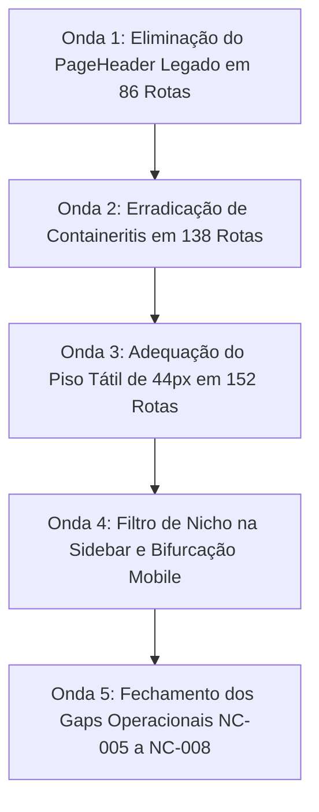

# 16 — Plano de Remediação Estruturado em 5 Ondas

Para alcançar a aprovação integral da plataforma sem introduzir regressões, estabelece-se o seguinte DAG de remediação:

## Detalhamento das Ondas de Execução:
1. **Onda 1 (Prioridade P1 - 86 Rotas):** Substituir todas as importações de `PageHeader` por `WorkspaceCanonicalToolbar`, liberando até 80px verticais úteis em cada tela.
2. **Onda 2 (Prioridade P0/P1 - 138 Rotas):** Remover contêineres externos redundantes com borda e background, implementando a casca única soberana.
3. **Onda 3 (Prioridade P1 - 152 Rotas):** Adicionar utilitário `min-h-11` e área de toque de 44x44px em todos os controles móveis.
4. **Onda 4 (Prioridade P1 - 27 Rotas):** Filtrar menus da sidebar pelo manifesto de nicho e adotar gavetas móveis com safe-area.
5. **Onda 5 (Prioridade P0/P2 - 4 Fluxos):** Implementar código defensivo para os gaps GAP-001 a GAP-004.
