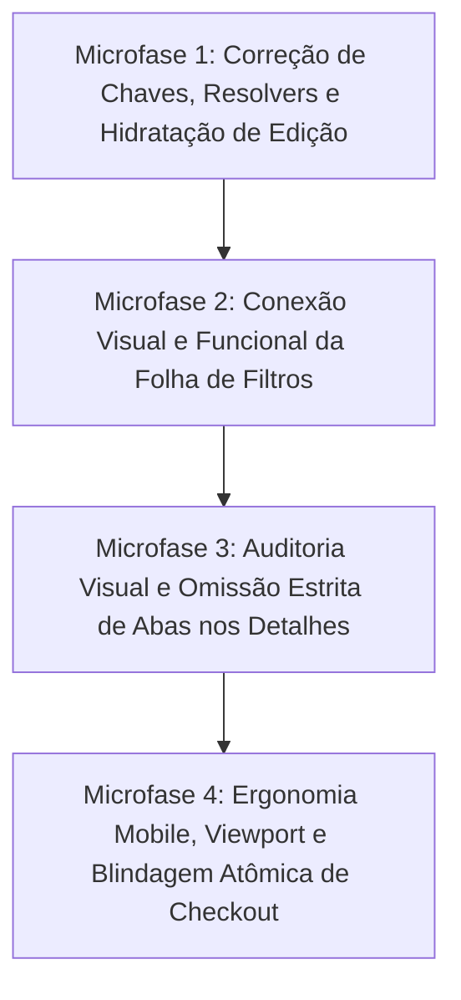

# PLANO MESTRE: AUDITORIA FORENSE, INTEGRIDADE END-TO-END E DECOMPOSIÇÃO EM MICROFASES
## Módulos: Classificados Multi-Nicho, Vitrines Públicas e Checkout Adaptativo

- **Data de Emissão:** 2026-10-22 (ISO)
- **Status:** Ativo / Aprovado para Execução
- **Escopo:** Classificados, Vitrines Públicas, Visualização Squircle, Detalhes de Anúncio e Checkout Multi-Nicho
- **Documentos de Referência:** `AGENTS.md`, `docs/design/DESIGN.md`, `docs/design/DECISIONS.md`, Invariantes B.20 a B.41

---

## 1. Visão Geral e Contexto Executivo

Este documento consolida a auditoria forense ponta a ponta do ecossistema de Classificados e Vitrines do Waesy, confrontando o que foi planejado, o que foi efetivamente executado no repositório, o que permaneceu pendente e, criticamente, **o que aparenta estar correto na superfície, mas contém desconexões funcionais ou estruturais**.

O ecossistema opera sob a premissa de **Zero Mocks, Zero Fallbacks Artificiais (B.33), Design Squircle Anti-Jank (B.32), Integridade Textual Plena (B.38), e Isolamento Semântico Estrito de Nichos (B.37)**.

---

## 2. Balanço de Execução: Planejado vs. Executado

### 2.1 O Que Está 100% Implementado e Verificado
1. **Resolução Semântica Canônica (`src/lib/classifieds/canonical-specs-resolver.ts`):**
   - 16 nichos isolados semanticamente (Imóveis, Veículos, Desapegos, Serviços, Agro, Viagens, Eventos, Farmácia, Empregos, etc.).
   - Prevenção ativa de vazamento de atributos (ex.: "Retirada no Local" e "Novo na Caixa" proibidos em Serviços, Imóveis, Turismo e Eventos).
   - 23 testes unitários verdes em `canonical-specs-resolver.test.ts`.
2. **Biblioteca de Rótulos Dinâmicos (`src/lib/classifieds/semantics.ts`):**
   - Exportação de `getNicheTabLabels` erradicando títulos estáticos como "Detalhes do Item".
   - Registro integral do nicho `event` (Eventos & Shows).
3. **Cards de Vitrine Universais (`src/components/commerce/universal-niche-card.tsx`):**
   - Erradicação de `truncate` em especificações técnicas, adotando `break-words text-wrap leading-tight` (Invariante B.38).
   - Inclusão de pílulas canônicas para Agro, Farmácia, Negócios e Vagas.
4. **Catálogo & Régua Superior (`src/components/classifieds/catalog/classified-catalog-types.ts`):**
   - Inclusão dos 16 nichos nos chips (`CLASSIFIED_CHIPS`) e hotpages (`CLASSIFIEDS_HOTPAGES`).
   - Declaração de opções de facetas para Agro, Farmácia e Eventos.
5. **Hook de Filtros (`src/components/classifieds/catalog/use-classified-catalog.ts`):**
   - Normalização de aliases em português (`agro`, `farmacia`, `eventos`, `vagas`) para IDs canônicos.
   - Lógica de filtragem reativa no `useMemo` cobrindo as novas facetas.
6. **Formulário de Criação (`src/routes/_store.conta.classificados.novo.tsx`):**
   - Passo 3 com campos especializados para Agro (horímetro, tração 4x4, implemento) e Farmácia (receita retida, Anvisa, princípio ativo).
   - Persistência em `attributes` (JSONB) no Supabase.

---

## 3. Matriz Forense de Gaps: "O Que Parece Certo, Mas Não Está"

| ID | Camada / Arquivo | Anomalia Identificada | Causa Raiz | Impacto / Risco |
| :--- | :--- | :--- | :--- | :--- |
| **GAP-01** | UI / `classified-filter-sheet.tsx` | Constantes de facetas foram importadas, mas o JSX e as props correspondentes não foram criados. | Edição parcial abortada por conflito de whitespace/CRLF. | No mobile, a gaveta de filtros não oferece refinamento de Agro, Farmácia ou Eventos. |
| **GAP-02** | Rota / `_store.classificados.index.tsx` | `<ClassifiedFilterSheet />` é instanciado sem repassar os novos estados e setters do hook `catalog`. | Falta de binding entre o hook e o componente visual. | As seleções de facetas específicas não chegam à folha de filtros. |
| **GAP-03** | BFF $\leftrightarrow$ UI / Specs Resolver | Potência de máquina salva como `power_cv` em `novo.tsx`, mas lida como `power_hp` no resolver. | Divergência de nomenclatura no payload JSONB. | Usuário preenche a potência no cadastro, ela grava no banco, mas a tela de detalhes não exibe o valor. |
| **GAP-04** | BFF $\leftrightarrow$ UI / Specs Resolver | Cabine salva como `cabin_type` (string) em `novo.tsx`, mas verificada como booleano `attrs.cabin` no resolver. | Tipagem divergente de atributo herdado. | Tipo de cabine não renderiza na ficha técnica do anúncio. |
| **GAP-05** | UI / `_store.conta.classificados.novo.tsx` | Modo Edição (`?editId=...`) hidrata campos herdados, mas deixa os novos estados de Agro e Farmácia vazios. | Falta de fallback `initialData?.attributes?.traction` no `useState`. | Ao editar um anúncio existente, os dados de maquinário ou farmácia podem ser sobrescritos por vazio. |
| **GAP-06** | UI / Detalhes de Anúncios | Abas vazias em `classified-detail-mobile.tsx` e `desktop` dependem de checagem rasa. | Falta de validação estrita com `getNicheTabLabels` e arrays vazios. | Risco de exibir abas órfãs sem conteúdo (violação da Invariante B.33). |
| **GAP-07** | BFF / `checkout.functions.ts` | Taxa de entrega na porta (`door_delivery_fee_cents`) aplicada via `UPDATE` posterior ao RPC transacional. | Desacoplamento entre o cálculo atômico do pedido e a taxa de comodidade. | Risco de inconsistência financeira caso o segundo update falhe. |

---

## 4. Decomposição do Trabalho Restante em Microfases Atômicas

Para garantir estabilidade, prevenir conflitos com outros agentes ativos e assegurar conformidade total com o `AGENTS.md`, o trabalho foi dividido em 4 microfases rigorosamente delimitadas:

---

### Microfase 1: Correção de Chaves, Resolvers e Hidratação de Edição

- **Objetivo:** Garantir que 100% dos dados gravados em `attributes` (Agro e Farmácia) sejam lidos perfeitamente pelas fichas técnicas e hidratados no formulário de edição.
- **Arquivos no Escopo:**
  - `src/lib/classifieds/canonical-specs-resolver.ts`
  - `src/components/commerce/universal-niche-card.tsx`
  - `src/routes/_store.conta.classificados.novo.tsx`
- **Requisitos EARS:**
  - *Quando* o anúncio possuir `attributes.power_cv`, *o sistema deve* resolver como potência do maquinário com sufixo "CV".
  - *Quando* o anúncio possuir `attributes.cabin_type`, *o sistema deve* exibir o rótulo textual correto ("Cabinado com Ar", "Plataformado").
  - *Quando* a rota `/conta/classificados/novo` for carregada com parâmetro `editId`, *o sistema deve* pré-popular todos os campos de Agro e Farmácia a partir de `initialData.attributes`.
- **Critério de Aceite & Evidência:**
  - Testes unitários em `canonical-specs-resolver.test.ts` passando com 100% de sucesso.
  - Teste de ida e volta (salvar $\rightarrow$ ler $\rightarrow$ editar) validado sem perda de atributos.

---

### Microfase 2: Conexão Visual e Funcional da Folha de Filtros

- **Objetivo:** Tornar os filtros de Agro, Farmácia e Eventos plenamente utilizáveis no catálogo mobile.
- **Arquivos no Escopo:**
  - `src/components/classifieds/catalog/classified-filter-sheet.tsx`
  - `src/routes/_store.classificados.index.tsx`
- **Requisitos EARS:**
  - *Quando* a categoria ativa for `agri`, *a folha de filtros deve* renderizar os seletores de subcategoria (Tratores, Colheitadeiras, Implementos) e tração (4x4, 4x2, Esteira).
  - *Quando* a categoria ativa for `pharmacy`, *a folha de filtros deve* renderizar a seleção de subnicho e switch de retenção de receita médica.
  - *Quando* a categoria ativa for `event`, *a folha de filtros deve* exibir os tipos de evento (Show, Curso, Esportivo).
  - *Em qualquer viewport mobile*, todos os botões e switches *devem* ter altura mínima de 44px (`h-11`) e anel de foco `:focus-visible:ring-2`.
- **Critério de Aceite & Evidência:**
  - Abertura e seleção de filtros em `/classificados` no mobile atualizando a contagem de filtros ativos e a listagem sem erros de console.

---

### Microfase 3: Auditoria Visual e Omissão Estrita de Abas nos Detalhes

- **Objetivo:** Eliminar abas vazias, garantir a ordem canônica de seções e blindar as páginas de detalhe de anúncios contra jank visual e sobreposição de z-index.
- **Arquivos no Escopo:**
  - `src/components/classifieds/classified-detail-mobile.tsx`
  - `src/components/classifieds/classified-detail-desktop.tsx`
  - `src/components/classifieds/universal-classified-showcase.tsx`
- **Requisitos EARS:**
  - *Quando* um anúncio não possuir itens para determinada aba (ex: "Fotos Extras" vazias ou "Roteiro" inexistente), *o sistema deve* omitir completamente a aba da régua de navegação (Invariante B.33).
  - *Em viewports mobile*, a barra inferior de contato/proposta *deve* operar estritamente em `z-30` com folga inferior `pb-32 pb-safe`, nunca ocluindo diálogos em `z-50` (Invariante B.34).
  - *Em qualquer detalhe de anúncio*, a ordem de blocos *deve* ser rigorosamente: Mídia/Galeria $\rightarrow$ Bloco Comercial (Preço e CTA) $\rightarrow$ Ficha Técnica Squircle $\rightarrow$ Descrição Completa $\rightarrow$ Vendedor/Localização.
- **Critério de Aceite & Evidência:**
  - Execução de `scripts/design-lint.mjs` reportando 0 violações P0 e 0 violações P1.

---

### Microfase 4: Ergonomia Mobile, Viewport e Blindagem Atômica de Checkout

- **Objetivo:** Desobstruir a viewport móvel do checkout (`/_store/checkout`), erradicar containeritis e garantir cálculo financeiro 100% transacional.
- **Arquivos no Escopo:**
  - `src/routes/_store.checkout.tsx`
  - `src/components/checkout/delivery-selector.tsx`
  - `src/services/checkout.functions.ts`
- **Requisitos EARS:**
  - *Quando* o checkout for renderizado em telas compactas (<600px), *o sistema deve* dispor os campos em coluna única confortável, eliminando grades espremidas e caixas aninhadas redundantes.
  - *Quando* a modalidade de entrega incluir taxa de comodidade de porta, *o sistema deve* computar o valor diretamente no cálculo do pedido dentro do RPC atômico.
  - *Se* o cliente possuir débito pendente registrado em seu CPF no `customer_debt_ledger`, *o sistema deve* bloquear a finalização com aviso educativo e link de quitação.
- **Critério de Aceite & Evidência:**
  - Simulação ponta a ponta: Carrinho $\rightarrow$ Dados de Entrega $\rightarrow$ Validação de CPF $\rightarrow$ Criação de Pedido com idempotência comprovada.

---

## 5. Matriz de Tabelas, Schemas e Contratos do Ecossistema

| Tabela / Schema Supabase | Coluna / Propriedade Chave | Contrato BFF / Validator | Componente UI Vinculado |
| :--- | :--- | :--- | :--- |
| `classifieds` | `category` (slug do nicho) | `classifieds.functions.ts` / `z.string()` | `_store.classificados.index.tsx` |
| `classifieds` | `attributes` (JSONB) | `CLASSIFIED_PUBLIC_ALLOWLIST_EXTRA` | `canonical-specs-resolver.ts` / `novo.tsx` |
| `classifieds` | `deal_type` (`venda`, `aluguel`, `temporada`) | `classifieds.functions.ts` | `classified-detail-*.tsx` / `UniversalNicheCard` |
| `customer_debt_ledger` | `customer_cpf`, `amount_cents`, `status` | `checkout.functions.ts` (Zero-Trust) | `_store.checkout.tsx` (Barreira de Inadimplência) |
| `orders` | `checkout_niche_metadata` (JSONB) | `CheckoutSchema` (Zod) | `_store.checkout.tsx` / `order-details` |
| `carts` | `session_token`, `customer_id`, `status` | `cart.functions.ts` (Ownership check) | `useCartContext` / Drawer de Carrinho |

---

## 6. Definition of Done & Critérios de Bloqueio

Nenhuma microfase poderá ser considerada concluída sem o cumprimento cumulativo dos seguintes critérios:
- [ ] Especificação técnica registrada e aprovada neste documento.
- [ ] Compilação TypeScript limpa (`tsc --noEmit` ou verificação cirúrgica por AST sem erros).
- [ ] Testes unitários Vitest verdes nos arquivos tocados pela microfase.
- [ ] Design Lint com 0 violações P0 (`!important`, `:focus-visible` ausente) e 0 violações P1 (cores fora do token, alvos de toque < 44px).
- [ ] Registro de decisão arquitetural padronizado em `docs/design/DECISIONS.md`.
- [ ] Prova de funcionamento em viewport mobile sem cortes horizontais e com safe-area respeitada.
