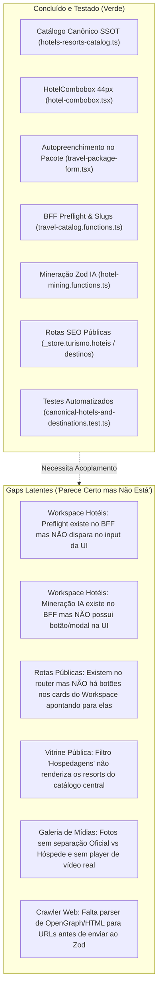
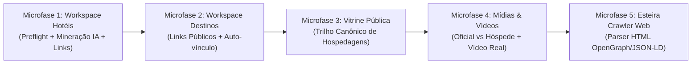

# PLANO-MESTRE: Ecossistema Canônico de Hotéis, Resorts, Destinos e Turismo (End-to-End)

**Status do Documento:** Ativo / Fonte Canônica do Backlog de Engenharia  
**Data de Criação:** 22 de Outubro de 2026  
**Governança:** AGENTS.md (Invariantes B.1 a B.45, DL-01 a DL-30, Piso WCAG 2.2 AA)  
**Repositório:** Waesy — Multi-tenant Urban & Tourism Operating System  

---

## 1. Visão Executiva & Propósito do Sistema

O ecossistema de Turismo e Hotelaria do Waesy tem como propósito centralizar uma **Fonte Única da Verdade (SSOT)** de hotéis, resorts, pousadas, destinos, praias e atrações turísticas. O objetivo estratégico é:
1. **Evitar Redundância e Duplicações:** Eliminar o esforço de cada agência local recadastrar os mesmos hotéis existentes no Brasil e no mundo.
2. **Autoridade Canônica de SEO:** Disponibilizar páginas públicas indexáveis de alta performance para hotéis (`/_store/turismo/hoteis/$slug`) e destinos (`/_store/turismo/destinos/$slug`) com dados Schema.org estruturados (`Hotel` e `TouristDestination`).
3. **Automação Inteligente de Pacotes & Propostas:** Autopreencher propostas e pacotes com 1 toque através do `HotelCombobox` de 44px com busca fonética tolerante a tokens e badges instantâneos.
4. **Esteira de Mineração Real (IA + Scraper):** Permitir a ingestão automatizada de URLs e conteúdos de portais oficiais, Booking e TripAdvisor, transformando páginas web em acomodações estruturadas, regras de check-in/out, cancelamento e comodidades sem hardcoding nem dados sintéticos.
5. **Isolamento de Segurança Multi-Tenant:** Preservar estritamente o isolamento de dados de cada agência (`hotels_bank.store_id`), permitindo customizações de preços, pacotes e fotos sem que dados privados vazem para outros estabelecimentos.

---

## 2. Diagnóstico Forense: O que foi feito vs. O que parece certo mas não está

### Análise Forense Detalhada por Camada

| Camada | Componente / Arquivo | O que foi feito | O que parece certo mas NÃO está (Gap Real) | Impacto no Usuário |
| :--- | :--- | :--- | :--- | :--- |
| **BFF & Schemas** | `travel-catalog.functions.ts` | Criada server function `checkHotelPreflightMatch` e queries de slug | A tabela `hotels_bank` não possui índice único ou geração de slug automático no insert local | Agências locais sem slug dependem do ID para rotas públicas |
| **BFF & Schemas** | `hotel-mining.functions.ts` | Criado extrator IA `mineHotelStructuredData` validado com Zod | Envio direto de URL ao LLM sem pré-extração HTML/OpenGraph | Falhas silenciosas se o site do hotel bloquear requisições de agentes |
| **UI / Workspace** | `workspace.turismo.hoteis.tsx` | UI existente com abas de dados, quartos e lazer | **Preflight não está ligado ao input `name`**. O operador ainda digita sem saber se o hotel já existe no banco central | Risco de duplicar cadastros canônicos |
| **UI / Workspace** | `workspace.turismo.hoteis.tsx` | Presets estáticos de 1-toque no topo da Sheet | **Falta o botão 'Minerar com IA'**. O operador tem que preencher manualmente ou usar preset fixo | Produtividade baixa no cadastro de hotéis novos |
| **UI / Workspace** | `workspace.turismo.hoteis.tsx` | Cards e tabela exibem ações (Editar, Duplicar, CSV) | **Falta link para a página pública canônica** (`/_store/turismo/hoteis/$slug`) | O operador não consegue conferir a vitrine SEO do hotel |
| **UI / Workspace** | `workspace.turismo.destinos.tsx` | Gestão de destinos turísticos com Studio Sheet | **Falta link para a página pública do destino** (`/_store/turismo/destinos/$slug`) | Não há atalho direto para o guia público gerado |
| **UI / Vitrine** | `_store.turismo.index.tsx` | Filtro por chip `hospedagens` | **Exibe apenas pacotes comerciais normais**, ignorando o catálogo de resorts canônicos | O visitante não consegue navegar pelos hotéis e resorts centrais |
| **UI / Galeria** | `workspace.turismo.hoteis.tsx` | Suporta lista simples de fotos | **Não separa foto oficial de foto de usuário** e não possui campo para URL de vídeo institucional | Interface incompleta perante as diretrizes de mídia |

---

## 3. Matriz de Requisitos e Invariantes Absolutas

1. **Invariante de Preflight Zero-Duplicação:** Ao digitar 3 ou mais caracteres no nome do hotel no Workspace, o sistema obrigatoriamente consulta o banco central e notifica visualmente se o hotel já estiver catalogado, permitindo vinculação instantânea.
2. **Invariante de Altura Canônica de 44px (B.26):** Todos os novos botões, inputs, comboboxes e gatilhos de mineração devem compartilhar a altura mínima de 44px (`h-11 min-h-11`), anel de foco `:focus-visible:ring-2` e área de toque confortável.
3. **Invariante Anti-Fake Estrita (B.33):** Terminantemente proibido inserir fotos de estoque (Unsplash, Pexels) ou estrelas fixas aleatórias. Se o hotel não possui avaliações cadastradas, exibe unicamente a identificação e selo verificado.
4. **Invariante de Bilateralidade do CMS (B.20):** Blocos de destaque de hotéis e resorts apresentados nas vitrines devem ser gerenciáveis e configuráveis via dados centrais, sem conteúdo comercial hardcoded.
5. **Invariante Anti-Truncate em Squircles (B.38):** Os nomes de quartos, acomodações e comodidades não podem ser truncados com `truncate` ou `...` na visualização detalhada; o texto deve quebrar naturalmente com respiro proporcional.

---

## 4. Decomposição MECE em Microfases de Engenharia

O plano de execução é fatiado em microfases atômicas e sequenciais. Cada microfase é executada isoladamente com testes e verificação de integridade antes do avanço.

---

### Microfase 1: Acoplamento do Workspace de Hotéis (`workspace.turismo.hoteis.tsx`)
- **Arquivos Envolvidos:** `src/routes/workspace.turismo.hoteis.tsx`.
- **Ações Técnicas:**
  1. Adicionar `useEffect` com debounce de 400ms invocando `checkHotelPreflightMatch({ data: { hotelName: formData.name } })`.
  2. Inserir banner tátil e não-intrusivo logo abaixo do input de nome quando houver match com registro canônico, contendo botão `[Vincular Ficha Oficial]`.
  3. Adicionar botão `[Minerar com IA]` no cabeçalho do Sheet de cadastro/edição.
  4. Implementar `Dialog` de Mineração com textarea para URL/texto e botão de 44px com feedback de carregamento.
  5. Acoplar retorno de `mineHotelStructuredData` para autopreencher todos os blocos: políticas (check-in/out, cancelamento, pets, voltagem), acomodações (m², camas, comodidades), complexo de lazer (piscinas, praia, kids club, spa) e regimes.
  6. Adicionar botão com ícone `ExternalLink` em cada linha de tabela e card do hotel direcionando para `/_store/turismo/hoteis/${hotel.slug || hotel.id}` (`target="_blank"`).
  7. Adicionar botão proeminente de visualização pública dentro da Sheet lateral `previewHotel`.
- **Critérios de Aceite:**
  - Digitar "Salinas" exibe o banner de correspondência do Salinas do Maragogi.
  - Clicar em "Vincular Ficha Oficial" popula a ficha canônica sem erros.
  - Colar URL ou texto no modal de mineração popula as acomodações e políticas.
  - Links externos abrem a página SEO do hotel sem quebrar o layout.
  - Zero violações de design lint e aprovação no typecheck.

---

### Microfase 2: Enriquecimento do Workspace de Destinos (`workspace.turismo.destinos.tsx`)
- **Arquivos Envolvidos:** `src/routes/workspace.turismo.destinos.tsx`.
- **Ações Técnicas:**
  1. Adicionar botão de ação direta `[Ver Guia Público]` em cada card de destino com ícone `ExternalLink` abrindo `/_store/turismo/destinos/${dest.slug || dest.id}` em nova aba.
  2. Na gaveta lateral de pré-visualização do destino, incluir botão de cabeçalho "Abrir Página Canônica de SEO".
  3. Exibir lista dos hotéis situados no destino com links internos de navegação cruzada.
- **Critérios de Aceite:**
  - Todos os destinos exibem atalho funcional para a rota pública.
  - Não ocorrem erros de rota ou parâmetros indefinidos no carregador TanStack.

---

### Microfase 3: Nativização da Vitrine Pública de Hospedagens (`_store.turismo.index.tsx`)
- **Arquivos Envolvidos:** `src/routes/_store.turismo.index.tsx` e `src/services/travel-catalog.functions.ts`.
- **Ações Técnicas:**
  1. Atualizar o query/loader da vitrine para que ao selecionar a categoria `hospedagens`, o sistema busque os hotéis canônicos destacados do banco central via `listHotelsBank` ou `GLOBAL_HOTELS_RESORTS_CATALOG`.
  2. Criar renderização nativa em grid/trilho para hotéis, com squircle cards de alta fidelidade:
     - Foto de capa em `aspect-video` ou `aspect-[4/3]`.
     - Badges de estrelas e regime ("All Inclusive", "Pé na Areia").
     - Cidade, estado e distância do aeroporto.
     - Botão primário tátil de 44px (`h-11 min-h-11`): `[Conhecer Hotel / Ver Ficha]`.
  3. Adicionar trilho horizontal temático: *"Resorts & Hotéis de Luxo Canônicos"*.
- **Critérios de Aceite:**
  - Ao clicar no chip "Hospedagens", a vitrine não fica vazia nem restrita a produtos avulsos.
  - Os cards de hotel conduzem diretamente à página pública indexável de cada hospedagem.

---

### Microfase 4: Governança de Mídia Hoteleira (Oficial vs Hóspede e Vídeo Real)
- **Arquivos Envolvidos:** `src/routes/workspace.turismo.hoteis.tsx`, `src/routes/_store.turismo.hoteis.$slug.tsx` e `src/services/travel-catalog.functions.ts`.
- **Ações Técnicas:**
  1. Evoluir a interface de galeria para permitir categorizar cada foto adicionada:
     - `photo_type`: `official` (Assessoria / Imprensa) ou `guest` (Hóspede Real).
  2. Adicionar campo de formulário dedicado para `video_url` (Tour virtual em vídeo MP4 ou stream).
  3. Na página pública de exibição do hotel (`_store.turismo.hoteis.$slug.tsx`), exibir abas de fotos separadas:
     - Aba 1: "Fotos Oficiais da Estrutura".
     - Aba 2: "Fotos de Viajantes & Hóspedes".
  4. Renderizar o player nativo `<video>` quando houver `video_url` cadastrada, garantindo conformidade com a Invariante B.33.
- **Critérios de Aceite:**
  - Fotos são salvas com metadados de procedência.
  - Vídeo institucional renderiza com controles nativos acessíveis e sem layout shift.

---

### Microfase 5: Esteira Crawler / Scraper de Pré-Extração Web
- **Arquivos Envolvidos:** `src/services/hotel-mining.functions.ts`.
- **Ações Técnicas:**
  1. Implementar função utilitária `fetchHotelWebMetadata(url: string)`:
     - Validação de URL segura (bloqueio de IPs locais / SSRF defensivo).
     - Leitura de tags OpenGraph (`og:title`, `og:image`, `og:description`).
     - Extração e parse de blocos `<script type="application/ld+json">` contendo schemas `Hotel`, `Resort` ou `LodgingBusiness`.
  2. Mesclar o texto HTML limpo e metadados estruturados antes de submeter ao LLM para normalização Zod.
  3. Implementar fallback defensivo em caso de timeout ou bloqueio de rede.
- **Critérios de Aceite:**
  - Teste unitário em `src/services/__tests__/hotel-mining.test.ts` cobrindo extração de metadados e conversão Zod.

---

## 5. Matriz de Rastreabilidade e Arquivos do Ecossistema

| Arquivo no Repositório | Responsabilidade Primária | Camada |
| :--- | :--- | :--- |
| `src/lib/data/hotels-resorts-catalog.ts` | Catálogo Central SSOT, busca fonética, normalização e resorts renomados | Shared Data SSOT |
| `src/lib/destinations-catalog.ts` | Catálogo Canônico de Destinos, IATA e sazonalidade climática | Shared Data SSOT |
| `src/components/ui/hotel-combobox.tsx` | Combobox tátil de 44px com busca, chips rápidos e drawers responsivos | Primitiva UI |
| `src/components/commerce/travel/travel-package-form.tsx` | Formulário de pacotes turísticos integrado ao combobox de hotéis | UI de Negócio |
| `src/services/travel-catalog.functions.ts` | Server functions de listagem, preflight, CRUD de hotéis e destinos | BFF / Server Functions |
| `src/services/hotel-mining.functions.ts` | Mineração e extração estruturada de hotéis com validação Zod | BFF / Inteligência |
| `src/routes/_store.turismo.hoteis.$slug.tsx` | Página pública canônica do hotel com SEO, Schema.org e galeria | Rota Pública Store |
| `src/routes/_store.turismo.destinos.$slug.tsx` | Página pública canônica do destino com guia turístico e hotéis situados | Rota Pública Store |
| `src/routes/_store.turismo.index.tsx` | Vitrine pública de turismo com busca, filtros e trilhos de hospedagens | Rota Pública Store |
| `src/routes/workspace.turismo.hoteis.tsx` | Painel de gestão de hotéis da agência com abas, preflight e mineração IA | Rota Workspace |
| `src/routes/workspace.turismo.destinos.tsx` | Painel de gestão de destinos da agência com atalhos para páginas públicas | Rota Workspace |
| `src/services/__tests__/canonical-hotels-and-destinations.test.ts` | Suíte de testes automatizados de integridade canônica | Testes Vitest |

---

## 6. Governança de Git e Concorrência de Agentes

1. **Proteção de Trabalho Concorrente:** Proibido executar `git reset --hard` ou `git checkout -- .`. Cada alteração deve ser atômica e estritamente restrita aos arquivos da microfase selecionada.
2. **Inspeção de Baseline:** Antes de iniciar qualquer alteração, executar `git status` para assegurar que nenhuma modificação concorrente de outros agentes seja sobrescrita.
3. **Validação Contínua:** Toda microfase concluída deve comprovar aprovação em:
   - `node ./node_modules/vitest/vitest.mjs run <test_file>` com Exit Code 0.
   - `node scripts/design-lint.mjs --ratchet` com 0 violações P0 e P1.
4. **Registro no Log de Decisões:** Registrar cada marco arquitetural em `docs/design/DECISIONS.md`.
