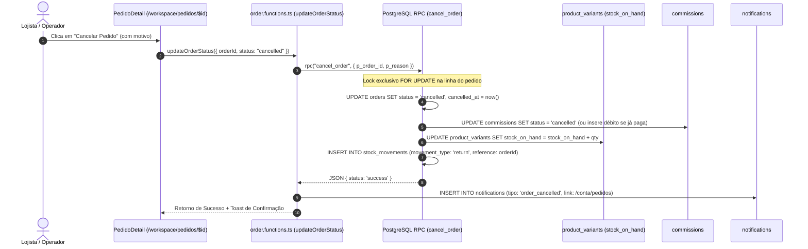
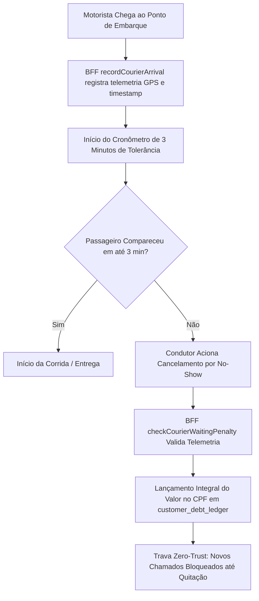

# 13 — Inventário Exaustivo de Fluxos de Negócio (52 Fluxos Reais)

O mapeamento forense identificou **52 processos operacionais reais** implementados e distribuídos pelos 10 macrodomínios.

---

## Índice Taxonômico dos 52 Fluxos de Negócio

### A. Varejo, Comércio & Pedidos
- **FLOW-001:** Cadastro e Atualização de Produto com Grade e Fotos.
- **FLOW-002:** Descoberta de Ofertas, Busca Multifacetada e Geolocalização.
- **FLOW-003:** Sacola de Compras e Checkout Multi-Loja Transparente.
- **FLOW-004:** Triagem e Aceite de Pedido pelo Lojista.
- **FLOW-005:** Separação com Conferência Cega (`picking-wizard`).
- **FLOW-006:** Expedição e Despacho de Entregas.
- **FLOW-007:** Atribuição de Entregador e Telemetria de Rota.
- **FLOW-008:** Entrega com Confirmação Segura via PIN de 4 Dígitos.
- **FLOW-009:** Solicitação de Troca, Devolução e Logística Reversa (RMA).
- **FLOW-010:** Cancelamento Atômico de Pedido com Devolução de Estoque (`cancel_order`).

### B. Gastronomia & Alimentação
- **FLOW-011:** Criação de Cardápio com Grupos de Opcionais e Modificadores.
- **FLOW-012:** Abertura de Mesa e Lançamento de Comanda Eletrônica.
- **FLOW-013:** Fila de Preparação de Cozinha por Estações (KDS).
- **FLOW-014:** Fechamento de Comanda com Divisão de Conta e Pagamento Múltiplo.
- **FLOW-015:** Conciliação e Importação de Vendas Externas (iFood).

### C. Turismo, Viagens & Receptivo (Nicho Profundo)
- **FLOW-016:** Captação de Lead e Elaboração de Cotação de Viagem.
- **FLOW-017:** Envio de Proposta Comercial e Aprovação pelo Cliente.
- **FLOW-018:** Conversão de Proposta em Reserva e Bloqueio de Vagas (`convertProposalToTrip`).
- **FLOW-019:** Gestão de Grupos Turísticos, Passageiros e Anamnese de Viagem.
- **FLOW-020:** Gestão de Bloqueios Aéreos, Conexões e Fornecedores.
- **FLOW-021:** Emissão de Vouchers Personalizados em PDF A4 e Formato Story.
- **FLOW-022:** Check-in de Embarque com Telemetria de Passageiros por Assento.
- **FLOW-023:** Gestão de Incidentes de Viagem e Reacomodação Emergencial.
- **FLOW-024:** Cancelamento de Reserva Turística com Retenção de Multas Contratuais.
- **FLOW-025:** Apuração e Pagamento de Comissões de Guias e Agentes.

### D. Serviços, Saúde & Atendimentos
- **FLOW-026:** Cadastro de Serviços, Especialidades e Duração.
- **FLOW-027:** Agendamento Online de Horários e Gestão de Grade de Profissionais.
- **FLOW-028:** Confirmação de Presença via Notificação Automática no WhatsApp.
- **FLOW-029:** Realização do Atendimento e Registro em Prontuário / Laudo.
- **FLOW-030:** Emissão de Recibo, Fatura de Serviço e Baixa na Agenda.

### E. Classificados, Imóveis & Veículos
- **FLOW-031:** Criação e Publicação de Anúncio com Ficha Técnica Completa.
- **FLOW-032:** Moderação de Anúncios e Prevenção de Fraudes.
- **FLOW-033:** Contratação de Destaque Promocional Pago.
- **FLOW-034:** Captação de Lead e Redirecionamento para WhatsApp do Anunciante.
- **FLOW-035:** Consulta de Histórico de Preços FIPE para Veículos.

### F. Atendimento, CRM & WhatsApp
- **FLOW-036:** Conexão de Instância WhatsApp via QR Code (`whatsapp-qr-connect-modal`).
- **FLOW-037:** Recepção de Mensagem Externa e Criação de Ticket de Atendimento.
- **FLOW-038:** Atendimento Humano Multicanal com Respostas Rápidas e Tags.
- **FLOW-039:** Transbordo Inteligente para Assistente Copilot de IA.
- **FLOW-040:** Disparo de Mensagens Ativas e Réguas de Cobrança / Notificação.

### G. CMS Visual & Builder Omni
- **FLOW-041:** Onboarding Visual com Seleção de Template de Nicho Predefinido.
- **FLOW-042:** Edição Modular de Blocos e Ajuste de Propriedades no Inspetor.
- **FLOW-043:** Tratamento e Recorte Fotográfico com HTML5 Canvas no Photo Studio.
- **FLOW-044:** Conexão e Verificação de Domínio Próprio da Loja.
- **FLOW-045:** Publicação Atômica com Snapshot de Versão Imutável.
- **FLOW-046:** Restauração de Versão Anterior com Rollback Imediato.

### H. Financeiro, Tesouraria & Governança
- **FLOW-047:** Abertura, Sangria e Fechamento de Caixa Físico (PDV).
- **FLOW-048:** Emissão de Cobrança e Carnê de Assinatura via Asaas.
- **FLOW-049:** Split de Pagamentos na Fonte com Retenção da Taxa Waesy.
- **FLOW-050:** Conciliação Bancária de Extratos e Quitação de Títulos.
- **FLOW-051:** Submissão de Documentos Societários e Aprovação KYC de Tenants.
- **FLOW-052:** Aplicação de Penalidade por Espera Excessiva do Passageiro (Waesy Go B.24).

---

## Detalhamento de Cadeias Críticas de Efeito

### 1. Cadeia de Cancelamento Atômico de Pedido (FLOW-010)

### 2. Cadeia de Emissão e Tolerância Waesy Go (FLOW-052 / Invariante B.24)

